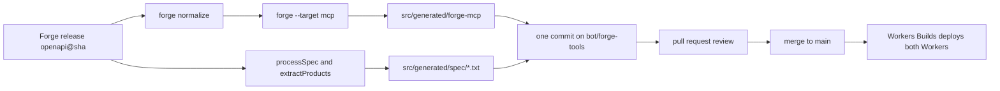

# The Generation Pipeline

This document describes how the generator builds the Cloudflare Application
Programming Interface (API) tools. R2 is Cloudflare's object storage product.
The pipeline does not use R2. The skills sync uses an R2 bucket
(`src/index.ts:95-103`). YAML means YAML Ain't Markup Language. KiB means kibibyte (1,024 bytes). MiB means
mebibyte (1,048,576 bytes). MB means megabyte (1,000,000 bytes). The document
also explains why the `yaml` package is not an input to the generator, although
it is a dependency.

## One release feeds everything

A deployment serves one pinned Forge release. The release is named
`openapi@<sha>` in `src/generated/forge-mcp/source.json`
(`src/generated/forge-mcp/source.json:1-3`). `src/spec-release.ts:1-9` reads
that value into `SPEC_RELEASE`.

The same release produces three things:

1. The generated direct tools in `src/generated/forge-mcp`.
2. The processed spec artifact `spec.json` for `search`.
3. The smaller artifacts `products.json` and `permissions.json`.

The source names omit the `.txt` suffix. The stored files add it so the bundler
treats them as text modules.

`scripts/generate-tools.ts:16-20` states this rule: every deploy carries the
spec it was reviewed with. A pin is the stored release tag. The runtime never
resolves a tag; it reads only the committed tools and artifacts that the tag
label produced.

The repository refuses to fetch the latest release at runtime. The guide gives
a concrete reason: one upstream release dropped 90 percent of
`x-api-token-group`, and refusal explanations and scope step-up need that
field (`AGENTS.md:183`). A pinned file makes that failure a review decision,
not a live incident.



The flow is `scripts/generate-tools.ts:95-141`,
`.github/workflows/forge-tools.yml:74-86`, and `AGENTS.md:199-200`.

## The npm scripts

| Script | Command | Purpose |
| --- | --- | --- |
| `generate:tools` | `tsx scripts/generate-tools.ts` | regenerate the tools and artifacts |
| `deploy` | `wrangler deploy --env staging` | deploy the main Worker to staging |
| `deploy:prod` | `wrangler deploy --env production` | deploy the main Worker to production |
| `deploy:forge-tools` | `wrangler deploy -c wrangler.forge-tools.jsonc --env staging` | deploy the tool service to staging |
| `deploy:forge-tools:prod` | same with `--env production` | deploy the tool service to production |
| `report:schema-mismatches` | `tsx scripts/schema-mismatch-report.ts` | read mismatch events from Analytics Engine |
| `seed:staging` | `tsx scripts/seed-r2.ts staging` | upload skills to the staging bucket |
| `seed:prod` | `tsx scripts/seed-r2.ts production` | upload skills to the production bucket |

The scripts are in `package.json:6-31`.

The tool service must be deployed before the main Worker in a new environment,
because the main Worker binds to it (`wrangler.forge-tools.jsonc:6-8`,
`AGENTS.md:204`).

## The generator, step by step

`scripts/generate-tools.ts` parses three optional arguments: `--spec`,
`--release`, and `--summary` (`scripts/generate-tools.ts:78-84`).

- `--spec` is a path to a local OpenAPI document. It skips the download.
- `--release` is the tag written into `source.json`.
- `--summary` is a path for the Markdown summary file. Without it, the script
  still prints the counts and writes no file.

When `--release` is present but `--spec` is not, the download replaces the
`--release` value. With no `--spec`, the script downloads the latest Forge
release asset named `openapi.forge.json` and sets the tag from that release
(`scripts/generate-tools.ts:96-106`). The comment states the intent:
`--release` names a local `--spec`
document's origin (`scripts/generate-tools.ts:11-13`). Use `--release` only
with `--spec`.

The script then runs two commands from the installed `@cloudflare/forge`
package (`scripts/generate-tools.ts:85-92`):

```bash
forge normalize --write openapi.normalized.json
forge openapi.normalized.json --target mcp --out <tmp>/out
```

The first command rewrites Fern extensions into native `x-forge-*` extensions,
because Forge reads only its own extensions. Fern is an API definition format.
The comment says the release carries the Fern extension names, and Forge reads
only the `x-forge-*` names (`scripts/generate-tools.ts:108-111`). The script
copies the input to `<tmp>/openapi.normalized.json` first, then runs
`forge normalize --write` on that copy in place
(`scripts/generate-tools.ts:109-111`). The original input file is not changed.

The second command generates the tools from the normalized copy
(`scripts/generate-tools.ts:113-114`).

The script then replaces the output directory and writes `source.json`
(`scripts/generate-tools.ts:116-120`). This step removes the old directory
before the rename. The rename moves the temporary output directory `<tmp>/out`
to `src/generated/forge-mcp` (`scripts/generate-tools.ts:118-119`). It builds
the three
spec artifacts after generation, from the original input document, not the
normalized copy (`scripts/generate-tools.ts:122-128`). Artifact provenance is
therefore the release as published. Tool provenance is the normalized form of
the same release.

The summary step counts tools and counts tools that carry permissions. It
writes added and removed tool names, and it warns when the permission count
falls below 95 percent of the previous count
(`scripts/generate-tools.ts:129-141`, `scripts/generate-tools.ts:204-227`).

```mermaid
stateDiagram-v2
  [*] --> Download: no --spec
  [*] --> Local: --spec given
  Download --> Normalize
  Local --> Normalize
  Normalize --> GenerateTools
  GenerateTools --> ReplaceDirectory
  ReplaceDirectory --> WriteSourceJson
  WriteSourceJson --> BuildArtifacts
  BuildArtifacts --> Counts["print added and removed counts"]
  Counts --> Summary{"--summary given?"}
  Summary -->|"yes"| WriteSummary["write summary file"]
  Summary -->|"no"| [*]
  WriteSummary --> [*]
  GenerateTools --> Failure: forge exits non-zero
  Failure --> Cleanup: finally removes temp directory
  Cleanup --> [*]
```

The state flow is `scripts/generate-tools.ts:95-144`. The `finally` block
removes the temporary directory even after a failure
(`scripts/generate-tools.ts:142-144`).

## The spec artifacts

`buildSpecArtifacts` calls `processSpec` and `extractProducts` from
`src/spec-processor.ts` (`scripts/generate-tools.ts:42-50`). It builds:

- `spec.json`, the processed document.
- `products.json`, the sorted product list.
- `permissions.json`, each operation's `x-api-token-group` by path and method
  (`scripts/generate-tools.ts:52-69`).

`processSpec` resolves all `$ref` values inline, extracts the fields search
needs, and splits merged account/zone paths (`src/spec-processor.ts:110-147`).
`extractProducts` reads the segment after the account or zone identifier and
sorts products by operation count (`src/spec-processor.ts:149-168`).

Each artifact is written with the `.txt` suffix and the `asciiJson` transform
(`scripts/generate-tools.ts:126-128`). The `.txt` suffix makes the file a text
module when TypeScript imports it (`src/forge-tools/spec.ts:1-15`).

`asciiJson` escapes every character above `U+007F` (`scripts/generate-tools.ts:146-157`).
The comment gives the exact reason. 710 non-Latin-1 characters would otherwise
make the 26.7 million character string a 53 megabyte two-byte string. That
string would live in every isolate that holds it
(`scripts/generate-tools.ts:147-151`).
[05-the-isolate-boundary.md](05-the-isolate-boundary.md) gives the
string-representation argument in full.

## What YAML does, and does not do

The `yaml` package in the dependency list does not feed generation
(`package.json:41`). The repository uses the package in one place: parsing skill
frontmatter in `src/skills/bundle.ts:1`. The OpenAPI path uses JavaScript Object Notation
(JSON) (`scripts/generate-tools.ts:71-72`, `scripts/generate-tools.ts:78-84`).

The package belongs to the Skills extension, not to the API tool catalog. A
skill is a Markdown file with YAML frontmatter, and the extension serves it. A
reader who scans dependencies could mistake the package for a spec input. It is
not.

## The six-hourly workflow

`.github/workflows/forge-tools.yml` runs at minute 30 of every sixth hour
(`.github/workflows/forge-tools.yml:17`). This is the tool regeneration job. It
is separate from the Worker's own six-hourly cron at minute 0, which syncs
skills (`src/index.ts:95-103`). The workflow installs dependencies, runs
`npm run generate:tools -- --summary ...`, and checks for changes in
`src/generated` (`.github/workflows/forge-tools.yml:50-63`).

If the tree changed, the workflow runs the type check and the full test suite
(`.github/workflows/forge-tools.yml:64-72`). It then force-pushes a branch
named `bot/forge-tools` and opens or updates one pull request
(`.github/workflows/forge-tools.yml:29-30`,
`.github/workflows/forge-tools.yml:74-86`).

The pull request is opened with `GITHUB_TOKEN`, so other workflows do not run
on it. The workflow's own type check and tests are the check
(`.github/workflows/forge-tools.yml:12-13`, `AGENTS.md:199`).

Merging deploys both Workers through Workers Builds
(`AGENTS.md:199-200`). The regular pull-request workflow runs formatting, lint,
type check, and tests (`.github/workflows/ci.yml:23-31`).

## Why the outputs are committed

There are four reasons visible in the code and comments.

1. The release pin is reviewable. `source.json` is a file in the tree
   (`src/spec-release.ts:3-9`).
2. The generated shape is inspectable. A reviewer can read a tool's schema and
   operation before it ships (`src/generated/forge-mcp/d1/tools.ts:1-160`).
3. The deploy is reproducible. Workers Builds deploys committed source, not a
   generator run (`AGENTS.md:199`).
4. The spec moves with the code. One merge changes Code Mode and direct tools
   together (`AGENTS.md:184`).

The cost is a large repository. The generated tool tree is 27,692 KiB
(27 MiB, about 28 MB) in this checkout. Lint and format skip it
(`package.json:17-19`), so the cost is mostly storage and diff size, not review
time. The guide states about 10 MB of generated code (`AGENTS.md:200`). That
figure conflicts with the measured source tree. The guide also gives a service
bundle of about 51 MB with about 31 MB of spec (`AGENTS.md:200`). That leaves
about 20 MB for tool code. This study cannot reconcile the 10 MB figure. See
[06-generated-code-sample.md](06-generated-code-sample.md) and
[13-limitations-and-open-questions.md](13-limitations-and-open-questions.md).

> **Aha:** The generator is not part of the runtime. The runtime reads
> committed artifacts. This turns an upstream spec change into a normal code
> review with a tool diff, a permission count, and a test run. It also means a
> bad upstream release cannot reach production until a person merges it.

## Schema mismatch reporting

`scripts/schema-mismatch-report.ts` reads the `response_schema_mismatch`
events that direct tools write to Analytics Engine
(`scripts/schema-mismatch-report.ts:1-16`). Analytics Engine is Cloudflare's
metrics store. The script groups results by product, operation, and violation.
It can print Markdown, JSON, or Structured Query Language (SQL), and it can
read a saved JSON result (`scripts/schema-mismatch-report.ts:17-40`).

The datasets are `mcp-metrics-production`, `mcp-metrics-staging`, and
`mcp-metrics-dev` (`scripts/schema-mismatch-report.ts:27-31`). The query uses
the `cf` command line tool and needs Account Analytics Read
(`scripts/schema-mismatch-report.ts:8-13`). `cf` is Cloudflare's command line
tool for account operations.

## A contradiction in the workflow comment

The workflow comment says a "ten-minute cron syncs R2 to the pin"
(`.github/workflows/forge-tools.yml:10`). The Worker configuration has a
six-hourly cron, `0 */6 * * *` (`wrangler.jsonc:61-63`). The scheduled handler
calls only `syncSkills`, and its comment says the spec ships with the deploy
(`src/index.ts:95-103`). No code path syncs the spec to R2 on a ten-minute
schedule.

This is a documentation defect. The code and the project guide agree with each
other: the spec is deploy-time, and the cron is only for skills
(`AGENTS.md:184`). See
[13-limitations-and-open-questions.md](13-limitations-and-open-questions.md).

## Related documents

- [01-repository-map.md](01-repository-map.md)
- [05-the-isolate-boundary.md](05-the-isolate-boundary.md)
- [06-generated-code-sample.md](06-generated-code-sample.md)
- [11-results-and-validation.md](11-results-and-validation.md)
- [12-operations.md](12-operations.md)
