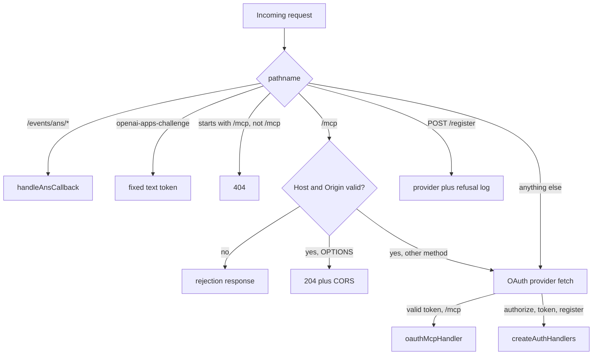
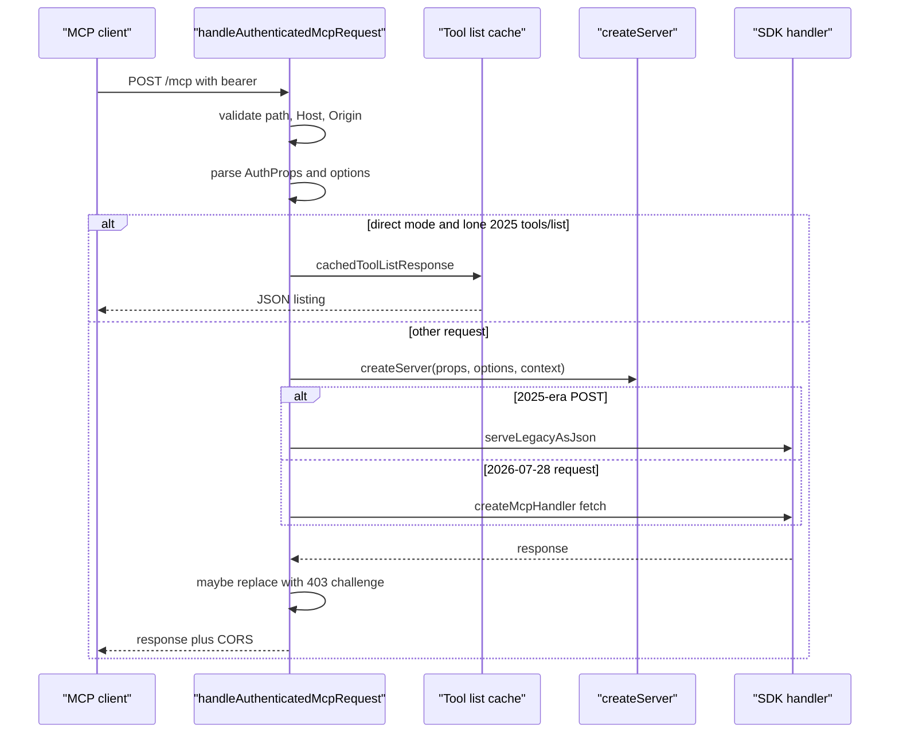

# The Request Path

This document follows one Model Context Protocol (MCP) request for the
Cloudflare Application Programming Interface (API). The request uses Open
Authorization (OAuth), Hypertext Transfer Protocol (HTTP), JavaScript Object
Notation (JSON), and a Uniform Resource Locator (URL).

Some terms recur. Code Mode is the default tool surface: `docs`, `search`,
`execute`, and `whoami`. Direct mode is the `?codemode=false` surface: `docs`,
`whoami`, and one tool per generated API method. A 2025-era request is an MCP
request on a protocol version before 2026-07-28. The external Software
Development Kit (SDK) helper `isLegacyRequest` detects it; the exact version list is in that package, not in
this repository (`src/mcp-handler.ts:235`). A 2026-07-28 request carries that
version in `_meta`, MCP's reserved metadata field. Events are the MCP Events
extension, served only when the environment has its bindings. A binding is a
configuration entry that gives the Worker access to another resource
(`src/mcp-handler.ts:204-249`).

## Entry module

`src/index.ts` is the Worker entry. It builds one OAuth provider at module
scope, then exports a fetch handler and a scheduled handler
(`src/index.ts:29-58`, `src/index.ts:60-104`).

The provider is built once per isolate. The comment says constructing it
validates the whole configuration, which used to run on every request
(`src/index.ts:24-26`).

The provider configuration has these parts (`src/index.ts:29-58`):

| Setting | Value | Citation |
| --- | --- | --- |
| API handler for `/mcp` | `oauthMcpHandler` | `src/index.ts:30-32` |
| Default handler | `createAuthHandlers()` | `src/index.ts:33` |
| Authorize endpoint | `/authorize` | `src/index.ts:34` |
| Token endpoint | `/token` | `src/index.ts:35` |
| Registration endpoint | `/register` | `src/index.ts:36` |
| Client metadata documents | enabled | `src/index.ts:37` |
| External token resolver | `resolveExternalToken` | `src/index.ts:38` |
| Supported scopes | all catalog scopes | `src/index.ts:46-47` |
| Access token lifetime | 3600 seconds | `src/index.ts:56` |
| Refresh token lifetime | 2592000 seconds | `src/index.ts:57` |

The OAuth details are in [09-authentication.md](09-authentication.md).

## Route order

The fetch handler checks routes in a fixed order (`src/index.ts:61-93`):

1. `/events/ans/` goes to the Alert Notification Service (ANS) callback. ANS
   is Cloudflare's alert delivery service. The callback receives one alert
   (`src/index.ts:61-63`).
2. `/.well-known/openai-apps-challenge` returns a fixed token. OpenAI uses such
   a path to verify an app listing; the code does not state the purpose.
3. A path that starts with `/mcp` but is not `/mcp` returns 404.
4. `/mcp` gets host and origin validation, then a preflight answer for
   `OPTIONS`.
5. `POST /register` is logged when the provider refuses it.
6. Everything else goes to the OAuth provider.

The order matters. The host and origin check runs before authentication, so an
invalid request cannot spend a bearer token on Cloudflare API identity probes
(`src/index.ts:74-79`). The comment states that reason.

The OpenAI challenge path returns a fixed string with `text/plain`
(`src/index.ts:16-17`, `src/index.ts:64-68`). The repository does not explain
why this value is public.

Cross-Origin Resource Sharing (CORS) is the browser rule set for cross-origin
requests. The preflight answer below uses it.

The route order is `src/index.ts:61-93`.

## The MCP handler

`src/mcp-handler.ts` exports `MCP_ROUTE = '/mcp'`
(`src/mcp-handler.ts:24`). It defines static allowlists for the Host header and
the browser Origin header (`src/mcp-handler.ts:26-36`). The lists contain
localhost, staging, and production values. The comment in the project guide
says the lists must not come from the request
(`AGENTS.md:155`).

The rejection function checks the Host header, then the Origin header
(`src/mcp-handler.ts:116-122`). A rejection happens before authentication
(`src/mcp-handler.ts:207-209`).

## Server options from the query string

`serverOptionsFromUrl` reads three query parameters
(`src/mcp-handler.ts:38-57`):

- `codemode` is on unless the value is exactly `false`.
- `experimentalOutputSchema` is on only when the value is exactly `true`.
- `truncateToolResult` is on unless the value is exactly `false`. When the
  parameter is absent, the mode default applies: on in Code Mode, off in direct
  mode (`src/server.ts:34-40`). The cap is about 6,000 tokens in Code Mode.
  [11-results-and-validation.md](11-results-and-validation.md) gives the exact
  character limit.

A fourth parameter, `scopeChallenge`, overrides the client's challenge
delivery for testing (`src/mcp-handler.ts:59-63`).

The exact-string tests are a small but important detail. A value such as
`codemode=0` or `codemode=FALSE` does not turn Code Mode off. The parameter is
a mode switch, not a general Boolean parser.

## Authenticated request flow

`handleAuthenticatedMcpRequest` performs these steps
(`src/mcp-handler.ts:199-250`):

1. Reject a path that is not exactly `/mcp`.
2. Reject an invalid Host or Origin.
3. Parse `ctx.props` with the `AuthProps` schema.
4. Read the server options.
5. For direct mode, try the cached 2025-era tool list.
6. Build the connection from `ctx.auth`.
7. Build a scope challenge from the provider token, if one exists.
8. Build the request context, including events when the environment exists.
9. Serve the request through the legacy JSON path or the modern handler.
10. Replace the response with a 403 challenge when the client wants one.

The steps are at `src/mcp-handler.ts:204-249`. `AuthProps` is the stored
credential record: a direct token or a provider token grant
(`src/auth/types.ts:41-62`). A connection records whether the credential is an
OAuth grant, and its scopes, or a direct token with unknown permissions
(`src/api-permissions.ts:5-18`). A scope challenge records a missing OAuth
scope so the response can ask for it (`src/scope-challenge.ts:19-59`). The SDK
is the `@modelcontextprotocol/server` request handler. The modern handler is
its `createMcpHandler` path for 2026-07-28 requests
(`src/mcp-handler.ts:75-79`).

The sequence follows `src/mcp-handler.ts:211-249`.

## The legacy JSON path

Every 2025-era POST that reaches the SDK is answered as one JSON response. The
lone direct-mode `tools/list` fast path is the one exception, and it returns
before this function (`src/mcp-handler.ts:102-114`,
`src/tools/tool-list-response.ts:54-56`). The function creates a
`WebStandardStreamableHTTPServerTransport` with `enableJsonResponse: true`, no
session identifier, connects the server, and closes both after the response
(`src/mcp-handler.ts:102-114`).

The comment gives three reasons (`src/mcp-handler.ts:81-101`):

- The HTTP status is still open, so a 403 can replace the result. The handler
  has not returned the response to the client yet, so it can replace the status
  and the body.
- Cloudflare's edge compresses JSON but never `text/event-stream`; the direct
  tool list goes from 3.7 megabytes to about 290 kilobytes with brotli.
- There is no Server-Sent Events (SSE) stream to build or frame per request.

The trade-off is stated: a long call sends no bytes until its result. The
TypeScript Software Development Kit (SDK) times out after 60 seconds, and the
Python SDK has a 300-second read timeout between bytes
(`src/mcp-handler.ts:90-100`). A call that runs longer than the client timeout
fails at the client. The repository defines no retry for that failure. A caller
must keep a direct-mode call under the client limit, or use Code Mode.

A 2026-07-28 request keeps the SDK's shaping: JSON unless a notification streams
first (`src/mcp-handler.ts:75-79`).

## The tool-list fast path

A lone 2025-era `tools/list` request in direct mode is answered before the SDK
sees it. Here, lone means the body holds one `tools/list` call and no cursor.
`plainToolListRequestId` accepts only a POST whose `Content-Type` contains
`application/json` (`src/tools/tool-list-response.ts:24-25`). The `Accept` header must list
both `application/json` and `text/event-stream`. If it does not, the fast path
declines, and the SDK answers with 406 (`src/tools/tool-list-response.ts:27-30`).
The SDK requires both values on its Streamable HTTP transport. The fast path
applies the same rule. The request must also carry a supported protocol version
in the `MCP-Protocol-Version` header. The version list is
`SUPPORTED_PROTOCOL_VERSIONS` in the external SDK, not in this repository
(`src/tools/tool-list-response.ts:1`,
`src/tools/tool-list-response.ts:31-33`). The body must be at most 4,096 bytes,
and it must have no cursor (`src/tools/tool-list-response.ts:34-56`).

The response body is built from bytes encoded once per cached listing
(`src/tools/tool-list-response.ts:13-21`,
`src/tools/tool-list-response.ts:74-87`). The code comment says the SDK's
`JSON.stringify` of the multi-megabyte list was most of the Central Processing
Unit (CPU) time that direct mode used
(`src/tools/tool-list-response.ts:59-64`). The guide gives a sharper figure:
about 23 percent of this Worker's production CPU (`AGENTS.md:190`).

This fast path does not run for Code Mode and does not run for a 2026-07-28
request. Those go to the SDK (`src/tools/tool-list-response.ts:54-56`).

## The challenge replacement

After a tool call, the handler checks whether a tool recorded a scope
challenge (`src/mcp-handler.ts:239-249`). The replacement needs four
conditions:

- A challenge exists.
- The token was issued by this provider.
- The response is JSON.
- The client's delivery behavior is `http`.

Then the handler cancels the unread body of the current result. It returns the
stored challenge response with CORS headers (`src/mcp-handler.ts:245-247`).

The challenge starts in the tool. `ScopeChallenge.require` builds the
`insufficient_scope` response and records it for the request
(`src/scope-challenge.ts:43-53`). It returns the `WWW-Authenticate` value. A
tool with `tool` behavior puts that value in its result's `_meta`. A tool with
`http` behavior lets the handler find the stored response and replace the
result with it. The handler checks that the token came from this provider, so a
direct Cloudflare token never produces a challenge
(`src/mcp-handler.ts:239-244`).

A client with `tool` behavior keeps the tool result and reads
`_meta["mcp/www_authenticate"]` (`src/clients.ts:9-20`). The Codex and ChatGPT
entries use that behavior (`src/clients.ts:44-57`).

> **Aha:** The server keeps no protocol session between requests. It stores no
> conversation identifier and no per-client state. The OAuth provider does store
> grants and tokens in the `OAUTH_KV` Key Value namespace, Cloudflare's
key-value store. A grant is a
> credential record, not a protocol session. A request is still not context-free: the credential, the
> query string, and the environment decide the tool surface. Mode, truncation,
> and output schemas are per-request decisions. This lets one deployment serve a
> Code Mode client and a direct tool client from the same URL path with
> different query strings.

## CORS and preflight

The handler answers a browser preflight with 204 and CORS headers
(`src/mcp-handler.ts:124-158`). The headers allow `POST` and `OPTIONS`, echo
the requested header list, cache the answer for 86,400 seconds, and expose
`WWW-Authenticate` (`src/mcp-handler.ts:124-140`).

The allowlist is again static. The handler reflects the request Origin only
after the Origin has passed the earlier validation step
(`src/mcp-handler.ts:208-209`, `src/mcp-handler.ts:124-127`).

## The scheduled handler

The scheduled handler runs only `syncSkills` (`src/index.ts:95-103`).
`syncSkills` refreshes the skills catalog from the `SPEC_BUCKET` R2 bucket. The
comment says the spec ships with the deploy. The cron expression is
`0 */6 * * *` (`wrangler.jsonc:61-63`).

## Related documents

- [00-overview.md](00-overview.md)
- [02-the-code-mode-surface.md](02-the-code-mode-surface.md)
- [09-authentication.md](09-authentication.md)
- [10-permissions-and-refusals.md](10-permissions-and-refusals.md)
- [12-operations.md](12-operations.md)
