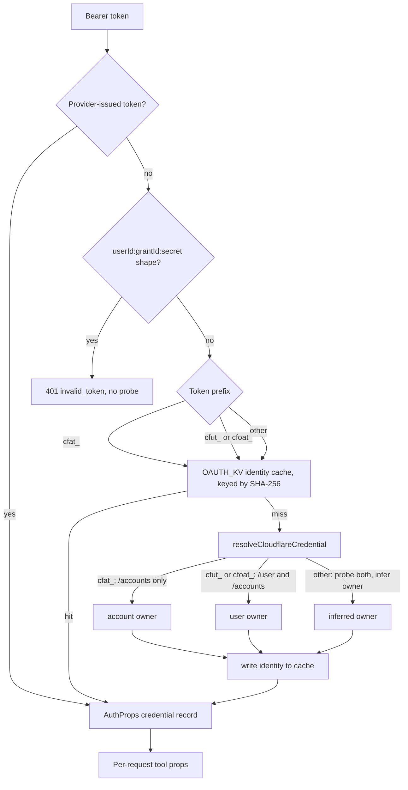
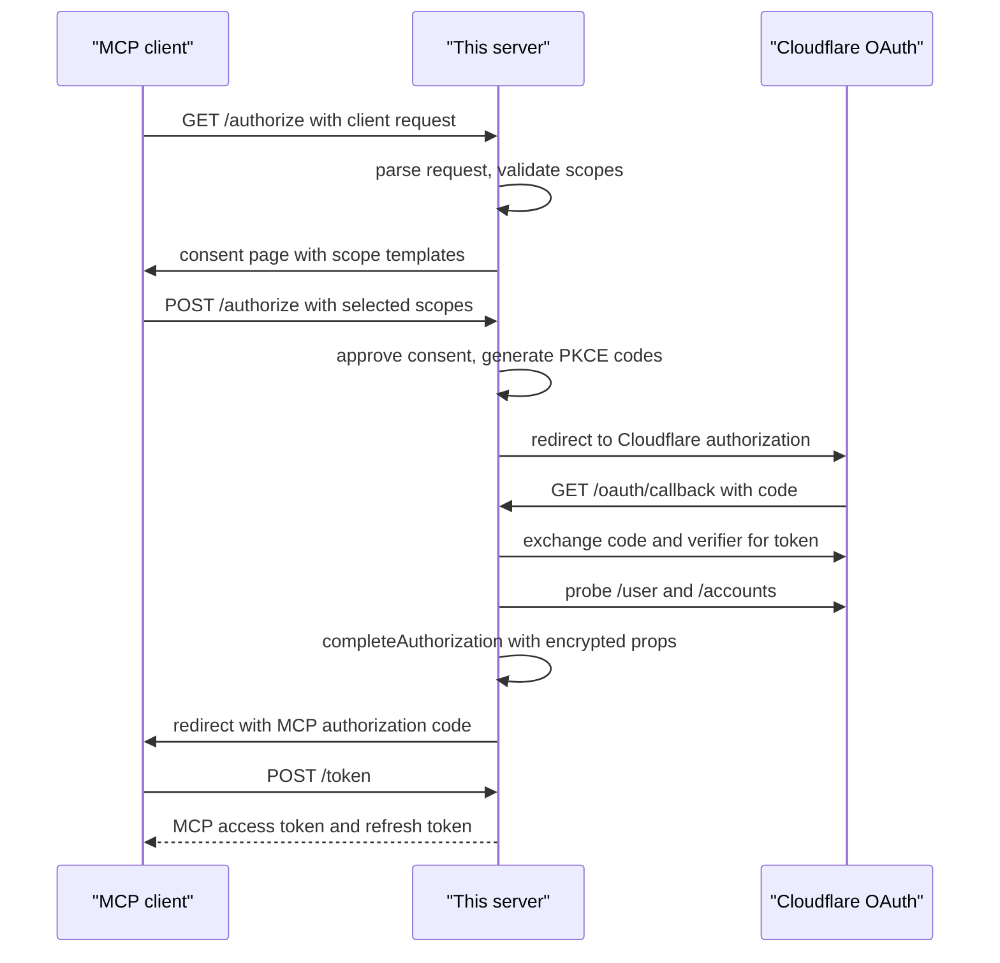

# Authentication

## Two credential paths

The server accepts two kinds of credential, and both become the same credential
record. The record is an `AuthProps` union: one shape for a provider grant, one
for a direct token (`src/auth/types.ts:41-62`). A grant is a stored OAuth
authorization record. The server validates the record against the union before
use. In this document, MCP means Model Context Protocol. KV means Key Value.
SHA-256 means Secure Hash Algorithm 256-bit. PKCE means Proof Key for Code
Exchange. `AuthProps` travels with each request as `ctx.props`. The Open Authorization
(OAuth) provider is the `@cloudflare/workers-oauth-provider` package. It acts as the authorization
server for MCP clients and stores grants, tokens, consent records, and upstream
state in the `OAUTH_KV` namespace (`src/index.ts:29-58`).

This document uses "downstream token" for the MCP token that this server issues
to the client. It uses "upstream token" for the Cloudflare token that the server
gets from Cloudflare.

1. An Open Authorization (OAuth) token issued by this server. The server
   stores the upstream Cloudflare token inside the grant.
2. A Cloudflare Application Programming Interface (API) token, or a Cloudflare
   OAuth token, passed directly as a bearer token.

The OAuth provider resolves its own tokens first. If its lookup misses, it
delegates to `resolveExternalToken` (`src/index.ts:27-38`,
`src/auth/api-token-mode.ts:124-152`).

The repository calls the second path "direct credential mode". It is useful for
automation and for clients that manage tokens themselves
(`README.md:35-48`).

The diagram uses the credential prefixes and the `userId:grantId:secret` token
shape. The prefix hints section below explains both.



The decision order is `src/auth/api-token-mode.ts:19-23`,
`src/auth/api-token-mode.ts:124-152`, and
`src/auth/cloudflare-identity.ts:297-310`. The cache is read before any probe,
so a warm entry avoids all Cloudflare calls (`src/auth/api-token-mode.ts:30-59`).

## The `AuthProps` union

The union has two shapes (`src/auth/types.ts:41-62`):

```typescript
{ type: 'account_token', accessToken: string, account: { id, name } }
{ type: 'user_token', accessToken: string, user: { id, email },
  accounts: Array<{ id, name }>, accountCount?: number,
  version?: number, refreshToken?: string }
```

Both shapes hold the raw Cloudflare token as `accessToken`. The provider
encrypts the grant, so the token is not stored in plain browser storage
(`AGENTS.md:172`).

The user shape stores at most 30 accounts (`src/auth/types.ts:15-26`). If a
user has more, the list is empty and `accountCount` holds the total
(`src/auth/types.ts:51-57`, `src/auth/cloudflare-identity.ts:229-237`). The
reason is privacy and size: a long account list should not be persisted.

The two limits have different ages. The current cap is 30. An older probe used
a page size of 20. A `version` field marks the current storage format
(`src/auth/types.ts:28-39`). A grant without a version may hold a list cut to
that old page. The code therefore treats a legacy list of exactly 20 accounts
as incomplete, even when the user really has 20 (`src/auth/account-access.ts:35-42`).

## The OAuth flow

The server is an OAuth authorization server to the MCP client, and an OAuth
client to Cloudflare. The two flows are separate.



The flow is `src/auth/oauth-handler.ts:172-384`. The diagram joins two
protocols that stay separate. The MCP client speaks OAuth to this server. This
server then speaks a different OAuth flow to Cloudflare. The downstream token
comes from this server's `/token` endpoint, not from Cloudflare.

### Consent

`GET /authorize` parses the client request with the provider
(`src/auth/oauth-handler.ts:172-197`). It rejects an unknown scope
(`src/auth/oauth-handler.ts:198-206`).

The default template is `minimal`, which holds only the required scopes
(`src/auth/scopes.ts:36-40`, `src/auth/scopes.ts:69-84`). The three templates
are minimal, read-only, and full access. Minimal is the default because a
client that supports step-up (a new authorization request for more scopes) can
ask for more later (`src/auth/scopes.ts:69-84`).

The templates have these contents (`src/auth/scopes.ts:26-84`):

| Template | Scopes |
| --- | --- |
| `minimal` | `user:read`, `offline_access`, `account:read` |
| `read-only` | the required three, plus every catalog scope whose last segment is `read`, `metadata_read`, `monitoring`, or `report` |
| `full-access` | the required three, plus every catalog scope |

The read-only test splits a scope on `:` or `.` and reads the last segment
(`src/auth/scopes.ts:42-50`). The full-access template uses the whole catalog
list (`src/auth/scopes.ts:80-83`).

A client request that asks for more than the required scopes selects those
scopes. A request for only the required scopes keeps the default template
(`src/auth/oauth-handler.ts:207-214`).

### Proof Key for Code Exchange

The server generates a PKCE verifier of 96
32-bit words (`src/auth/cloudflare-auth.ts:68-76`). It maps each word to one
character of a 66-character set, then base64url-encodes the result
(`src/auth/cloudflare-auth.ts:53-57`,
`src/auth/cloudflare-auth.ts:69-76`). The set holds the letters, the digits,
and the four unreserved marks `-`, `.`, `_`, and `~`
(`src/auth/cloudflare-auth.ts:53`). The base64url step is not needed for URL
safety, because that set is already URL-safe. The repository does not state why
the step runs. The challenge method is `S256`, meaning a
SHA-256 hash, base64url-encoded (`src/auth/cloudflare-auth.ts:78-86`,
`src/auth/cloudflare-auth.ts:105-106`). The verifier stays on the server.
`beginUpstream` stores it in the provider's upstream record and binds that
record to the browser with a cookie (`src/auth/oauth-handler.ts:268-276`). The
callback recovers it with `finishUpstream` before it exchanges the code
(`src/auth/oauth-handler.ts:304-311`). The verifier never goes to the MCP
client.

PKCE binds the authorization request to the token request, so a stolen
authorization code is not enough to get a token. The stored verifier and the
browser cookie add a second bound: another browser cannot finish the upstream
exchange.

### Callback and grant creation

The callback exchanges the code and verifier for a Cloudflare token
(`src/auth/oauth-handler.ts:323-343`). It then probes the identity
(`src/auth/oauth-handler.ts:345`). It calls `completeAuthorization` with the
user identifier, a metadata label, the granted scopes, and the props
(`src/auth/oauth-handler.ts:348-362`).

The granted scopes are the intersection of requested scopes and the upstream
scope string, when the upstream token reports one
(`src/auth/oauth-handler.ts:59-72`). The local MCP token must not claim more
than the upstream token can do. If the upstream response has no `scope` field,
the function keeps the requested scopes unchanged
(`src/auth/oauth-handler.ts:62-63`, `src/auth/oauth-handler.ts:69`).

The metadata label is the user's email (`src/auth/oauth-handler.ts:351`).

### Refresh

The provider calls `handleTokenExchangeCallback` when it refreshes a downstream
token, meaning the MCP token it issued (`src/auth/oauth-handler.ts:74-118`). The
handler acts only for a `user_token` grant with a refresh token, and only on
`refresh_token` (`src/auth/oauth-handler.ts:88-94`).

It calls the Cloudflare refresh endpoint and returns new props, a new access
token lifetime, and the newly granted scope (`src/auth/oauth-handler.ts:99-117`).
The new props hold the new access token and the new refresh token, because
both rotate (`src/auth/oauth-handler.ts:107-113`). The refreshed upstream token
may carry fewer scopes. The downstream access token then takes the same
narrower set (`src/auth/oauth-handler.ts:114-115`).

A genuine upstream `invalid_grant` revokes the grant, so the client must
reauthorize (`src/auth/oauth-handler.ts:74-82`,
`src/auth/cloudflare-auth.ts:24-50`).

## Refresh admission

Concurrent refreshes can rotate a downstream token more than once. The server
adds a best-effort gate (`src/auth/refresh-admission-gate.ts:60-118`).

The gate has three layers (`src/auth/refresh-admission-gate.ts:5-11`):

- A local map rejects a duplicate refresh in the same isolate at once.
- A KV claim with an owner identifier narrows the cross-isolate race.
- A short settle wait of 100 milliseconds lets a concurrent writer become
  visible before the refresh starts.

The admission key is `oauth:refresh-admission:v1:<userId>:<grantId>`
(`src/auth/refresh-admission-gate.ts:5`, `src/auth/refresh-admission-gate.ts:22-24`).
The owner is a random Universally Unique Identifier (UUID) for each attempt
(`src/auth/refresh-admission-gate.ts:85`). The claim lasts 10 seconds of blocked
time and has a 60-second KV lifetime
(`src/auth/refresh-admission-gate.ts:9-10`). The two times have different jobs.
The 10-second value is the functional block. The 60-second value is the
record's retention time in KV. After 10 seconds the record no longer rejects
an attempt, even though KV can keep it for 50 more seconds. A failed refresh releases the
claim, so the client can retry (`src/auth/refresh-admission-gate.ts:109-117`).
A successful refresh keeps the claim as a tombstone until the window ends.

A successful callback keeps a ten-second tombstone, so a burst of retries
receives `429 temporarily_unavailable` instead of another rotation
(`src/auth/refresh-admission-gate.ts:60-67`). The comment says this is load
shedding, not a strict mutual exclusion, because KV is eventually consistent
(`AGENTS.md:177`).

The access token lifetime is 3,600 seconds, and the refresh token lifetime is
2,592,000 seconds (`src/index.ts:56-57`).

## Direct API tokens

A direct token has no provider grant. The server must learn who owns it and
which accounts it can see.

### Prefix hints

A prefix is an ownership hint (`src/auth/api-token-mode.ts:18-23`):

| Prefix | Owner | Probe |
| --- | --- | --- |
| `cfat_` | account | `/accounts` only |
| `cfut_` | user | `/user` and `/accounts` |
| `cfoat_` | user | `/user` and `/accounts` |
| none | unknown | probe both and infer |

An unprefixed legacy token stays supported (`src/auth/api-token-mode.ts:18-23`).

### Identity probes

An account token must resolve to exactly one account
(`src/auth/cloudflare-identity.ts:218-227`). The `/accounts` endpoint enforces
a minimum page size of five. The probe asks for five accounts, which is enough
to prove the invariant without fetching the 31-record user page
(`src/auth/cloudflare-identity.ts:27-29`,
`src/auth/cloudflare-identity.ts:239-248`). The 31-record page is the 30-account
storage cap plus one (`src/auth/types.ts:20-26`).

A user probe calls `/user` and `/accounts` in parallel
(`src/auth/cloudflare-identity.ts:250-271`). A legacy probe calls both and uses
the user result when it exists, otherwise the account result
(`src/auth/cloudflare-identity.ts:273-295`).

The failure classification is careful. Cloudflare uses status 403 and error code
9109 both for an invalid credential and for a missing permission. Only the
message distinguishes them (`src/auth/cloudflare-identity.ts:80-106`). The
classifier returns:

- `server_error` for any 5xx, with status 502.
- `temporarily_unavailable` for 429, with the server's retry delay.
- `invalid_token` for 401 or for a 403 whose message is `Invalid access token`.
- `insufficient_scope` for another 403.
- `invalid_token` for a 400.

The rules are at `src/auth/cloudflare-identity.ts:108-147`.

### Identity cache

A successful identity probe is cached in `OAUTH_KV` by the SHA-256 hash of the
token, for 2,592,000 seconds (`src/auth/api-token-mode.ts:16`,
`src/auth/api-token-mode.ts:25-59`).

The cache key includes a version, `api-token-identity:v4:`
(`src/auth/api-token-mode.ts:35`). The key is a hash, so the cache does not
store the token as a key. The value is the identity object, not the token
(`src/auth/cloudflare-identity.ts:45-50`).

A malformed cache entry is ignored and replaced (`src/auth/api-token-mode.ts:37-46`).
A cache read or write failure is logged and does not fail the request
(`src/auth/api-token-mode.ts:44-56`).

### Provider-shaped token refusal

A token with the shape `userId:grantId:secret` is refused without a Cloudflare
probe (`src/auth/api-token-mode.ts:115-137`). The provider only calls the
external resolver after its own lookup misses. Such a token is therefore one it
issued that has expired or been revoked. Cloudflare credentials never contain a
colon (`src/auth/api-token-mode.ts:115-122`).

This saves two API calls and avoids a misleading 400 from Cloudflare.

## Account resolution

The account for the connection is resolved once per tool call
(`src/auth/account-access.ts:16-25`):

- An account token has one fixed account.
- A user token with one account uses that account.
- A user token with many accounts has no automatic account.

The `execute` handler prefers an explicit `account_id` over the automatic
value (`src/tools/execute.ts:463-468`). The direct tools do the same through
`planCall` (`src/forge-tools/plan.ts:51-61`).

When no account resolves, the tool result names the connection's accounts if the
list is known, or gives discovery guidance if it is not
(`src/auth/account-access.ts:52-72`). Tool metadata never names an account,
because a client may cache it (`src/tools/execute.ts:387-394`).

> **Aha:** The two credential paths converge on one props object, but they do
> not converge on trust. A provider grant carries scopes, so the server can
> explain a missing scope and ask for a step-up. A direct Cloudflare token
> carries unknown permissions, so the server can only name the permission the
> endpoint needs and tell the user to add it. The `Connection` type records
> this difference: `{ kind: 'oauth', scopes }` or `{ kind: 'direct' }`
> (`src/api-permissions.ts:5-18`). "Session" in this document means one
> request's credential context. The server stores no protocol session between
> requests.

## Credential storage and the model

Neither credential reaches the model. The provider stores the OAuth grant in
encrypted form. The direct token lives in the `AuthProps` for one request. The
`execute` sandbox never holds the token. The token reaches the API only through
the outbound proxy (`src/tools/execute.ts:60-88`).

The model learns the identity through `whoami`, which returns a stable
`user:<id>` or `account:<id>` (`src/tools/whoami.ts:80-97`). It never sees the
token, the refresh token, or the account list beyond what a tool result
chooses to show.

## Related documents

- [04-execute-tool.md](04-execute-tool.md)
- [05-the-isolate-boundary.md](05-the-isolate-boundary.md)
- [08-request-path.md](08-request-path.md)
- [10-permissions-and-refusals.md](10-permissions-and-refusals.md)
- [12-operations.md](12-operations.md)
