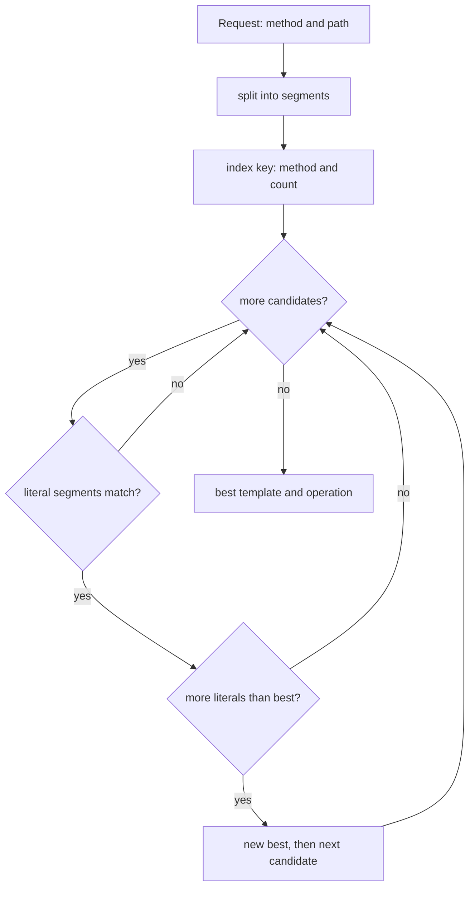
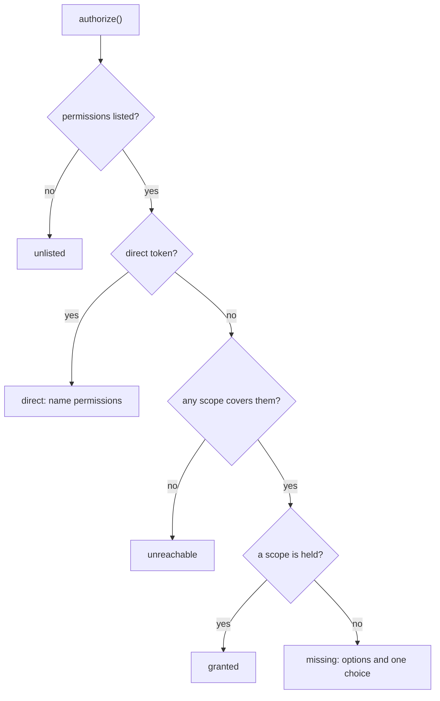
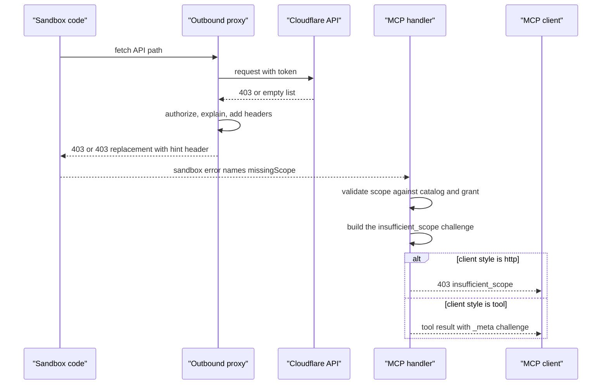

# Permissions and Refusals

## The permission problem

A Cloudflare Application Programming Interface (API) token carries one or more
permission names. An Open Authorization (OAuth) connection carries scopes. A
request can fail for several reasons, and the status code alone does not say
which one (`src/api-permissions.ts:288-303`). In this document, MCP means
Model Context Protocol.

An account is a Cloudflare customer boundary. A zone is one domain inside an
account. An API token permission is a named capability on an endpoint. An OAuth
scope is the OAuth equivalent. A role is an account or zone role for a user,
and it sits outside the token.

Cloudflare reports a missing scope, a missing role, and a rejected credential
with the same codes: `10000` and `9109`, with status 401 or 403
(`src/api-permissions.ts:288-303`). An agent that reads only "401" usually tells
the user to reconnect. That advice often changes nothing.

The server answers this problem in three parts:

1. A permission table that explains the decision after the response.
2. `reviewResponse`, which corrects a misleading answer.
3. A step-up challenge that names the scope to grant.

The table never blocks a call. It runs after Cloudflare answers, on the status
and body, so the server can say why the call failed (`src/api-permissions.ts:269-281`).
It has two call sites. `reviewResponse` uses it in the outbound proxy for
`execute` (`src/api-refusals.ts:183-208`). `apiCallResult` uses it for direct
tools after the main Worker has sent the request (`src/tools/api-call-result.ts:47-48`).

## Two connection kinds

The `Connection` type has two variants (`src/api-permissions.ts:5-18`):

```typescript
type Connection =
  | { readonly kind: 'oauth'; readonly scopes: readonly string[] }
  | { readonly kind: 'direct' }
```

An OAuth connection has a known scope list. A direct Cloudflare token has
unknown permissions. The OAuth provider reports a client identifier and scopes
only for the tokens it issued (`src/api-permissions.ts:20-33`).

The distinction is important. For an OAuth connection, the server can say
"you do not hold the scope" and ask for it. For a direct token, the server can
only name the permission the endpoint needs and tell the user to add it
(`src/api-permissions.ts:319-328`).

## The permission catalog

`permissions.json` maps each path and method to the accepted permission names.
The generator builds it from `x-api-token-group` (`scripts/generate-tools.ts:52-69`).
The main Worker caches it for one hour (`src/isolate-cache.ts:51-67`).

The catalog gives a set, because some endpoints accept more than one permission
(`src/api-permissions.ts:37-49`).

Scope identifiers share names with API token permissions
(`src/api-permissions.ts:65-70`). Two maps join the names. `SCOPE_NAMES` maps
a scope identifier such as `access.read` to a display name such as
`Access: Apps and Policies Read`. `SCOPES_BY_PERMISSION` is the reverse map,
from display name to scope identifiers. One permission can map to more than
one scope, so the reverse map holds a list (`src/api-permissions.ts:65-70`).

A small alias table maps drifted names (`src/api-permissions.ts:72-89`):

| Spec permission | Catalog permission |
| --- | --- |
| `Zone Zone Read` | `Zone Read` |
| `Zone Zone Edit` | `Zone Write` |
| `Zone DNS Edit` | `DNS Write` |
| `Browser Rendering Read` | `Browser Run Read` |
| `Browser Rendering Write` | `Browser Run Write` |

The aliases exist because the `/zones` part of the spec uses dashboard-style
names, and one product was renamed (`src/api-permissions.ts:72-77`).

## Finding the operation

`execute` sends arbitrary paths, so the server must find the matching spec
operation. A segment is one part of the path between slashes. A template is a
spec path with parameter placeholders. `findOperation` keys operations by
method and segment count, then compares literal segments
(`src/api-permissions.ts:132-151`).

The lookup index is built once per `paths` object
(`src/api-permissions.ts:100-121`). The comment gives the reason: splitting
about 3,000 templates on every lookup cost several milliseconds of Central
Processing Unit (CPU) per request.

A parameter segment matches any non-empty value. A literal segment must match
exactly. The match with the most literal segments wins
(`src/api-permissions.ts:140-150`). Two other results are possible. If no
bucket exists for the method and segment count, the function returns
`undefined`. If two templates match with the same literal count, the first one
in insertion order stays, because the test is `>` and not `>=`
(`src/api-permissions.ts:138-150`).



The flow is `src/api-permissions.ts:100-151`.

## The authorization decision

`authorize` returns one of five results (`src/api-permissions.ts:176-185`,
`src/api-permissions.ts:269-281`):

| Result | Meaning |
| --- | --- |
| `unlisted` | the spec lists no permission for the endpoint |
| `direct` | the credential's permissions are unknown |
| `unreachable` | no OAuth scope covers any accepted permission |
| `granted` | the connection holds an accepted scope |
| `missing` | none held; `options` lists the scopes that would work, and `scope` picks one |

For `missing`, the result has both `options` and `scope`. `options` is the
full list of accepted scopes. `scope` is the one to ask for, or `undefined`
when no choice stands out (`src/api-permissions.ts:176-185`).
`unreachable` and `missing` lead to different advice. `unreachable` means no
OAuth scope exists for the endpoint, so an OAuth reconnect cannot fix it. The
user needs an API token. A direct token is not checked against OAuth scopes, so
it can still work. `missing` means a scope exists but the grant lacks it, so the
user can reconnect and grant it (`src/api-permissions.ts:330-334`).

For a missing scope, the server picks one scope to ask for
(`src/api-permissions.ts:222-243`). It prefers a read scope for `GET` and
`HEAD`. Then it picks the scope whose name shares the most words with the path.
A tie names no scope, because either choice is arbitrary. The word list drops
the generic words `read`, `write`, `revoke`, and `edit`
(`src/api-permissions.ts:189-196`, `src/api-permissions.ts:240-242`).

The path decides the account or zone variant of a scope
(`src/api-permissions.ts:198-220`). The same permission name can map to
`access.read` and `zone-access.read`. The request path starts with `/accounts`
or `/zones`, so the server uses it rather than the template.



The decision is `src/api-permissions.ts:269-281`.

> **Aha:** The server does not trust the status code to explain a refusal. It
> infers the likely cause from the catalog and the granted scopes, then uses the
> status only when that inference is silent. This is why a 403 can produce
> "reconnecting will not help": the connection already holds an accepted scope
> (`src/api-permissions.ts:336-341`).

## Reviewing a response

`reviewResponse` runs in the outbound proxy, between the sandbox and Cloudflare
(`src/api-refusals.ts:177-220`). Direct tools do not use that proxy. They call
`apiCallResult` on the body the main Worker already read
(`src/tools/api-call-result.ts:38-62`). Both paths use the same `authorize` and
`refusalFor` functions, so the explanation does not change with the mode.

It reads the catalog only in two situations. The response is a 401 or 403.
Alternatively, the response is a successful JavaScript Object Notation (JSON)
`GET` from an OAuth connection, and small enough to be an empty list. In both
situations, the
catalog must hold a match for the request (`src/api-refusals.ts:183-195`).

The empty-list case matters. Cloudflare filters some lists to what the
credential may see. `GET /zones` without a scope answers `200` with an empty
`result` (`src/api-permissions.ts:359-387`). An empty list therefore proves
nothing. The server replaces that `200` with a `403` so that a client can see
the difference between "no rows" and "not allowed"
(`src/api-refusals.ts:119-127`).

The replacement needs all of these conditions (`src/api-refusals.ts:130-148`,
`src/api-permissions.ts:377-387`):

- The status is 2xx.
- The method is `GET`.
- The connection is OAuth, not direct.
- The content type is JSON.
- The `Content-Length` is at most 4,096 bytes.
- The body is an empty array, or an envelope whose `result` is an empty array.
- The authorization result is `missing`.
- No accepted permission is one the baseline scopes described below sometimes
  grant.

The byte limit keeps the server from reading a large body only to check its
length (`src/api-refusals.ts:130-131`). An absent `Content-Length` counts as
zero, so the size gate passes. The body check still requires an empty array
(`src/api-refusals.ts:139-148`, `src/api-refusals.ts:52-58`).

The replacement body is a Cloudflare-shaped error
(`src/api-refusals.ts:34-46`).

A 403 is not always a credential refusal. Some products answer 403 about the
resource, such as a workflow that is not a preview (`src/api-refusals.ts:67-89`).
The server treats a 403 as a credential refusal when its error list has no code,
or when any code is `10000` or `9109` (`src/api-refusals.ts:77-89`).

The two headers carry the answer (`src/api-refusals.ts:13-20`):

| Header | Meaning |
| --- | --- |
| `X-Cloudflare-MCP-Refusal-Hint` | the explanation, Uniform Resource Identifier (URI) encoded |
| `X-Cloudflare-MCP-Missing-Scope` | the OAuth scope to request, when one exists |

## The step-up challenge

A missing scope can be fixed without a new tool design. The server returns an
`insufficient_scope` challenge (`src/scope-challenge.ts:19-59`).

The challenge names three groups of scopes (`src/scope-challenge.ts:43-53`):

- The baseline required scopes, without `offline_access`. These are the
  `BASELINE_SCOPES` constant: `user:read` and `account:read`
  (`src/scope-challenge.ts:5`).
- Every scope the connection already holds, again without `offline_access`.
- The missing scope.

`offline_access` is left out because it is not a resource scope. It permits a
refresh token; it does not permit data (`src/scope-challenge.ts:4-5`,
`src/scope-challenge.ts:45`).

The comment explains why the held scopes are included: a new grant replaces the
old one. Naming only the missing scope would drop the rest. Codex
re-authorizes with exactly the challenged scopes, and Claude asks the server to
list everything the user still needs (`src/scope-challenge.ts:30-38`).

A direct token cannot step up, because there is no provider grant to replace.
`require` returns `undefined` in that case (`src/scope-challenge.ts:43-45`).
For a provider grant, the first call records the 403 response. Later calls reuse
that response, because the assignment keeps the existing value
(`src/scope-challenge.ts:51`).

### Two delivery styles

Clients differ in how they learn about a challenge (`src/clients.ts:8-21`):

| Style | Delivery | Clients |
| --- | --- | --- |
| `http` | 403 with `WWW-Authenticate` replaces the response | every unlisted client, including Claude |
| `tool` | the tool result carries `_meta["mcp/www_authenticate"]` | Codex and ChatGPT |

The `tool` value is an array that holds the `WWW-Authenticate` string
(`src/tools/api-call-result.ts:61-62`). The `http` value is a full response
with the same header (`src/scope-challenge.ts:46-52`).

Codex is matched by its Client Identifier (ID) Metadata Document
(`src/clients.ts:45-50`). ChatGPT is matched by a redirect Uniform Resource
Locator (URL) host (`src/clients.ts:51-56`).

The handler replaces the response only when four conditions hold
(`src/mcp-handler.ts:239-249`). A challenge must exist. The token must be
provider-issued, meaning this server's OAuth provider issued it, not a direct
Cloudflare token. The response must be JSON. The client style must be `http`.



The replacement is `src/mcp-handler.ts:239-249`. The client styles are
`src/clients.ts:41-57`.

## The baseline-scope exception

The required scopes `user:read` and `account:read` sit outside the catalog, but
they grant data on a few endpoints. The server measured these
(`src/api-permissions.ts:345-357`):

- `/accounts/{account_id}/members` and `/roles`, through Account Settings Read.
- `/memberships` and `/user/invites`, through Memberships Read.
- `/user`, through User Details Read.

Those permissions never count as "not held" for a refusal. Otherwise a working
call would be refused as an empty list (`src/api-permissions.ts:377-387`).

## What this design does not do

The catalog predicts; it does not enforce. The real decision belongs to
Cloudflare. The server uses the prediction to choose the explanation and the
step-up scope, not to block a call (`src/api-permissions.ts:269-281`,
`src/api-permissions.ts:309-343`).

A wrong permission in the spec produces a wrong explanation. The alias table
handles known drift, but a new drift needs a code change
(`src/api-permissions.ts:72-89`).

A direct token can name the permission, but the server cannot know whether the
token has it. The user must check the token in the Cloudflare dashboard
(`src/api-permissions.ts:319-328`).

## Related documents

- [04-execute-tool.md](04-execute-tool.md)
- [09-authentication.md](09-authentication.md)
- [11-results-and-validation.md](11-results-and-validation.md)
- [12-operations.md](12-operations.md)
