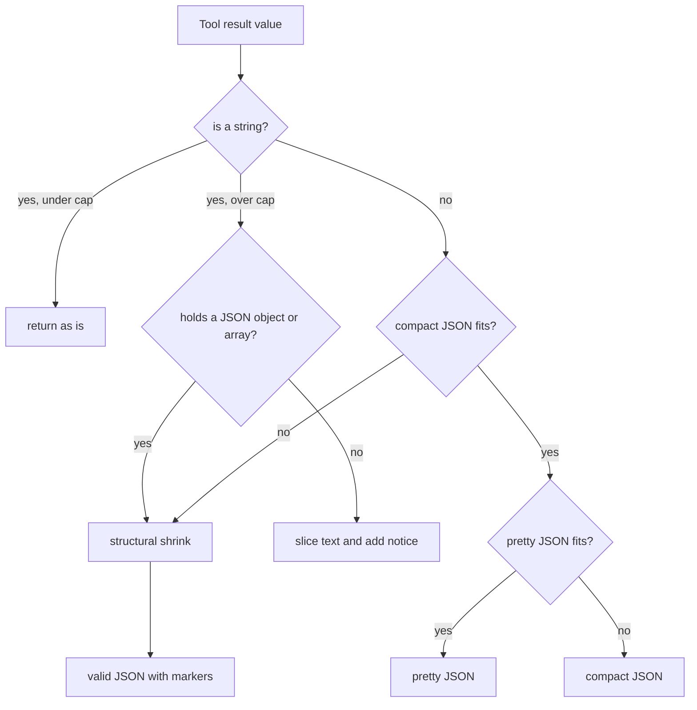
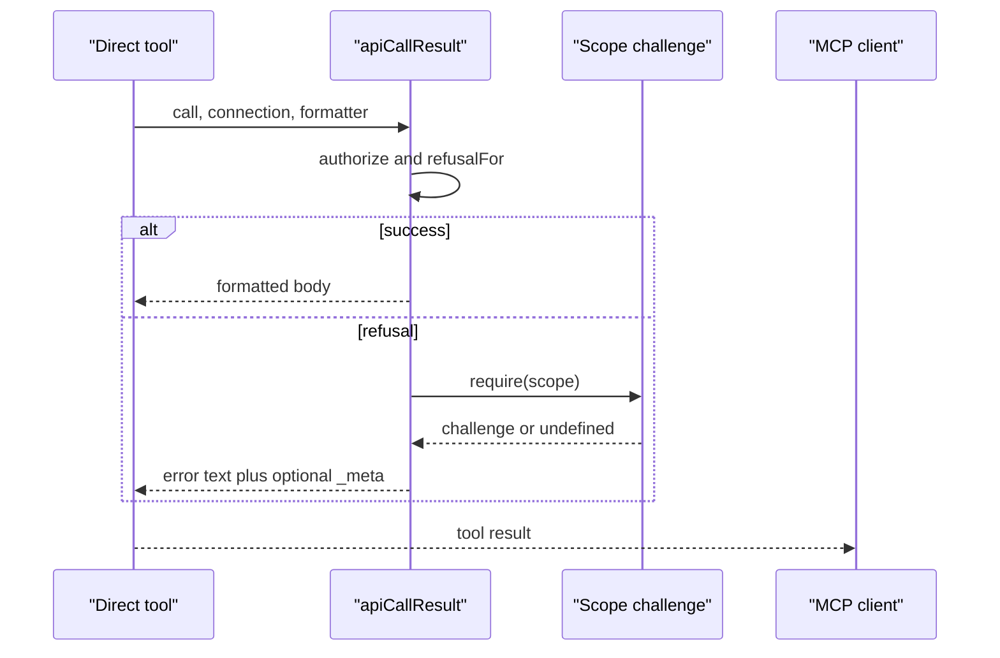
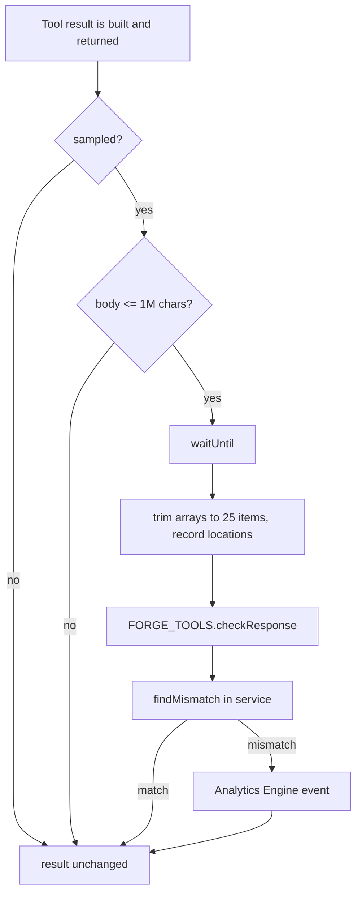

# Results and Validation

## The result path

A tool result travels from Cloudflare to the model in four steps:

1. The sandbox or tool service returns a value.
2. The main Worker turns the value into text.
3. The result is capped, unless the call turns the cap off.
4. The Model Context Protocol (MCP) client receives the text.

In this document, JSON means JavaScript Object Notation. The sandbox is the
dynamic Worker that runs model code. The tool service is the forge tools
service, the second Worker. The cap is the result-size limit.

The cap exists because a broad query can return megabytes. The tool description
warns that the result should go to a file or pipe when the cap is off
(`src/truncate.ts:33-39`).

## Choosing the formatter

`formatterFor` selects one of two functions (`src/truncate.ts:41-50`):

| Call argument | Connection default | Formatter |
| --- | --- | --- |
| `truncate: true` | any | `truncateResponse` |
| `truncate: false` | any | `stringifyResponse` |
| omitted | cap on | `truncateResponse` |
| omitted | cap off | `stringifyResponse` |

The query parameter `?truncateToolResult=false` sets the connection default
off (`src/mcp-handler.ts:38-49`). The connection default is the value from that
parameter for this request. The call argument wins over the default.

`truncateResponse` returns capped text. It slices the body to at most 24,000
characters, then adds a notice in the plain-text case
(`src/truncate.ts:73-92`). `stringifyResponse`
has no length limit. It returns a string unchanged, or pretty-printed JSON for
any other value (`src/truncate.ts:54-62`).

The tool metadata never states the default, because the metadata is shared by
every connection (`src/truncate.ts:33-39`).

## The cap

The cap uses a rough conversion of four characters per token
(`src/truncate.ts:19-21`):

```text
MAX_TOKENS = 6000
CHARS_PER_TOKEN = 4
MAX_CHARS = 24,000
```

The value is a character budget, not a tokenizer output. A string with many
non-Latin characters costs more tokens than the estimate. The comment says
"about 6,000 tokens" for that reason (`src/truncate.ts:3-10`).

`stringifyResponse` has no cap. A string passes through. Another value becomes
pretty-printed JSON (`src/truncate.ts:54-62`).

The diagram in the next section shows `truncateResponse` only. It runs when the cap is on.
The plain-text branch is a character slice at 24,000, then the notice with the
original token estimate (`src/truncate.ts:89-93`).

## Structural truncation

`truncateResponse` does not slice JSON in the middle. It shrinks the structure,
so the output stays valid JSON (`src/truncate.ts:64-87`).

The rules are (`src/truncate.ts:108-118`):

- Each child gets a floor of at least 128 characters, unless its full size is
  smaller.
- Remaining space is shared by water-filling: small children keep their size,
  and large children take the cut.
- An array drops items from the tail, because order carries meaning.
- An object drops its largest values first, because keys are meaningful.
- A dropped value leaves a marker in the output.

Water-filling works on each child's "want", meaning its full size minus its
floor. The smallest wants are filled first. Large children then share what
remains (`src/truncate.ts:188-207`).

The floor rule has one special case for arrays. Each item keeps every object
key (`keyFloor`), so a list of records keeps whole records
(`src/truncate.ts:159-165`, `src/truncate.ts:209-213`). `keyFloor` returns the
characters an item needs for all its keys, not only for one value. This is the
one difference from the `@cloudflare/codemode` algorithm that the code started
from (`src/truncate.ts:12-16`).

The markers are exact strings (`src/truncate.ts:6-10`, `src/truncate.ts:22`):

| Case | Marker |
| --- | --- |
| clipped string | `--- TRUNCATED --- <n> chars` |
| clipped array | `--- TRUNCATED --- <n> more items` |
| object with dropped entries | a `"--- TRUNCATED ---"` entry naming them |
| plain text | a notice with the original token estimate |

A marker key that already exists gains a space, so it never hides a real key
(`src/truncate.ts:263-265`).

If only indentation pushes a value over the cap, the code uses compact JSON
instead (`src/truncate.ts:80-87`). If compact JSON still does not fit, the
structure shrinks.



The flow is `src/truncate.ts:73-87` and `src/truncate.ts:104-311`.

> **Aha:** The truncation is not a display concern. It is the part of the
> protocol that keeps a result usable. A cut JSON document stays parseable, and
> a list keeps whole records, so the model can still merge or filter the data.
> A naive character slice would produce broken JSON and a misleading answer.

## Execute results

The sandbox returns one of two shapes, and the parent parses it with a Zod
union (`src/tools/execute.ts:27-43`). The parent is the main Worker, which
receives the sandbox result. Zod is a TypeScript schema library; a union here
means "one of two allowed object shapes".

```typescript
{ ok: true, result: unknown }
{ ok: false, message: string, missingScope?: string,
  graphqlRefusal?: 'zone' | 'account', replaySafe: boolean }
```

`graphqlRefusal` tags a GraphQL permission failure as a zone or account
dataset. `replaySafe` says whether the parent may rerun the code after a new
authorization.

A result that does not match becomes an error: "The code sandbox returned an
unreadable result" (`src/tools/execute.ts:344-347`).

The sandbox encodes byte values before return (`src/tools/execute.ts:326-328`).
The parent then formats the result with the selected formatter
(`src/tools/execute.ts:477-480`).

An error becomes a tool error result. The handler adds an account hint when the
path names an unknown account (`src/tools/execute.ts:482-489`).

The `replaySafe` flag is the basis for a step-up. It is true only when every
recorded request was a read, or got a 401 or 403 (`src/tools/execute.ts:330-336`).
A request that changed resources makes it false. When it is false, the result
says an automatic retry is unsafe (`src/tools/execute.ts:350-351`,
`src/tools/execute.ts:500-503`).

## Direct tool results

Direct tools are the generated tools served with `?codemode=false`. They share
`apiCallResult` (`src/tools/api-call-result.ts:38-63`). They also share the two
formatters. Direct mode sets the default cap off (`src/server.ts:71`). The
query parameter `?truncateToolResult=true` turns it on
(`src/server.ts:84`, `src/mcp-handler.ts:51-55`).

A successful call returns the formatted body (`src/tools/api-call-result.ts:49-50`).
A refusal returns one error text with four parts:

- The method, path, and status.
- The body, or the synthetic filtered-list body.
- The permission explanation.
- Extra notes, such as an unknown-account hint.

The result sets `isError: true` (`src/tools/api-call-result.ts:52-60`). If the
refusal names a scope, the result also carries the step-up challenge in
`_meta["mcp/www_authenticate"]` (`src/tools/api-call-result.ts:61-62`).

Output schemas are the direct-tool feature described in
[02-the-code-mode-surface.md](02-the-code-mode-surface.md). When output schemas
are on for a 2026-07-28 request, a successful JSON result also carries
`structuredContent` with the whole body (`src/tools/forge-tools.ts:161-163`).
The text may be capped, but `structuredContent` is not.



The sequence is `src/tools/api-call-result.ts:46-63`.

## Response validation

Direct tool responses are also checked against the generated response schemas.
The check never changes the result (`src/response-validation.ts:8-19`).

The check is sampled. `RESPONSE_VALIDATION_SAMPLE_RATE` is a fraction from 0 to
1. An unset or invalid value means 1 (`src/response-validation.ts:89-95`).

The main Worker does four things (`src/response-validation.ts:48-57`):

1. Skip the check when the sample rate is zero or the random draw is outside
   the rate.
2. Skip a body larger than 1,000,000 characters.
3. Run the check in `waitUntil`, after the result is built.
4. Catch every error and log it.

The body is trimmed before it crosses the Remote Procedure Call (RPC)
boundary. Every array is cut to 25 items, and the trim records the instance
location of each cut array (`src/response-validation.ts:21-26`,
`src/response-schema-check.ts:139-165`). The comment says validation costs
about 0.5 milliseconds per kilobyte, so the trim bounds the cost
(`src/response-schema-check.ts:139-145`).

The trim also counts every JSON value in the trimmed body
(`src/response-schema-check.ts:146-165`). That count feeds a separate limit.
The service counts all violations only when the body has at most 20,000
values. Above that limit, it reports a lower bound and sets `counted` to false
(`src/response-schema-check.ts:17-23`,
`src/response-schema-check.ts:97-108`). The 25-item limit bounds each array.
The 20,000-value limit bounds the second validation pass, which collects every
violation (`src/response-schema-check.ts:90-104`).

`counted` is true only when the whole body was checked and no array was cut
(`src/response-schema-check.ts:53-58`,
`src/response-schema-check.ts:104`).

The forge tools service holds the schemas, so it runs the validator
(`src/response-validation.ts:13-18`). It uses `@cfworker/json-schema` and
caches compiled validators (`src/response-schema-check.ts:1-3`,
`src/response-schema-check.ts:71`).

The validator has three limits (`src/response-schema-check.ts:13-23`):

| Limit | Value | Reason |
| --- | --- | --- |
| reported errors | 5 | keep the log line small |
| compiled validators | 256 | bound cache size per isolate |
| counted values | 20,000 | avoid stack overflow on a body with many violations |

The check tries the exact status, then the status class such as `4XX`, then
`default` (`src/response-schema-check.ts:127-137`). A documented response with
no JSON body is skipped.

A mismatch records these fields in Analytics Engine, Cloudflare's metrics store
and query service (`src/metrics.ts:205-255`):

- The tool name.
- The method and path template.
- The product.
- The response key: the status entry that selected the schema, such as `200`.
- The spec release, the pinned `openapi@sha` value.
- The error count and whether it is exact.
- The first error's keyword, schema location, and instance path.

The event contains no response values. Array indices and undeclared object keys
become `*` (`src/response-schema-check.ts:344-359`). This is deliberate,
because response values are customer data (`src/response-validation.ts:14-18`).



The pipeline is `src/response-validation.ts:48-87` and
`src/response-schema-check.ts:78-125`.

## What the result path does not guarantee

The token estimate is approximate. A result near the cap may still exceed the
model's real token budget (`src/truncate.ts:19-21`).

The structural shrink can drop data. It prefers to keep shapes and keys, but a
budget that cannot hold every floor drops entries and marks them
(`src/truncate.ts:250-311`). The model should narrow its query when it sees a
marker.

Validation is sampling, not a gate. A response that fails the schema still
reaches the model. The event is a signal to the product team, not a correction
(`src/response-validation.ts:8-19`).

Validation covers JSON responses from the generated direct tools
(`src/tools/forge-tools.ts:136-147`). It does not cover `execute`, `search`,
`docs`, or `whoami`. The Code Mode path returns arbitrary sandbox values, and
its tool registration declares no output schema (`src/tools/execute.ts:450-461`).

The comment in `src/response-validation.ts:44-46` says "the endpoint tools and
the forge tools both call it". Only the forge tools call it in this checkout.
The endpoint tools may be an earlier design.

## Related documents

- [04-execute-tool.md](04-execute-tool.md)
- [05-the-isolate-boundary.md](05-the-isolate-boundary.md)
- [06-generated-code-sample.md](06-generated-code-sample.md)
- [10-permissions-and-refusals.md](10-permissions-and-refusals.md)
- [12-operations.md](12-operations.md)
