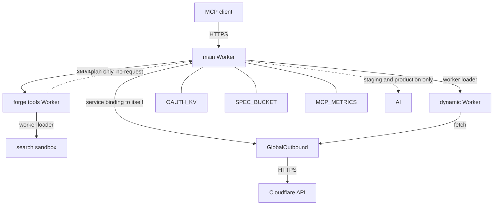
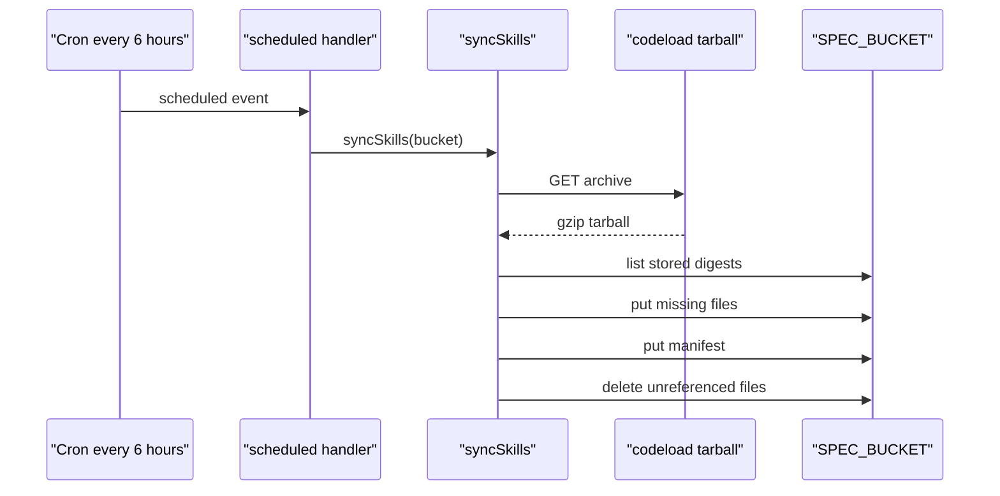
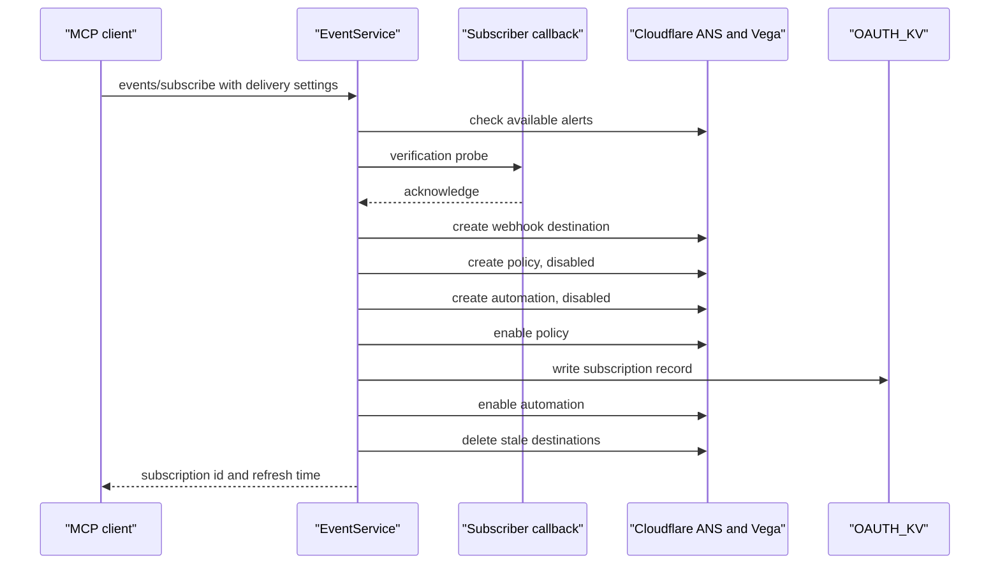
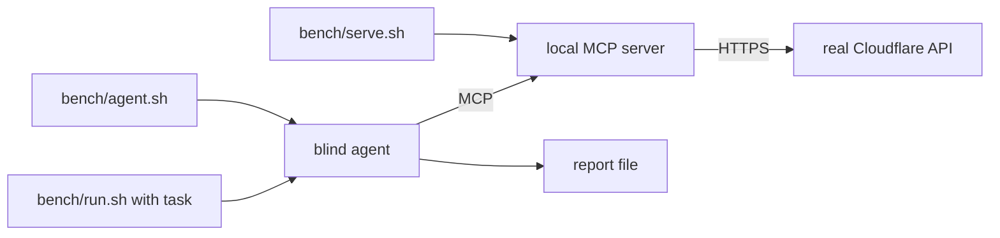

# Operations

This document describes deployment, bindings, scheduled work, observability,
and tests for the Cloudflare Model Context Protocol (MCP) server. It uses API
for Application Programming Interface. It uses KV for Key Value. R2 is
Cloudflare's object storage product. AI means Artificial Intelligence. HTTPS
means Hypertext Transfer Protocol Secure. RPC means Remote Procedure Call.
SHA-256 means Secure Hash Algorithm 256-bit.

## Two Workers

The repository deploys two Workers (`wrangler.jsonc:3-5`,
`wrangler.forge-tools.jsonc:10-12`):

| Worker | Entry | Public route | Job |
| --- | --- | --- | --- |
| main | `src/index.ts` | `mcp.cloudflare.com/mcp` | Open Authorization (OAuth), MCP handling, sandbox creation, API requests |
| forge tools | `src/forge-tools/worker.ts` | none | generated tools, spec search, request planning, response checks |

The forge tools configuration states that the service holds no credentials,
makes no requests, and has no public route
(`wrangler.forge-tools.jsonc:1-8`). It plans a direct tool call and returns the
plan. The main Worker sends the request with the token
(`src/tools/forge-tools.ts:80-131`). The plan is plain data: method,
Uniform Resource Locator (URL), headers, and optional body. The spec is the
processed OpenAPI document that the service holds. The plan never contains the
token. The main Worker adds the `Authorization` header after the plan returns.

The main Worker binds to the service through `FORGE_TOOLS`
(`wrangler.jsonc:39-42`). In a new environment the service must deploy first,
because the binding must exist (`wrangler.forge-tools.jsonc:7-8`).

The bindings are `wrangler.jsonc:28-60` and
`wrangler.forge-tools.jsonc:16-20`. The forge tools service binds only
`LOADER`. It reaches no storage and no API (`wrangler.forge-tools.jsonc:16-20`).

## Bindings

| Binding | Kind | Use | Citation |
| --- | --- | --- | --- |
| `LOADER` | Worker loader | create dynamic Worker sandboxes | `wrangler.jsonc:28-32` |
| `GLOBAL_OUTBOUND` | service, same Worker | outbound fetch proxy for `execute` | `wrangler.jsonc:34-38` |
| `FORGE_TOOLS` | service | direct tools and search | `wrangler.jsonc:39-42` |
| `OAUTH_KV` | KV namespace | grants, identity cache, events records | `wrangler.jsonc:44-48` |
| `SPEC_BUCKET` | R2 bucket | skills manifest and files | `wrangler.jsonc:49-54` |
| `MCP_METRICS` | Analytics Engine | tool and mismatch events | `wrangler.jsonc:55-60` |
| `AI` | Workers AI | documentation search | `wrangler.jsonc:70-72` |

`GLOBAL_OUTBOUND` is a service binding from the Worker to itself. The binding
names the `GlobalOutbound` entrypoint (`wrangler.jsonc:34-38`). The entry module
re-exports the class so Wrangler can find it (`src/index.ts:22`).

`AI` exists only in the staging and production environments, not in the default
development environment (`wrangler.jsonc:70-72`, `wrangler.jsonc:125-127`).
The `docs` tool uses it (`src/tools/docs-search.ts:155-171`).

The R2 bucket is named `mcp-spec`, but the current scheduled handler writes
only skills (`wrangler.jsonc:49-54`, `src/index.ts:95-103`). The name suggests
an earlier job that stored the spec. This study found no code that writes the
spec to R2, so the name is probably historical. That reading is an inference,
not a stated fact.

## Environments

Each environment has its own name, route, API base, and metrics dataset
(`wrangler.jsonc:67-177`):

| Environment | Worker name | Route | API base | Metrics dataset |
| --- | --- | --- | --- | --- |
| default | `cloudflare-api-mcp-dev` | none | `api.cloudflare.com/client/v4` | `mcp-metrics-dev` |
| staging | `cloudflare-api-mcp-staging` | `staging.mcp.cloudflare.com` | `api.staging.cloudflare.com/client/v4` | `mcp-metrics-staging` |
| production | `cloudflare-api-mcp` | `mcp.cloudflare.com` | `api.cloudflare.com/client/v4` | `mcp-metrics-production` |

The staging and production values are at `wrangler.jsonc:68-121` and
`wrangler.jsonc:123-176`.

The default development environment uses `http://localhost:2529/mcp` as
`MCP_RESOURCE` and port 2529 for `wrangler dev`
(`wrangler.jsonc:25`, `wrangler.jsonc:64-66`).

The deploy scripts call Wrangler directly (`package.json:8-11`). The production
flow uses Workers Builds on a push to `main`, which deploys both Workers
(`AGENTS.md:199-200`).

The main Worker uses compatibility date `2026-06-17` and the flags
`nodejs_compat` and `global_fetch_strictly_public` (`wrangler.jsonc:6-10`).
`nodejs_compat` enables Node.js built-in modules in the Worker. The second flag
keeps `fetch` from reaching a private address, which matters because model code
can call `fetch` (`src/tools/execute.ts:262-324`).

## Scheduled work

The cron expression is `0 */6 * * *` in every environment
(`wrangler.jsonc:61-63`, `wrangler.jsonc:113-115`,
`wrangler.jsonc:168-170`).

The scheduled handler calls only `syncSkills` (`src/index.ts:95-103`). Skills
are the files of the MCP Skills extension. It passes the `SPEC_BUCKET` binding
(`src/index.ts:102`).

`syncSkills` does four things (`src/skills/sync.ts:75-135`):

1. Download the `cloudflare/skills` default-branch tarball.
2. Write only file bytes that R2 does not already hold, by digest.
3. Write the manifest after its files, and only when a skill changed.
4. Delete files that neither the new nor the previous manifest names.

The sync keeps 16 writes in flight (`src/skills/sync.ts:21-22`). A failure
leaves the previous manifest in place (`src/skills/sync.ts:85`).

The one-hour cache in the main Worker is shorter than the six-hour sync. A warm
isolate therefore cannot serve a manifest older than the previous one
(`src/skills/handlers.ts:11-15`, `src/skills/sync.ts:80-84`).

The flow is `src/index.ts:95-103` and `src/skills/sync.ts:89-135`.

## The events subsystem

The server advertises the MCP Events draft and implements three methods:
`events/list`, `events/subscribe`, and `events/unsubscribe`
(`src/events/methods.ts:54-97`). It does not offer the poll or stream methods
(`docs/mcp-events.md:1-8`). The client therefore cannot poll, and the
server opens no long-lived stream. Every notification goes to the subscriber's
callback URL as a webhook.

The supported event is
`cloudflare.alert.workers_observability_real_time_issue`
(`docs/mcp-events.md:6-8`).

The design maps MCP concepts onto existing Cloudflare resources
(`docs/mcp-events.md:14-21`). Vega is the Workers Observability issue
automation service. Its records hold the trigger settings, such as an
occurrence count (`docs/mcp-events.md:101-104`).

| MCP concept | Cloudflare resource |
| --- | --- |
| subscription | Alert Notification Service (ANS) policy |
| callback destination | ANS generic webhook destination |
| Worker and trigger settings | Vega issue automation |
| delivery attempts and retries | ANS webhook delivery |

A subscribe call provisions the resources in a fixed order
(`src/events/service.ts:183-321`):

1. Check that the account offers the event.
2. Verify the subscriber callback with a probe.
3. Create or reuse an ANS webhook destination.
4. Create the ANS policy in a disabled state.
5. Create the Vega automation in a disabled state.
6. Enable the policy.
7. Write the short-lived subscription record to `OAUTH_KV`.
8. Enable the automation, then delete stale destinations.

The order matters. The record is written before the automation turns on, so the
first alert finds it. The record is written only after Cloudflare accepts the
policy, so a read-only caller cannot extend delivery
(`src/events/service.ts:292-315`).

The Worker keeps no session between requests. It does store one short-lived
record per subscription in `OAUTH_KV`, and it stores no secret there
(`docs/mcp-events.md:23-29`). A failed subscribe leaves the resources it
created. A retry resumes from them, or the client can unsubscribe to remove
them (`docs/mcp-events.md:23-29`, `docs/mcp-events.md:119`).

The sequence is `src/events/service.ts:183-321`.

A subscription defaults to 30 minutes. It should expire no later than the MCP
token that authorized it. `ttlMs` is clamped to between 1 minute and 1 hour,
never rejected. A value of `null` gives the maximum
(`docs/mcp-events.md:77-81`). The MCP access token also lives 3,600 seconds, so
at the maximum the two lifetimes can end together (`src/index.ts:56`). The
response carries `refreshBefore`, and the client refreshes before that time
(`docs/mcp-events.md:79-81`).

The ANS webhook targets `/events/ans/{subscriptionId}` on this server
(`docs/mcp-events.md:31-37`). The route is first in the fetch handler
(`src/index.ts:61-63`).

The callback opens the secret that ANS presents. ANS presents it in the
`cf-webhook-auth` header (`docs/mcp-events.md:44-52`). Opening the secret is
the ingress check, because the encryption authenticates it and binds it to the
subscription (`src/events/state.ts:75-90`). The callback then reads the KV
record, checks the expiry, and compares the SHA-256 hash of the presented
secret with the stored hash (`docs/mcp-events.md:44-52`). The sealed value uses
Advanced
Encryption Standard Galois/Counter Mode (AES-GCM), an authenticated encryption
mode (`docs/mcp-events.md:46`). The `OAUTH_KV` record holds only a SHA-256 hash
of the signing secret, not the secret (`docs/mcp-events.md:47`).

Subscription mutations for one identifier are serialized inside an isolate
(`src/events/service.ts:49-59`). This prevents two overlapping creates from
racing in the same isolate.

The error mapping is (`src/events/methods.ts:24-52`):

| Code | Meaning |
| --- | --- |
| `-32011` | event not found |
| `-32012` | forbidden |
| `-32015` | callback endpoint error |
| `-32603` | internal error |

## Metrics

The server writes three event types to Analytics Engine
(`src/metrics.ts:1-43`):

| Event | When |
| --- | --- |
| `tool_call` | every tool invocation, with an error flag |
| `auth_user` | authentication outcome |
| `response_schema_mismatch` | a direct response that fails its schema |

The positional layout matches the per-product Cloudflare MCP servers, so the
same dashboards read this data (`src/metrics.ts:3-8`).

`auth_user` is written during the OAuth callback and on authorize errors
(`src/auth/oauth-handler.ts:235`, `src/auth/oauth-handler.ts:364`).

`attachMetrics` wraps `registerTool`, so every tool registered after the call
is tracked in the same way (`src/metrics.ts:320-371`). A tool that returns
`{ isError: true }` logs an error, and a thrown error logs its code
(`src/metrics.ts:324-368`).

The metrics tracker is a no-op when `MCP_METRICS` is missing
(`src/metrics.ts:257-275`). The default configuration does bind it, with the
dataset `mcp-metrics-dev` (`wrangler.jsonc:55-60`). Local `wrangler dev` writes
there. A test that builds the Worker without the binding still works, because
the tracker returns early (`src/metrics.ts:267-268`).

The server emits no `session_start` event. It is stateless, and both protocol
paths keep no session between requests (`src/metrics.ts:36-42`).

## Observability

The main Worker enables issues, logs, and traces
(`wrangler.jsonc:11-21`). The forge tools Worker enables logs only
(`wrangler.forge-tools.jsonc:21-25`).

The scheduled sync logs each run with the commit, changed skills, and file
counts (`src/skills/sync.ts:124-127`). A skipped skill logs its name and reason
(`src/skills/sync.ts:68`).

A response schema mismatch logs a warning with the event fields and the first
five errors (`src/response-validation.ts:69-83`). The log contains no response
values (`src/response-validation.ts:14-18`).

## Tests

The test suite uses Vitest with the Cloudflare plugin and Mock Service Worker
(`package.json:35-48`).

The tests cover the main mechanisms:

| Test file | Focus |
| --- | --- |
| `tests/executor.test.ts` | sandbox execution and result handling |
| `tests/api-permissions.test.ts` | authorization decisions |
| `tests/api-refusals.test.ts` | refusal and empty-list handling |
| `tests/scope-challenge.test.ts` | step-up delivery |
| `tests/response-schema-check.test.ts` | schema validation |
| `tests/truncate.test.ts` | structural truncation |
| `tests/events-e2e.test.ts` | events end to end |
| `tests/mcp-modern.test.ts` | 2026-07-28 request path |

The file list is in `tests/` and in `package.json:18-21`.

The `check` script runs format check, lint, type check, and tests in that order
(`package.json:22`). Lint and format skip `src/generated`
(`package.json:14-15`).

## The agent bench

`bench/` holds blind tests with real agents (`bench/README.md:1-11`). A local
server calls the real Cloudflare API. An agent that knows nothing about the
repository sees one server named `cloudflare`.

The scripts are:

- `bench/serve.sh` starts this checkout on a port.
- `bench/agent.sh` starts an agent with one server.
- `bench/run.sh` runs a task and writes a report.

The agent authenticates with `npx wrangler auth token`, so the bench uses the
operator's account (`bench/README.md:11`). Each task asks the agent to clean up
what it created.

The bench tests behavior, not unit correctness. It is the only check that sees
the tools as a model sees them.

The flow is `bench/README.md:5-11`.

> **Aha:** The operations design keeps the two Workers separate for two
> reasons: compile cost and the effect of a failure. The generated tools compile only in
> the forge tools service, and that service has no credentials and no public
> route (`wrangler.forge-tools.jsonc:1-8`). A bug in generated code cannot read
> a token, because the token lives in the main Worker and reaches the API only
> through the proxy.

## Operational limits

The repository does not define a rollback procedure. A bad merge reaches
production through Workers Builds (`AGENTS.md:199-200`). The usual Cloudflare
version rollback is available, but the repository does not document it.

The repository does not define an alert on the six-hour sync. A failed sync
logs an error and keeps the previous manifest, but no code raises an alarm
(`src/skills/sync.ts:85-86`).

The repository does not set a retention policy for Analytics Engine. The
dataset retention is a Cloudflare setting, not code.

## Related documents

- [01-repository-map.md](01-repository-map.md)
- [07-generation-pipeline.md](07-generation-pipeline.md)
- [09-authentication.md](09-authentication.md)
- [11-results-and-validation.md](11-results-and-validation.md)
- [13-limitations-and-open-questions.md](13-limitations-and-open-questions.md)
