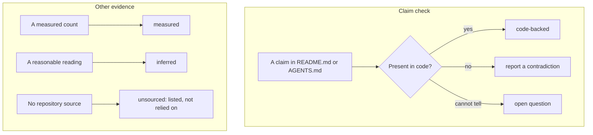
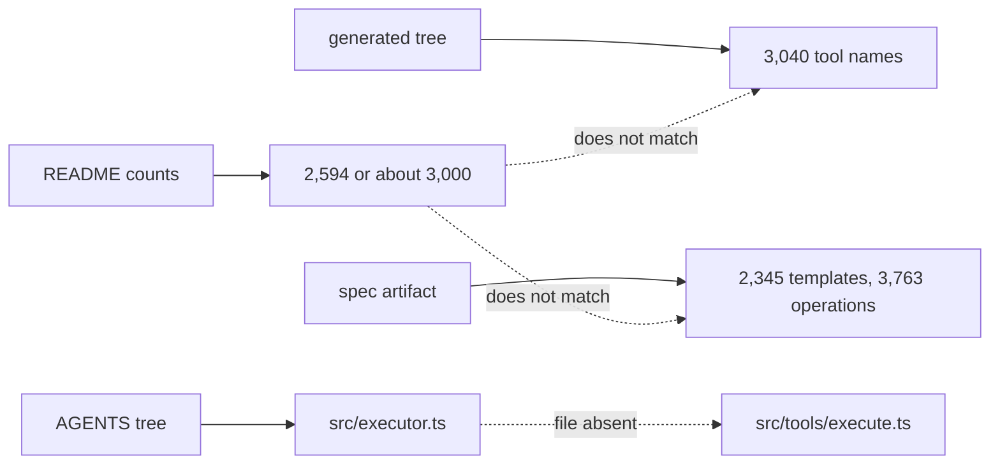

# Limitations and Open Questions

This document states what the code does not prove, where the documents and the
code disagree, and what a reader should not assume.

## How to read this document

This document uses short forms. API means Application Programming Interface.
MCP means Model Context Protocol. CPU means Central Processing Unit. JSON
means JavaScript Object Notation. KV
means Key Value. KiB means kibibyte (1,024 bytes). MiB means mebibyte
(1,048,576 bytes). MB means megabyte (1,000,000 bytes). RPC means Remote
Procedure Call. R2 is Cloudflare's object storage product. ASCII means American
Standard Code for Information Interchange. `du` is the disk-usage command, and
it reports KiB, so this document
converts its output to MiB and keeps the raw value. Code Mode is the default
tool surface, where the model writes code instead of loading one tool for each
endpoint.

The study treats code as the primary source. A statement in `README.md` or
`AGENTS.md` is a claim. A statement in a source file is a fact about this
checkout. When the two disagree, this document reports the difference and does
not choose a winner silently.

The confidence levels are:

| Level | Meaning |
| --- | --- |
| measured | counted or read directly in this checkout |
| code-backed | follows from a cited source path |
| inferred | a reasonable reading, not stated in code |
| unsourced | no source in the repository |

The levels are labels, not steps in one process. A measured value does not pass
through the claim check. A reading that code contradicts becomes a
contradiction, not an inference.

## Contradictions

### Tool count

The repository says several different things:

| Source | Claim |
| --- | --- |
| `README.md:12` | Code Mode has 3 tools |
| `README.md:101-106` | the table lists 4 tools: `docs`, `search`, `execute`, `whoami` |
| `AGENTS.md:5` | "just two tools (`search` and `execute`)" |
| `src/server.ts:91-98` | registers four tools |
| `src/generated/forge-mcp/` | 3,040 generated direct tool names |

The four-tool surface is the code-backed value. The table in
`README.md:101-106` agrees with it. The 3,040 row counts the direct surface,
not the Code Mode surface. This study infers that the number 3 counts the three
Code Mode tools before `whoami` became a profile tool, meaning a tool that
reports identity. It also infers that the
"two tools" sentence describes the original idea, not the deployed surface.
Neither reading has a source.

### Direct tool count and token cost

`README.md:7-12` is a token comparison. Its 2,594-tool rows measure a "Native
MCP" baseline, not this checkout's direct surface. The direct surface today
has 3,040 generated tool names. `README.md:52` says "about 3,000", which matches
the measured count. The 244,047-token value belongs to the 2,594-tool baseline.
It is not a measurement of the 3,040-tool surface. A reader must not attach that
token count to 3,040.

The token figure cannot be reproduced from the repository. The exact
tokenizer, the schema shape, and the measurement date are not recorded. Treat
the comparison as an order-of-magnitude claim, not an exact measurement.

### Endpoint count

`README.md:3` and `AGENTS.md:5` say 2,500 endpoints. The processed spec in this
checkout has 2,345 path templates and 3,763 operations
(`src/generated/spec/spec.json.txt`). The server can call more operations than
templates, because one path holds several methods. Neither 2,345 nor 3,763 is
2,500.

The inference is a rounded count from an earlier release. The pin is the release
tag stored in `source.json`, and it has changed since the number was written
(`src/generated/forge-mcp/source.json:1-3`). No file records the count for the
release named in `README.md`.

### The scheduled handler

`AGENTS.md:325` lists "Scheduled handler (spec fetching & processing, skills
sync)". The handler calls only `syncSkills` (`src/index.ts:95-103`). The
comment says the spec ships with the deploy. No code fetches or processes the
spec on a schedule.

### The ten-minute cron comment

`.github/workflows/forge-tools.yml:10` says a "ten-minute cron syncs R2 to the
pin". The Worker cron is `0 */6 * * *` (`wrangler.jsonc:61-63`). No path syncs
the spec to R2. The spec artifacts are committed and deployed
(`AGENTS.md:184`).

### The generated size

`AGENTS.md:200` says "~10 MB of generated code" and a compile cost of "~27 ms
per isolate". The `src/generated/forge-mcp/` directory measures 27,692 KiB in
this checkout. That value is 27.0 MiB, or about 28.3 MB.

A third figure appears in this study's README: about 52 megabytes of generated
code. That figure is the whole `src/generated` directory. `du -sk` reports
53,784 KiB there, which is 52.5 MiB or about 55.1 MB. It holds 27.0 MiB of
tools and 25.5 MiB of spec directory, rounded by block size. The spec file
itself is 26,325,766 bytes, which is 25.1 MiB or 26.3 MB. The directory is
slightly larger than the file because of block allocation.

The three figures measure three different things: compile input, tool tree,
and whole generated tree. The 10 MB figure may count only the TypeScript source
that workerd compiles. Workerd is Cloudflare's Workers runtime. The repository
does not state which. Do not use any
number as a precise size. See
[06-generated-code-sample.md](06-generated-code-sample.md).

### The executor file

`AGENTS.md:25` lists `src/executor.ts`. That file does not exist. The
implementation is `src/tools/execute.ts`. The tree in `AGENTS.md:25` is stale.

### The endpoint-tool comment

`src/response-validation.ts:44-46` says "The endpoint tools and the forge tools
both call it". Only `src/tools/forge-tools.ts:136-147` calls `checkResponse` in
this checkout. The endpoint tools may be an earlier design that no longer
exists.

### The search tool read-only hint

`search` returns `readOnlyHint: false` (`src/tools/search.ts:87-92`), even
though it has no network access and cannot write (`src/forge-tools/search.ts:26-53`).
The hint is conservative. It does not match the behavior, but it is not unsafe.

## Technical limitations

### Fresh isolate per call

Every `execute` and `search` call creates a new dynamic Worker
(`src/tools/execute.ts:107`, `src/forge-tools/search.ts:27`). This gives clean
isolation, but it also means:

- No warm cache inside model code between calls.
- A compile cost on every call.
- No way to resume a long computation.

The code gives the cause (`src/tools/execute.ts:91-98`). A dynamic Worker
isolate disallows `eval`, so the runtime cannot compile a string at call time.
The code therefore must arrive as module source. A new loader entry with new
source is the supported route, and the loader keys entries by name
(`src/tools/execute.ts:107`). A warm loader entry keeps its first module map,
so new source needs a new entry name.

### The spec is near the RPC limit

`spec.json` is about 27 MB, and the service returns it as a stream because a
stream has no message-size limit (`src/forge-tools/worker.ts:98-105`). A larger
spec would not fit a normal RPC message.

The ASCII transform, `asciiJson`, escapes every character above `U+007F` as
`\uXXXX` (`scripts/generate-tools.ts:146-157`). The stored string then uses one
byte per code unit in the runtime's internal form. The escaped output itself is
longer than the input, because one character becomes six output characters.
The saving is in representation, not length. One character outside Latin-1
forces the whole string into the two-byte form. The escape keeps every code
unit in the one-byte form, so the total falls.
[05-the-isolate-boundary.md](05-the-isolate-boundary.md) gives the full
representation argument. The transform saves memory, but
it does not fix unbounded growth.

### Result truncation is approximate

The cap uses four characters per token (`src/truncate.ts:19-21`). A result with
non-Latin text, long identifiers, or many punctuation marks can use more tokens
than the estimate.

The structural shrink keeps valid JSON, but it can drop data
(`src/truncate.ts:250-311`). A model that ignores the `--- TRUNCATED ---`
marker may reason from an incomplete list.

### Validation is sampled and passive

The response check runs only when the sample rate allows it, and only for a body
under 1,000,000 characters (`src/response-validation.ts:48-57`).
`RESPONSE_VALIDATION_SAMPLE_RATE` is `"1"` in the checked-in configurations
(`wrangler.jsonc:26`, `wrangler.jsonc:120`, `wrangler.jsonc:175`). A deployment
can lower it.

The check never changes a result (`src/response-validation.ts:8-19`). A schema
mismatch reaches the model as it is. The event is a product-team signal, not a
safety gate.

### Direct mode is expensive

Direct mode lists 3,040 tools. The README's 244,047-token row measures a
2,594-tool baseline, not this surface (`README.md:10-11`). That baseline is
already larger than many model context windows. The repository does not measure
the 3,040-tool surface. The tool-list fast path is the direct-mode shortcut
that returns the pre-encoded listing without the SDK. It reduces Central
Processing Unit (CPU) cost, not token cost
(`src/tools/tool-list-response.ts:59-64`).

Direct mode remains useful for composition with another code-mode client, as
the README says (`README.md:50-52`, `README.md:77`). It is not a cheap default.

### The network check is host-only

The proxy compares the hostname and nothing else (`src/tools/execute.ts:62-66`).
`new URL(request.url).hostname` drops the scheme and the port. A request to
`http://api.cloudflare.com/...` or to another port on that host passes the
check. A path outside the API base prefix also reaches the same host. The code
does not check the scheme, port, or prefix before the API call.

The API decides whether the path is valid. A path traversal on the same host is
therefore an API concern, not a sandbox escape.

### Refresh admission is best effort

The refresh gate uses a local map and a KV claim (`src/auth/refresh-admission-gate.ts:60-118`).
KV is eventually consistent, so two isolates can still refresh at the same
time. The comment states this and calls the gate load shedding
(`AGENTS.md:177`).

### The model sees customer data

The design keeps the token and the full spec away from the model. It does not
keep response data away. A tool result can hold customer records, and the model
reads it. That is the purpose of the tool, but it means the model boundary is
not a data-loss boundary.

### The repository does not record platform limits

The dynamic Worker call passes `compatibilityDate` and a module, but no CPU,
memory, or subrequest limit (`src/tools/execute.ts:119-124`,
`src/forge-tools/search.ts:27-30`). The type declaration allows `cpuMs` and
`subRequests` (`worker-configuration.d.ts:3674-3677`). The platform default
applies, and this study did not measure it.

A long loop, a large allocation, or many API calls can hit a limit that the
repository does not name. The tool description does not state a limit either
(`src/tools/execute.ts:395-414`).

## Claims that could not be sourced

These claims are plausible but have no source in the repository:

- The default CPU, memory, wall-clock, and subrequest limits for a dynamic
  Worker. The code passes no `limits` object.
- The exact token counts in `README.md:7-12`. The tokenizer and method are not
  recorded.
- The internals of `@cloudflare/forge`. It is the external generator package
  pinned to a preview build (`package.json:36`). It is not the forge tools
  service, which is the deployed Worker that serves its output.
- The internals of `@cloudflare/workers-oauth-provider`. It is an external
  package (`package.json:29`).
- Why `/.well-known/openai-apps-challenge` returns a public fixed token
  (`src/index.ts:16-17`, `src/index.ts:64-68`). The code does not explain it.
- Whether the spec was ever synced from R2 at runtime. The comments say it was
  not, but the workflow comment suggests an older design
  (`.github/workflows/forge-tools.yml:10`).
- The production sample rate and traffic volume. The checked-in value is 1, but
  a deployment can change it.

## Open questions

These questions are worth an answer but are outside this checkout:

1. What is the real per-call CPU and wall-clock budget for `execute`? The
   answer decides whether a broad multi-step program is practical.
2. Does the model ever see the `--- TRUNCATED ---` marker as a reason to retry?
   The bench may answer this, but no result is committed.
3. How often does the response schema check find a mismatch in production? The
   report script exists, but no result is committed
   (`scripts/schema-mismatch-report.ts:1-40`).
4. Do clients other than Codex and ChatGPT need the `tool` challenge style?
   `src/clients.ts:44-57` lists only those two.
5. Does the six-hourly regeneration pull request ever stay open long enough to
   miss a security fix? This regeneration is the tool workflow at minute 30.
   The Worker's own six-hourly cron at minute 0 syncs skills. The workflow
   opens or updates one pull request
   (`.github/workflows/forge-tools.yml:74-86`).
6. Why does the generated tree measure 27.0 MiB when the guide says 10 MB? A
   measurement of the bundled output would settle it.

## What would change the conclusions

This study's main conclusion is that Code Mode is a context boundary, not a
security boundary. That conclusion would change if:

- The sandbox received the token directly.
- The proxy allowed a host other than the API host.
- The model received the full spec or the full tool catalog.
- The generated tools ran in the same isolate as Code Mode.

None of these is true in this checkout. The token stays in props
(`src/tools/execute.ts:60-88`), the proxy checks the host
(`src/tools/execute.ts:62-66`), and the spec lives in the forge tools service
(`src/forge-tools/worker.ts:1-14`).

> **Aha:** The most important limitation is not a bug. It is the design
> trade-off. The server moves the spec and the token to the server side, and it
> accepts a compile cost and a truncation cost to do that. A reader who wants a
> cheaper direct-tool server will lose the boundary. A reader who wants a
> stronger security boundary needs more than this design provides. The sandbox
> can still call the whole Cloudflare API with the user's token.

## Related documents

- [00-overview.md](00-overview.md)
- [05-the-isolate-boundary.md](05-the-isolate-boundary.md)
- [07-generation-pipeline.md](07-generation-pipeline.md)
- [11-results-and-validation.md](11-results-and-validation.md)
- [12-operations.md](12-operations.md)
