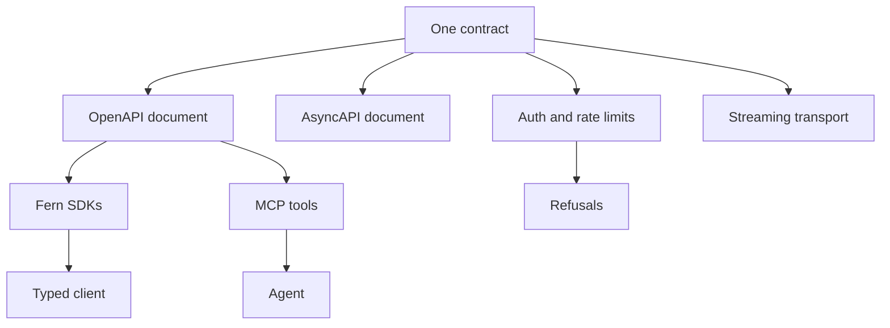
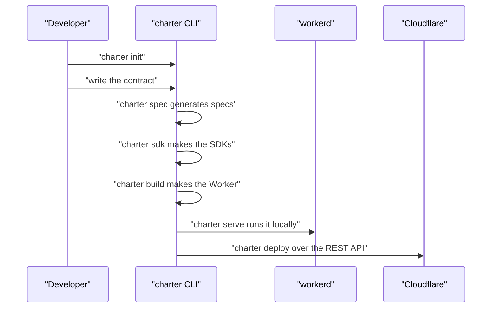

# 00 -- Overview: contract-first APIs on Cloudflare Workers

charter is a library and a command-line tool (CLI) for building application programming interfaces (APIs) on Cloudflare Workers. Its one sentence of self-description, printed by `charter help`, is the shortest accurate summary of the project.

```go
// Source: cmd/charter/main.go, lines 107-113
// help lists charter's commands, each with what it takes and what it does.
func help() {
	fmt.Printf("charter %s: contract-first APIs on Cloudflare Workers, in TypeScript or Go, and the repos that hold them.\n\n", version.String())
	for _, c := range repo.Commands {
		fmt.Printf("  charter %s\n      %s\n", c.Usage, c.About)
	}
	fmt.Printf("\nAnd: charter %s. charter <command> -h: its flags.\n", joinExtra())
}
```

"Contract-first" is the load-bearing word. A developer declares an operation once — a Go struct and route in Huma, or a TypeScript procedure in oRPC — and charter derives everything else from that one declaration. The contract is the single source of truth.

## The one contract, everything that falls out of it

A contract in charter is not a hand-written YAML file. It is the API's code itself. A Huma operation in Go, or an oRPC procedure in TypeScript, already names the path, the method, the request body, the response, the parameters, and the authentication scopes. charter reads that code and produces, from it, every artifact a client or a server needs:

- the **OpenAPI Specification (OpenAPI)** document that describes the request-and-response surface,
- the **AsyncAPI Specification (AsyncAPI)** document that describes the streaming channels,
- **Fern** software development kits (SDKs) in Go, TypeScript, and Python, typed from those specs,
- **Model Context Protocol (MCP)** tools, one per operation, exposed over a single endpoint,
- authentication checks, rate-limit checks, and standard problem-details refusals,
- the live streaming transport, from a gap-free feed to Server-Sent Events (SSE) and WebSocket adapters.



The claim is strong: nothing is duplicated, so nothing can drift out of sync. When the contract changes, `charter spec` regenerates the specs, and `charter check` fails if any derived artifact is stale.

## Go or TypeScript, one behavior

charter is two libraries with the same contract model. The Go library uses Huma for the routing and declaration layer. The TypeScript library (shipped as `charter-lib`) uses oRPC. The module file names the Go path and the toolchain.

```go
// Source: go.mod, lines 1-3
module github.com/joeblew999/charter

go 1.27.1
```

The two libraries are not merely parallel in spirit; they are proven identical. `charter twins` runs the same API in both languages under the same local runtime, sends the same requests to both, and fails on any answer that differs. The same dependency list that names the Go route layer also names the pieces the whole system is built from.

```go
// Source: go.mod, lines 5-13
require (
	github.com/BurntSushi/toml v1.6.0
	github.com/coder/websocket v1.8.15
	github.com/danielgtaylor/huma/v2 v2.40.0
	github.com/evanw/esbuild v0.27.7
	github.com/go-jose/go-jose/v4 v4.1.5
	github.com/syumai/workers-go v0.36.0
	modernc.org/sqlite v1.61.0
)
```

## The whole lifecycle in one binary

charter is not only a library; it is also the command that walks an API from an empty folder to a deployed Worker, with no wrangler and no Node in the path. The `steps` map in the command dispatcher lists every step a project takes.

```go
// Source: cmd/charter/main.go, lines 60-68
var steps = map[string]func(args []string){
	"build":     build.Main,
	"deploy":    deploy.Main,
	"tail":      tail.Main,
	"bench":     bench.Main,
	"local":     local.Local,
	"serve":     local.Serve,
	"with":      local.With,
	"token":     token.Main,
	"ci":        ci.Main,
}
```

These steps form one cycle: write the contract, generate the specs and SDKs, build the Worker (with TinyGo to WebAssembly (Wasm), or esbuild for TypeScript), check everything that needs no Cloudflare account, run the API locally on plain workerd, deploy it over the Cloudflare REST API, and prove the Go and TypeScript twins answer alike.



## The Aha Moment

**Aha:** The API's own code is the contract. Because a Huma operation or an oRPC procedure already declares everything a client must know — path, method, body, response, parameters, scopes — charter never asks for a separate description file. It reads the code and emits the OpenAPI and AsyncAPI documents, the Fern SDKs, the MCP tools, the auth and rate-limit checks, and the streaming transport. There is one source of truth, so there is nothing left to drift out of sync; `charter check` simply verifies that every derived artifact is still the one this contract produces.

## Cross-References

- [01-architecture.md](01-architecture.md) — the packages, the layers, and how they depend on each other.
- [02-humaworkers.md](02-humaworkers.md) — Huma on Workers: the API, the router, and form bodies.
- [17-typescript-library-examples.md](17-typescript-library-examples.md) — the TypeScript twin and the example APIs.

Continue to [01-architecture.md](01-architecture.md)
