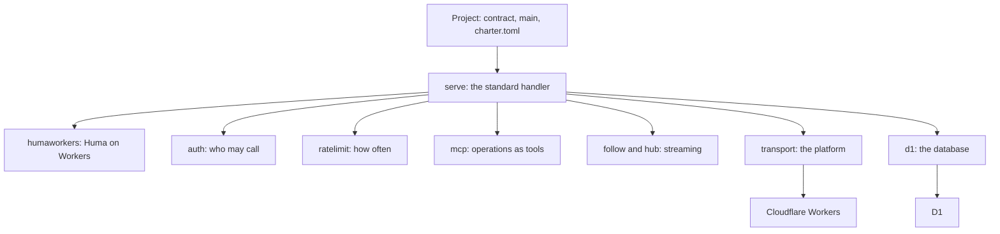
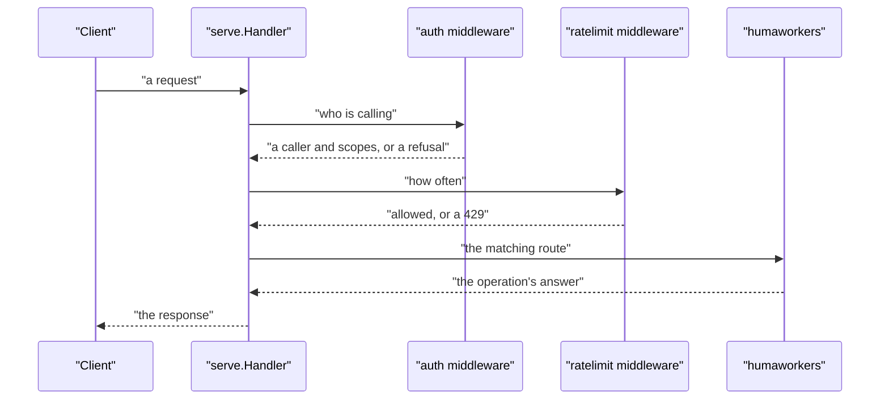

# 01 -- Architecture: packages, layers, and the dependency graph

charter is one Go module split into layers. Each layer has one job, and each layer calls only the layers below it. The top of the stack is what a project writes: a contract (Huma operations in Go, or oRPC procedures in TypeScript), a small `main` function, and one configuration file. Everything under that is charter. The package `serve` states the layering in its own opening comment.

```go
// Source: serve/serve.go, lines 1-15
// Package serve serves a charter API the standard way (docs/self/standard.md), so a project
// gives its contract, its handlers and whom it trusts, and wires nothing itself:
//
//   - its operations under /api, each call checked by the contract's security (auth) and limited by
//     its rate limits (ratelimit);
//   - its specs at /api/openapi.json and /api/asyncapi.json, with the request's origin as their server;
//   - its operations as MCP tools at /api/mcp (charter/mcp);
//   - how to get in, at /.well-known/ (auth.WellKnown);
//   - a WebSocket channel's token as ?access_token=, on the channel only, for a client that cannot send
//     headers (a browser, a Worker);
//   - every refusal as RFC 9457 problem details (Huma's, and charter/problem's), as charter-lib answers.
//
// The same API gives the specs charter spec writes (OpenAPI, AsyncAPI) and the MCP check it runs (Tools).
// The platform carries the WebSocket (transport) and runs the handler (transport.Run).
package serve
```

The layering reads from the bottom up. At the very bottom is the platform: `transport` puts Go on Cloudflare Workers and `d1` talks to the D1 database. Above that, `humaworkers` runs Huma on Workers, and `auth`, `ratelimit`, `mcp`, `asyncapi`, and `problem` add the standard behaviors around it. `serve` ties them into one handler. `follow` and `hub` implement streaming. Then come the build tools: `spec`, `sdk`, `check`, `build`, `deploy`, `local`, `ci`, `twins`, `scaffold`, and the command dispatcher.



## The API struct: what a project gives, and nothing else

The contract between a project and charter is one struct, `serve.API`. The project fills in a configuration function, a list of routes, a live title, a way to look up settings, a list of trusted credentials, and an optional function that adds what the document says but no route does. charter does the rest.

```go
// Source: serve/serve.go, lines 60-75
// API is what a project gives; the rest is the standard.
type API struct {
	// Config is the document around the operations: its title, version and description, its
	// security schemes (auth.Scheme, ...), its rate limits (ratelimit.Declare), its extensions.
	Config func() huma.Config
	// Routes are the operations, bound to the request's environment (to an empty one, for the specs).
	Routes []humaworkers.Route
	// LiveTitle is the AsyncAPI document's title: the API's channels.
	LiveTitle string
	// Setting looks a secret or variable up (the Worker's environment; natively, os.Getenv).
	Setting func(name string) string
	// Trusted are the ways in the API takes (auth); none, and it checks no credentials.
	Trusted []auth.Trusted
	// Document adds what the document says that no route does (the webhooks), to the API it gives.
	Document func(api *humaworkers.API)
}
```

A route is a single operation, and it keeps two facts: where it is served and how to register it with Huma. The `OperationID` field is what lets charter find one operation without registering all the others — a saving that matters on Workers, where a fresh Go runtime starts for every request. `Config` strips out the Huma defaults that do not run on Workers.

```go
// Source: humaworkers/humaworkers.go, lines 35-54
// Route is one operation: where it is served, and how to register it with Huma (a huma.Register call).
type Route struct {
	Method string
	Path   string // Huma's form, e.g. /api/notes/{id}
	// OperationID is the id Register gives the operation. Optional: it lets Operation find one
	// operation by id without registering the others.
	OperationID string
	Register    func(api huma.API)
}

// Upstream: tinygo-org/net#56 (when merged and in a TinyGo release: Huma's own humago adapter can do the routing, on http.ServeMux)
// Upstream: tinygo-org/tinygo#3599 (when fixed: keep huma.DefaultConfig's CreateHooks, the schema links work)
// Config is huma.DefaultConfig without what does not run or is not wanted on Workers: no
// schema-link hook (reflect.StructOf), and no built-in /openapi, /docs and /schemas routes (serve
// the specs yourself, with the request's origin as their server).
func Config(title, version string) huma.Config {
	config := huma.DefaultConfig(title, version)
	config.CreateHooks = nil
	config.OpenAPIPath, config.DocsPath, config.SchemasPath = "", "", ""
	return config
}
```

One request travels through this stack in a fixed order. `serve.Handler` first moves a WebSocket channel's `access_token` query parameter into the Authorization header, then routes by path: the two spec documents, the MCP endpoint, the discovery documents, or the operation itself. The operations pass through the authentication middleware, then the rate-limit middleware, then the media-type check, then the route that matches.



## The Aha Moment

**Aha:** The architecture is a stack where one struct, `serve.API`, is the entire contract between a project and the library. The project declares operations, credentials, and limits; `serve` wires them into a standard handler, and each layer below it — `humaworkers` for routing, `auth` and `ratelimit` for the checks, `mcp` and `asyncapi` for the derived surfaces, `transport` and `d1` for the platform — does one thing. Because every layer reads the same declaration, the specifications, the software development kits (SDKs), the Model Context Protocol (MCP) tools, and the live server can never drift apart.

## Cross-References

- [00-overview.md](00-overview.md) — what charter is and the contract-first promise.
- [02-humaworkers.md](02-humaworkers.md) — how Huma actually runs on Workers.
- [03-serve.md](03-serve.md) — how the standard handler routes a request.

Continue to [02-humaworkers.md](02-humaworkers.md)
