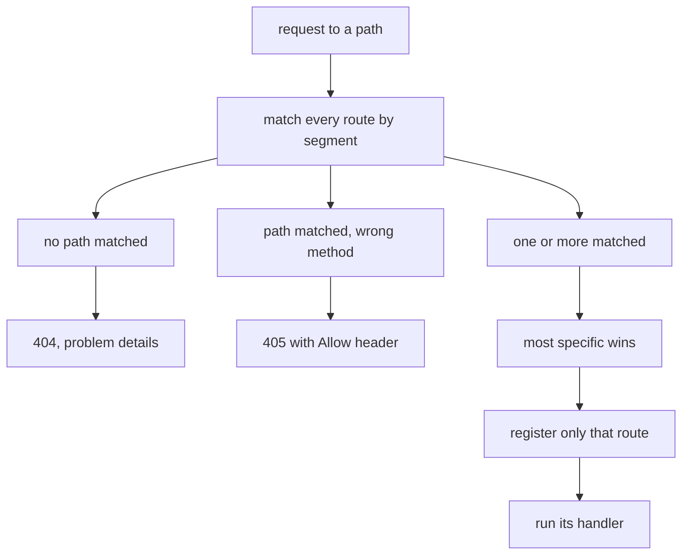
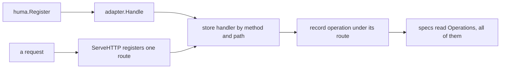

# 02 -- humaworkers: Huma on Workers

`humaworkers` is the layer that makes Huma run on Cloudflare Workers through workers-go and TinyGo. It exists for three reasons, each one measured under workerd, the local Workers runtime. The package states them plainly, so the design decisions are visible and not hidden behind an abstraction.

```go
// Source: humaworkers/humaworkers.go, lines 1-14
// Package humaworkers runs a Huma API (github.com/danielgtaylor/huma) on Cloudflare Workers through
// workers-go and TinyGo. It exists for three reasons, each
// measured under workerd:
//
//   - workers-go starts a fresh Go runtime for every request, so registering every operation at
//     start-up would be paid on every request. Here only the operation a request matches is registered
//     (ServeHTTP by path, Operation by id). Specs register them all (Operations, OpenAPI).
//   - TinyGo's http.ServeMux has no "GET /path/{id}" patterns, which Huma's own net/http adapter
//     needs. Routes are matched here: the most specific one wins, whatever their order.
//   - Huma's default config installs a hook that calls reflect.StructOf, which TinyGo does not have.
//     Config leaves it out.
//
// Build with `tinygo build -target wasm -stack-size=128kb` (charter build does): Huma overflows TinyGo's default stack.
package humaworkers
```

The first reason is the heart of the design: on Workers, a fresh Go runtime starts for every request, so registering every operation at start-up would be paid on every request. `humaworkers` registers only the operation a request matches. The `ServeHTTP` method does that matching itself, because TinyGo's `http.ServeMux` lacks the `{id}` path patterns Huma needs.

```go
// Source: humaworkers/humaworkers.go, lines 148-186
func (a *API) ServeHTTP(w http.ResponseWriter, r *http.Request) {
	var allow []string
	var values map[string]string
	best := -1
	for i, route := range a.routes {
		found, ok := match(route.Path, r.URL.Path)
		if !ok {
			continue
		}
		if route.Method != r.Method {
			allow = append(allow, route.Method)
		} else if best < 0 || moreSpecific(route.Path, a.routes[best].Path) {
			best, values = i, found
		}
	}
	if best < 0 {
		if len(allow) > 0 {
			slices.Sort(allow)
			w.Header().Set("Allow", strings.Join(slices.Compact(allow), ", "))
			problem.Write(w, http.StatusMethodNotAllowed, "method not allowed")
			return
		}
		problem.Write(w, http.StatusNotFound, "not found")
		return
	}
	route := a.routes[best]
	a.registering.Lock()
	a.register(best)
	h, ok := a.handlers[route.Method+" "+route.Path]
	a.registering.Unlock()
	if !ok {
		http.Error(w, "route "+route.Method+" "+route.Path+" registered no such operation", http.StatusInternalServerError)
		return
	}
	for name, value := range values {
		r.SetPathValue(name, value)
	}
	h.run(humago.NewContext(h.op, r, w))
}
```

An unknown path answers `404`; a known path with a different method answers `405` with an `Allow` header that lists the methods it has. When several routes match one request, the most specific one wins, whatever their order. That is what lets a route like `/things/watch` take a request ahead of `/things/{id}`. Every refusal is written as problem details, which keeps the whole API on one answer shape.



## Form bodies, which Huma has no format for

Huma handles JavaScript Object Notation (JSON) bodies natively, but not form bodies. An OAuth token request, for example, arrives as `application/x-www-form-urlencoded`. `WithForm` teaches Huma that media type, and `unmarshalForm` decodes it the way Huma asks a format to.

```go
// Source: humaworkers/form.go, lines 13-32
const FormContentType = "application/x-www-form-urlencoded"

// WithForm lets operations take form-encoded request bodies, which Huma has no format for. Tag the
// input's Body with `contentType:"application/x-www-form-urlencoded"`: the spec then names that
// media type, and the body is validated and decoded like a JSON one. Every form value is a string
// (a repeated name is a list of strings), so the Body's fields must be strings too.
func WithForm(config huma.Config) huma.Config {
	formats := map[string]huma.Format{}
	for name, format := range config.Formats {
		formats[name] = format
	}
	formats[FormContentType] = huma.Format{
		Marshal: func(io.Writer, any) error {
			return errors.New("humaworkers: " + FormContentType + " is for request bodies only")
		},
		Unmarshal: unmarshalForm,
	}
	config.Formats = formats
	return config
}
```

The `Register` field of a route is a closure that calls Huma's own registration with the operation. The adapter then records the operation under a `"METHOD /path"` key, which `ServeHTTP` looks up after it matches. Registering one route at a time is what keeps a Workers request cheap: the other operations are never touched until they are asked for, or until the specifications ask for all of them.



## The Aha Moment

**Aha:** Huma is a full-featured framework, but on Workers it cannot run the ordinary way. Because workers-go starts a fresh Go runtime for every request, registering every operation up front would be paid on every request; because TinyGo's router lacks `{id}` patterns, matching must be done by hand; and because TinyGo lacks `reflect.StructOf`, the default configuration must be trimmed. `humaworkers` turns those three constraints into one idea: register only the operation a request matches, and let the specifications be the one place that registers everything.

## Cross-References

- [01-architecture.md](01-architecture.md) — where humaworkers sits in the stack.
- [03-serve.md](03-serve.md) — how the standard handler uses these routes.
- [06-mcp.md](06-mcp.md) — how the same operations become MCP tools.

Continue to [03-serve.md](03-serve.md)
