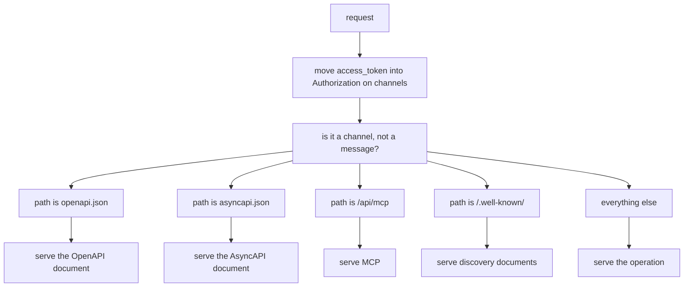
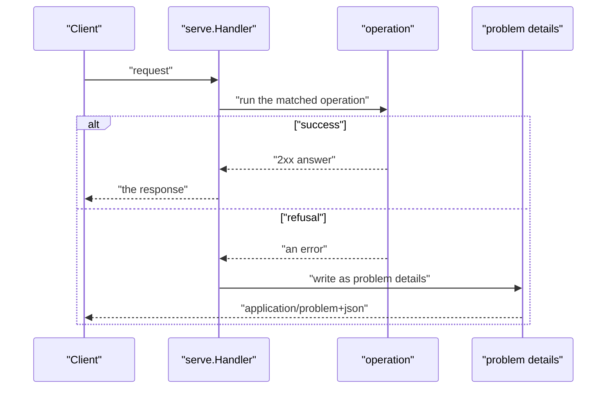

# 03 -- serve: the standard server

`serve` is the layer a project reaches for, and the last one before a request meets the contract. It turns `serve.API` into one standard handler: operations under `/api`, the OpenAPI and AsyncAPI specifications at fixed paths, the Model Context Protocol (MCP) endpoint, the discovery documents, and every refusal as Request for Comments (RFC) 9457 problem details. Its handler is a single switch.

```go
// Source: serve/serve.go, lines 96-123
	return http.HandlerFunc(func(w http.ResponseWriter, r *http.Request) {
		if token := r.URL.Query().Get("access_token"); token != "" && r.Header.Get("Authorization") == "" && slices.Contains(channels, r.URL.Path) {
			r = r.Clone(r.Context())
			r.Header.Set("Authorization", "Bearer "+token)
		}
		path := r.URL.Path
		// A request to a channel's address is the channel's, whatever its method, as in charter-lib: let
		// in or refused, then 426 if it is no upgrade. Only the transport's frames (MessageHeader) are the
		// channel's messages.
		if slices.Contains(channels, path) && r.Method != http.MethodGet && r.Header.Get(transport.MessageHeader) == "" {
			r = r.Clone(r.Context())
			r.Method = http.MethodGet
		}
		switch {
		case path == openAPIPath:
			a.write(w, a.OpenAPI, auth.Origin(r))
		case path == asyncAPIPath:
			a.write(w, a.AsyncAPI, auth.Origin(r))
		case path == mCPPath:
			tools.ServeHTTP(w, r)
		case len(a.Trusted) > 0 && strings.HasPrefix(path, "/.well-known/"):
			// An API that takes credentials says how to get in; one that takes none has nothing to say.
			wellKnown.ServeHTTP(w, r)
		default:
			routes.ServeHTTP(w, r)
		}
	})
```

The first two lines are careful compatibility work. A browser cannot send headers on a WebSocket handshake, so a client may pass the token as a `?access_token=` query parameter on a channel only; the handler moves it into the Authorization header before anything else reads it. And a request to a channel's address is treated as the channel's `GET`, whatever its method, unless it is a message frame from the transport.

The standard paths are fixed: `/api/openapi.json`, `/api/asyncapi.json`, and `/api/mcp`. The handler writes each specification with the request's own origin as its server, so the same document names the address it was fetched from.



## One document, one answer shape

The interesting part of `serve` is `standardDocument`. Huma writes a document its own way: request bodies become schemas named after Go types, refusals are scattered, and the `int` type is 32 bits under TinyGo. `standardDocument` rewrites it so it matches what charter-lib writes from oRPC, so a Go Worker and a TypeScript Worker publish the same specification.

```go
// Source: serve/serve.go, lines 149-171
// The reason phrase a refusal is declared with.
var reasons = map[string]string{"400": "Bad Request", "401": "Unauthorized", "403": "Forbidden", "404": "Not Found", "409": "Conflict", "415": "Unsupported Media Type", "422": "Unprocessable Entity", "429": "Too Many Requests"}

// standardDocument writes the document as the standard has it (docs/self/standard.md), as
// charter-lib writes it from oRPC: a body inline, not a schema Huma names after its Go type
// (CreateInputBody); every refusal declared as problem details (401 when the operation needs
// credentials, 422 when it takes input, its 429 when it is limited, any other it declares, and a
// default); `explode` only on a parameter that is an array.
func standardDocument(doc *huma.OpenAPI) {
	schemas := doc.Components.Schemas.Map()
	inlined := map[string]bool{}
	inline := func(schema *huma.Schema) *huma.Schema {
		if schema == nil || !strings.HasPrefix(schema.Ref, "#/components/schemas/") {
			return schema
		}
		name := strings.TrimPrefix(schema.Ref, "#/components/schemas/")
		if def := schemas[name]; def != nil && strings.HasSuffix(name, "Body") {
			inlined[name] = true
			return def
		}
		return schema
	}
	problem := map[string]*huma.MediaType{"application/problem+json": {Schema: &huma.Schema{Ref: "#/components/schemas/ErrorModel"}}}
```

Every refusal is collapsed into one shape: the `application/problem+json` body with the `ErrorModel` schema. A `401` appears when an operation needs credentials, a `422` when it takes input, a `429` when it is rate-limited, plus a `default` error. The result is that every error the API ever answers, from any layer, looks the same to a client — and the software development kits (SDKs) know that one shape up front.

The loop below does the collapsing. For every operation it walks the methods, drops `explode` except on array parameters, inlines request and success body schemas, gathers the refusals, and writes each as the one problem body. Then it deletes the inlined `*Body` schemas and pins a problem's `status` to `int64` — under TinyGo Huma's `int` is 32 bits, so a Worker's own spec would say `int32` where the one `charter spec` writes natively says `int64`.

```go
// Source: serve/serve.go, lines 172-228
	for _, item := range doc.Paths {
		for _, op := range []*huma.Operation{item.Get, item.Put, item.Post, item.Delete, item.Patch, item.Head, item.Options, item.Trace} {
			if op == nil {
				continue
			}
			for _, param := range op.Parameters {
				if param.Schema == nil || param.Schema.Type != huma.TypeArray {
					param.Explode = nil
				}
			}
			if op.RequestBody != nil {
				for _, media := range op.RequestBody.Content {
					media.Schema = inline(media.Schema)
				}
			}
			security := op.Security
			if security == nil {
				security = doc.Security
			}
			refusals := map[string]*huma.Response{}
			if slices.ContainsFunc(security, func(requirement map[string][]string) bool { return len(requirement) > 0 }) {
				refusals["401"] = &huma.Response{Description: reasons["401"]}
			}
			if len(op.Parameters) > 0 || op.RequestBody != nil {
				refusals["422"] = &huma.Response{Description: reasons["422"]}
			}
			for status, response := range op.Responses {
				if strings.HasPrefix(status, "2") || strings.HasPrefix(status, "3") {
					for _, media := range response.Content {
						media.Schema = inline(media.Schema)
					}
					continue
				}
				delete(op.Responses, status)
				if len(status) == 3 && strings.HasPrefix(status, "4") {
					if reason := reasons[status]; reason != "" && status != "429" {
						response.Description = reason
					}
					refusals[status] = response
				}
			}
			refusals["default"] = &huma.Response{Description: "Error"}
			for status, response := range refusals {
				response.Content = problem
				op.Responses[status] = response
			}
		}
	}
	for name := range inlined {
		delete(schemas, name)
	}
	// A problem's status is Huma's `int`: 32 bits under TinyGo, so the Worker's own spec would say
	// int32 where the one charter spec writes natively says int64. The standard's is int64.
	if model := schemas["ErrorModel"]; model != nil && model.Properties["status"] != nil {
		model.Properties["status"].Format = "int64"
	}
}
```



## The Aha Moment

**Aha:** The standard server is less about routing and more about agreement. It fixes the paths, fixes the token handling, and — above all — rewrites Huma's document so it is exactly the document charter-lib writes from oRPC. Because both libraries produce the same specification and the same problem-details answer shape, the Go Worker and the TypeScript Worker are interchangeable, and `charter twins` can prove they answer identically.

## Cross-References

- [02-humaworkers.md](02-humaworkers.md) — the routing layer beneath this one.
- [04-auth.md](04-auth.md) — the authentication middleware this handler installs.
- [07-ratelimit-problem.md](07-ratelimit-problem.md) — the rate-limit middleware and the problem-details writer.

Continue to [04-auth.md](04-auth.md)
