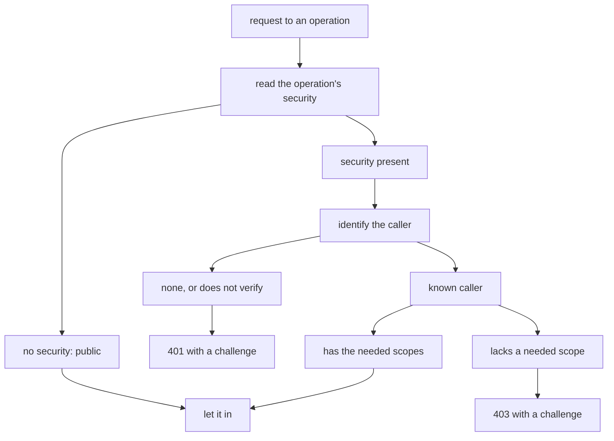
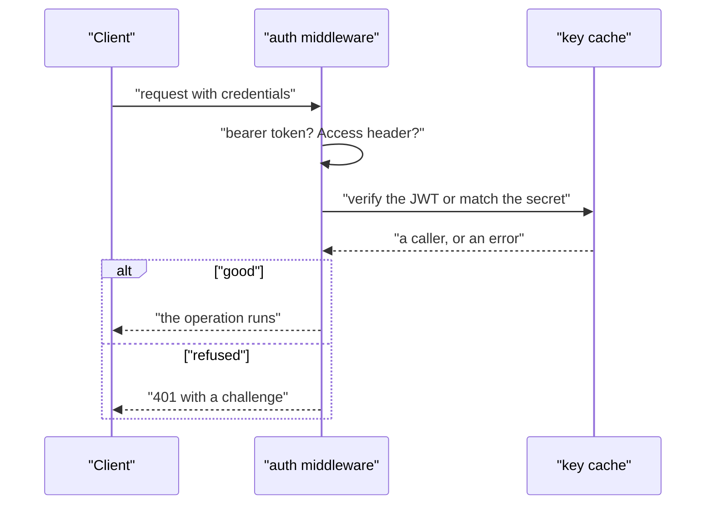

# 04 -- auth: authentication middleware

`auth` answers one question — who may call the API, and with what scopes — in one place. The contract declares what each operation needs, and one middleware enforces it. That is the whole trick: because the enforcement reads the same declaration the specifications read, the specifications, the software development kits (SDKs), and the server can never disagree about who is allowed in.

```go
// Source: auth/auth.go, lines 1-28
// Package auth is who may call a Huma API, and with what scopes: the contract declares what each
// operation needs, and one middleware enforces it, so the specs, the SDKs and the server agree.
//
// A caller proves who it is in one of these ways, and the API lists those it trusts:
//
//   - [Token]: a bearer token, one of the Worker's secrets (READ_TOKEN, WRITE_TOKEN), with the
//     scopes it grants.
//   - [Access]: Cloudflare Access in front of the Worker. A person logs in (with GitHub, say), a
//     machine shows its own service token; Access sends the Worker a JWT in Cf-Access-Jwt-Assertion,
//     verified here against the team's keys and the application's AUD tag (the settings
//     ACCESS_TEAM_DOMAIN and ACCESS_AUD). People and machines get the scopes the API gives them.
//   - [OIDC]: an access token from an OpenID Connect issuer, in Authorization: Bearer, verified
//     here against the issuer's keys, found by its discovery document (the settings OIDC_ISSUER and
//     OIDC_AUDIENCE). The token's own scope claim is what it may do.
//   - [Issued]: a bearer token the API issued itself, at an OAuth token endpoint of its own; the API
//     checks it, and says what it may do.
//
// The schemes go into the specs with [Scheme], [AccessScheme] and [OIDCScheme]; an operation needs
// the scopes its Security lists ([Needs]; the API's default when it lists none; nothing when its
// Security is [Public]), by any of the schemes. No credentials, or credentials that do not verify:
// 401. Known, without a scope the operation needs: 403. An unset setting trusts nothing, so a
// Worker without its secrets refuses everything that is not public. The handler finds the caller
// with [CallerOf].
//
// JWTs are verified with go-jose (github.com/go-jose/go-jose/v4): RS256, ES256 and EdDSA only, the
// issuer, the audience, exp (required) and nbf with a minute's leeway. Keys are fetched once and
// kept for an hour; a token whose key is not among them makes one new fetch, at most every 30 s.
package auth
```

There are four ways in. The API lists the ones it trusts as a `[]Trusted`, and each is one small struct. The value of the `Trusted` interface is that the middleware can switch on the concrete type and build a `gate` out of whichever ways the project named.

```go
// Source: auth/auth.go, lines 67-97
// Trusted is a way in that Middleware accepts: a Token, Access, OIDC or Issued.
type Trusted interface{ trusted() }

// Token is one secret and the scopes it grants.
type Token struct {
	Secret string   // the Worker's secret (the environment variable) that holds the token
	Scopes []string // what it may do, e.g. read; write
}

// Access trusts Cloudflare Access for the application in ACCESS_TEAM_DOMAIN and ACCESS_AUD: a
// person who logged in gets People, a machine with a service token Machines. Which people and which
// tokens Access lets through is Access's policy, set in Cloudflare (cf zero-trust access).
type Access struct {
	People   []string
	Machines []string
}

// OIDC trusts the OpenID Connect issuer in OIDC_ISSUER, for tokens whose audience is OIDC_AUDIENCE.
// A token grants the scopes in its scope claim (or scp).
type OIDC struct{}

// Issued trusts bearer tokens the API issues itself, at an OAuth token endpoint of its own: Check
// says whether a token is one of them and still good, and what it may do. Scheme is that endpoint's
// security scheme in the specs (an oauth2 one), which an operation's Security names beside this
// package's schemes, with the same scopes. TokenPath is the endpoint (e.g. /oauth/token): with it, the
// API names itself an authorization server and says how to use it (WellKnown: serverPath).
type Issued struct {
	Scheme    string
	Check     func(token string) (scopes []string, ok bool)
	TokenPath string
}
```

The middleware itself is a `gate` and one returned function. The `gate` collects the trusted ways and a key cache; the returned function reads the operation's security, identifies the caller, and either lets the call in with the caller attached to the request's context, or refuses with a `WWW-Authenticate` challenge.



The `identify` method is where the four ways are actually tried, in a fixed order. It reads the Cloudflare Access header first, then a bearer token: an OpenID Connect token when it has three dot-separated parts, otherwise one of the Worker's own tokens, otherwise an issued token.

```go
// Source: auth/auth.go, lines 352-391
// identify verifies every credential the request carries, and says who each one is. One that does
// not verify is an error; none at all is no callers.
func (g gate) identify(ctx context.Context, header func(string) string) ([]Caller, error) {
	var callers []Caller
	if jwt := header(AccessHeader); jwt != "" && g.access != nil {
		if team, aud := g.setting(AccessTeam), g.setting(AccessAUD); team != "" && aud != "" {
			c, err := g.keys.access(ctx, team, aud, jwt)
			if err != nil {
				return nil, err
			}
			c.Scopes = g.access.People
			if c.Machine != "" {
				c.Scopes = g.access.Machines
			}
			callers = append(callers, c)
		}
	}
	token := bearer(header("Authorization"))
	if token == "" {
		return callers, nil
	}
	if strings.Count(token, ".") == 2 && g.oidc != nil {
		if issuer, audience := g.setting(OIDCIssuer), g.setting(OIDCAudience); issuer != "" && audience != "" {
			c, err := g.keys.oidc(ctx, issuer, audience, token)
			if err != nil {
				return nil, err
			}
			return append(callers, c), nil
		}
	}
	if c, known := scopesOf(token, g.setting, g.tokens); known {
		return append(callers, c), nil
	}
	for _, issued := range g.issued {
		if scopes, ok := issued.Check(token); ok {
			return append(callers, Caller{Scheme: issued.Scheme, Subject: issued.Scheme + " client", Scopes: scopes}), nil
		}
	}
	return nil, errUnknownToken
}
```

One subtlety is worth noting: the token secrets are compared with `subtle.ConstantTimeCompare`, so a timing difference cannot reveal whether a guess was close. And an unset setting trusts nothing — so a Worker deployed without its secrets refuses everything that is not public, which is the safe default.



## The Aha Moment

**Aha:** Authentication is not four separate code paths — it is one middleware and one `identify` function that tries four ways in order. The same declaration the specifications read (the security schemes and the scopes) is the one the middleware enforces, so a generated SDK sends exactly the credentials the server will accept, and the server refuses exactly what the SDK was told it would refuse. The specifications, the SDKs, and the server agree because they are three readers of one contract.

## Cross-References

- [03-serve.md](03-serve.md) — the handler that installs this middleware.
- [05-jwt-discovery.md](05-jwt-discovery.md) — how the JSON Web Tokens (JWTs) are actually verified and the keys cached.
- [07-ratelimit-problem.md](07-ratelimit-problem.md) — the middleware that counts calls per caller, right after this one.

Continue to [05-jwt-discovery.md](05-jwt-discovery.md)
