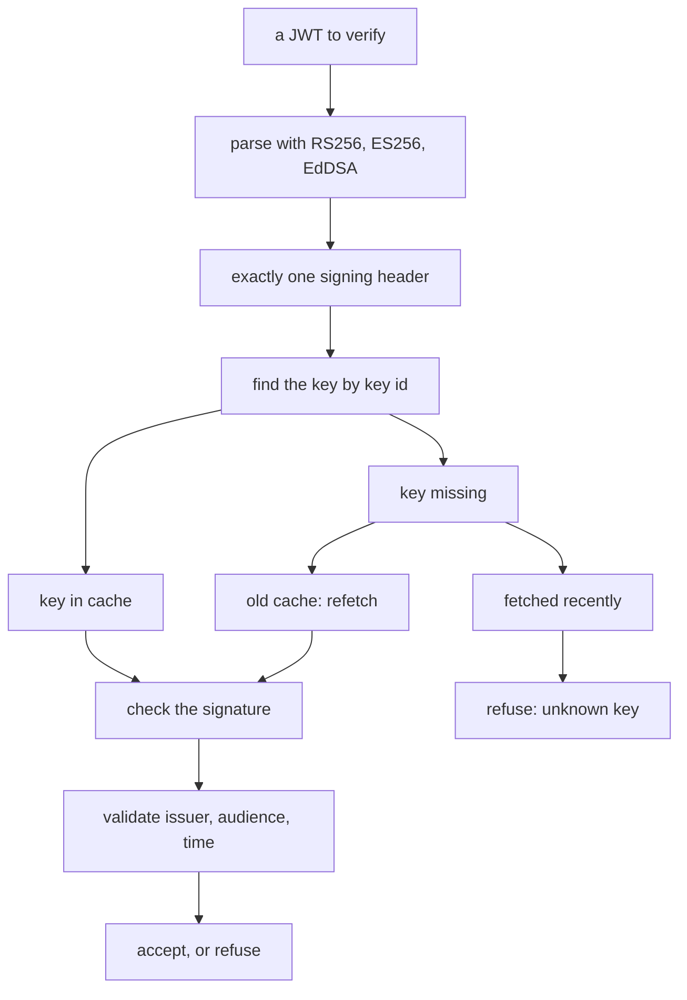
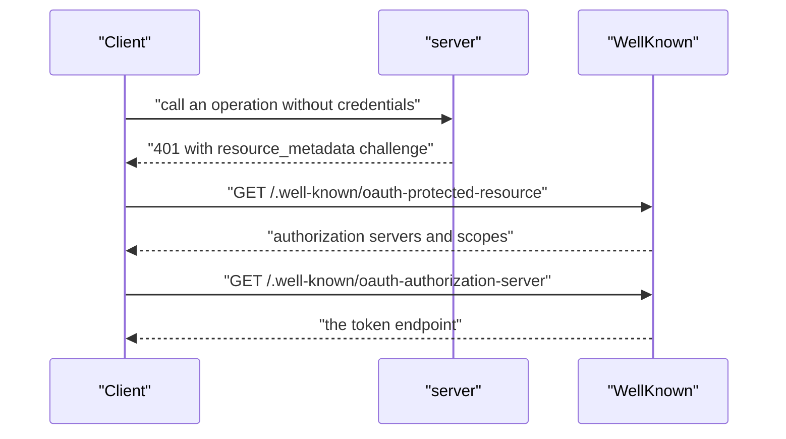

# 05 -- jwt-discovery: JWT verification and discovery documents

Where `auth` decides who is allowed in, `jwt.go` does the actual verification of the JSON Web Tokens (JWTs), and `discovery.go` tells a client how to get in. Together they answer the two halves of one problem: proving a token is real, and telling a client how to obtain one in the first place.

The verification rules are narrow on purpose. Only three signature algorithms are accepted — never `none`, never a shared-key Hash-based Message Authentication Code (HMAC) — and the clock skew allowed on the time claims is one minute. Keys are fetched once and kept for an hour, and a token whose key is not among them triggers at most one new fetch every 30 seconds.

```go
// Source: auth/jwt.go, lines 18-37
// The JWT checks, made by go-jose: the algorithms it accepts (never none, never HMAC), and the
// clock skew allowed on exp, nbf and iat.
var algorithms = []jose.SignatureAlgorithm{jose.RS256, jose.ES256, jose.EdDSA}

const leeway = time.Minute

// How long fetched keys and discovery documents are kept, and the least time between two fetches of
// one key set: a token with a key id the set lacks makes one new fetch, at most this often.
const (
	keysKept     = time.Hour
	refetchAfter = 30 * time.Second
)

// The errors a JWT can be refused with.
var (
	errMalformed = errors.New("not a JWT this API accepts (RS256, ES256 or EdDSA, signed once)")
	errKey       = errors.New("signed with a key the issuer does not publish")
	errSignature = errors.New("the signature does not verify")
	errNoOne     = errors.New("the token names no one")
)
```

The `verify` method is the whole pipeline. It parses the token with those algorithms, requires exactly one signing header, finds the key by its key id, checks the signature, requires an expiry, and then validates the issuer, audience, and time claims against what was expected.

```go
// Source: auth/jwt.go, lines 111-131
// verify checks token's signature against the issuer's keys at jwks, then its claims: iss, aud,
// exp (which it must have), nbf and iat. extra receives the claims the caller wants besides.
func (k *keyCache) verify(ctx context.Context, token, issuer, jwks, audience string, extra any) (jwt.Claims, error) {
	parsed, err := jwt.ParseSigned(token, algorithms)
	if err != nil || len(parsed.Headers) != 1 {
		return jwt.Claims{}, errMalformed
	}
	key, err := k.key(ctx, jwks, parsed.Headers[0].KeyID)
	if err != nil {
		return jwt.Claims{}, err
	}
	var std jwt.Claims
	if err := parsed.Claims(key, &std, extra); err != nil {
		return jwt.Claims{}, errSignature
	}
	if std.Expiry == nil {
		return jwt.Claims{}, jwt.ErrExpired
	}
	if err := std.ValidateWithLeeway(jwt.Expected{Issuer: issuer, AnyAudience: jwt.Audience{audience}, Time: time.Now()}, leeway); err != nil {
		return jwt.Claims{}, err
	}
	return std, nil
}
```

The key cache is where the economy of the design lives. The public keys of an issuer are fetched once and kept for an hour. If a token names a key the cache does not have, and the cache was fetched less than 30 seconds ago, it is refused as `errKey` rather than refetched — a way to stop a flood of unknown key ids from turning into a flood of fetches.



## The discovery documents: how a client learns to get in

A client that is refused with a `401` needs to know how to sign in. `discovery.go` serves three well-known documents: the protected-resource metadata of Request for Comments (RFC) 9728, the authorization-server metadata of RFC 8414, and the OpenID Connect discovery redirect.

```go
// Source: auth/discovery.go, lines 32-66
func WellKnown(api huma.API, setting func(name string) string, trusted ...Trusted) http.Handler {
	if setting == nil {
		setting = func(string) string { return "" }
	}
	discovery := discoveryHandler(setting)
	return http.HandlerFunc(func(w http.ResponseWriter, r *http.Request) {
		origin := originOf(r.URL.Scheme, r.URL.Host, r.Host, r.TLS != nil, r.Header.Get("X-Forwarded-Proto"))
		switch path := r.URL.Path; {
		case path == openIDPath:
			discovery.ServeHTTP(w, r)
		case path == resourcePath || strings.HasPrefix(path, resourcePath+"/"):
			metadata := map[string]any{
				"resource":                 origin + strings.TrimPrefix(path, resourcePath),
				"authorization_servers":    authorizationServers(origin, setting, trusted),
				"scopes_supported":         apiScopes(api.OpenAPI()),
				"bearer_methods_supported": []string{"header"},
			}
			if info := api.OpenAPI().Info; info != nil && info.Title != "" {
				metadata["resource_name"] = info.Title
			}
			writeJSON(w, metadata)
		case path == serverPath && tokenPath(trusted) != "":
			writeJSON(w, map[string]any{
				"issuer":                                origin,
				"token_endpoint":                        origin + tokenPath(trusted),
				"grant_types_supported":                 []string{"client_credentials"},
				"token_endpoint_auth_methods_supported": []string{"client_secret_basic", "client_secret_post"},
				"response_types_supported":              []string{},
				"scopes_supported":                      apiScopes(api.OpenAPI()),
			})
		default:
			problem.Write(w, http.StatusNotFound, "not found")
		}
	})
}
```

The `WWW-Authenticate` challenge on a refusal points at the protected-resource metadata, so a Model Context Protocol (MCP) client can read it and start signing in. The metadata names the authorization servers in the order a client should try them — the API itself first, if it issues its own tokens, then an OpenID Connect issuer, then the Cloudflare Access team. This is the piece that turns a bare `401` from "you are refused" into "here is how to get in."



## The Aha Moment

**Aha:** Verification is strict and cheap at the same time. It accepts only three asymmetric algorithms, refuses anything with no expiry, and keeps fetched keys for an hour — so the common case is a local cache hit. The 30-second refetch floor means an attacker who sends tokens with fresh, made-up key ids costs one fetch, not a flood of them. And the discovery documents close the loop: every refusal carries a pointer to the document that says how to sign in, so the "you are refused" answer is also the "here is how to get in" answer.

## Cross-References

- [04-auth.md](04-auth.md) — the middleware that calls this verification.
- [03-serve.md](03-serve.md) — the handler that mounts these discovery documents.
- [15-check-test-twins.md](15-check-test-twins.md) — the standard test that checks the challenge leads to the metadata.

Continue to [06-mcp.md](06-mcp.md)
