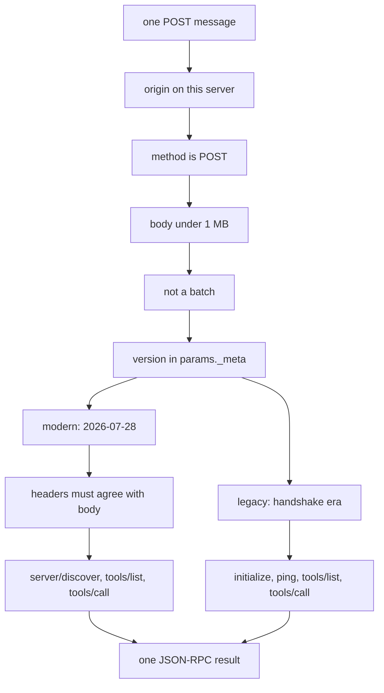
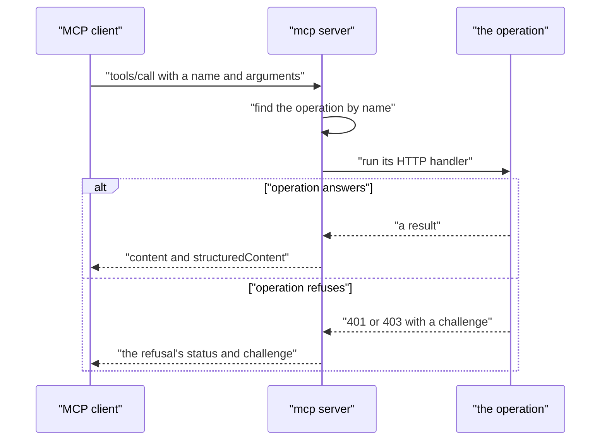

# 06 -- mcp: operations as Model Context Protocol tools

`mcp` serves a Huma API as a Model Context Protocol (MCP) server, the way Huma itself serves it as OpenAPI: every operation is a tool, its input struct is the tool's input schema, and a tool call runs the operation's own Hypertext Transfer Protocol (HTTP) handler. MCP gets the same validation, the same errors, and the same code as representational state transfer (REST). There is no MCP software development kit (SDK): the Go ones do not build with TinyGo, and nothing here needs one.

```go
// Source: mcp/mcp.go, lines 1-18
// Package mcp serves a Huma API as an MCP server (Model Context Protocol), the way Huma itself
// serves it as OpenAPI: every operation is a tool, its input struct is the tool's inputSchema, and a
// tool call runs the operation's own HTTP handler, so MCP gets the same validation, the same errors
// and the same code as REST.
//
// It is MCP's Streamable HTTP transport written out by hand: JSON-RPC 2.0, one POST per message,
// one application/json answer. No MCP SDK: the Go ones don't build with TinyGo, and nothing here
// needs one. The official one (github.com/modelcontextprotocol/go-sdk v1.8.0) still did not on
// 2026-10-15, with TinyGo 0.43.0: five gaps, each an issue. When they are all closed, build the
// official SDK again, and use it if it fits.
// Upstream: tinygo-org/tinygo#5684 (when fixed: hash/maphash compiles with Go 1.27)
// Upstream: tinygo-org/tinygo#5888 (when fixed: reflect.VisibleFields gives usable types)
// Upstream: tinygo-org/tinygo#5889 (when fixed: os.OpenRoot exists)
// Upstream: tinygo-org/net#106 (when fixed: http.Transport.DialTLSContext and CrossOriginProtection exist)
// Upstream: tinygo-org/net#95 (when fixed: net.Dialer.Control exists)
// It keeps no state, which is what workers-go needs (a fresh Go runtime per request) and
// what MCP became in revision 2026-07-28 (no handshake, no sessions). Both eras are served on the
```

The server keeps no state, because workers-go starts a fresh Go runtime for every request — and because the modern MCP revision removed the handshake and sessions. So the one endpoint serves both eras: the modern one (`2026-07-28`) and the handshake era (`2025-11-25` and `2025-06-18`). The version lists and the JavaScript Object Notation (JSON) remote procedure call (RPC) error codes are fixed up front.

```go
// Source: mcp/mcp.go, lines 53-70
// The protocol revisions served: modernVersions ones say their version on every request, legacyVersions ones open
// with initialize.
var (
	modernVersions = []string{"2026-07-28"}
	legacyVersions = []string{"2025-11-25", "2025-06-18"}
)

// JSON-RPC and MCP error codes.
const (
	parseError         = -32700
	invalidRequest     = -32600
	methodNotFound     = -32601
	invalidParams      = -32602
	headerMismatch     = -32020
	unsupportedVersion = -32022
	unauthorized       = -32001 // a server error (JSON-RPC's -32000 to -32099): the HTTP status says which
	serverError        = -32000 // what the MCP SDK answers a request that is no POST with
)
```

Every message is one POST, and the entry to the handler does the protocol's own checks before it reads the method. A browser page on another site is refused by the origin rule; a request that is not a POST is refused; a body over 1 megabyte (MB) is refused; and a batch is refused, because batches left the protocol in 2025-06-18.

```go
// Source: mcp/mcp.go, lines 106-127
func (s server) ServeHTTP(w http.ResponseWriter, r *http.Request) {
	// A browser page on another site must not reach the server (the spec's Origin rule).
	if origin := r.Header.Get("Origin"); origin != "" && !sameOrigin(origin, r) {
		fail(w, http.StatusForbidden, nil, invalidRequest, "Origin "+origin+" is not this server's", nil)
		return
	}
	// No stream to open (GET) and no session to end (DELETE): answered as the MCP SDK answers.
	if r.Method != http.MethodPost {
		w.Header().Set("Allow", http.MethodPost)
		fail(w, http.StatusMethodNotAllowed, json.RawMessage("null"), serverError, "Method not allowed.", nil)
		return
	}
	body, err := io.ReadAll(io.LimitReader(r.Body, maxBody+1))
	if err != nil || len(body) > maxBody {
		fail(w, http.StatusRequestEntityTooLarge, nil, invalidRequest, "the message could not be read, or is over 1 MB", nil)
		return
	}
	// One message per POST: batches left the protocol in 2025-06-18.
	if body = bytes.TrimSpace(body); len(body) > 0 && body[0] == '[' {
		fail(w, http.StatusBadRequest, nil, invalidRequest, "Invalid Request: batches are not supported", nil)
		return
	}
```

After the entry checks, the handler picks one of two paths by the version. In the modern era, every request names its version in `params._meta`, and the routing headers must agree with the body. In the handshake era, `initialize` only reports, and every other request is answered whether or not it came first — nothing is remembered between requests.



The interesting half is `tools.go`: how an operation becomes a tool, and how a tool call becomes a request. The tool's name is the operation's identifier (ID); its input schema is one object, with path, query, header, and cookie parameters as flat properties next to a JSON body's properties. A call is run through the operation's own HTTP handler, so the answer is exactly what REST would answer.

```go
// Source: mcp/tools.go, lines 19-36
// How an operation becomes a tool:
//
//   - name: its OperationID; description: its Summary, then its Description.
//   - inputSchema: one object. Every path, query, header and cookie parameter is a property (hidden
//     ones are not parameters to Huma, so they are left out). A JSON request body that is an object
//     adds its properties next to them, so the arguments are flat, as an oRPC procedure's input is;
//     any other body is the property "body". An object body with a property that has a parameter's
//     name is also the property "body" (PUT /things/{id} with the thing, id and all, as its body),
//     so both values have a place.
//   - outputSchema: the schema of the 2xx application/json response, when it is an object.
//   - $ref: Huma's "#/components/schemas/Note" becomes "#/$defs/Note", with the schemas referred to
//     in $defs, so each tool's schemas stand alone.
//   - annotations: GET is read-only; of the others, all but POST may overwrite or delete.
//
// And how a call becomes a request: arguments go where the operation's parameters say, the rest is
// the JSON body. What Huma answers is the result: the body as text, also as structuredContent when
// it is a JSON object, and isError for 4xx and 5xx (the text is then Huma's problem+json, with the
// locations of what was wrong).
```

A `tools/call` runs the operation through `api.ServeHTTP` with a recording response writer. When the operation refuses because it needs credentials, the answer is that refusal's own HTTP status (401 or 403) and its `WWW-Authenticate` challenge — not a tool error — so an MCP client knows to sign in. The challenge points to the API's metadata, by Request for Comments (RFC) 9728.



## The Aha Moment

**Aha:** An MCP server is not a second implementation of the API — it is the same operations, listed as tools and called through their own HTTP handlers. The tool list is derived from the same operations the OpenAPI document describes, and a tool call answers with the same validation and errors as a REST call. Because the server keeps no state, the modern and the handshake eras share one endpoint with one small dispatch; and because a refusal is passed through as the operation's own status and challenge, an MCP client learns how to sign in from the same answer a browser would get.

## Cross-References

- [02-humaworkers.md](02-humaworkers.md) — the operations this endpoint lists as tools.
- [05-jwt-discovery.md](05-jwt-discovery.md) — the discovery documents a refusal's challenge points to.
- [03-serve.md](03-serve.md) — the standard handler that mounts this endpoint at `/api/mcp`.

Continue to [07-ratelimit-problem.md](07-ratelimit-problem.md)
