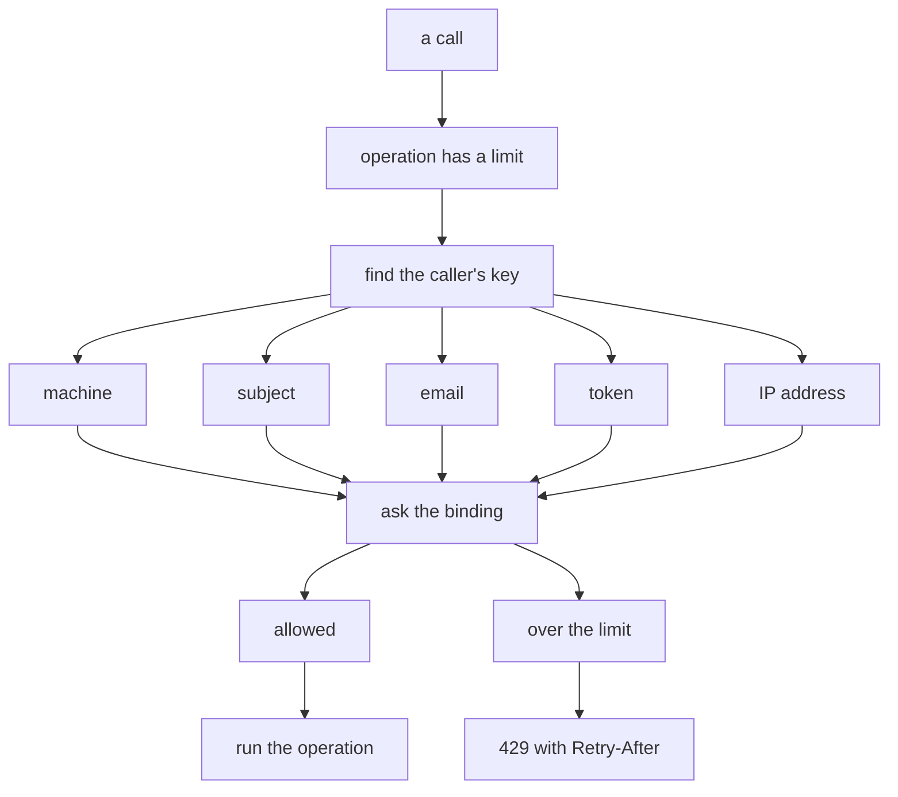
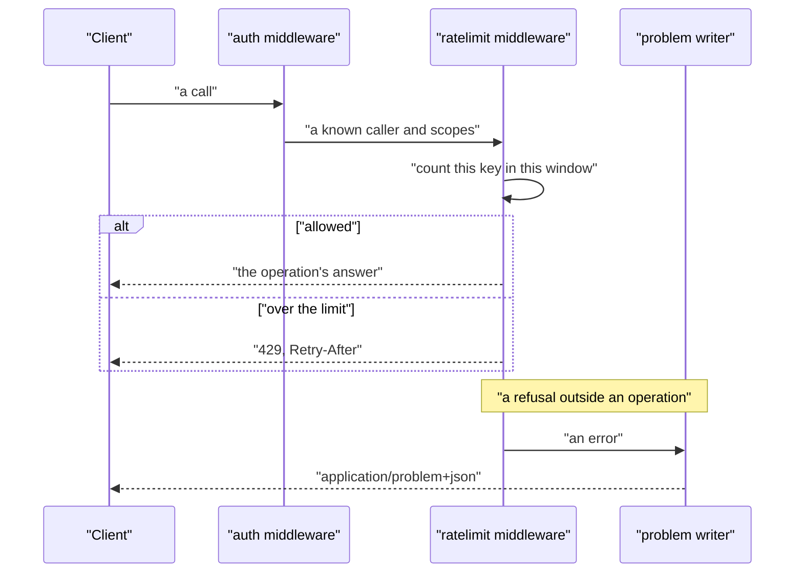

# 07 -- ratelimit-problem: counting calls and one answer shape

`ratelimit` answers one question — how often may a caller call each operation — beside `auth`, and in the same way: the contract declares each limit, and one middleware enforces it, so the specifications, the software development kits (SDKs), and the server agree. `problem` writes every refusal outside an operation as Request for Comments (RFC) 9457 problem details, so the whole API answers errors in one shape.

```go
// Source: ratelimit/ratelimit.go, lines 1-17
// Package ratelimit is how often a caller may call a Huma API's operations, beside auth: the
// contract declares each limit, and one middleware enforces it, so the specs, the SDKs and the
// server agree.
//
// A limit is a Cloudflare Workers Rate Limiting binding (the Worker's config names it, with the
// same limit and period: charter.toml binds them from the spec), counted per caller: the
// key is who auth let in ([auth.CallerOf]: the service token, the subject, the email or the
// token's secret), or the client's IP (CF-Connecting-IP) for an operation that is public. An
// operation has a limit of its own ([On], in its Extensions), or the limit of a scope it needs
// ([Declare]). Over it: 429, with Retry-After the binding's period, and the specs say so.
//
// The binding is a fixed window per key, local to each Cloudflare location and eventually
// consistent: good for stopping abuse, not for accounting
// (https://developers.cloudflare.com/workers/runtime-apis/bindings/rate-limit/). A Worker without
// the binding lets every call through and logs it. Built for the host (go run, go test), the
// counting is in memory, the same fixed window.
package ratelimit
```

A limit is one Cloudflare Workers Rate Limiting binding: at most some number of calls per caller in each period. The binding is a fixed window per key, local to each Cloudflare location and eventually consistent — good for stopping abuse, not for accounting. One limit is one small struct, and `Limited` attaches it to an operation's extensions.

```go
// Source: ratelimit/ratelimit.go, lines 39-55
// Limit is one Rate Limiting binding: at most Limit calls per caller in each Period.
type Limit struct {
	Binding string `json:"binding"`         // the Worker's binding that counts, e.g. WRITE_LIMIT
	Limit   int    `json:"limit"`           // calls per caller in a period
	Period  int    `json:"period"`          // seconds: 10 or 60, all the binding takes
	Scope   string `json:"scope,omitempty"` // Declare: every operation that needs this scope
}

// Limited is an operation's own limit, for its Extensions (with Fern's, if it has them):
// charter-lib/ratelimit's limited, in TypeScript.
func Limited(limit Limit, extensions map[string]any) map[string]any {
	out := map[string]any{extension: limit}
	for key, value := range extensions {
		out[key] = value
	}
	return out
}
```

An operation has a limit of its own, or the limit of a scope it needs. `Declare` makes the specifications say each limited operation's limit and its 429 answer, by adding an `OnAddOperation` hook that Huma runs as it builds the document.

```go
// Source: ratelimit/ratelimit.go, lines 57-86
// Declare has the specs say each limited operation's limit and its 429 (config.OpenAPI): those
// with their own (On), and every other operation that needs the scope of one of perScope.
func Declare(spec *huma.OpenAPI, perScope ...Limit) {
	spec.OnAddOperation = append(spec.OnAddOperation, func(spec *huma.OpenAPI, op *huma.Operation) {
		limit, ok := limitOf(op)
		if !ok {
			security := op.Security
			if security == nil {
				security = spec.Security
			}
			for _, l := range perScope {
				if needs(security, l.Scope) {
					limit, ok = l, true
					break
				}
			}
		}
		if !ok {
			return
		}
		if op.Extensions == nil {
			op.Extensions = map[string]any{}
		}
		op.Extensions[extension] = limit
		if op.Responses == nil {
			op.Responses = map[string]*huma.Response{}
		}
		op.Responses[strconv.Itoa(http.StatusTooManyRequests)] = tooMany(spec, limit)
	})
}
```

The middleware runs after the authentication middleware, because it counts per caller. When the limit is over, it writes a 429 with a `Retry-After` header. When the binding fails, it fails open: a missing or failing binding never takes the API down, but it logs once.

```go
// Source: ratelimit/ratelimit.go, lines 139-165
func Middleware(api huma.API, limiter Limiter) func(huma.Context, func(huma.Context)) {
	if limiter == nil {
		limiter = allow
	}
	var warned sync.Map
	return func(ctx huma.Context, next func(huma.Context)) {
		limit, ok := limitOf(ctx.Operation())
		if !ok {
			next(ctx)
			return
		}
		allowed, err := limiter(ctx.Context(), limit, callerKey(ctx))
		if err != nil {
			// Fail open: a missing or failing binding never takes the API down.
			if _, seen := warned.LoadOrStore(limit.Binding+err.Error(), true); !seen {
				log.Printf("ratelimit: %s: %v; calls are not limited", limit.Binding, err)
			}
			allowed = true
		}
		if !allowed {
			ctx.SetHeader("Retry-After", strconv.Itoa(limit.Period))
			huma.WriteErr(api, ctx, http.StatusTooManyRequests, fmt.Sprintf("too many calls: at most %d in %d s; retry after %d s", limit.Limit, limit.Period, limit.Period))
			return
		}
		next(ctx)
	}
}
```

The key that a call counts against is the most specific thing that names the caller: the machine, the subject, the email, or the token — or, for a public operation, the client's Internet Protocol (IP) address, which Cloudflare puts in `CF-Connecting-IP`.



`problem` is the last piece of the shape. Every refusal outside an operation — an unknown path, a method the path lacks, the discovery documents — is written as one `application/problem+json` answer with a title, a status, and a detail.

```go
// Source: problem/problem.go, lines 17-22
// Write answers w with status and what went wrong.
func Write(w http.ResponseWriter, status int, detail string) {
	w.Header().Set("Content-Type", mediaType)
	w.WriteHeader(status)
	json.NewEncoder(w).Encode(&huma.ErrorModel{Title: http.StatusText(status), Status: status, Detail: detail})
}
```



## The Aha Moment

**Aha:** The rate limit and the problem details are two sides of the same promise: the server and the generated SDK agree. `Declare` writes the 429 and its `Retry-After` into the specifications from the same declaration the middleware enforces, so a client is told up front how often it may call and how to wait. And `problem` collapses every refusal outside an operation into one shape, so a client that can read a 401 from the authentication middleware can read a 429 from this one — there is exactly one error shape to parse.

## Cross-References

- [04-auth.md](04-auth.md) — the middleware this one runs after, and which names the caller.
- [03-serve.md](03-serve.md) — the standard handler that installs both middlewares and writes problem details.
- [06-mcp.md](06-mcp.md) — how a refusal becomes the MCP answer's own status.

Continue to [08-streaming.md](08-streaming.md)
