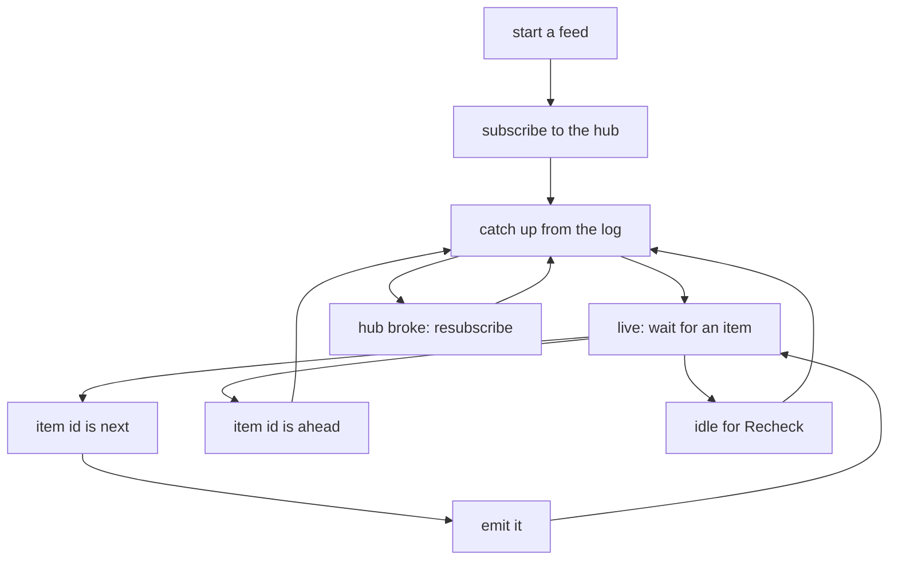
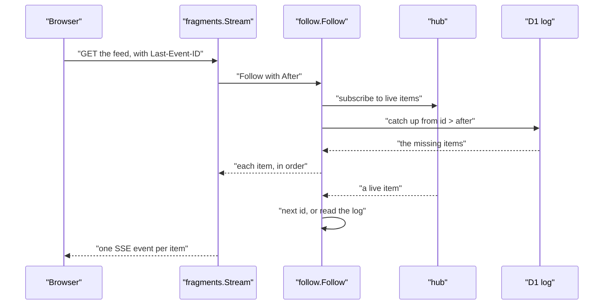

# 08 -- streaming: a live, ordered, gap-free feed

Streaming is one rule set out in `follow`, with three thin pieces around it: `hub` is the live signal, `fragments` is a Server-Sent Events (SSE) adapter for browsers, and `asyncapi` declares the WebSocket channels in a document. The core idea is that the log (the D1 database) is the source of truth, and the live source (a Durable Object) is only a wake-up signal that may drop, restart, or deliver out of order.

```go
// Source: follow/follow.go, lines 1-17
// Package follow is the one way a client receives a live, ordered, gap-free feed
// (docs/self/streaming.md, rule 3): the Go port of ts/src/follow.ts, with the same tests. Both transports
// (SSE and the WebSocket) are thin adapters over Follow.
//
// The log (D1) is the source of truth and the item id is the only position. The live source (the hub
// Durable Object) is only a wake-up signal and may drop, restart, or deliver out of order:
//   - subscribe first, then catch up from the log (id > after), then go live;
//   - a live item is emitted directly only when it is the next id; otherwise the log is read, which
//     fills gaps and restores order (a single SQLite writer makes a visible id imply all lower ones);
//   - on a hub error, resubscribe and catch up from the last id emitted;
//   - when idle for Recheck, catch up from the log anyway, so a hub that closes silently costs at
//     most that much delay, never a lost item.
//
// Follow returns an error only after MaxFailures consecutive failed subscribes, when the log fails,
// or when emit does, so the adapter can end the stream explicitly (rule 5); a cancelled context ends
// it quietly.
package follow
```

The item identifier (ID) is the only position. `Follow` subscribes first, then catches up from the log, then goes live. A live item is emitted directly only when it is the next ID; otherwise the log is read, which fills gaps and restores order. The catch-up read is one small loop over pages of the log.

```go
// Source: follow/follow.go, lines 85-103
	catchUp := func() error {
		for {
			page, err := src.Since(ctx, last, opt.PageSize)
			if err != nil {
				return err
			}
			for _, item := range page {
				if item.Position() > last {
					last = item.Position()
					if err := emit(item); err != nil {
						return err
					}
				}
			}
			if len(page) < opt.PageSize {
				return nil
			}
		}
	}
```

The live loop is where the rule is enforced. An item whose ID is the next one is emitted directly. An item whose ID is greater than the next one means a gap or out-of-order delivery — the log decides, and the loop reads it. When nothing has arrived for `Recheck` (30 seconds by default), the loop reads the log anyway, so a hub that closes silently costs at most that much delay and never a lost item.

```go
// Source: follow/follow.go, lines 128-152
				if ok {
					switch id := item.Position(); {
					case id == last+1:
						last = id
						if err := emit(item); err != nil {
							return nil, err
						}
					case id > last: // a gap or out of order: the log decides
						if err := catchUp(); err != nil {
							return nil, err
						}
					}
					continue
				}
				idle := time.NewTimer(opt.Recheck)
				select {
				case <-live.wake:
					idle.Stop()
				case <-ctx.Done():
					idle.Stop()
				case <-idle.C: // idle: covers a hub that closed silently
					if err := catchUp(); err != nil {
						return nil, err
					}
				}
```

`hub` is the live signal. Publish an item, and every subscriber gets it. It is deliberately thin: one hub carries one type of item, and a second feed is a second hub with its own name. On Cloudflare it is a Durable Object; natively and in tests it is memory.

```go
// Source: hub/hub.go, lines 1-24
// Package hub is the live signal of a feed: publish an item, and every subscriber gets it.
//
// It is only a wake-up signal. The log (D1) is the source of truth, and follow.Follow fills any
// gap from it, so a hub may drop, restart or deliver out of order (docs/self/streaming.md, rule 2).
//
// One hub carries one type of item. A second feed is a second hub, with its own name:
//
//	notes, err := hub.DurableObject[Note]("HUB", "notes")       // on Cloudflare (hub_js.go)
//	devices, err := hub.DurableObject[Device]("HUB", "devices") // the same class, another object
//	var local hub.Memory[Device]                                // natively and in tests
package hub

import (
	"context"
	"sync"
)

// Hub is the live fan-out of items of one type.
type Hub[T any] interface {
	Publish(ctx context.Context, item T) error
	// Subscribe calls listener for every published item and onError when the subscription breaks;
	// neither may block. It returns unsubscribe.
	Subscribe(listener func(T), onError func(error)) (unsubscribe func(), err error)
}
```

`fragments` is the SSE adapter. It serves the feed to a browser, each item rendered by the caller — an HTML fragment for htmx, a `datastar-patch-elements` event for Datastar. Every event's ID is its item's position, which the browser sends back as `Last-Event-ID` when it connects again, so a reconnect loses nothing.

```go
// Source: fragments/fragments.go, lines 46-71
func (s Stream[T]) ServeHTTP(w http.ResponseWriter, r *http.Request) {
	lifetime := s.For
	if lifetime <= 0 {
		lifetime = streamLife
	}
	w.Header().Set("Content-Type", "text/event-stream")
	w.Header().Set("Cache-Control", "no-cache")
	out := transport.Flushing(w)
	// A comment first: the response starts now, not at the first item.
	if _, err := io.WriteString(out, ": \n\n"); err != nil {
		return
	}
	ctx, cancel := context.WithTimeout(r.Context(), lifetime)
	defer cancel()
	err := follow.Follow(ctx, s.Feed, s.Options, func(item T) error {
		event, err := s.Event(ctx, item)
		if err != nil {
			return err
		}
		_, err = fmt.Fprintf(out, "id: %d\n%s\n\n", item.Position(), event)
		return err
	})
	if err != nil {
		log.Printf("fragments: stream ended: %v", err)
	}
}
```



`asyncapi` declares the channels in an AsyncAPI 3.0.0 document, the way Huma generates OpenAPI. An operation marked with `Channel` becomes a channel whose query parameters are its `bindings.ws.query` and whose payload is a `receive` operation. An operation marked with `SendOperation` becomes a message the client sends on a channel, as a `send` operation.

```go
// Source: asyncapi/asyncapi.go, lines 94-156
func Generate(ops []*huma.Operation, registry huma.Registry, info Info, server string) (map[string]any, error) {
	scheme, host, ok := strings.Cut(server, "://")
	if !ok || host == "" {
		return nil, fmt.Errorf("asyncapi: server %q is not a URL", server)
	}
	protocol := "wss"
	if scheme == "http" {
		protocol = "ws"
	}
	channels, operations, messages := map[string]any{}, map[string]any{}, map[string]any{}
	used := map[string]bool{}
	for _, op := range ops {
		channel, ok := op.Metadata[metadataKey].(Channel)
		if !ok {
			continue
		}
		if channel.Name == "" || channel.Payload == nil {
			return nil, fmt.Errorf("asyncapi: %s %s: a channel needs a Name and a Payload", op.Method, op.Path)
		}
		payload := registry.Schema(reflect.TypeOf(channel.Payload), true, channel.Name+"Message")
		message := channel.Message
		if message == "" {
			message = strings.TrimPrefix(payload.Ref, "#/components/schemas/")
		}
		if message == "" {
			message = channel.Name
		}
		collect(registry, payload, used)
		messages[message] = map[string]any{"name": message, "payload": payload}

		entry := map[string]any{
			"address":  op.Path,
			"messages": map[string]any{message: map[string]any{"$ref": "#/components/messages/" + message}},
		}
		if op.Summary != "" {
			entry["summary"] = op.Summary
		}
		if op.Description != "" {
			entry["description"] = op.Description
		}
		if query := queryObject(op); query != nil {
			for _, param := range op.Parameters {
				if param.In == "query" {
					collect(registry, param.Schema, used)
				}
			}
			entry["bindings"] = map[string]any{"ws": map[string]any{"query": query}}
		}
		for key, value := range channel.Extensions {
			entry[key] = value
		}
		channels[channel.Name] = entry

		operationID := channel.OperationID
		if operationID == "" {
			operationID = "receive" + strings.ToUpper(channel.Name[:1]) + channel.Name[1:]
		}
		operations[operationID] = map[string]any{
			"action":   "receive",
			"channel":  map[string]any{"$ref": "#/channels/" + channel.Name},
			"messages": []any{map[string]any{"$ref": "#/channels/" + channel.Name + "/messages/" + message}},
		}
	}
```



## The Aha Moment

**Aha:** The whole streaming design is one reversal: the live signal is allowed to be wrong, and the log is the only thing trusted. The hub may drop, restart, or deliver out of order, because the item ID is the only position and any gap sends the reader back to the log. That is why a feed can be gap-free across reconnects and deploys — the disposable Durable Object only wakes the reader up, and the durable D1 database supplies every item that is actually missing.

## Cross-References

- [01-architecture.md](01-architecture.md) — where the streaming pieces sit in the stack.
- [10-d1-promise-web.md](10-d1-promise-web.md) — the D1 log that is the source of truth.
- [09-transport.md](09-transport.md) — the WebSocket and streaming transport beneath this.

Continue to [09-transport.md](09-transport.md)
