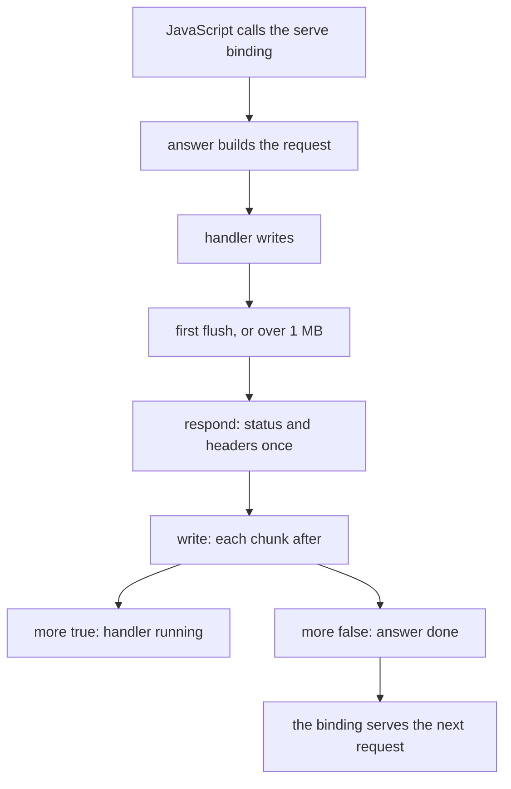
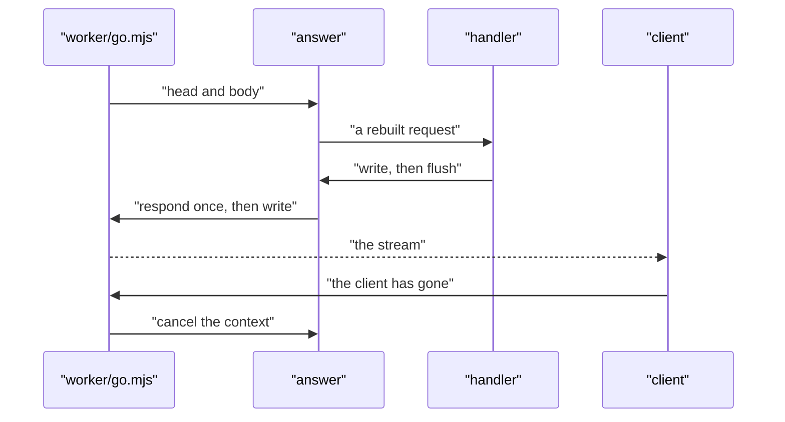

# 09 -- transport: Go on Cloudflare Workers, and WebSockets

`transport` is what a platform puts around the API's handler so that Go can serve WebSockets. workers-go cannot answer an upgrade, and Go's `net/http` needs a WebSocket library. In both places Go answers the upgrade request with plain Hypertext Transfer Protocol (HTTP), and an adapter carries it over the socket: `worker/websocket.mjs` on Cloudflare, and `Serve` natively. What the contract says about a channel stays in the Go handler.

```go
// Source: transport/transport.go, lines 1-24
// Package transport is what a platform puts around the API's handler so that Go can serve
// WebSockets: workers-go can't answer an upgrade, and net/http needs a WebSocket library. In both
// places Go answers the upgrade request with plain HTTP, and an adapter carries it over the socket:
// worker/websocket.mjs on Cloudflare, Serve natively. Which paths are WebSockets, their input and
// what they send stay in the Go handler (and so in the contract).
//
// What Go answers a WebSocket upgrade (a GET with `Upgrade: websocket`) with:
//
//   - Anything but 2xx: a refusal (401, 422, 426). It is returned as it is, and no socket opens.
//   - 200 with a body: the feed, a stream of lines. Each line is sent as one text frame (empty lines
//     are padding). The feed only ends when it gave up, so the socket is then closed with 1011.
//   - 204: there is no feed. The socket stays open until the client closes it.
//   - The header MessagesHeader set to MessagesPost: the channel takes messages. Each text frame
//     the client sends is given to Go as a POST to the same URL, with the upgrade request's headers
//     (so Go authorizes every message as it did the upgrade), MessageHeader, and the frame as the
//     JSON body. The
//     answer is lines again, each sent as one frame. Messages are handled one at a time, in order.
//     Anything but 2xx closes the socket with 1008. Without the header, what the client sends is
//     ignored.
//
// The limit: on Cloudflare the feed and each message run in Go runtimes of their own (a runtime
// serves one request at a time), so a message can't change what the feed sends through memory. What must
// be shared goes through a binding, a Durable Object or a database, as the notes hub does.
package transport
```

The three header names are the protocol between the Go handler and the adapter. `MessagesHeader` on the answer says how the channel takes what the client sends; `MessagesPost` turns every text frame into a POST; `MessageHeader` marks that POST as a frame.

```go
// Source: transport/transport.go, lines 51-60
// MessagesHeader, on the answer to an upgrade, says how the channel takes what the client sends.
const MessagesHeader = "X-Websocket-Messages"

// MessagesPost: every text frame from the client becomes a POST to the upgrade's URL.
const MessagesPost = "post"

// MessageHeader is set on that POST: it is a frame from the socket. Any other request to a channel's
// address is the channel's (charter/serve), as in charter-lib.
const MessageHeader = "X-Websocket-Message"
```

On Cloudflare, `Run` keeps the Go runtime alive after a response so that `worker/go.mjs` can give it the next request — workers-go's own `Serve` returns when the first response body closes. The runtime is warmed up with the paths it is given, so a new isolate's first request does not pay the cost of registering every operation.

```go
// Source: transport/transport_js.go, lines 44-63
func Run(h http.Handler) {
	if paths := binding.Get("warm"); paths.Type() == js.TypeObject {
		for i := 0; i < paths.Length(); i++ {
			if request, err := http.NewRequest(http.MethodGet, "https://warm.invalid"+paths.Index(i).String(), nil); err == nil {
				h.ServeHTTP(&discard{header: http.Header{}}, request)
			}
		}
	}
	var stats runtime.MemStats
	runtime.ReadMemStats(&stats)
	allocated = stats.TotalAlloc // start-up is not a request's allocation
	handler := Serve(h)
	binding.Set("serve", js.FuncOf(func(_ js.Value, args []js.Value) any {
		answer(handler, args[0].String(), args[1])
		return nil
	}))
	workers.ServeNonBlock(handler)
	workers.Ready()
	select {}
}
```

Every value that crosses between JavaScript and Go costs central processing unit (CPU) time, so `worker/go.mjs` gives each request as a compact pair: the head (method, Uniform Resource Locator (URL), and headers, one per line) and the body (a byte array). `answer` rebuilds the request, runs the handler, and sends the answer back through two binding functions.

```go
// Source: transport/transport_js.go, lines 87-106
func answer(h http.Handler, head string, body js.Value) {
	lines := strings.Split(head, "\n")
	w := &response{header: http.Header{}}
	r, err := http.NewRequest(lines[0], lines[1], http.NoBody)
	if err != nil {
		http.Error(w, err.Error(), http.StatusBadRequest)
		w.send(false)
		return
	}
	for i := 2; i+1 < len(lines); i += 2 {
		r.Header.Add(lines[i], lines[i+1])
	}
	r.RemoteAddr = r.Header.Get("Cf-Connecting-Ip")
	r = withCF(r)
	if !body.IsNull() {
		r.Body, r.ContentLength = &requestBody{js: body}, int64(body.Length())
	}
	h.ServeHTTP(w, r)
	w.send(false)
}
```

An answer becomes a stream at the handler's first flush, or when one megabyte (MB) is waiting. `send` gives JavaScript what was written since the last send; `respond` sends the status and headers once, and `write` sends the stream after that. The `more` flag says whether the handler is still running, so after the last send the binding's functions belong to the next request.



`CF` is what Cloudflare knows of where a request came from — its `request.cf` — carried from `worker/go.mjs` to the handler as one header. `withCF` moves that header's JavaScript Object Notation (JSON) out of the request and into its context, reading each field on its own so a field Cloudflare changes costs that field only, never the rest.

```go
// Source: transport/cf.go, lines 69-87
func withCF(r *http.Request) *http.Request {
	raw := r.Header.Get(cfHeader)
	r.Header.Del(cfHeader)
	var fields map[string]json.RawMessage
	if raw == "" || json.Unmarshal([]byte(raw), &fields) != nil {
		return r
	}
	cf := CF{
		Country: text(fields["country"]), Region: text(fields["region"]), RegionCode: text(fields["regionCode"]),
		City: text(fields["city"]), PostalCode: text(fields["postalCode"]), Continent: text(fields["continent"]),
		Timezone: text(fields["timezone"]), Latitude: text(fields["latitude"]), Longitude: text(fields["longitude"]),
		Colo: text(fields["colo"]),
	}
	cf.ASN, _ = strconv.Atoi(text(fields["asn"]))
	if eu := text(fields["isEUCountry"]); eu == "1" || eu == "true" {
		cf.IsEUCountry = "1"
	}
	return r.WithContext(context.WithValue(r.Context(), cfKey{}, cfValue{cf, json.RawMessage(raw)}))
}
```



## The Aha Moment

**Aha:** The transport makes Go treat a WebSocket as ordinary HTTP and lets the adapter do the socket work, so the contract — which paths are channels, their input, and what they send — stays in the Go handler and in the generated documents. On Cloudflare it also cuts the cost of the JavaScript-to-Go boundary to one compact hand-off per request, and it reuses a Go runtime only while its heap has room, because a garbage collection in a full heap costs more than a new runtime does.

## Cross-References

- [03-serve.md](03-serve.md) — how the handler answers a channel's upgrade and its messages.
- [08-streaming.md](08-streaming.md) — the feed the transport carries over a socket.
- [10-d1-promise-web.md](10-d1-promise-web.md) — the database a message writes through a binding.

Continue to [10-d1-promise-web.md](10-d1-promise-web.md)
