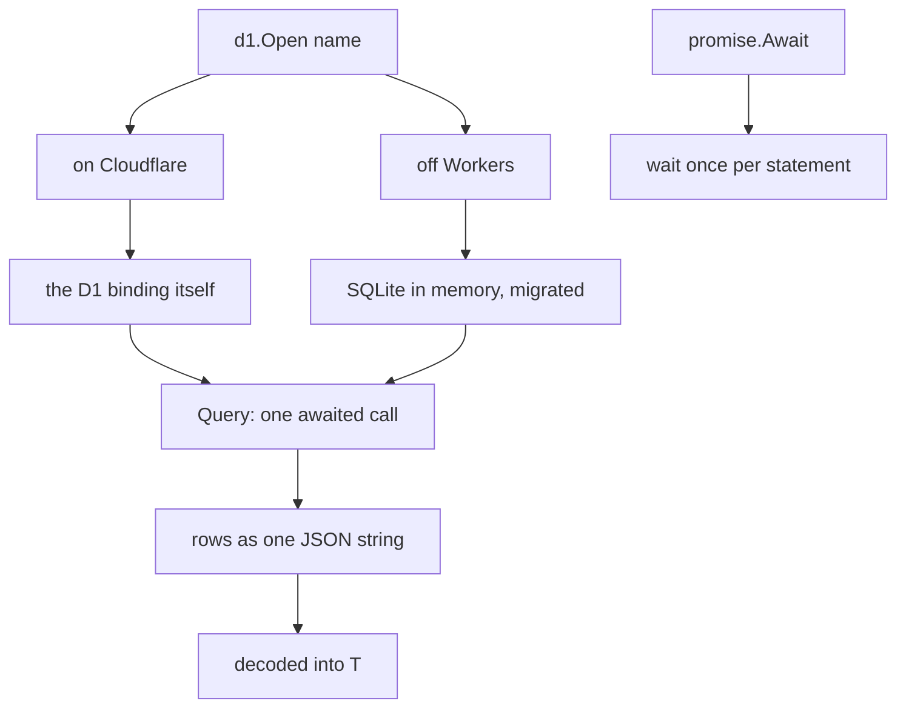
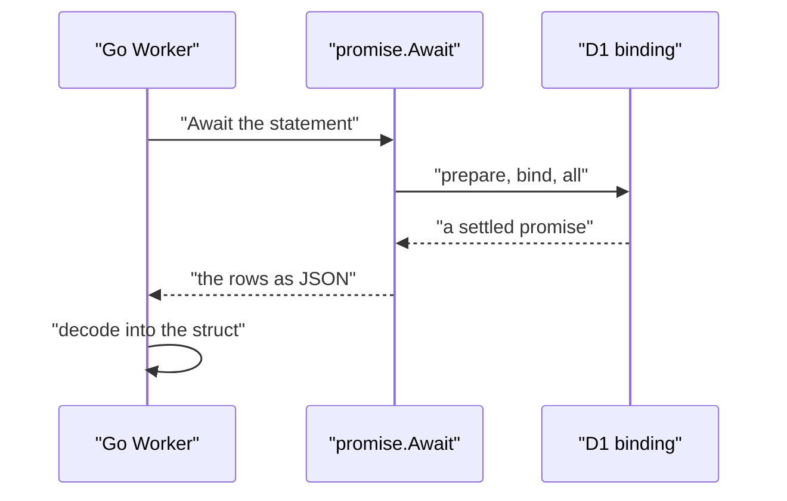

# 10 -- d1-promise-web: the database, the promise wait, and page helpers

`d1` runs Structured Query Language (SQL) statements on a Cloudflare D1 database from a Go Worker. Off Workers, the same calls run on SQLite in memory. `promise` is the one place the Go Worker's own packages wait for a JavaScript promise. `web` and `bindings` are small helpers for pages and bindings. Together they are the platform's data and page layer.

```go
// Source: d1/d1.go, lines 1-16
// Package d1 runs statements on a Cloudflare D1 database from a Go Worker.
//
// A value that crosses between Go and JavaScript costs CPU, and so does every promise Go waits
// for. database/sql over workers-go's driver reads a result value by value, and starts a goroutine
// for every database opened. Here a statement is one awaited call, and its rows come over as one
// string of JSON, whatever their number:
//
//	db, err := d1.Open("DB") // per request: a binding belongs to the request's environment
//	notes, err := d1.Query[Note](db, "SELECT id, body FROM notes WHERE id < ? LIMIT ?", before, limit)
//
// Off Workers (go test, an ordinary Go server) the same calls run on SQLite in memory, one database per binding, with
// the migrations charter.toml's [[d1]] names applied when it is opened: the app's own SQL, tested as it runs.
//
// charter spec writes a project's queries (api/queries.sql) as functions over these, typed by sqlc
// (charter.toml: db = "sqlc").
package d1
```

The economics are the point. A value that crosses between Go and JavaScript costs central processing unit (CPU) time, and so does every promise Go waits for. `database/sql` over workers-go's driver reads a result value by value and starts a goroutine for every database opened. Here a statement is one awaited call, and its rows come over as one string of JavaScript Object Notation (JSON).

```go
// Source: d1/d1_js.go, lines 29-45
// Query runs one statement and returns its rows: those of a SELECT or of a RETURNING clause, and
// none for any other statement. A row is decoded from JSON, an object with the column names as its
// keys, so T is a struct whose json tags name the columns. An INTEGER or a REAL is a number, TEXT
// a string, NULL null, and a BLOB an array of numbers.
//
// The arguments are bound to the statement's ? in order: strings, numbers, bools and nil.
func Query[T any](db DB, query string, args ...any) ([]T, error) {
	result, err := promise.Await(db.binding.Call("prepare", query).Call("bind", args...).Call("all"))
	if err != nil {
		return nil, fmt.Errorf("d1: %w", err)
	}
	rows := []T{}
	if err := json.Unmarshal([]byte(stringify.Invoke(result.Get("results")).String()), &rows); err != nil {
		return nil, fmt.Errorf("d1: a row is not a %T: %w", *new(T), err)
	}
	return rows, nil
}
```

Off Workers, the same `Open` stands in for the D1 binding: SQLite in memory, one database per binding, migrated with the `*.sql` files the binding names. The application's own SQL is then tested exactly as it runs on Cloudflare.

```go
// Source: d1/d1_other.go, lines 29-66
func Open(name string) (DB, error) {
	open.mu.Lock()
	defer open.mu.Unlock()
	if db, ok := open.dbs[name]; ok {
		return DB{db}, nil
	}
	p, err := project.Load(".")
	if err != nil {
		return DB{}, fmt.Errorf("d1: %s: %w", name, err)
	}
	i := slices.IndexFunc(p.D1, func(d project.D1) bool { return d.Binding == name })
	if i < 0 {
		return DB{}, fmt.Errorf("d1: charter.toml has no [[d1]] binding %s", name)
	}
	db, err := sql.Open("sqlite", "file:charter-d1-"+name+"?mode=memory&cache=shared")
	if err != nil {
		return DB{}, err
	}
	db.SetMaxOpenConns(1) // one connection: the database lives as long as it does
	if dir := p.D1[i].Migrations; dir != "" {
		files, err := filepath.Glob(filepath.Join(p.Root, dir, "*.sql"))
		if err != nil {
			return DB{}, err
		}
		slices.Sort(files)
		for _, f := range files {
			b, err := os.ReadFile(f)
			if err != nil {
				return DB{}, err
			}
			if _, err := db.Exec(string(b)); err != nil {
				return DB{}, fmt.Errorf("d1: %s: migration %s: %w", name, filepath.Base(f), err)
			}
		}
	}
	open.dbs[name] = db
	return DB{db}, nil
}
```

`promise` is the one place the Worker's own packages wait for a JavaScript promise. Under TinyGo every call from JavaScript into Go starts a goroutine, and a settled promise is such a call — so it awaits once per piece of work: one statement, one publish.

```go
// Source: internal/promise/promise_js.go, lines 16-43
func Await(promise js.Value) (js.Value, error) {
	type result struct {
		value js.Value
		err   error
	}
	done := make(chan result, 1)
	then := js.FuncOf(func(_ js.Value, args []js.Value) any {
		value := js.Undefined()
		if len(args) > 0 {
			value = args[0]
		}
		done <- result{value: value}
		return nil
	})
	catch := js.FuncOf(func(_ js.Value, args []js.Value) any {
		message := "rejected"
		if len(args) > 0 {
			message = js.Global().Call("String", args[0]).String()
		}
		done <- result{err: errors.New(message)}
		return nil
	})
	defer then.Release()
	defer catch.Release()
	promise.Call("then", then, catch)
	r := <-done
	return r.value, r.err
}
```

`web` holds `net/http` helpers for a Go Worker's pages that work the same under TinyGo and standard Go. `Origin` finds the scheme and host a request was made to, for absolute Uniform Resource Locators (URLs) without configuring one: on Workers the request URL is absolute, and under standard Go the scheme comes from Transport Layer Security (TLS) and `X-Forwarded-Proto`.

```go
// Source: web/web.go, lines 72-87
func Origin(r *http.Request) string {
	scheme, host := r.URL.Scheme, r.URL.Host
	if host == "" {
		host = r.Host
	}
	if scheme == "" {
		scheme = "http"
		if r.TLS != nil || strings.EqualFold(r.Header.Get("X-Forwarded-Proto"), "https") {
			scheme = "https"
		}
	}
	return scheme + "://" + host
}
```

`bindings` is the front door to every Cloudflare binding an application uses, each with what stands in for it off Workers. `ClientKey` is a request's caller for a per-client limit: the client's Internet Protocol (IP) address, which Cloudflare puts in `CF-Connecting-IP`, or `"local"` without one.

```go
// Source: bindings/bindings.go, lines 22-29
// ClientKey is a request's caller for a per-client limit: the client's IP, which Cloudflare puts in CF-Connecting-IP,
// or "local" without one (local workerd, go test).
func ClientKey(r *http.Request) string {
	if ip := r.Header.Get("CF-Connecting-IP"); ip != "" {
		return ip
	}
	return "local"
}
```





## The Aha Moment

**Aha:** The data layer is one interface with two implementations that share the same calls and the same row shape. On Cloudflare a statement is one awaited call whose rows cross as one JSON string; off Workers the same call runs on SQLite in memory, migrated with the application's own SQL. Because the two agree on how a row is decoded, an application can run its real queries in a test with no driver to swap — and `promise` makes sure the JavaScript wait happens once per piece of work, not once per value.

## Cross-References

- [08-streaming.md](08-streaming.md) — the D1 log that is the source of truth for a feed.
- [09-transport.md](09-transport.md) — the binding and request boundary this sits on.
- [11-project-configuration.md](11-project-configuration.md) — the `charter.toml` that names these bindings and migrations.

Continue to [11-project-configuration.md](11-project-configuration.md)
