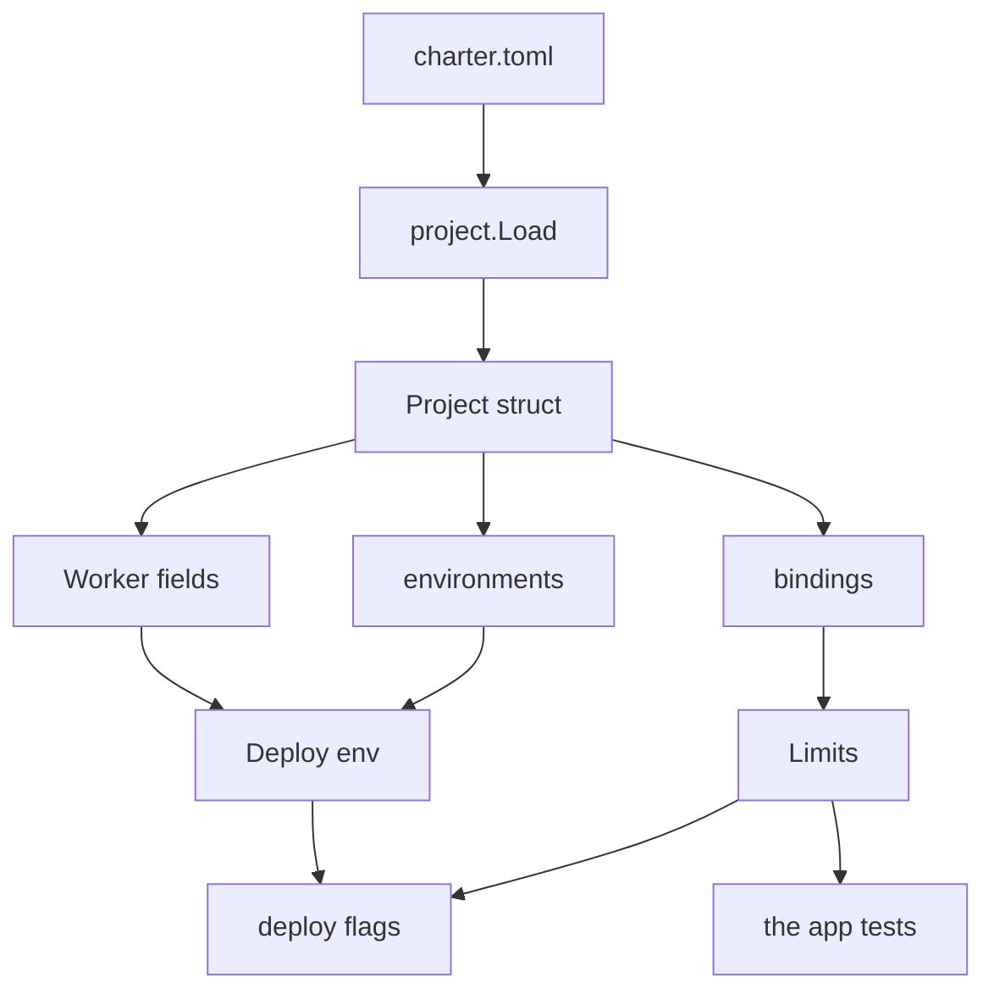
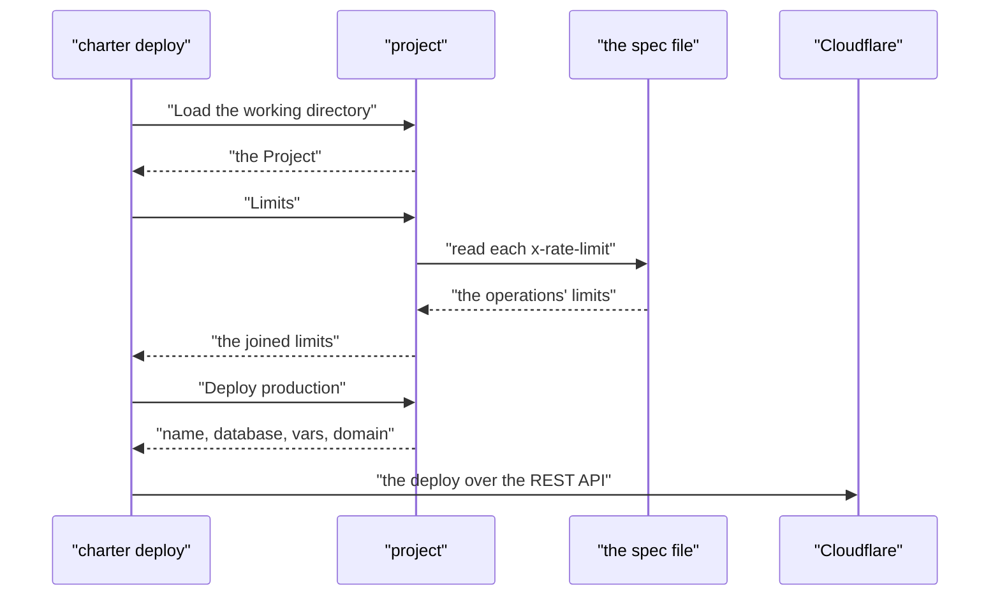

# 11 -- project-configuration: charter.toml, one file that names a Worker

`charter.toml` is the one file at an application's root that says everything about a Go Worker on Cloudflare: its name, compatibility date and modules, its Static Assets, its bindings (D1 databases, Durable Objects, rate limits), and what each environment gets. charter reads it to run the Worker locally and to deploy it. An application's tests also read it, so a fact kept anywhere else — a limit a test counts to — can be checked against it.

```go
// Source: project/project.go, lines 100-132
// Project is charter.toml.
type Project struct {
	Name               string          `toml:"name"`
	CompatibilityDate  string          `toml:"compatibility_date"`
	CompatibilityFlags []string        `toml:"compatibility_flags"`
	Main               string          `toml:"main"`
	Modules            []string        `toml:"modules"`
	Assets             string          `toml:"assets"`
	Health             string          `toml:"health"`
	Port               int             `toml:"port"`
	Repo               string          `toml:"repo"`
	Subdomain          string          `toml:"subdomain"`
	D1                 []D1            `toml:"d1"`
	DurableObjects     []DurableObject `toml:"durable_objects"`
	RateLimits         []RateLimit     `toml:"rate_limits"`
	Spec               string          `toml:"spec"`
	Secrets            Secrets         `toml:"secrets"`
	URL                string          `toml:"url"`
	SpecServer         string          `toml:"spec_server"`
	DB                 string          `toml:"db"`
	SDKs               SDKs            `toml:"sdks"`
	Go                 Go              `toml:"go"`
	Test               Test            `toml:"test"`
	Production         Environment     `toml:"production"`
	Staging            *Environment    `toml:"staging"`
	Preview            *Environment    `toml:"preview"`
	Local              Environment     `toml:"local"`
	Build              Build           `toml:"build"`
	CI                 CI              `toml:"ci"`
	GitHub             GitHub          `toml:"github"`

	Root string `toml:"-"` // the directory charter.toml is in
}
```

One struct mirrors the whole file. The top-level fields are the Worker's settings; `D1`, `DurableObjects` and `RateLimits` are slices because a Worker may bind many of each; the four `Environment` fields are the environments production, staging, preview and local. `Root` is not read from the file — it is the directory the file sits in, filled in by `Load`.

`Load` reads the file in a directory, or walks up to the nearest directory above it. A project without a `name` is not a Worker at all — it is only a repository's settings, so `Load` refuses it and says so.

```go
// Source: project/project.go, lines 366-394
// Load reads charter.toml in dir, or the nearest directory above it.
func Load(dir string) (*Project, error) {
	dir, err := filepath.Abs(dir)
	if err != nil {
		return nil, err
	}
	start := dir
	for {
		path := filepath.Join(dir, File)
		if _, err := os.Stat(path); err == nil {
			p, err := decode(dir)
			if err != nil {
				return nil, err
			}
			if p.Name == "" {
				return nil, fmt.Errorf("%s: name is required: it is a repo's, which names no Worker", path)
			}
			return p, nil
		}
		parent := filepath.Dir(dir)
		if parent == dir {
			if _, err := os.Stat(filepath.Join(start, "charter.config.ts")); err == nil {
				return nil, errors.New("no " + File + " here, but a charter.config.ts: charter-ts's, which charter.toml takes the place of. " + UpgradePage)
			}
			return nil, errors.New("no " + File + " at or above the working directory")
		}
		dir = parent
	}
}
```

The walk up matters because a step may run in a subfolder. When it reaches the top with nothing found, it gives one of two errors: a pointer to the older `charter-ts` tool if that tool's file is present, or a plain "no `charter.toml`". Every field is also decoded strictly — `decode` fails on keys the file does not know, and on a Worker's own checks such as a required `compatibility_date`.

A rate limit is the one value the file and the contract can both say, so `Limits` joins them and refuses to let them disagree. When the file names a spec, each operation's `x-rate-limit` is read out of it; a binding named in both places must be said only once, and said the same way.

```go
// Source: project/project.go, lines 235-272
func (p *Project) Limits() ([]RateLimit, error) {
	out := slices.Clone(p.RateLimits)
	if p.Spec == "" {
		return out, nil
	}
	b, err := os.ReadFile(filepath.Join(p.Root, p.Spec))
	if err != nil {
		return nil, fmt.Errorf("spec: %w (charter spec writes it)", err)
	}
	var spec struct {
		Paths map[string]map[string]json.RawMessage `json:"paths"`
	}
	if err := json.Unmarshal(b, &spec); err != nil {
		return nil, fmt.Errorf("%s: %w", p.Spec, err)
	}
	for _, path := range slices.Sorted(maps.Keys(spec.Paths)) {
		for _, method := range slices.Sorted(maps.Keys(spec.Paths[path])) {
			var op struct {
				Limit *RateLimit `json:"x-rate-limit"`
			}
			if json.Unmarshal(spec.Paths[path][method], &op) != nil || op.Limit == nil {
				continue
			}
			l := *op.Limit
			if i := slices.IndexFunc(out, func(r RateLimit) bool { return r.Binding == l.Binding }); i >= 0 {
				if i < len(p.RateLimits) {
					return nil, fmt.Errorf("rate limit %s: in [[rate_limits]] and in %s (%s %s): say it in one", l.Binding, p.Spec, method, path)
				}
				if out[i].Limit != l.Limit || out[i].Period != l.Period {
					return nil, fmt.Errorf("rate limit %s: %s declares it twice, differently", l.Binding, p.Spec)
				}
				continue
			}
			out = append(out, l)
		}
	}
	return out, nil
}
```

This is the code-is-the-grandfather rule in miniature. The deploy reads `Limits` to bind the rate limits; the local server reads the same call; the application's own tests read the same call. One place, one answer, so a limit cannot drift between what a test counts to and what Cloudflare enforces.

`Deploy` turns an environment name into a concrete deploy: which Worker name, which database names, which variables and domain. Production is the Worker's own name; staging appends `-staging`; a preview names a Worker Preview and shares the preview database. The `{preview}` placeholder in a variable is filled with the preview's name.

```go
// Source: project/project.go, lines 568-595
func (p *Project) Deploy(env, preview string) (Deploy, error) {
	var e *Environment
	d := Deploy{Worker: p.Name, Database: p.Name}
	switch env {
	case "production":
		e = &p.Production
		d.Domain = e.Domain
	case "staging":
		e = p.Staging
		d.Worker, d.Database = p.Name+"-staging", p.Name+"-staging"
	case "preview":
		if preview == "" {
			return Deploy{}, errors.New("a preview needs a name, e.g. pr-7")
		}
		e = p.Preview
		d.Preview, d.Database = preview, p.Name+"-preview"
	default:
		return Deploy{}, fmt.Errorf("%q: deploy to production, staging or preview <name>", env)
	}
	if e == nil {
		return Deploy{}, fmt.Errorf("%s has no [%s]", File, env)
	}
	d.Vars = map[string]string{}
	for k, v := range e.Vars {
		d.Vars[k] = strings.ReplaceAll(v, "{preview}", preview)
	}
	return d, nil
}
```





## The Aha Moment

**Aha:** One file is the single source of truth for everything that is not the contract, and the contract's spec is folded in where the two overlap. `Load` walks up to find the file, `decode` refuses a field it does not know, `Limits` refuses a limit said twice and differently, and `Deploy` turns a word like "staging" into exact names. Because every reader — the deploy, the local server, the application's tests — goes through the same functions, a fact cannot drift between what the machine does and what a test asserts.

## Cross-References

- [10-d1-promise-web.md](10-d1-promise-web.md) — the D1 and rate-limit bindings this file names.
- [13-build-deploy-local.md](13-build-deploy-local.md) — the build and deploy that read this file.
- [14-spec-sdks-fern.md](14-spec-sdks-fern.md) — the spec and SDK settings this file points to.

Continue to [12-cli.md](12-cli.md)
