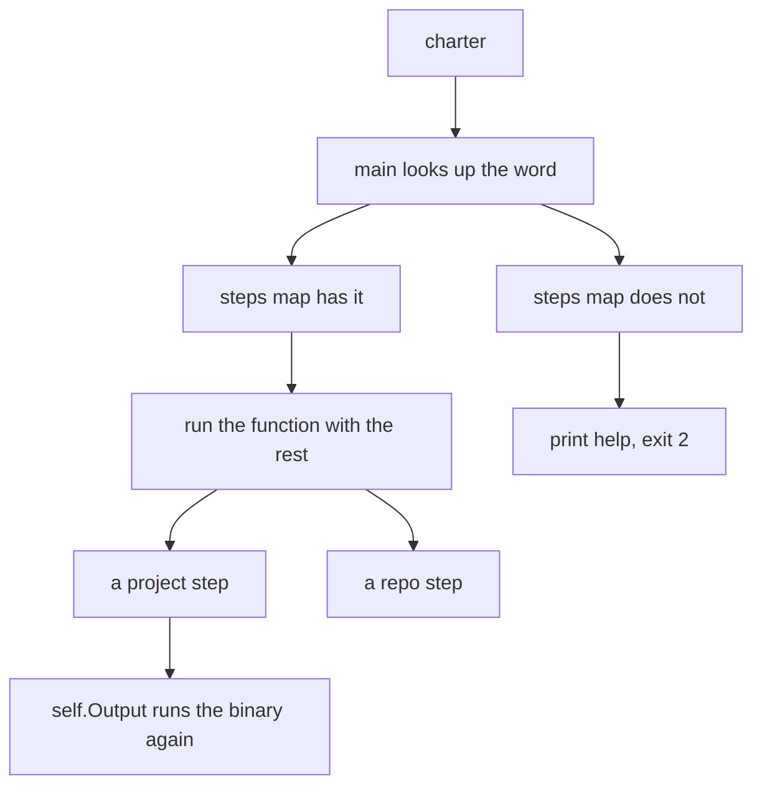
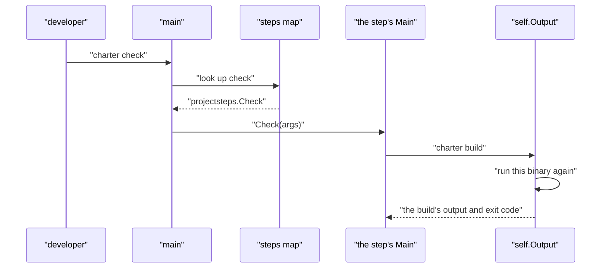

# 12 -- cli: the command dispatcher and the command registry

charter is one command for all of a Worker's steps on Cloudflare, and for how the repository that holds it is kept. There is no framework and no plugin system: a single map from a name to a function is the dispatcher, and a plain slice of structs is the registry that `charter help` prints. Everything a developer can do is a name in one of those two lists.

```go
// Source: cmd/charter/main.go, lines 1-16
// Command charter is a Worker's every step on Cloudflare, and how the repo that holds it is kept, one command for all
// of them (#100, #121). charter help lists every command; docs/charter/README.md says when each is run.
//
// A project's steps (a folder with a charter.toml naming a Worker):
//
//	charter build    the Worker into build/: a Go one with TinyGo (go doc .../internal/cli/build), a TypeScript one
//	                 bundled with esbuild ([build] entry)
//	charter dev      the Worker on local workerd (-native: the app run natively), until Ctrl-C
//	charter check    every check that needs no Cloudflare account (go doc .../internal/cli/projectsteps)
//	charter spec     the specs from its contract, Fern's settings, its database's code
//	charter sdk      its SDKs with Fern: one, every one proven (-prove), the Go SDK it commits (-publish)
//	charter deploy   to Cloudflare over its REST API: production, Worker Previews, the preview pipeline
//	charter live-test  the standard test and its live tests against the deployed Worker
//	charter local    write .charter/ from charter.toml: what runs the Worker on plain workerd
//	charter serve    run it locally, in the developer's time zone
//	charter with     run a command against it on a free port (BASE its URL), then stop it
```

The package comment doubles as the help text's source of truth. Notice the split in the list: a project's steps (build, dev, check, spec, sdk, deploy, live-test, local, serve, with) live beside the repository's steps (init, issues, docs, ci, upstream, repo, new, twins, release). A `Project` field in the registry marks which is which.

The dispatcher is a map. `main` looks up the first argument; a missing command, or no command, prints the help and exits with status 2. Each entry is one function that takes the remaining arguments.

```go
// Source: cmd/charter/main.go, lines 60-89
var steps = map[string]func(args []string){
	"build":     build.Main,
	"deploy":    deploy.Main,
	"tail":      tail.Main,
	"bench":     bench.Main,
	"local":     local.Local,
	"serve":     local.Serve,
	"with":      local.With,
	"token":     token.Main,
	"ci":        ci.Main,
	"builds":    builds.Main,
	"init":      scaffold.Init,
	"tasks":     scaffold.Tasks,
	"skill":     scaffold.Skill,
	"workflow":  scaffold.Workflow,
	"check":     projectsteps.Check,
	"spec":      projectsteps.Spec,
	"sdk":       projectsteps.SDK,
	"dev":       projectsteps.Dev,
	"live-test": projectsteps.LiveTest,
	"twins":     twins.Main,
	"issues":    repo.Issues,
	"upstream":  repo.Upstream,
	"repo":      repo.Repo,
	"docs":      repo.Docs,
	"new":       repo.New,
	"release":   repo.Release,
	"test":      projectsteps.Test, // what check runs under charter with: no step to run alone
	"version":   func([]string) { fmt.Println("charter", version.String()) },
}
```

The registry is what `help` iterates, and what the documentation pages read, so the help text and the README stay in agreement by construction. Each `Command` carries a `Usage`, a `When` (when a developer runs it), an `About`, and the `Project` flag.

```go
// Source: internal/cli/repo/repo.go, lines 30-36
// Command is one of charter's commands, as docs/charter/README.md and charter help say it.
type Command struct {
	Name, Usage string
	When        string // when a developer runs it; "" for one docs/charter/README.md leaves out
	About       string
	Project     bool // a project's step (in a folder with a charter.toml naming a Worker), not the repo's
}
```

A step of a second or more is not run in-process as a library call — it is run as the same binary again, so its flags, output and exit code stay exactly its own. `self.Output` finds the binary with `os.Executable`, runs it with the same arguments, and returns its standard output; `self.ExitCode` turns the result into the step's own exit code.

```go
// Source: internal/cli/self/self.go, lines 13-25
// Output runs this binary with args, its stderr on ours, and returns its stdout, trimmed. A step that exits non-zero
// is an *exec.ExitError.
func Output(args ...string) (string, error) {
	bin, err := os.Executable()
	if err != nil {
		return "", err
	}
	var out bytes.Buffer
	cmd := exec.Command(bin, args...)
	cmd.Stdout, cmd.Stderr = &out, os.Stderr
	err = cmd.Run()
	return strings.TrimSpace(out.String()), err
}
```

This is why `charter build` and `charter deploy` can each be a full command of their own and still be steps inside `charter check` and `charter ci`: the outer step runs the binary again, and the inner step's flags, output and exit code pass through untouched.

The version is three-tiered. A release build has its version written in at build time; a `go install …@v1.2.3` records the version in the Go build information; a build from a checkout is `(devel)`. `String` reads them in that order.

```go
// Source: internal/version/version.go, lines 13-22
// String is the version: v1.2.3 for a release, a pseudo-version or (devel) for a build from a checkout.
func String() string {
	if set != "" {
		return set
	}
	if info, ok := debug.ReadBuildInfo(); ok && info.Main.Version != "" {
		return info.Main.Version
	}
	return "(devel)"
}
```





## The Aha Moment

**Aha:** The command-line tool has no framework because it does not need one — a map and a slice of structs are the whole dispatcher, and every command is reachable in exactly one place. The help text, the README, and the dispatcher agree because they are generated from the same registry. And a composite step is just the same binary run again through `self.Output`, so the inner step's flags and exit code are exactly its own — there is no second code path to keep in sync.

## Cross-References

- [11-project-configuration.md](11-project-configuration.md) — the charter.toml these steps read first.
- [13-build-deploy-local.md](13-build-deploy-local.md) — the build, deploy and local steps in the map.
- [16-ci-scaffold-repo.md](16-ci-scaffold-repo.md) — the repo and scaffolding steps in the map.

Continue to [13-build-deploy-local.md](13-build-deploy-local.md)
