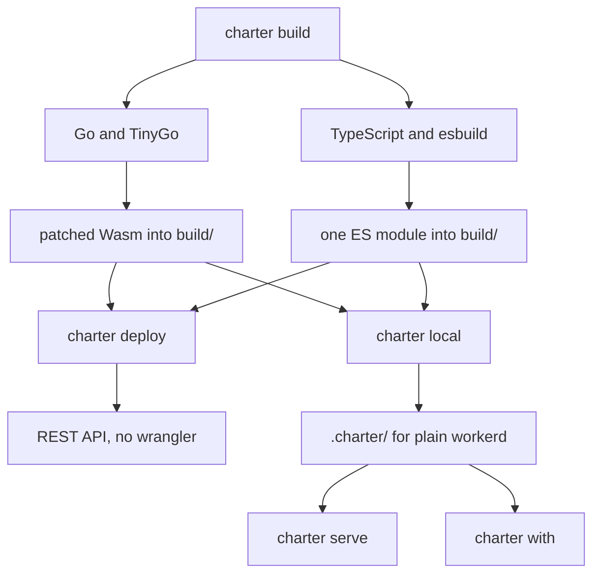
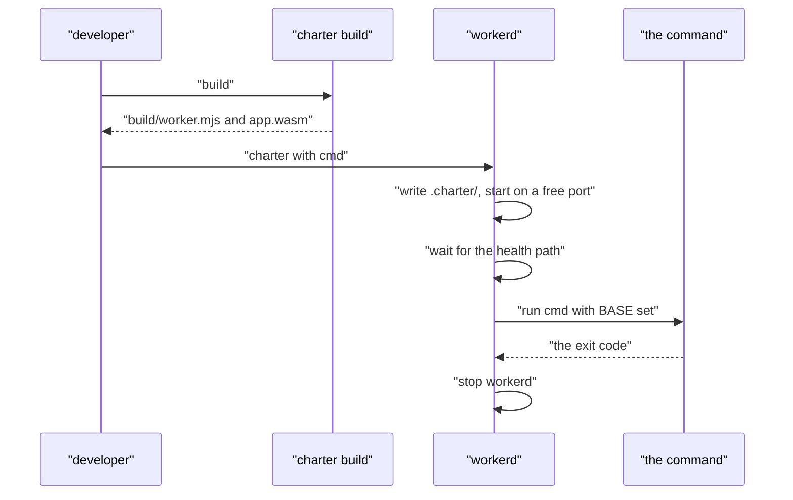

# 13 -- build-deploy-local: the build, the deploy, and local workerd

Three steps take a Worker from source to Cloudflare and back to a laptop, with no wrangler and no Node. `charter build` compiles a Go Worker with TinyGo (or bundles a TypeScript one with esbuild) into `build/`; `charter deploy` sends that build to Cloudflare over its REST API; `charter local`, `serve` and `with` run it on plain workerd from a `.charter/` folder written out of `charter.toml`.

```go
// Source: internal/cli/build/build.go, lines 1-18
// Package build is charter build: it builds a Go Worker into build/ with TinyGo, tuned for Cloudflare Workers, and
// fills build/ with what runs it: workers-go's JavaScript and this library's Worker glue (worker/*.mjs,
// go.mjs first). Run it in the Worker's module, with tinygo and wasm-opt on the PATH:
//
// -patches=false, -reuse=false and -heap=0 each turn one of these off, so what each saves can be
// measured (charter bench, docs/self/benchmarks.md); -compiler=go is a dev build in seconds.
//
//	charter build              (mise use github:joeblew999/charter)
//
// charter check, dev and twins run it too. A TypeScript Worker ([build] entry in charter.toml) it bundles with esbuild
// instead (internal/bundle).
//
// The Wasm has TinyGo's runtime patched (patches, below), a starting heap so an ordinary request never
// collects (-heap), a stack per goroutine that Huma fits in (-stack), and the smallest code (-opt z,
// also the quickest build: wasm-opt's asyncify pass takes longer the bigger the Wasm). The same
// sources, pins and options make the same Wasm, so one built before is copied from the cache instead
// (-fresh builds it again). docs/self/benchmarks.md has what each of these saved.
```

The build is not stock TinyGo. It patches the runtime source at build time. The one patch turns off a full garbage collection TinyGo runs whenever the scheduler goes idle after enough finalizers were registered; every JavaScript reference registers one, and a Worker goes idle at every await, so without the patch it collected on every request. The collector still runs when the heap is full.

```go
// Source: internal/cli/build/build.go, lines 45-55
var patches = []patch{
	// No collection at every pause. TinyGo runs a full collection whenever the scheduler goes idle once
	// 32 finalizers were registered since the last one. Every JavaScript reference registers one, and a
	// Worker goes idle at every await, so it collected on every request: the first step in "What closed
	// the gap" (docs/self/benchmarks.md). The collector still runs when the heap is full.
	// TinyGo 0.44 moved the threshold to gc_finalizer_common.go and made the trigger grow with the number
	// of finalizers (finalizerGCTrigger), but a threshold of 0 still turns it off: the trigger is then 0,
	// and finalizerPressureGC never collects. mise.toml pins the TinyGo this text is in.
	// Upstream: tinygo-org/tinygo#5800 (when fixed: drop the patch)
	{"src/runtime/gc_finalizer_common.go", "const finalizerGCThreshold = 32", "const finalizerGCThreshold = 0"},
}
```

A TypeScript Worker takes the other path: the same `charter build` bundles its entry into one ES module with esbuild, leaving Cloudflare's and Node's own modules to the runtime, with syntax and whitespace minified but names kept so a stack trace still reads.

```go
// Source: internal/bundle/bundle.go, lines 37-63
// Build bundles entry (a path under root) into root's build/worker.mjs, and returns its size.
func Build(root, entry string) (int, error) {
	if _, err := os.Stat(filepath.Join(root, entry)); err != nil {
		return 0, fmt.Errorf("the Worker's entry: %w", err)
	}
	if err := os.MkdirAll(filepath.Join(root, "build"), 0o755); err != nil {
		return 0, err
	}
	result := api.Build(api.BuildOptions{
		EntryPoints:   []string{entry},
		AbsWorkingDir: root,
		Outfile:       Out,
		Write:         true,
		Bundle:        true,
		Format:        api.FormatESModule,
		Platform:      api.PlatformNeutral,
		Target:        api.ES2024,
		// A package's Worker build first, as Cloudflare's tools resolve one (workerd, worker), then the browser's.
		Conditions: []string{"workerd", "worker", "browser"},
		MainFields: []string{"module", "main"},
		External:   external(),
		// As small as a deploy uploads it, names kept so a stack trace reads.
		MinifySyntax:     true,
		MinifyWhitespace: true,
		KeepNames:        true,
		LogLevel:         api.LogLevelSilent,
	})
```

`charter deploy production|staging|preview` reads `charter.toml` and turns it into the deploy's flags, so a developer names an environment and nothing else. The rate limits are the clearest example: `Deploy`'s `Limits` (doc 11) is joined with each binding's namespace — either the one named, or one derived from the Worker and binding so no two Workers share a counter by mistake.

```go
// Source: internal/cli/deploy/deploy.go, lines 341-349
	limits, err := p.Limits()
	check(err)
	for _, r := range limits {
		ns := r.NamespaceID
		if ns == 0 {
			ns = project.Namespace(d.Worker, r.Binding)
		}
		out = append(out, "-ratelimit", fmt.Sprintf("%s=%d:%d/%d", r.Binding, ns, r.Limit, r.Period))
	}
```

The deploy itself has no wrangler and no Node. Credentials come from two environment variables; the client is one small struct over the Cloudflare REST API, and it fails fast if either variable is missing.

```go
// Source: internal/cli/deploy/deploy.go, lines 367-379
// client is the API client, with credentials from CLOUDFLARE_API_TOKEN and CLOUDFLARE_ACCOUNT_ID.
func client() *cfdeploy.Client {
	c := &cfdeploy.Client{
		Token:     os.Getenv("CLOUDFLARE_API_TOKEN"),
		AccountID: os.Getenv("CLOUDFLARE_ACCOUNT_ID"),
		HTTP:      &http.Client{Timeout: 2 * time.Minute},
		Logf:      log.Printf,
	}
	if c.Token == "" || c.AccountID == "" {
		log.Fatal("deploy: CLOUDFLARE_API_TOKEN and CLOUDFLARE_ACCOUNT_ID must be set (use fnox exec)")
	}
	return c
}
```

Local development is the same idea in reverse. `Write` turns `charter.toml` and the `build/` folder into a `.charter/` directory that workerd can run: its config, the entry module, a D1 stand-in on a Durable Object's SQLite, an in-memory rate limiter, and Static Assets. The folder is rebuilt by every command that needs it and never committed.

```go
// Source: internal/local/local.go, lines 37-70
// Write writes .charter/ for p, from the build in build/.
func Write(p *project.Project) error {
	dir := filepath.Join(p.Root, Dir)
	if err := os.MkdirAll(filepath.Join(p.Root, StateDir), 0o755); err != nil {
		return err
	}
	build, err := buildModules(p.Root)
	if err != nil {
		return err
	}
	migrations, err := migrationModules(p)
	if err != nil {
		return err
	}
	limits, err := p.Limits()
	if err != nil {
		return err
	}
	files := map[string]string{
		".gitignore":    "# " + header + "\n*\n",
		"config.capnp":  config(p, build, migrations, limits),
		"local.mjs":     entry(p),
		"d1.mjs":        d1(p, migrations),
		"d1-entry.mjs":  d1Entry,
		"ratelimit.mjs": rateLimit,
		"assets.mjs":    assets,
	}
	for name, content := range files {
		if err := write(filepath.Join(dir, name), content); err != nil {
			return err
		}
	}
	return nil
}
```

`charter with` is the workhorse behind the tests. It starts workerd on a free port with its own state, waits for the health path to answer, runs a command with `BASE` set to the Worker's URL, and stops workerd after — with an optional `-strict` that also fails on a panic or an uncaught exception in the log.

```go
// Source: internal/cli/local/local.go, lines 89-106
	workerd := exec.Command("workerd", "serve", local.Dir+"/config.capnp", "--socket-fd", "http=3", "--directory-path", "state="+state)
	workerd.Dir, workerd.Stdout, workerd.Stderr = p.Root, out, out
	workerd.ExtraFiles = []*os.File{socket}
	check(workerd.Start())
	socket.Close()
	exited := make(chan error, 1)
	// Closed after its one value: healthy may take that value (workerd exited while starting), and stop's wait then
	// returns at once instead of waiting forever.
	go func() { exited <- workerd.Wait(); close(exited) }()
	defer stop(workerd, exited)

	base := fmt.Sprintf("http://127.0.0.1:%d", port)
	if err := healthy(base+p.Health, exited); err != nil {
		b, _ := os.ReadFile(logPath)
		log.Printf("✗ workerd: %v\n%s", err, b)
		return 1
	}
	log.Printf("→ %s (workerd, log %s)", base, logPath)
```





## The Aha Moment

**Aha:** Build, deploy and local serve are three views of one file. The build is tuned to the platform — a patched runtime, a pre-sized heap, and the smallest Wasm — and its cache key is the sources themselves, so the same inputs reuse the same output. The deploy turns `charter.toml` into flags, so a developer names an environment and nothing else. And the local run writes the same binding shapes workerd needs out of that same file, so the Worker sees Cloudflare's world on a laptop without wrangler or Node.

## Cross-References

- [11-project-configuration.md](11-project-configuration.md) — the charter.toml all three steps read.
- [10-d1-promise-web.md](10-d1-promise-web.md) — the D1 binding the local run stands in for.
- [12-cli.md](12-cli.md) — where these steps are wired into the dispatcher.

Continue to [14-spec-sdks-fern.md](14-spec-sdks-fern.md)
