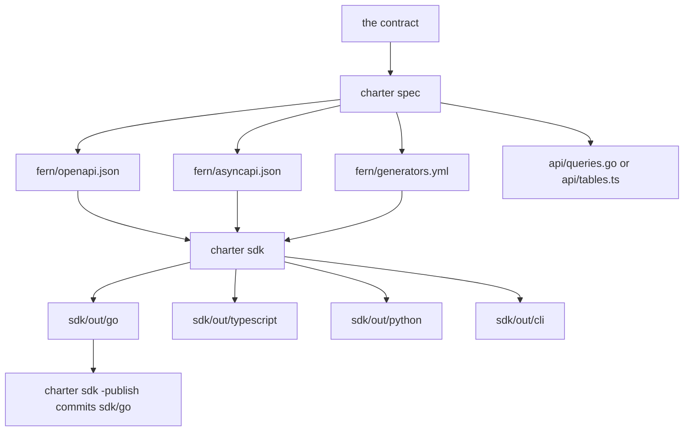
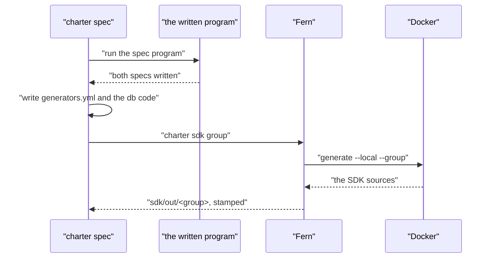

# 14 -- spec-sdks-fern: the specs, the database code, and the SDKs

The contract travels outward in one step: `charter spec`. From a Go project's `api.API` or a TypeScript project's `api/spec.ts` it writes the OpenAPI and AsyncAPI specs into `fern/`, writes Fern's settings (`generators.yml`) from the specs and `charter.toml`'s `[sdks]`, and writes the database's typed code from `migrations/`. `charter sdk` then turns `fern/` into typed clients with Fern. `charter check` fails whenever any of those files has drifted from what the contract gives.

```go
// Source: internal/cli/projectsteps/spec.go, lines 28-70
// spec writes (or with check, compares) what the contract gives, in the project's root: from a Go project's api.API,
// or a TypeScript project's api/spec.ts.
func spec(p *project.Project, checkOnly bool) error {
	server := p.SpecServer
	if server == "" {
		server = p.URL
	}
	if server == "" {
		return errors.New("charter.toml has no url: the specs name the server the Worker is deployed at")
	}
	// The Go SDK's module: the project's own Go module, or the Worker's name, with /sdk/go.
	module := goModule(p.Root)
	var command []string
	switch {
	case module != "":
		program, err := specProgram(p.Root, module)
		if err != nil {
			return err
		}
		command = []string{"go", "run", program}
	case exists(filepath.Join(p.Root, "api", "spec.ts")):
		program, err := tsSpecProgram(p.Root)
		if err != nil {
			return err
		}
		command, module = []string{"node", program}, p.Name
	default:
		return errors.New("charter spec writes the specs from the contract: a Go project's api.API (go.mod), or a TypeScript project's api/spec.ts, and this project has neither")
	}
	if checkOnly {
		command = append(command, "-check")
	}
	if err := run.Run(p.Root, nil, command[0], append(command[1:], "fern/openapi.json", "fern/asyncapi.json", server)...); err != nil {
		return err
	}
	if err := fernSettings(p, module+"/sdk/go", checkOnly); err != nil {
		return err
	}
	if p.DB != "" {
		return dbcode.Write(p.Root, p.DB, checkOnly)
	}
	return nil
}
```

Both programs are tiny and identical in every project, so charter writes them into `build/` and runs them — a Go program that calls `api.API` and hands its two spec functions to the `specs` package, and a Node program that imports the spec from `api/spec.ts`. The contract is the only thing a project owns; the program that prints it is boilerplate.

The database code is the same idea for the data layer. In Go (`db = "sqlc"`), sqlc works out each query's parameters and columns against the schema, and charter writes the Go functions over its `d1` package — with no `database/sql`, for the reasons doc 10 gave. The Go type of each column comes from SQLite's rules of affinity.

```go
// Source: internal/dbcode/sqlc.go, lines 151-175
// goType is the Go type of a column, by SQLite's rules of affinity, with dates as the text D1 gives; a column that may
// be NULL is a pointer.
func goType(c Column) (string, error) {
	if c.IsSqlcSlice || c.IsArray {
		return "", fmt.Errorf("api/queries.sql: %s is a list (sqlc.slice): charter writes queries of single values", c.Name)
	}
	name := strings.ToLower(c.Type.Name)
	base := "any"
	switch {
	case strings.Contains(name, "int"):
		base = "int64"
	case regexp.MustCompile(`char|clob|text|date|time`).MatchString(name):
		base = "string"
	case regexp.MustCompile(`real|floa|doub|numeric|decimal`).MatchString(name):
		base = "float64"
	case strings.Contains(name, "bool"):
		base = "bool"
	case strings.Contains(name, "blob"):
		base = "[]byte"
	}
	if c.NotNull || base == "[]byte" || base == "any" {
		return base, nil
	}
	return "*" + base, nil
}
```

In TypeScript (`db = "drizzle"`), the tables are read from SQLite itself — the migrations run in an in-memory database, then each table and column is read with `PRAGMA`, so the output matches what D1 actually has once the migrations ran. The column builder is picked by the same affinity rules.

```go
// Source: internal/dbcode/drizzle.go, lines 133-146
// builderOf is Drizzle's column builder for a column's declared type, by SQLite's rules of affinity.
func builderOf(typ string) string {
	switch {
	case strings.Contains(typ, "int"):
		return "integer"
	case textType.MatchString(typ):
		return "text"
	case realType.MatchString(typ):
		return "real"
	case strings.Contains(typ, "blob") || typ == "":
		return "blob"
	}
	return "numeric"
}
```

The SDK side is Fern, pinned at versions charter controls in one place. `charter spec` writes `generators.yml` from the spec's security schemes and `charter.toml`'s `[sdks]`, and `charter sdk <group>` generates one group with Docker into `sdk/out/<group>`. Each generation is stamped with the hash of `fern/`, so a contract change reaches the SDK, and `-if-stale` skips the work when nothing did.

```go
// Source: internal/fern/sdk.go, lines 111-142
func Generate(dir, group string, ifStale, quiet bool) (time.Duration, error) {
	if ifStale && UpToDate(dir, group) {
		fmt.Printf("sdk %s: up to date (made from fern/ as it is), not generated again\n", group)
		return 0, nil
	}
	if err := Ready(); err != nil {
		return 0, err
	}
	if err := os.MkdirAll(filepath.Join(dir, "sdk", "out"), 0o755); err != nil {
		return 0, err
	}
	env, err := ContainerEnv()
	if err != nil {
		return 0, err
	}
	args := []string{"generate", "--local", "--group", group, "--force", "--log-level", "warn"}
	start := time.Now()
	if quiet {
		_, err = run.Quietly(dir, env, "fern", args...)
	} else {
		err = run.Run(dir, env, "fern", args...)
	}
	if err != nil {
		return 0, err
	}
	// A generator that fails inside its container (pnpm unable to reach npm, say) exits 0 there, and Fern then
	// reports "Finished" over an empty folder, so the failure would only show later, as a module the SDK lacked.
	if entries, _ := os.ReadDir(filepath.Join(dir, "sdk", "out", group)); len(entries) == 0 {
		return 0, fmt.Errorf("fern generate --group %s finished but wrote nothing to sdk/out/%s: its generator failed inside its container, and Fern does not pass that on. Its own output says why: fern generate --local --group %s --log-level debug", group, group, group)
	}
	return time.Since(start), stamp(dir, group)
}
```





## The Aha Moment

**Aha:** `charter spec` is a re-builder, not a generator you trust to stay in sync by hand. Everything downstream — the OpenAPI and AsyncAPI specs, Fern's settings, the typed database code — is written from the contract and the schema, and `charter check` refuses to pass if any of them differs from what the contract gives now. The SDKs add one more layer on the same principle: each is stamped with the hash of `fern/`, so a contract change reaches the client, and a stale one is caught rather than silently shipped.

## Cross-References

- [02-humaworkers.md](02-humaworkers.md) — the Go operations the specs are generated from.
- [10-d1-promise-web.md](10-d1-promise-web.md) — the `d1` package the generated queries call.
- [15-check-test-twins.md](15-check-test-twins.md) — the check that fails on a stale spec or SDK.

Continue to [15-check-test-twins.md](15-check-test-twins.md)
