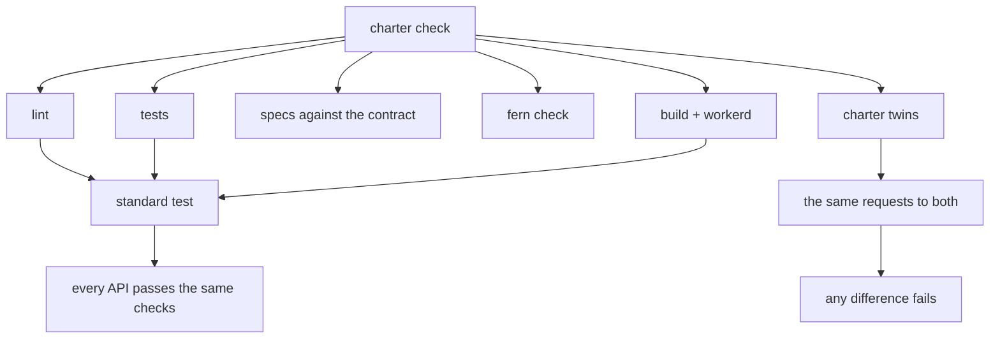
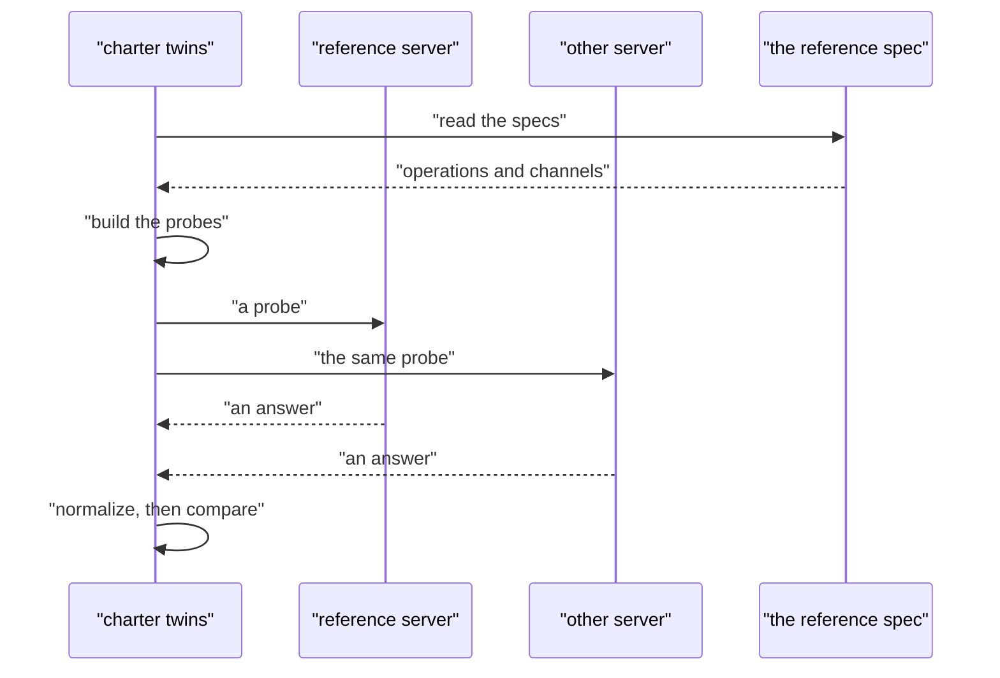

# 15 -- check-test-twins: the check, the standard test, and the twin comparison

`charter check` is every check that needs no Cloudflare account, each timed: the project's lint and tests, the specs against the contract, Fern's check, and the Worker tried natively and under workerd. `standard` is the one test every charter API must pass, written once and run on every project. `charter twins` runs the same requests against a TypeScript project and its Go twin and fails if any answer differs.

```go
// Source: internal/cli/projectsteps/check.go, lines 107-158
func projectCheck(p *project.Project, fresh bool) error {
	var times []string
	var total time.Duration
	timed := func(name string, part func() error) error {
		start := time.Now()
		if err := part(); err != nil {
			return err
		}
		took := time.Since(start)
		total += took
		times = append(times, name+" "+run.Seconds(took))
		return nil
	}
	goProject := goModule(p.Root) != ""
	if goProject {
		if err := timed("lint", func() error { return lint(p) }); err != nil {
			return err
		}
		if err := timed("go test", func() error { return run.Run(p.Root, nil, "go", "test", "./...") }); err != nil {
			return err
		}
	} else if err := timed("types", func() error { return types(p) }); err != nil {
		return err
	}
	if err := timed("specs", func() error { return spec(p, true) }); err != nil {
		return err
	}
	if exists(filepath.Join(p.Root, "fern")) {
		if err := timed("fern check", func() error { return fernCheck(p, fresh) }); err != nil {
			return err
		}
	}
	// A TypeScript project's unit tests sit beside the code they test (api/*.test.ts), as Go's _test.go files do.
	if unit, _ := filepath.Glob(filepath.Join(p.Root, "api", "*.test.ts")); !goProject && len(unit) > 0 {
		for i := range unit {
			unit[i], _ = filepath.Rel(p.Root, unit[i])
		}
		if err := timed("unit tests", func() error { return run.Run(p.Root, nil, "node", append([]string{"--test"}, unit...)...) }); err != nil {
			return err
		}
	}
	if p.Test.Native {
		if err := timed("native", func() error { return native(p) }); err != nil {
			return err
		}
	}
	if err := timed("build + workerd", func() error { return workerd(p, fresh) }); err != nil {
		return err
	}
	say("check took %s: %s", run.Seconds(total), strings.Join(times, ", "))
	return nil
}
```

The standard test knows no API. It reads the one it tests — its `/api/openapi.json` — and checks it against itself, as a client sees it. A refusal must be problem details: an unknown path is 404, and a method a path does not have is 405 with the methods it has.

```go
// Source: internal/standard/standard.go, lines 133-167
	// Refusals are problem details.
	check("an unknown path is 404, as problem details", problem(get("/api/charter-standard-unknown"), 404), "not a 404 problem")
	// The operations in the spec's own order, as a client reading it meets them.
	var ops []op
	paths := orderedPaths(specAnswer.body)
	for _, p := range paths {
		for _, m := range Methods {
			if raw, ok := s.Paths[p][m]; ok {
				var o operation
				json.Unmarshal(raw, &o)
				ops = append(ops, op{p, m, o})
			}
		}
	}
	// The first path without parameters.
	if i := slices.IndexFunc(paths, func(p string) bool { return !strings.Contains(p, "{") }); i >= 0 {
		p := paths[i]
		var has []string
		for _, m := range Methods {
			if _, ok := s.Paths[p][m]; ok {
				has = append(has, strings.ToUpper(m))
			}
		}
		slices.Sort(has)
		other := ""
		for _, m := range []string{"DELETE", "PUT", "PATCH", "POST", "GET"} {
			if !slices.Contains(has, m) {
				other = m
				break
			}
		}
		a := do(other, p, nil, "")
		check(fmt.Sprintf("%s %s is 405, with the methods it has", other, p), problem(a, 405) && a.header.Get("allow") == strings.Join(has, ", "),
			map[string]any{"status": a.status, "allow": a.header.Get("allow")})
	}
```

The twin comparison goes further: it reads the reference project's specs and generates the requests itself, so they need no upkeep. For every operation it sends the right request and every kind of wrong one — no credentials, too little scope, each parameter missing, of the wrong type or out of bounds, a body that is not JSON, and a method the path does not have.

```go
// Source: internal/twins/twins.go, lines 1-11
// Package twins is charter twins <reference> <other>: the same API in two projects (a TypeScript one and its Go twin)
// must answer the same. Both run under workerd, as they are deployed (each built first), each on a free port with
// local state of its own. Both get the same requests, in the same order, and every answer that differs is printed (its
// status, the headers a client reads, its body); it fails if any does. The requests come from the reference's own
// specs, so they need no upkeep: for each operation, the right request and each kind of wrong one (no credentials, too
// little scope, each parameter missing, of the wrong type or out of bounds, a body that is not JSON, of a media type the
// operation does not take, with a property it does not have, a method the path does not have); for each channel, a
// request that is no upgrade; and what every API serves (docs/self/standard.md): /.well-known/, MCP, both specs, an
// unknown path. Then what is saved in each project, which no request shows: the specs in fern/ (the files the SDKs are
// made from) and the database's migrations/.
package twins
```

To build a request, `valueOf` makes a valid value for a schema: its example, its default, or the least the schema allows. That is why the probes need no upkeep — a changed contract changes the probes automatically, and a field with no example falls back to the least value its constraints allow.

```go
// Source: internal/twins/twins.go, lines 131-173
// valueOf is a valid value for a schema: its example, its default, or the least the schema allows.
func (s *spec) valueOf(sc schema) any {
	sc = s.resolved(sc)
	if sc == nil {
		return "x"
	}
	if ex, ok := sc["examples"].([]any); ok && len(ex) > 0 {
		return ex[0]
	}
	if d, ok := sc["default"]; ok {
		return d
	}
	if e, ok := sc["enum"].([]any); ok && len(e) > 0 {
		return e[0]
	}
	switch typeOf(sc) {
	case "integer", "number":
		if m, ok := sc["minimum"]; ok {
			return m
		}
		return 1.0
	case "boolean":
		return true
	case "array":
		items, _ := sc["items"].(schema)
		return []any{s.valueOf(items)}
	case "object":
		out := map[string]any{}
		props, _ := sc["properties"].(map[string]any)
		required, _ := sc["required"].([]any)
		for _, r := range required {
			name, _ := r.(string)
			p, _ := props[name].(schema)
			out[name] = s.valueOf(p)
		}
		return out
	}
	n := 1
	if m, ok := number(sc["minLength"]); ok && int(m) > n {
		n = int(m)
	}
	return strings.Repeat("x", n)
}
```

Each probe is sent to both servers, the answer is normalized so only real differences survive — the two projects' names, origins and times are scrubbed out — and every differing answer is printed with its status, the headers a client reads, and its body.

```go
// Source: internal/twins/twins.go, lines 834-853
	for _, p := range probes {
		a, err := ask(origins[0], p, tokens)
		if err != nil {
			return err
		}
		b, err := ask(origins[1], p, tokens)
		if err != nil {
			return err
		}
		found := differences(toAny(normalize(a, origins[0], ref.Name)), toAny(normalize(b, origins[1], oth.Name)), "")
		if len(found) == 0 {
			continue
		}
		differ++
		method := p.method
		if method == "" {
			method = "GET"
		}
		fmt.Printf("\nDIFFERS  %s  (%s %s)\n  %s %s\n", p.name, method, p.path, refDir, strings.Join(found, "\n  "+refDir+" "))
	}
```





## The Aha Moment

**Aha:** Testing is generated from the contract, so it cannot fall behind it. The standard test reads the API's own OpenAPI document and checks the server against it, and the twin comparison turns that same document into the full set of requests — the right one and every wrong one — and sends them to both languages. A changed contract changes the tests; a real behavioral difference between the Go and TypeScript implementations is found by construction, not by a hand-maintained list of cases.

## Cross-References

- [14-spec-sdks-fern.md](14-spec-sdks-fern.md) — the specs these tests read and check against.
- [03-serve.md](03-serve.md) — the standard handler that answers the refusals and documents being tested.
- [13-build-deploy-local.md](13-build-deploy-local.md) — the workerd run that `check` and `twins` use.

Continue to [16-ci-scaffold-repo.md](16-ci-scaffold-repo.md)
