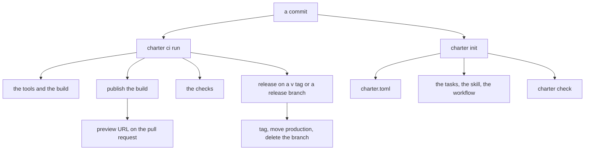
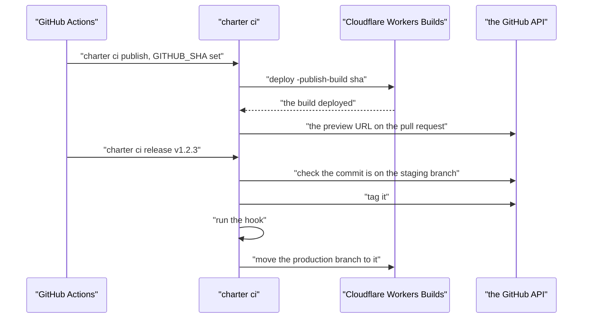

# 16 -- ci-scaffold-repo: CI, scaffolding, and repo management

`charter ci` is the application's CI and the GitHub side of its previews and releases, so a commit is compiled once — on CI — and Cloudflare deploys that build. `charter init`, `tasks`, `skill` and `workflow` set up a fresh application the way intl and seo set up any project: a config file, its mise tasks, an agent skill, and a check that says when any of them is stale.

```go
// Source: internal/cli/ci/ci.go, lines 1-18
// Package ci is charter ci run|publish|release: an app's CI, and the GitHub side of its previews and releases,
// so a commit is compiled once, on CI, and Cloudflare deploys that build (charter builds).
//
//	charter ci run                what .github/workflows/charter.yml runs, from charter.toml's [ci]: the tools,
//	                                      the build, on a push its publishing (as ci publish), the checks, and for a
//	                                      v* tag or a release/v* branch the release (as ci release), then a table of
//	                                      where the time went; anywhere else (this machine), the build and the checks
//	charter ci publish            this commit's build (build/, the Static Assets) and this binary to the
//	                                      repository's preview-builds pre-release; on a branch with a preview, its
//	                                      URL on the branch's pull request
//	charter ci release <version>  a v* tag or a release/v* branch whose checks passed: on main, tag it (a
//	                                      branch), run -hook, move the production branch to it (Workers Builds
//	                                      deploys production), and delete the release branch
//
// Run it from a static linux/amd64 build (CGO_ENABLED=0 go build …/cmd/charter): publish hands Workers Builds that
// very binary. GitHub sets GITHUB_TOKEN (contents and pull-requests: write), GITHUB_REPOSITORY, GITHUB_SHA,
// GITHUB_REF_NAME and GITHUB_REF_TYPE.
package ci
```

`publish` is where the "compiled once" promise is kept. It runs `charter deploy` with `-publish-build <sha>`, so Cloudflare's Workers Builds deploys the exact build CI just made; on a preview branch it also writes the preview URL onto the branch's pull request, and a failed comment never fails the deploy.

```go
// Source: internal/cli/ci/ci.go, lines 127-146
func publish(p *project.Project, repo, sha, ref, refType string) int {
	args := []string{"deploy", "-name", p.Name, "-repo", repo, "-publish-build", sha}
	if p.Assets != "" {
		args = append(args, "-assets", p.Assets)
	}
	if _, err := self.Output(args...); err != nil {
		return self.ExitCode(err)
	}
	if refType == "branch" && project.BranchEnvironment(ref) == "preview" && p.Subdomain != "" {
		note := ""
		if p.Preview != nil {
			note = p.Preview.Note
		}
		url := p.PreviewURL(previewbuild.Slug(ref, p.Name))
		if _, err := self.Output("deploy", "-repo", repo, "-comment-pr", ref, "-url", url, "-comment-note", note); err != nil {
			log.Printf("· the pull request comment failed (%v); the preview still deploys", err)
		}
	}
	return 0
}
```

A release is a move of one branch, guarded every step of the way. It refuses a version that does not start with `v`, checks the commit is actually on the staging branch (not behind it), tags it if the trigger was a branch, runs the optional `-hook`, force-pushes the production branch to it — and deletes the release branch afterward.

```go
// Source: internal/cli/ci/ci.go, lines 148-186
// release checks the commit is on main, tags it (for a release branch), runs hook, moves production to it and
// deletes the release branch.
func release(gh github, version, sha, ref, refType, hook string) error {
	if !strings.HasPrefix(version, "v") {
		return fmt.Errorf("%s: a release is v<something>", version)
	}
	var compare struct {
		Status string `json:"status"`
	}
	if err := gh.do(http.MethodGet, "/compare/"+sha+"..."+project.StagingBranch, nil, &compare); err != nil {
		return err
	}
	if compare.Status != "identical" && compare.Status != "ahead" {
		return fmt.Errorf("%s (%.7s) isn't on %s (%s): not released", version, sha, project.StagingBranch, compare.Status)
	}
	if refType == "branch" {
		if err := gh.do(http.MethodPost, "/git/refs", map[string]string{"ref": "refs/tags/" + version, "sha": sha}, nil); err != nil {
			return fmt.Errorf("tag %s (it may exist already): %w", version, err)
		}
		log.Printf("✓ tag %s → %.7s", version, sha)
	}
	if hook != "" {
		cmd := exec.Command("sh", "-c", hook)
		cmd.Stdout, cmd.Stderr = os.Stdout, os.Stderr
		if err := cmd.Run(); err != nil {
			return fmt.Errorf("-hook: %w", err)
		}
	}
	if err := pushProduction(gh, sha); err != nil {
		return err
	}
	log.Printf("✓ %s: %s → %.7s; Workers Builds deploys it", version, project.ProductionBranch, sha)
	if refType == "branch" {
		if err := gh.do(http.MethodDelete, "/git/refs/heads/"+ref, nil, nil); err != nil {
			log.Printf("· couldn't delete %s: %v", ref, err)
		}
	}
	return nil
}
```

Scaffolding is a small set of files charter owns, written from a fixed list. `owned` names each one and the command that writes it; the TinyGo pins are added only when the app is a Go module, because only TinyGo builds them.

```go
// Source: internal/cli/scaffold/scaffold.go, lines 59-74
// owned are the files charter writes into an app, but charter.toml, run from its root: the TinyGo pins only for a Go
// app (a go.mod), which TinyGo builds.
func owned() []file {
	b, err := fs.ReadFile(skills.FS, "charter/SKILL.md")
	check(err)
	out := []file{
		{TasksFile, tasks, 0o644, "charter tasks"},
		{".mise/tasks/charter-builds", launcher, 0o755, "charter tasks"},
		{".claude/skills/charter/SKILL.md", b, 0o644, "charter skill"},
		{".github/workflows/charter.yml", workflow, 0o644, "charter workflow"},
	}
	if _, err := os.Stat("go.mod"); err == nil {
		out = append(out, file{pins.ConfFile, pins.File, 0o644, "charter tasks"})
	}
	return out
}
```

`charter init` is the one command that turns a bare Go module into a Worker project. In a Go module with no `charter.toml`, it writes a starter from the module path and the workerd on the path; then it writes the app's files, and at the repo's top it writes charter's repo files. `-check` writes nothing and fails where any of those files differs from what this charter writes.

```go
// Source: internal/cli/scaffold/scaffold.go, lines 113-173
// Init runs charter init: in a Go module with no charter.toml, a starter, then an app's files (charter.toml's folder:
// build/ ignored, the mise tasks, the skill, the CI workflow); at the repo's top, charter's files (go doc
// .../internal/cli/repo), and the mise tasks for a repo that is no app. -check writes nothing, and fails where a file
// is not what this charter writes.
func Init(args []string) {
	fs := flag.NewFlagSet("charter init", flag.ExitOnError)
	checkOnly := fs.Bool("check", false, "write nothing; fail where a file of charter's is not what this charter writes")
	name := fs.String("name", "", "the Worker's name (default: the module path's last element)")
	compat := fs.String("compat", "", "the compatibility date (default: the date of the workerd on PATH, which runs it locally)")
	fs.Parse(args)
	log.SetFlags(0)
	_, err := repo.Root()
	check(err)
	if *checkOnly {
		if !Report() {
			os.Exit(1)
		}
		return
	}
	app := false
	if _, err := os.Stat("go.mod"); err == nil {
		if _, err := os.Stat(project.File); err != nil {
			if *name == "" {
				*name = workerName(modulePath())
			}
			if *compat == "" {
				*compat = workerdDate()
			}
			if *compat == "" {
				log.Fatal("✗ no workerd on PATH to take the compatibility date from: give one, -compat 2026-09-25")
			}
			check(os.WriteFile(project.File, []byte(starter(*name, *compat)), 0o644))
			log.Printf("✓ %s: the Worker %s, compatibility date %s", project.File, *name, *compat)
		}
	}
	if p, err := project.Load("."); err == nil {
		app = true
		check(os.Chdir(p.Root))
		check(ignore(".gitignore", "/build/"))
		for _, how := range []string{"charter tasks", "charter skill", "charter workflow"} {
			write(how)
		}
	}
	if top, atTop := repo.AtTop(); atTop {
		if !app && !repo.IsCharter(top) {
			write("charter tasks")
		}
		check(repo.Init(top))
	}
	if !app {
		log.Print("\nNext: charter check, and what docs/charter/README.md says, and when.")
		return
	}
	log.Print(`
Next:
  main.go     func main() { transport.Run(handler) }   // github.com/joeblew999/charter/transport
  bindings    D1, Durable Objects, rate limits, vars: charter.toml (go doc github.com/joeblew999/charter/project)
  mise run charter:build && mise run charter:serve      // or charter build, serve
  mise run charter:deploy production                     // Cloudflare credentials in the environment, or fnox
  charter.toml [ci], then mise run charter:builds-configure   // CI and Workers Builds: a commit compiled once`)
}
```





## The Aha Moment

**Aha:** CI is not a pile of shell steps checked into YAML; it is one command, `charter ci run`, which the workflow calls, and it derives its work from `charter.toml`'s `[ci]` table. That is why the "compiled once" promise holds: the exact binary CI publishes is the one Workers Builds deploys, and the exact build is the one the preview URL points at. Scaffolding completes the circle — `charter init` writes the tasks, the skill, the workflow and the config, and `charter check` fails when any of those files has drifted from what this charter writes now.

## Cross-References

- [11-project-configuration.md](11-project-configuration.md) — the `[ci]`, `[preview]` and `[github]` tables this command reads.
- [12-cli.md](12-cli.md) — the repo steps (init, ci, release) wired into the dispatcher.
- [13-build-deploy-local.md](13-build-deploy-local.md) — the build that `ci publish` hands to Workers Builds.

Continue to [17-typescript-library-examples.md](17-typescript-library-examples.md)
