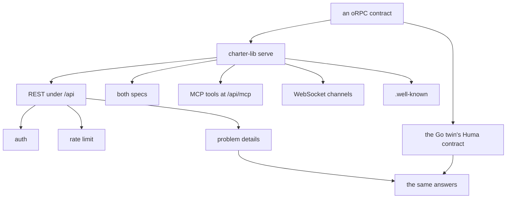
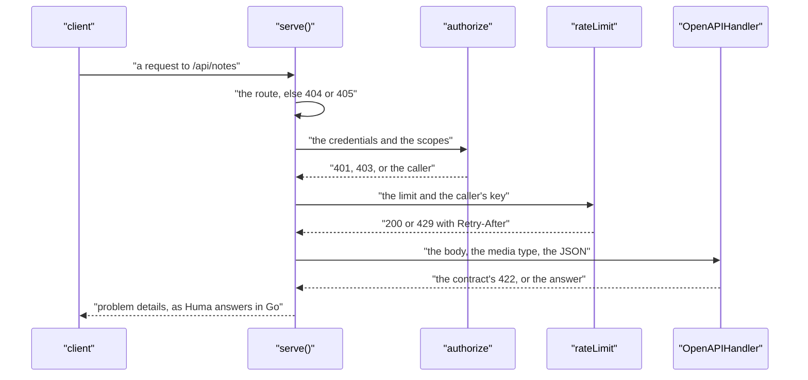

# 17 -- typescript-library-examples: charter-lib and the example APIs

`charter-lib` is the TypeScript counterpart of charter's Go library: the same standard, in the same order, over an oRPC contract. A project gives its router, its document and whom it trusts, and `serve()` wires the rest — REST under `/api`, both specs, the MCP tools, the WebSocket channels and `/.well-known/` — so a Go and a TypeScript API answer the same. The example APIs (the conformance pair, and the notes API) prove it, twin against twin.

```ts
// Source: ts/src/serve.ts, lines 1-18
// A Worker's API served the standard way (docs/self/standard.md), as charter/serve serves a Huma
// API, so a project gives its router, its document and whom it trusts, and wires nothing itself:
//   - its procedures under /api, as plain REST (oRPC's OpenAPIHandler), each call allowed by the
//     credentials it carries and limited as its contract says (guard);
//   - its specs at /api/openapi.json and /api/asyncapi.json, with the request's origin as their server;
//   - its procedures that answer once as MCP tools at /api/mcp (charter-lib/mcp);
//   - how to get in, at /.well-known/ (charter-lib/auth's wellKnown), when it trusts anyone;
//   - its WebSocket channels (asyncapi() procedures) at their addresses, a token on them taken as
//     ?access_token= too, for a client that cannot send headers (a browser, a Worker);
//   - every refusal as RFC 9457 problem details (problem.ts), as Huma answers in Go, checked
//     in Huma's order: the route (404, 405), the credentials and the limits (401, 403, 429), the body's
//     media type and its JSON (415, 400), then the contract (422).
//
//   const os = implement(contract).$context<Served>();
//   const api = os.use(guard);
//   export const router = os.router({ notes: { list: api.notes.list.handler(...) } });
//   const served = serve(router, { document, trusted: () => trusted, limits: () => env });
//   export default { fetch: request => served(request, {}) } satisfies ExportedHandler;
//
// The router is built from `os`, without the guard: oRPC would otherwise run it twice per call.
```

Authentication is one check, fed by the contract. `authorize` takes a request's headers and an operation's `security` (its required scopes, or the document's default) and returns one decision: 200 with the caller, or 401 or 403 with why and the `WWW-Authenticate` challenge that tells a client where the API says how to get in.

```ts
// Source: ts/src/auth.ts, lines 184-200
export async function authorize(headers: Headers, security: Security | undefined, trusted: Trusted, resource?: string): Promise<Decision> {
	if (!security?.length) return { status: 200 };
	let callers: Caller[];
	try {
		callers = await identify(headers, trusted);
	} catch (error) {
		return { status: 401, message: `the credentials were refused: ${(error as Error).message}`, challenge: challenge(resource, "invalid_token") };
	}
	if (!callers.length) return { status: 401, message: `credentials are required: ${ways(trusted)}`, challenge: challenge(resource) };
	// Security is a list of alternatives; the scopes of one are all needed.
	for (const alternative of security) {
		const caller = callers.find(c => scopesIn(alternative).every(scope => c.scopes.includes(scope)));
		if (caller) return { status: 200, caller };
	}
	const needed = [...new Set(security.map(a => `scope ${scopesIn(a).join(" and ")}`))].join(", or ");
	return { status: 403, message: `${callerName(callers[0]!)} may not do this: it needs ${needed}`, challenge: challenge(resource, "insufficient_scope", scopesIn(security[0]!)) };
}
```

The rate limit follows the same rule: the contract declares it, one check enforces it, and the specs say so. A missing or failing binding never takes the API down — it answers 200 and logs once — because the binding is a fixed window per key, local to each Cloudflare location, meant for stopping abuse, not accounting.

```ts
// Source: ts/src/ratelimit.ts, lines 89-103
export async function rateLimit(limit: Limit | undefined, key: string, bindings: object): Promise<Verdict> {
	if (!limit) return { status: 200 };
	const binding = (bindings as Record<string, RateLimiter | undefined>)[limit.binding];
	if (typeof binding?.limit !== "function") {
		warn(limit.binding, "the Worker has no such Rate Limiting binding");
		return { status: 200 };
	}
	try {
		if ((await binding.limit({ key })).success) return { status: 200 };
	} catch (error) {
		warn(limit.binding, String(error));
		return { status: 200 };
	}
	return { status: 429, retryAfter: limit.period, message: `too many calls: at most ${limit.limit} in ${limit.period} s; retry after ${limit.period} s` };
}
```

Both specs come from the one contract, and `charter-lib/specs` knows no contract itself — the caller passes the `info` and the URL, so Node (offline, for `charter spec`) and a Worker (for `/api/openapi.json`) run the same code. The OpenAPI document is 3.1.0, filters out the WebSocket channels, and is then shaped into the standard: every refusal declared as problem details, and each operation's security naming every scheme the document declares.

```ts
// Source: ts/src/specs.ts, lines 38-47
export const openapiSpec = async (router: RouterContract | AnyRouter, { info, server, base, webhooks, rateLimits = [] }: OpenAPISpecOptions): Promise<OpenAPIV3_1.OpenAPIObject> => {
	const doc = await new OpenAPIGenerator({ converters }).generate(router, {
		version: "3.1.0",
		base: { info, servers: [{ url: server }], ...base },
		filter: procedure => !getAsyncAPIMeta(procedure as any),
	});
	withScopeLimits(doc, rateLimits);
	withEveryScheme(doc);
	return standardDocument(withoutSafeBounds(webhooks ? await addWebhooks(doc, webhooks) : doc));
};
```

MCP tools are declared nowhere twice. Every procedure that answers once becomes a tool named by its `operationId`, with its own input and output schemas, and a call runs the procedure through oRPC's `call()` in the REST handler's context — so auth and rate limits are the REST route's. `toolOf` skips streams, channels, and operations marked out, and derives the read-only, destructive and idempotent hints from the method alone.

```ts
// Source: ts/src/mcp.ts, lines 40-57
function toolOf(procedure: AnyProcedure): Tool | undefined {
	const def = procedure["~orpc"] as { meta: Meta; inputSchemas?: unknown[]; outputSchemas?: unknown[] };
	const meta = def.meta as Record<string, unknown>;
	if (meta["~charter-mcp"] === false || meta["~asyncapi"]) return undefined;
	const outputs = def.outputSchemas ?? [], inputs = def.inputSchemas ?? [];
	if (outputs.some(schema => getAsyncIteratorObjectSchemaDetails(schema as never))) return undefined;
	const route = getOpenAPIMeta(procedure as never) as { method?: string; operationId?: string; summary?: string; description?: string } | undefined;
	if (!route?.operationId) return undefined;
	const method = (route.method ?? "POST").toUpperCase();
	return {
		name: route.operationId,
		description: [route.summary, route.description].filter(Boolean).join("\n\n") || undefined,
		annotations: method === "GET" ? { readOnlyHint: true } : { readOnlyHint: false, destructiveHint: method !== "POST", idempotentHint: method === "PUT" || method === "DELETE" },
		procedure,
		input: inputs.length === 1 ? inputs[0] : undefined,
		output: outputs.length === 1 ? outputs[0] : undefined,
	};
}
```

The example APIs are the contract in action. The conformance contract exists in two languages — this TypeScript one and its Go twin — and both declare the same operations, names and `x-fern-*` extensions, so the twin comparison can hold them to the same answers. Here a WebSocket channel is declared: `openapi()` gives it a path, `asyncapi()` turns it into a channel in the AsyncAPI spec, and the query carries a token for clients that cannot send WebSocket headers.

```ts
// Source: examples/conformance-ts/api/contract.ts, lines 131-145
		live: oc
			.meta(openapi({ method: "GET", path: "/api/notes/live" }))
			.meta(asyncapi({
				channel: "liveNotes", address: "/api/notes/live", operationId: "receiveNoteEvent", message: "NoteEvent", send: { message: "Subscribe", operationId: "sendSubscribe" },
				summary: "Note events over a WebSocket: send `subscribe` with a topic, receive that topic's events",
				// A token on the channel's URL, which charter-lib/serve takes there and only there.
				query: z.object({ access_token: z.string().optional().describe("The OAuth token, for clients that can't send WebSocket headers (browsers, Workers). Others send Authorization") }),
			}))
			.input(asyncIteratorObject(z.strictObject({ topic: z.string().meta({ examples: ["notes"] }) }).meta({ id: "Subscribe" })))
			.output(asyncIteratorObject(z.object({
				event: z.string().meta({ examples: ["notes.created"] }),
				id: z.string().meta({ examples: ["note-1"] }),
				body: z.string().optional().meta({ examples: ["Buy milk"] }),
				auth: z.string().optional().describe("The Authorization value the server received on connecting: the harness test reads it"),
			}).meta({ id: "NoteEvent" }))),
```

The same channel is declared in Go in `examples/conformance-go/api/contract.go`, with `asyncapi.Operation` and `asyncapi.SendOperation` on the two routes that make up one WebSocket. Both languages also share `follow()` — charter-lib's one way to receive a live, ordered, gap-free feed — whose rule is the doc 08 rule: subscribe first, catch up from the log, then go live, and the log (not the live hub) is the source of truth.





## The Aha Moment

**Aha:** `charter-lib` is the same standard in a second language, not a similar one. The same order of refusals, the same problem-details body, the same "the contract declares it, one check enforces it, the specs say so" for auth, rate limits and MCP tools — so the specs, the SDKs and the server agree in TypeScript exactly as they do in Go. The conformance pair makes that claim testable: one contract written twice, and the twin comparison refuses any behavioral difference between the two implementations.

## Cross-References

- [02-humaworkers.md](02-humaworkers.md) — the Go counterpart these modules mirror.
- [08-streaming.md](08-streaming.md) — the live, ordered feed rule that `follow()` implements.
- [15-check-test-twins.md](15-check-test-twins.md) — the twin comparison that holds both languages to the same answers.

Continue to [README.md](README.md)
