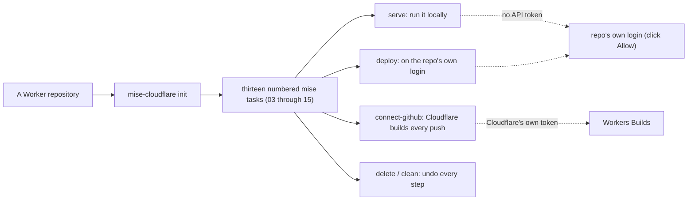
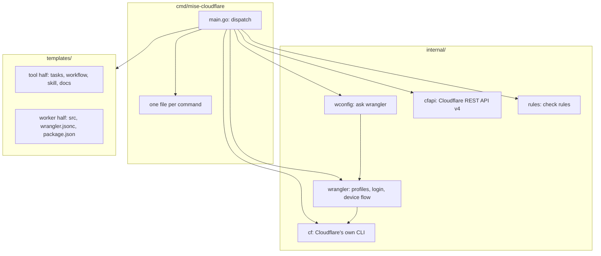
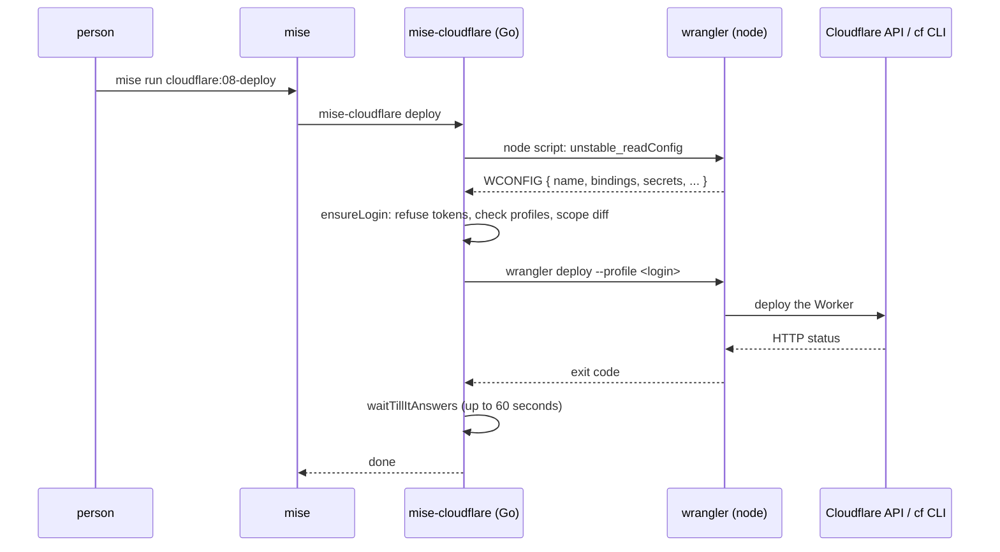

# Project Exploration: mise-cloudflare

## Overview

mise-cloudflare is a backend plugin for [mise](https://mise.jdx.dev), the polyglot version and task manager. Given a repository that holds a Cloudflare Worker, it writes thirteen numbered mise tasks (03 through 15) into the repository and then runs them. Each task is one command: run it locally, deploy it, connect GitHub so Cloudflare builds and deploys every push, and then undo each of those steps. See [The overview](markdown/00-overview.md).

The one idea the whole project stands on: **no API token anywhere.** A Worker repository normally needs a person to create and store a Cloudflare API token, and that token is a leak waiting to happen. mise-cloudflare replaces it with two logins. The first is the **repo's own login**, a wrangler auth profile bound to the repository's folder, made the first time by clicking **Allow**. The second is Cloudflare's own build token, made by Cloudflare and never leaving Cloudflare, which drives Workers Builds. A `CLOUDFLARE_API_TOKEN` in the shell or a `.env` file would silently override both, so every command refuses one. See [The login model](markdown/03-the-login-model.md).



## The mental model in one minute

A Worker repository has a wrangler config (`wrangler.jsonc`, `.json`, or `.toml`). mise-cloudflare never reads that config itself. Instead it runs the repository's own wrangler through a tiny embedded JavaScript bridge that calls wrangler's config-reading functions and prints the result as one marked line (`WCONFIG …`). The Go program reads only that line. This keeps mise-cloudflare correct across every wrangler version and every config field, because wrangler is the one that understands wrangler configs. See [The wconfig bridge](markdown/02-the-wconfig-bridge.md).

The thirteen numbered tasks (03 through 15) follow the order a repository meets them. Task `cloudflare` alone (which is `show`) prints a report: what is done, and the one command to run next. Every step has an undo: `delete` undoes `deploy` on Cloudflare, `clean` undoes the local state, `logout` undoes the login. See [The status report](markdown/07-the-status-report.md).

## The thirteen numbered tasks (03 through 15)

| Task | Command | What it does |
|------|---------|--------------|
| `cloudflare` | show | What's done, and what to run next |
| `cloudflare:03-init` | init | Writes the tool's files again after an upgrade |
| `cloudflare:04-check` | check | The repo's rules: no tokens, no stray secrets, wrangler pinned |
| `cloudflare:05-show` | show | The status report (`--json` for a program) |
| `cloudflare:06-serve` | serve | `wrangler dev`: the Worker locally, with local D1/KV/R2 |
| `cloudflare:07-set-secrets` | set-secrets | The secrets the Worker requires that Cloudflare lacks |
| `cloudflare:08-deploy` | deploy | `wrangler deploy` on the repo's own login |
| `cloudflare:09-connect-github` | connect-github | Cloudflare Workers Builds: previews, production, staging |
| `cloudflare:10-set-preview-secrets` | set-preview-secrets | The previews' secrets, which they don't inherit |
| `cloudflare:11-preview` | preview | A preview of what's here now |
| `cloudflare:12-login` | login | The repo's own login (others make it when they need it) |
| `cloudflare:13-delete` | delete | The Worker and its own resources deleted |
| `cloudflare:14-logout` | logout | The repo's logins logged out and deleted |
| `cloudflare:15-clean` | clean | `.wrangler/` and `.dev.vars` removed |
| `cloudflare:verify` | verify | What the GitHub workflow runs: setup, test, check |
| `cloudflare:update` | update | Every pin moved to its newest release |
| `cloudflare:template` | template | The template's Worker, named for the folder |
| `cloudflare:run-wrangler` | run-wrangler | Any other wrangler command on the repo's login |
| `cloudflare:show-version` | show-version | This build's version |
| `cloudflare:show-help` | show-help | Every command |

See [The overview](markdown/00-overview.md) and [The templates and init](markdown/06-templates-and-init.md).

## Repository

- **Location:** /Users/darkvoid/GitSources/src.Ged/mise-cloudflare
- **Remote:** git@github.com:joeblew999/mise-cloudflare.git
- **Primary Language:** Go
- **License:** MIT (Copyright 2026 joeblew999)
- **Module:** github.com/joeblew999/mise-cloudflare, `go 1.26.0`

## Directory Structure

```
mise-cloudflare/
├── cmd/mise-cloudflare/     # The CLI: main.go dispatches; one file per command
│   ├── main.go              # dispatch, flags, the repo struct, inCI guard
│   ├── init.go              # initRepo: writes the tool half of the template
│   ├── check.go             # rules.Check + stale + noProfiles
│   ├── show.go              # the status report and its "next" logic
│   ├── serve.go             # wrangler dev (local)
│   ├── deploy.go            # wrangler deploy + waitTillItAnswers
│   ├── connect_github.go    # Workers Builds via the cf CLI (423 lines)
│   ├── delete.go            # wrangler delete + own/preview resources
│   ├── resources.go         # preview resources and own resources
│   ├── update.go            # move every pin to its newest release
│   ├── template.go          # write the template's Worker
│   ├── login.go / logout.go # the repo's login, made and removed
│   ├── clean.go             # local state undone
│   ├── set_secrets.go / set_preview_secrets.go  # secrets (hidden typing)
│   ├── preview.go           # wrangler preview
│   ├── run_wrangler.go      # any wrangler command
│   ├── verify.go            # setup → test → check
│   ├── show_version.go / show_help.go
│   └── paths.go / paths_windows.go   # long path names (Windows)
├── internal/
│   ├── wconfig/             # the bridge: asks wrangler for the config
│   ├── wrangler/            # the wrangler CLI wrapper + device login
│   ├── cf/                  # the cf CLI wrapper (Cloudflare's own CLI)
│   ├── cfapi/               # the Cloudflare REST API (v4)
│   └── rules/               # the check rules
├── templates/               # the embedded template (tool half + worker half)
├── mise.toml                # the root's own tasks (build, test, release)
├── .goreleaser.yaml         # cross-platform release binaries
├── .github/workflows/       # ci.yml, release.yml, new-repo.yml
├── repos.txt                # the corpus of third-party Workers adopted
└── *_test.go                # mise_test.go, e2e_*_test.go, tool_test.go
```

## Architecture



The dependency graph is flat and one-way: the command files import the internal packages and the template; the internal packages import only each other and the standard library plus `golang.org/x/term`. See [The architecture](markdown/01-architecture.md).

## Entry Points

### The CLI (`cmd/mise-cloudflare/main.go`)

`main()` parses the first argument as a command, defines the shared flags (`-json`, `-off`, `-branch`, `-staging`, `-build`, `-yes`), builds a `repo` struct by opening the repository and reading its wrangler config through the bridge, and then switches on the command. It also holds the `passes` map that forwards `serve`/`deploy`/`preview`/`run-wrangler` arguments on to wrangler, and the `inCI()` guard that stops any login in CI. See [The architecture](markdown/01-architecture.md).

### init (the bootstrap)

`mise exec github:joeblew999/mise-cloudflare@latest -- mise-cloudflare init` writes the tool half of the template into a repository before any task exists. It pins mise-cloudflare at exactly that release in `.mise/config.toml`. See [The templates and init](markdown/06-templates-and-init.md).

## Data Flow



The bridge runs once per command (in `openRepo`), and every later decision reads from the in-memory `wconfig.Config` — the config is never parsed by Go. See [The wconfig bridge](markdown/02-the-wconfig-bridge.md).

## External Dependencies

| Dependency | Version | Purpose |
|------------|---------|---------|
| golang.org/x/term | v0.47.0 | `ReadPassword` for hidden secret typing |
| golang.org/x/sys | v0.49.0 (indirect) | needed by `x/term` |
| wrangler | 4.155.0 (in the template's package.json) | the Worker's own CLI, run by the repo |
| cf (npm:cf) | 1.0.0-beta.26 (in the template's tasks) | Cloudflare's own CLI, for Workers Builds |
| node | 26.13.0 (in the template's mise.toml) | runs wrangler |
| mise | — | the host that runs the tasks |

## Configuration

The repository has no settings file. Every choice is a command's flag (`--off`, `--branch`, `--staging`, `--build`, `--yes`, `--json`), kept by Cloudflare's Workers Builds setup. The only pinned values are in the template: wrangler `4.155.0`, node `26.13.0`, cf `1.0.0-beta.26`, and the Worker's `compatibility_date` `2026-10-01`. The environment reads `CLOUDFLARE_LOGIN=device` and `CLAUDE_CODE_REMOTE=true` to force the device-authorization flow, `CLOUDFLARE_ENV` to name a wrangler environment, and `CLOUDFLARE_API_TOKEN` to be refused. See [The login model](markdown/03-the-login-model.md) and [The templates and init](markdown/06-templates-and-init.md).

## Testing

The test suite is unusual: it is an end-to-end walk, not unit tests alone. `TestWalk` (in `e2e_walk_test.go`) runs every numbered task in a stamped copy of the repository and checks that each did what a person would see it do. `TestSteps` (in `e2e_steps_test.go`) asserts the walk is exactly the template's numbered tasks, in order. `TestMise` (in `mise_test.go`) is a bidirectional checker that proves the Go program's commands and flags match the mise task file, both ways. `TestToolRelease` (in `tool_test.go`) releases and then re-installs the release through the Go module proxy. The corpus in `repos.txt` lists three third-party Worker repositories that are adopted and walked. See [The testing and release](markdown/12-testing-and-release.md).

## Key Insights

- **Ask the tool that knows.** The wconfig bridge never parses a wrangler config; it runs wrangler's own read functions. This is the one design decision that keeps the whole project correct.
- **No token is the feature.** Every login path exists to avoid creating a `CLOUDFLARE_API_TOKEN`; the refusal of a stray token is a first-class behavior with a test.
- **Decide on the status, not the words.** `cf.Status(err)` pulls the HTTP status out of an error message; `NotFound` is `404`. The tests assert 404-is-gone explicitly.
- **Every step has an undo.** delete, clean, and logout mirror deploy, serve, and login, and the walk proves the account is empty afterward.
- **The walk is the test.** Instead of mocking Cloudflare, the tests deploy for real to a throwaway account and check the URLs, then delete everything.

## Open Questions

- A Python Worker (pywrangler) is not handled yet — the shipped docs say so.
- The `remoteExtras` and `withEnv` walk variants are gated by environment variables, so they do not run in the default CI matrix.
- The `cf` CLI's device login is driven by regexes over its output (`verifyURL`, `userCode`), which is brittle against cf changing its text.

## Verdict

A genuinely opinionated and unusually honest piece of developer tooling. Its two reusable ideas — "ask the tool that knows" and "no token, ever" — are portable far beyond Cloudflare. The critical assessment weighs where it gets it right and where it is limited. See [Critical assessment](markdown/13-critical-assessment.md).
