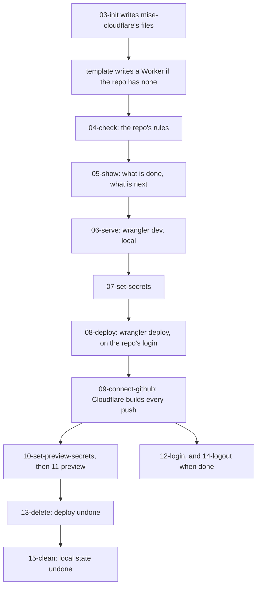
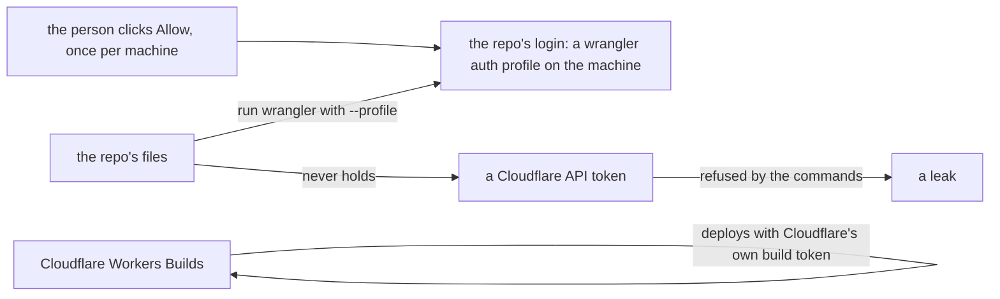

# Overview

mise-cloudflare is a backend plugin for mise. It gives a repository its own Cloudflare login. It runs the repository's own wrangler on that login. It replaces the Cloudflare application programming interface (API) token that a Worker repository normally needs.

## The problem it solves

A Worker repository normally needs a Cloudflare API token. A token pasted into a `.env` file leaks when the file is committed. mise-cloudflare removes that token. It replaces the token with two credentials that stay where they belong: the repository's own login, and Cloudflare's own build token.

The root README lists the full problem. Each repository does the dozen steps a little differently, or not at all:

```text
- wrangler and Node at the same versions on every machine, in CI and in a Claude Code cloud session;
- a Cloudflare login for the repo, without API tokens pasted into `.env` files or handed to CI;
- the Worker's secrets set on Cloudflare and kept out of git, locally (`.dev.vars`) and again for previews, which don't
  get the Worker's own;
- what its bindings use (a D1, a KV namespace, a bucket, a queue, …) for production, for local development and for
  each pull request's preview, with no account IDs in the repo;
- Cloudflare building every push: production from `main`, a preview for every pull request, staging if you want it;
- CI that checks the repo without any Cloudflare credential;
- all of that kept up to date as wrangler, Cloudflare and the tools move on.
```

Source: `README.md:9-20`.

One command adds the tool to a repository. From then on every step is a mise task, numbered in the order a repository meets them. Each task says what it did and what to run next. `mise run cloudflare` shows where the repository is at any time.

```sh
mise exec github:joeblew999/mise-cloudflare@latest -- mise-cloudflare init
```

Source: `README.md:40`.

## What it is

mise-cloudflare is a Go module at `github.com/joeblew999/mise-cloudflare`. A repository installs it with `mise use github:joeblew999/mise-cloudflare@<version>`. The module declares Go 1.26.0 and toolchain go1.27.3. Its only direct dependency is `golang.org/x/term`. The license is the MIT (Massachusetts Institute of Technology) license.

```go
module github.com/joeblew999/mise-cloudflare

go 1.26.0

toolchain go1.27.3

require golang.org/x/term v0.47.0

require golang.org/x/sys v0.49.0 // indirect
```

Source: `go.mod:1-9`.

The repository has 79 tracked files. 45 of them are Go files. They hold 6,600 lines of Go. The binary is one command: `mise-cloudflare`. The README says the repo is two things kept apart: the binary and the template for other repos, and the tasks, tests and release for this repo (`README.md:103-108`).

The template's own README, which `init` writes into every repository, shows what a repository sees after setup. `mise run cloudflare` prints a status report:

```text
my-worker
  compatibility date 2026-10-01
  ✓ 06. Run it locally     mise run cloudflare:06-serve
  ✓ 08. Deploy it          mise run cloudflare:08-deploy   https://my-worker.example.workers.dev
  · 09. Deploy every push  mise run cloudflare:09-connect-github   a preview for every pull request, then staging and production
  login: my-worker, on My Account
next: mise run cloudflare:09-connect-github
```

Source: `templates/docs/mise-cloudflare/README.md:67-75`.

## The mental model: the repository's own login

One idea runs through the whole tool. The repository's login is the credential. The login is a wrangler auth profile. wrangler keeps the profile on the machine. The profile never enters the repository. The login is named after the Worker at the top of the wrangler config. `openRepo` sets it with one line:

```go
w.Profile = cmp.Or(wc.Login, wc.Name)
```

Source: `cmd/mise-cloudflare/main.go:174`.

The `cmp.Or` function returns the first non-empty value. So the profile is `wc.Login` when the config sets one. Otherwise it is `wc.Name`, the Worker's name. One login serves the whole repository, whichever environment wrangler deploys.

There is no API token anywhere. The template's README states the two credentials:

| Credential | What it is | Where it lives |
|---|---|---|
| The repo's login | What you get by clicking Allow: kept on your machine, never in the repo | Your machine, Claude Code |
| Cloudflare's build token | Cloudflare's own, which never leaves Cloudflare | Cloudflare deploying every push |

Source: `templates/docs/mise-cloudflare/README.md:155-163`.

The build token matters for Workers Builds. `connect-github` uses Cloudflare's own command-line interface (CLI), `cf`, because wrangler's login cannot hold the `workers_builds:write` scope. The README states this rule directly:

```text
Never create, ask for or store a Cloudflare API token for a person: the repo's login is a wrangler auth profile, and
Workers Builds deploys with Cloudflare's own build token. CI only checks.
```

Source: `README.md:125-126`.

## The tasks

The task file numbers the steps a repository meets from 03 through 15. That is 13 numbered tasks. Six more commands have no number. The Go test names all 19 in one slice:

```go
var commands = []string{"init", "check", "show", "serve", "set-secrets", "deploy", "connect-github", "set-preview-secrets", "preview", "login", "delete", "logout", "clean", "verify", "update", "template", "run-wrangler", "show-version", "show-help"}
```

Source: `cmd/mise-cloudflare/main_test.go:22`.

Each task is named `noun:verb`. Each task runs one command of the same name. The task file declares them all in `templates/.mise/tasks/mise-cloudflare.toml`.

| Task | Command | Purpose |
|---|---|---|
| `cloudflare:03-init` | `init` | Write mise-cloudflare's files into the repo again, after upgrading it |
| `cloudflare:04-check` | `check` | The repo's rules: no tokens or account identifiers (IDs), secrets git-ignored, files current |
| `cloudflare:05-show` | `show` | What is done for this Worker, and what to run next |
| `cloudflare:06-serve` | `serve` | Run the Worker locally, with local D1, key-value (KV) and R2 |
| `cloudflare:07-set-secrets` | `set-secrets` | Set the secrets the Worker requires that Cloudflare does not have yet |
| `cloudflare:08-deploy` | `deploy` | Put the Worker on Cloudflare, on the repo's login |
| `cloudflare:09-connect-github` | `connect-github` | Cloudflare deploys every push: a preview for every pull request, then production |
| `cloudflare:10-set-preview-secrets` | `set-preview-secrets` | Set the secrets the Worker's previews require, which they do not inherit |
| `cloudflare:11-preview` | `preview` | A preview of what is here now, at its own Uniform Resource Locator (URL) |
| `cloudflare:12-login` | `login` | Make the repo's Cloudflare login |
| `cloudflare:13-delete` | `delete` | Undo the deploy: the Worker and what deploy made, its previews' own |
| `cloudflare:14-logout` | `logout` | Log out and delete the repo's logins |
| `cloudflare:15-clean` | `clean` | Undo the local state: `.wrangler/` and `.dev.vars` |
| `cloudflare:verify` | `verify` | What the GitHub workflow runs: setup, test, then check |
| `cloudflare:update` | `update` | Move the repo's own pins to their newest releases |
| `cloudflare:template` | `template` | Write the template's Worker into a repo with none |
| `cloudflare:run-wrangler` | `run-wrangler` | Any other wrangler command, on the repo's login |
| `cloudflare:show-version` | `show-version` | This build's version |
| `cloudflare:show-help` | `show-help` | Every command |

The numbered tasks are listed in order in the binary's own help text:

```text
The steps, in order (mise run cloudflare says which is next):
  mise run cloudflare:03-init                  mise-cloudflare's files written into the repo (again, after upgrading)
  mise run cloudflare:04-check                 the repo's rules: no tokens or account IDs in it, secrets git-ignored, files current
  mise run cloudflare:05-show                  what's done, and what to run next (mise run cloudflare, too)
  mise run cloudflare:06-serve                 the Worker locally, with local D1, KV and R2: no account needed
  mise run cloudflare:07-set-secrets           the secrets the Worker requires that Cloudflare doesn't have yet
  mise run cloudflare:08-deploy                the Worker on Cloudflare, on the repo's login: the first time, you click Allow
  mise run cloudflare:09-connect-github        Cloudflare deploys every push: a preview for every pull request, then
                                               production (--staging main for staging; --off to stop)
  mise run cloudflare:10-set-preview-secrets   the secrets its previews require, which they don't inherit
  mise run cloudflare:11-preview               a preview of what's here now, at its own URL (--name my-test)
  mise run cloudflare:12-login                 the repo's Cloudflare login (the others make it when they need it)
  mise run cloudflare:13-delete                deploy undone: the Worker and what deploy made, its previews' own (--yes: don't ask)
  mise run cloudflare:14-logout                the repo's logins logged out and deleted
  mise run cloudflare:15-clean                 the local state undone: .wrangler/ and .dev.vars (--yes: don't ask)
```

Source: `cmd/mise-cloudflare/main.go:24-41`.

## The seven rules

The README's Rules section holds seven rules. Each rule is a design decision, stated as a command. They are the contract the whole tool keeps.

```text
- Work with any wrangler config: the repo's own wrangler reads it (`internal/wconfig`, the one bridge), runs it and
  deploys it. Never parse a config here, and never refuse, change or delete what it names. What wrangler can't answer
  is a gap we fill, kept small.
- Decide every outcome on Cloudflare's HTTP status (`internal/cfapi`; cf's from the status in its error box), never on
  its wording.
- Never create, ask for or store a Cloudflare API token for a person: the repo's login is a wrangler auth profile, and
  Workers Builds deploys with Cloudflare's own build token. CI only checks.
- A login needs a person to click Allow: never try to do it for them. With `CLOUDFLARE_LOGIN=device`, or in a Claude
  Code cloud session, the tool prints a link with the code already in it; send it to the person.
- The repo's login asks for wrangler's own login's scopes, read from the repo's wrangler (`wrangler login
  --scopes-list`): never a list of binding kinds or a binding-to-scope table here. There's no settings file: every
  choice is a task's flag, kept by Cloudflare's Workers Builds setup.
- Test on Cloudflare itself, never against a fake API. The template stays minimal (one small Worker, one D1, KV and R2,
  one secret), so its walks are fast; other kinds are the extras.
- Work with the cloud session through pull request comments, never through the owner copying text between devices.
```

Source: `README.md:119-134`.

Three of these rules carry the no-token idea. Rule three forbids the token. Rule four forbids clicking Allow for the person. Rule one forbids parsing a config here. The config stays the repository's own. The repository's own wrangler reads it.

## What it does with the bindings

wrangler does the work for every kind of binding. mise-cloudflare adds only what wrangler leaves undone. The README states the split in one table (`README.md:75-83`). These are the binding kinds, and what mise-cloudflare does with each:

| Binding kind | What mise-cloudflare does |
|---|---|
| KV (key-value) | `wrangler deploy` makes one named `<worker>-<binding>` when the config names none. Previews get their own. `delete` removes what deploy made |
| D1 | The same pattern as KV: made by deploy, previews get their own, delete removes it |
| R2 | The same pattern. An R2 bucket that still holds objects stays; it never deletes what is in one |
| Queues | Made by deploy. Previews get their own. Delete removes it |
| Flagship apps | Made by deploy. Previews get their own. Delete removes it |
| Dispatch Namespaces | Deploy makes one when the config names none. Not yet run in the walk |
| Durable Objects | `wrangler delete` deletes the Worker's own Durable Objects and all their data. It names them and checks they went |
| Workers AI | wrangler runs it on Cloudflare even locally. It needs the repo's login, and its resource on Cloudflare |
| AI Search / Agent Memory namespace | Always named (wrangler requires a name), so delete leaves it |
| Hyperdrive | Checked in the corpus. Delete names it as left |
| Workflows | Checked in the corpus |
| rate limits | Checked in the corpus |
| containers | Checked in the corpus |
| static assets | Checked in the corpus. The adopted third-party Worker has them |
| vars | They go with the Worker. The adopted third-party Worker has them |
| secrets | `set-secrets` sets the ones in `secrets.required`. `set-preview-secrets` sets the previews' own |

The previews' own resources are limited to five kinds. The wconfig package names them:

```go
var PreviewsOwn = map[string]string{"kv_namespace": "KV", "d1": "D1", "r2_bucket": "R2", "queue": "Queue", "flagship": "Flagship"}
```

Source: `internal/wconfig/wconfig.go:47`.

The README states what is proven, and what is not yet handled (`README.md:85-99`). Every step is proven on Cloudflare for the template's KV, D1, R2 and a secret. A third-party Worker with a Durable Object, static assets and vars is proven too. Check only covers Durable Objects, Workflows, Hyperdrive, rate limits, containers, Workers AI and static assets in third-party configs. A Python Worker and a monorepo are not yet handled.

## The overall loop

The numbered tasks form one loop. Init writes the files. The tasks walk a repository from local serve to deploy to Cloudflare builds. Delete and clean undo each half.



Every step has an undo. `13-delete` undoes the Cloudflare side. `15-clean` undoes the local side. The two undo tasks both ask first, and `--yes` does not skip the question in their command flags. The task file states it for `15-clean`:

```toml
["cloudflare:15-clean"]
description = "15. The local state undone, as 13-delete undoes Cloudflare's: .wrangler/ (the local D1, KV and R2, and what deploys wrote) and .dev.vars, so the next 06-serve starts from nothing (it asks first; --yes doesn't)"
usage = 'flag "--yes" help="do not ask first"'
run = 'mise-cloudflare clean --yes'
```

Source: `templates/.mise/tasks/mise-cloudflare.toml:73-76`.

## Two credentials, no token

The credential model is the core of the design. The repository holds no credential. The machine holds the login. Cloudflare holds the build token.



A token is a static secret. It travels with the files that hold it. It leaks the moment a `.env` file is committed. A login is machine-local. A build token never leaves Cloudflare. Neither can leak through the repository.

## Aha moments

**Key insight: the login replaces the token, not just relocates it.** A token is data the repository carries, so any file the repository holds can leak it. A wrangler auth profile is state on the machine, bound to the repository's folder by its real path. The repository holds only its wrangler config and its tasks. There is nothing to leak.

**Key insight: the config is never parsed here, so the tool cannot be wrong about it.** The repository's own wrangler reads the config. The tool asks wrangler, through `internal/wconfig`, and trusts the answer. A tool that parsed wrangler's config itself would drift every time wrangler's format changed. This one delegates the one hard question to the tool that already owns it.

## Where to go next

Read [Architecture](01-architecture.md) for the module map and the dispatch flow. Read [The wconfig bridge](02-the-wconfig-bridge.md) for how the tool asks the repository's own wrangler for its config.
