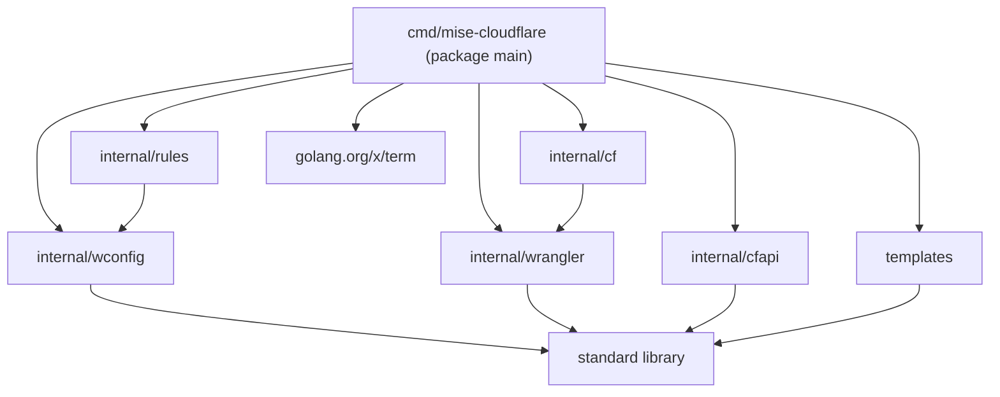
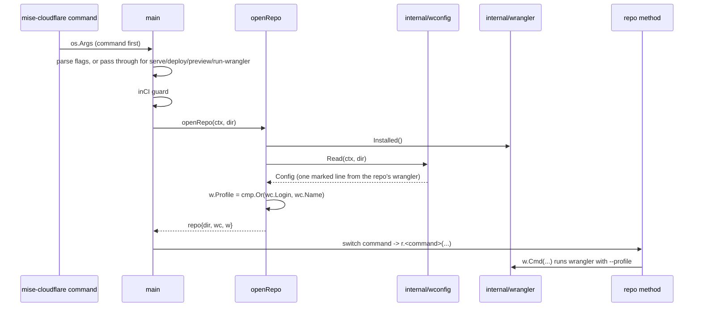

# Architecture

mise-cloudflare is one Go binary with a flat, one-way dependency graph. One package, `cmd/mise-cloudflare`, is the entry point. It imports five internal packages and one template package. No internal package imports the command package, so there are no cycles.

## The module map



The edges are real import statements. `internal/cf` imports `internal/wrangler` (`internal/cf/cf.go:19`). `internal/rules` imports `internal/wconfig` (`internal/rules/rules.go:17`). The three leaf packages import only the standard library: `internal/wconfig`, `internal/wrangler` and `internal/cfapi`. `templates` imports only `embed` and `io/fs`. The one external module is `golang.org/x/term`, used by `clean.go`, `delete.go` and `set_secrets.go`.

The `go.mod` declares the module and the single direct dependency:

```go
module github.com/joeblew999/mise-cloudflare

go 1.26.0

toolchain go1.27.3

require golang.org/x/term v0.47.0

require golang.org/x/sys v0.49.0 // indirect
```

Source: `go.mod:1-9`.

The command package has one file per command. Each file holds a method on the `repo` struct: `check.go` holds `r.check`, `deploy.go` holds `r.deploy`, and so on — except `init`, `template`, `verify`, `show-version` and `show-help`, whose entry points are package functions. `main.go` is the dispatcher. The README states the layout rule: "a file per command, `x.go` holding `r.x`, which `main.go`'s `case "x"` calls" (`README.md:227`).

## The command package in detail

The command package has 24 files. 20 of them are commands or helpers: the 19 command files plus `resources.go` (the preview-resource helpers). `main.go` is the dispatcher. `paths.go` and `paths_windows.go` hold one platform function. `main_test.go` holds the package's unit tests.

### main.go: command-first arguments

`main` takes the command first, before any flags. It strips the command from `os.Args` and keeps the rest as arguments.

```go
func main() {
	// The command first, then its flags. serve, deploy, preview and run-wrangler pass everything after them to wrangler.
	args := os.Args[1:]
	command := ""
	if len(args) > 0 && !strings.HasPrefix(args[0], "-") {
		command, args = args[0], args[1:]
	}
	passes := map[string]bool{"serve": true, "deploy": true, "preview": true, "run-wrangler": true}
```

Source: `cmd/mise-cloudflare/main.go:52-59`.

The first argument is the command only when it does not start with `-`. A bare `mise-cloudflare` leaves `command` empty, which the switch later treats as `show`. The `passes` map names the four commands that pass their arguments straight through to wrangler.

### main.go: the flag set

The flag set declares six flags. Every flag is a command's option. No settings file exists. The README rule states it: "every choice is a task's flag" (`README.md:130`).

```go
	flags := flag.NewFlagSet("mise-cloudflare "+command, flag.ExitOnError)
	jsonOut := flags.Bool("json", false, "print one JSON document on stdout instead of text")
	off := flags.Bool("off", false, "connect-github: turn it off")
	branch := flags.String("branch", "", "connect-github: the branch whose pushes deploy production (default the repository's default branch, or production with --staging)")
	staging := flags.String("staging", "", "connect-github: a staging branch, whose pushes deploy the wrangler environment env.staging")
	build := flags.String("build", "", "connect-github: the build command (default installing from the lockfile: npm ci, …)")
	yes := flags.Bool("yes", false, "delete, clean: don't ask first")
	flags.Usage = func() { fmt.Fprint(os.Stderr, help) }
```

Source: `cmd/mise-cloudflare/main.go:60-67`.

`-json` makes the command print one JavaScript Object Notation (JSON) document. `-off`, `-branch`, `-staging` and `-build` belong to `connect-github`. `-yes` belongs to `delete` and `clean`. The usage function prints the `help` constant to standard error.

For the four pass-through commands, the flags are not parsed. Their arguments go to wrangler unchanged. For every other command, the flags are parsed, and extra positional arguments are an error:

```go
	if !passes[command] {
		flags.Parse(args)
		if flags.NArg() > 0 {
			flags.Usage()
			os.Exit(2)
		}
		args = nil
	}
```

Source: `cmd/mise-cloudflare/main.go:68-75`.

So `mise-cloudflare serve --ip 127.0.0.1` passes `--ip 127.0.0.1` to wrangler. `mise-cloudflare check extra` prints the help and exits with status 2.

### main.go: the pre-open switch

Six commands run before the repository is opened. They do not need the wrangler config. The first switch in `main` handles them and returns.

```go
	ctx := context.Background()
	dir, err := os.Getwd()
	must(err)
	switch command {
	case "show-version":
		showVersion()
		return
	case "show-help":
		showHelp()
		return
	case "init":
		initRepo(dir)
		trustConfig(dir, ".mise/config.toml")
		sayNewest()
		return
	case "template": // a repo with no Worker yet; it never writes over a file, so it runs in CI too (the walk there makes a new repo with it)
		if templateRepo(dir) {
			setUpWorker(ctx, dir)
		}
		return
	case "verify": // before the repo is opened: its setup installs the wrangler that needs
		verify(ctx, dir)
		return
	case "update": // any folder with pins of its own, a Worker or not
		if inCI() {
			fail(errors.New("in CI update doesn't run: CI only checks the repo, and update changes its pins; run mise run cloudflare:update on your machine, then the steps"))
		}
		repo{dir: dir}.update(ctx)
		return
	}
```

Source: `cmd/mise-cloudflare/main.go:76-105`.

`init` writes the template's tool half, trusts `.mise/config.toml` with mise, and prints the newest release. `template` writes the template's Worker into a repository that has none. `verify` runs the setup, test and check sequence that the GitHub workflow runs. `update` refuses to run in Continuous Integration (CI), because CI only checks and update changes pins. `show-version` and `show-help` print and return.

### main.go: the CI guard

After the pre-open switch, one guard stops most commands in CI. CI has no person to click Allow. So only the read-only commands and `clean` may run there.

```go
	// CI only checks the repo; Cloudflare's Workers Builds deploys. No one is there to click Allow.
	if inCI() && command != "" && command != "show" && command != "check" && command != "verify" && command != "serve" && command != "clean" {
		fail(errors.New("in CI there's no one to log in: CI runs mise run cloudflare:verify, and Cloudflare's Workers Builds deploys (mise run cloudflare:09-connect-github)"))
	}
```

Source: `cmd/mise-cloudflare/main.go:106-109`.

The guard allows `show`, `check`, `verify`, `serve` and `clean` in CI. It blocks everything else, including `deploy`, `connect-github` and `login`. `serve` is allowed because its local bindings run without a login. The `inCI` function decides what CI means:

```go
// inCI reports whether this runs in CI (CI=true, as GitHub Actions and every other CI set it).
func inCI() bool {
	return os.Getenv("CI") != "" && os.Getenv("CI") != "false" && os.Getenv("CI") != "0"
}
```

Source: `cmd/mise-cloudflare/main.go:178-181`.

The environment variable `CI` means CI when it is non-empty, and not `false` and not `0`. So `CI=true` and `CI=1` both mean CI. `CI=false`, `CI=0` and an unset variable mean not CI. The test states this exactly:

```go
func TestCI(t *testing.T) {
	for v, want := range map[string]bool{"true": true, "1": true, "": false, "false": false, "0": false} {
		t.Setenv("CI", v)
		if inCI() != want {
			t.Errorf("CI=%q: %v", v, !want)
		}
	}
}
```

Source: `cmd/mise-cloudflare/main_test.go:54-61`.

### main.go: openRepo and the second switch

After the guard, `main` opens the repository and dispatches to the command's method.

```go
	r := openRepo(ctx, dir)
	switch command {
	case "", "show":
		r.show(ctx, *jsonOut)
	case "check":
		r.check(ctx, *jsonOut)
	case "serve":
		r.serve(ctx, args)
	case "set-secrets":
		r.setSecrets(ctx, false)
	case "set-preview-secrets":
		r.setPreviewSecrets(ctx)
	case "deploy":
		r.deploy(ctx, args)
	case "connect-github":
		r.connectGithub(ctx, builds{Branch: *branch, Staging: *staging, Build: *build}, *off, *jsonOut)
	case "preview":
		r.preview(ctx, args)
	case "run-wrangler":
		r.runWrangler(ctx, args)
	case "login":
		r.login(ctx, *jsonOut)
	case "delete":
		r.delete(ctx, *yes)
	case "logout":
		r.logout(ctx)
	case "clean":
		r.clean(*yes)
	default:
		fmt.Fprint(os.Stderr, help)
		os.Exit(2)
	}
}
```

Source: `cmd/mise-cloudflare/main.go:110-141`.

An empty command is `show`. The four pass-through commands receive `args` untouched. `connect-github` receives a `builds` struct built from the three flags. `delete` and `clean` receive the `-yes` boolean. An unknown command prints the help and exits with status 2.

### The repo struct and openRepo

The `repo` struct is the receiver for every command method. It holds the directory, the config and the wrangler runner.

```go
// repo is a Worker repo with its wrangler installed: its config as wrangler reads it, and wrangler on its login.
type repo struct {
	dir string
	wc  wconfig.Config
	w   wrangler.W
}
```

Source: `cmd/mise-cloudflare/main.go:144-149`.

`openRepo` builds that struct. It checks three things in order: the folder has a Worker, the pinned wrangler is installed, and Node runs. Then it reads the config once and names the login.

```go
func openRepo(ctx context.Context, dir string) repo {
	w := wrangler.W{Dir: dir}
	if !hasWorker(dir) {
		fail(errNoWorker)
	}
	if !w.Installed() {
		install := "mise run setup"
		if has := exec.CommandContext(ctx, "mise", "tasks", "info", "setup"); has.Run() != nil {
			_, install = rules.Lockfile(dir)
		}
		fail(errors.New("wrangler isn't installed here: install the repo's dependencies, " + install))
	}
	// wrangler runs on node. The repo's mise.toml pins it (the template's does), and a mise task puts it on the PATH.
	if exec.Command("node", "--version").Run() != nil {
		fail(errors.New("node, which wrangler runs on, doesn't run here: run this through its mise task (mise run cloudflare…), which brings the node the repo's mise.toml pins; a repo with no pin needs one: mise use node@lts"))
	}
	wc, err := wconfig.Read(ctx, dir)
	must(err)
	if wc.Name == "" {
		fail(fmt.Errorf("%s has no name: add one (\"name\"), which wrangler deploy needs and the repo's login is named after", filepath.Base(wc.Path)))
	}
	// The login is named after the Worker at the config's top level: one login for the repo, whichever environment
	// wrangler deploys (CLOUDFLARE_ENV), as they're all on its account.
	w.Profile = cmp.Or(wc.Login, wc.Name)
	return repo{dir: dir, wc: wc, w: w}
}
```

Source: `cmd/mise-cloudflare/main.go:151-176`.

The three failures are informative. A missing Worker names the error. A missing wrangler names the install command, which is `mise run setup` or the lockfile's install. A missing Node names the pin to add. The config read is the one and only read for the whole command. After it, `w.Profile` is the login name: the config's `login` field when present, else the Worker's name.

### emit, fail, buildVersion

The output helpers are small. `emit` writes one JSON document to standard output, indented, with HyperText Markup Language (HTML) escaping turned off.

```go
func emit(v any) {
	enc := json.NewEncoder(os.Stdout)
	enc.SetIndent("", "  ")
	enc.SetEscapeHTML(false)
	must(enc.Encode(v))
}
```

Source: `cmd/mise-cloudflare/main.go:191-196`.

`fail` prints one line to standard error and exits with status 1.

```go
func fail(err error) {
	fmt.Fprintln(os.Stderr, "mise-cloudflare:", err)
	os.Exit(1)
}
```

Source: `cmd/mise-cloudflare/main.go:204-207`.

`buildVersion` returns the version from three places, in order. The release build sets the `version` variable with goreleaser's linker flag. Otherwise Go's build info gives the module version. Otherwise the string is `(devel)`.

```go
// version is set by the release build (goreleaser's -X main.version); otherwise Go's module version, or "(devel)".
var version = ""

func buildVersion() string {
	if version != "" {
		return strings.TrimPrefix(version, "v")
	}
	if bi, ok := debug.ReadBuildInfo(); ok && bi.Main.Version != "" {
		return strings.TrimPrefix(bi.Main.Version, "v")
	}
	return "(devel)"
}
```

Source: `cmd/mise-cloudflare/main.go:209-220`.

The `strings.TrimPrefix` calls strip the leading `v` from a version like `v0.1.36`.

## The full command list

The test declares the command list in the exact order of a repository's tasks. The numbered steps come first, 03 through 14, then `clean`, then the rest.

```go
var commands = []string{"init", "check", "show", "serve", "set-secrets", "deploy", "connect-github", "set-preview-secrets", "preview", "login", "delete", "logout", "clean", "verify", "update", "template", "run-wrangler", "show-version", "show-help"}
```

Source: `cmd/mise-cloudflare/main_test.go:22`.

That is 19 commands. Each is both a binary command and a mise task. The task name adds the number: `cloudflare:08-deploy` names `deploy`. The test's `taskVerb` regular expression checks that mapping: `^cloudflare:(?:\d\d-)?([a-z][a-z-]*)$` (`main_test.go:25`).

## The platform path helper

`longPath` exists for one Windows-specific problem. mise compares a ceiling path against the real path of the repository. On Windows the real path can use short names like `RUNNER~1`. mise needs the long name. Two files split the function by platform.

The non-Windows file is a no-op, guarded by a build tag:

```go
//go:build !windows

package main

// longPath is p as is: only Windows has short names (paths_windows.go).
func longPath(p string) string { return p }
```

Source: `cmd/mise-cloudflare/paths.go:1-6`.

The Windows file has no build tag in the source. Its file name suffix, `_windows.go`, is the build constraint. It calls the Windows system call `GetLongPathName`:

```go
package main

import "syscall"

// longPath is p with Windows' long names (C:\Users\runneradmin, not C:\Users\RUNNER~1), as mise compares a ceiling.
func longPath(p string) string {
	u, err := syscall.UTF16PtrFromString(p)
	if err != nil {
		return p
	}
	buf := make([]uint16, 1024)
	n, err := syscall.GetLongPathName(u, &buf[0], uint32(len(buf)))
	if err != nil || n == 0 || int(n) > len(buf) {
		return p
	}
	return syscall.UTF16ToString(buf[:n])
}
```

Source: `cmd/mise-cloudflare/paths_windows.go:1-17`.

The function converts the path to the Windows text format, calls `GetLongPathName` into a 1024-element buffer, and converts the result back. On any failure it returns the input unchanged. The test uses it to make `MISE_TRUSTED_CONFIG_PATHS` accept the real path (`main_test.go:104`).

## The internal packages at a glance

Each package has one job. The deep dives are in documents 02 through 05.

### internal/wconfig: the one bridge

The package asks the repository's own wrangler for its config. Nothing in mise-cloudflare parses a wrangler config. The package runs a Node script through the installed wrangler. The script calls `wrangler.unstable_readConfig` and returns one marked line. The package decodes that line into a `Config` struct.

```go
type Config struct {
	Path    string   `json:"path"`    // the file wrangler read
	Name    string   `json:"name"`    // the Worker's name, as wrangler resolves it (CLOUDFLARE_ENV included)
	Login   string   `json:"login"`   // the top level's name, whichever environment: the repo's one login is named after it
	Secrets []string `json:"secrets"` // secrets.required
	Envs    []string `json:"envs"`    // the environments the file defines (env.<name>)
	// The Worker's bindings and its previews block's, name → type, as wrangler itself converts them (kv_namespace, d1,
	// queue, workflow, …).
	Bindings        map[string]string `json:"bindings"`
	PreviewBindings map[string]string `json:"previewBindings"`
	// Named and PreviewNamed are the bindings that name the resource they use (wrangler's converted binding has more than
	// its type: an id, a database_name, a bucket_name, …): the developer's, never made or deleted here. One that names
	// none is made by wrangler deploy, by the Worker's name.
	Named        []string `json:"named"`
	PreviewNamed []string `json:"previewNamed"`
	Previews     bool     `json:"previews"` // it has a previews block
	// Remote is the bindings wrangler dev runs on Cloudflare even locally (one with no local simulator, as Workers AI,
	// or marked "remote": true), as wrangler itself picks them: they need the repo's login, and their resource there.
	Remote []string `json:"remote"`
	// CompatibilityDate is the config's compatibility_date; DevDate the one this wrangler's dev uses when a config gives
	// none (its runtime's own date in recent wranglers, today's in older ones).
	CompatibilityDate string `json:"compatibilityDate"`
	DevDate           string `json:"devDate"`
	Warnings          string `json:"-"` // what wrangler said about the config reading it, its own validation
}
```

Source: `internal/wconfig/wconfig.go:18-43`.

`Read` asks for the config in the environment `CLOUDFLARE_ENV` names, or none when it is unset.

```go
// Read asks the wrangler installed in dir (node_modules) for dir's config, in CLOUDFLARE_ENV's environment if it's set.
func Read(ctx context.Context, dir string) (Config, error) {
	return ReadEnv(ctx, dir, os.Getenv("CLOUDFLARE_ENV"))
}
```

Source: `internal/wconfig/wconfig.go:76-79`.

### internal/wrangler: the repo's wrangler

The package runs the repository's own pinned wrangler on the repository's own login. The `W` struct holds the folder and the profile. `bin` finds the wrangler script by walking up from the folder through its `node_modules` folders.

```go
// W is wrangler in a repo folder, on a profile.
type W struct {
	Dir     string // the repo folder: its node_modules holds the pinned wrangler
	Profile string
}

// Installed reports whether the repo's pinned wrangler is installed (the repo's own install).
func (w W) Installed() bool {
	_, err := os.Stat(w.bin())
	return err == nil
}
```

Source: `internal/wrangler/wrangler.go:20-30`.

Every wrangler command gets the profile. `Cmd` appends `--profile` to the arguments. `Plain` is for the auth commands, which name the profile themselves.

```go
// Plain is a wrangler command with no profile: the auth commands, which name the profile themselves, and an older
// wrangler's dev, which has no profiles.
func (w W) Plain(ctx context.Context, args ...string) *exec.Cmd {
	cmd := exec.CommandContext(ctx, "node", append([]string{w.bin()}, args...)...)
	cmd.Dir = w.Dir
	cmd.Env = os.Environ()
	return cmd
}

// Cmd is a wrangler command on the repo's profile.
func (w W) Cmd(ctx context.Context, args ...string) *exec.Cmd {
	return w.Plain(ctx, append(args, "--profile", w.Profile)...)
}
```

Source: `internal/wrangler/wrangler.go:50-62`.

### internal/cf: Cloudflare's cf CLI

The package runs Cloudflare's own command-line interface (CLI), `cf`, on the repository's cf login, for Workers Builds. wrangler's login cannot hold the `workers_builds:write` scope, so `connect-github` uses `cf` instead. The package declares the scopes it needs:

```go
// Scopes is what connect-github needs: the account and Workers Builds.
var Scopes = []string{"account:read", "user:read", "workers:write", "workers_scripts:write", "workers_builds:write"}
```

Source: `internal/cf/cf.go:22-23`.

### internal/cfapi: Cloudflare's API, decided on status

The package calls Cloudflare's application programming interface (API) with the login's Open Authorization (OAuth) token. What is decided on is the HyperText Transfer Protocol (HTTP) status, never the words.

```go
func Call(ctx context.Context, token, method, path string, body []byte, contentType string) (Result, error) {
	var a Result
	req, err := http.NewRequestWithContext(ctx, method, Base+path, bytes.NewReader(body))
	if err != nil {
		return a, err
	}
	req.Header.Set("Authorization", "Bearer "+token)
	if contentType != "" {
		req.Header.Set("Content-Type", contentType)
	}
	resp, err := (&http.Client{Timeout: 30 * time.Second}).Do(req)
	if err != nil {
		return a, fmt.Errorf("%s %s: %w", method, path, err)
	}
	defer resp.Body.Close()
	json.NewDecoder(resp.Body).Decode(&a) // a body that isn't the envelope leaves only the status
	a.Status = resp.StatusCode
	return a, nil
}
```

Source: `internal/cfapi/cfapi.go:49-66`.

The base is `https://api.cloudflare.com/client/v4` (`internal/cfapi/cfapi.go:16`). The `Result` struct keeps the HTTP status and the error envelope. `OK` reports a 2xx status (`internal/cfapi/cfapi.go:32`).

### internal/rules: the check rules

The package is the `check` command. It returns the repository's problems, one line each. A repository must keep its login and secrets out of itself. `Check` starts with the previews problems and wrangler's own warnings.

```go
func Check(dir string, w wconfig.Config) ([]string, error) {
	problems := Previews(w, false)
	bad := func(format string, a ...any) { problems = append(problems, fmt.Sprintf(format, a...)) }
	// wrangler's own validation of the config: what it warned about reading it (an unexpected field, …).
	if w.Warnings != "" {
		bad("wrangler warns about %s:\n%s", filepath.Base(w.Path), w.Warnings)
	}
```

Source: `internal/rules/rules.go:27-34`.

The package scans every git-tracked file for a token or a `wrangler login` call, and checks that secret files are git-ignored. It also checks that wrangler is pinned.

### templates: the embedded repo

The package embeds the template's files with Go's `embed`. It has two halves: the tool half that `init` writes into any repository, and the worker half that `template` writes into a repository with no Worker.

```go
//go:embed .mise/tasks/mise-cloudflare.toml .mise/config.toml
//go:embed .github/workflows/cloudflare.yml
//go:embed .claude/hooks/mise-cloudflare-session-start.sh .claude/settings.json .claude/skills
//go:embed docs/mise-cloudflare
//go:embed .gitignore
var tool embed.FS

// Tool is the template's tool half: the files init writes into a repo, at their paths there.
var Tool fs.FS = tool
```

Source: `templates/templates.go:16-24`.

The second half holds the Worker's own files: `src`, `wrangler.jsonc`, `package.json`, its lockfile, `.dev.vars.example`, `mise.toml` and `README.md` (`templates/templates.go:26-32`).

## The dispatch flow



The config read is the only bridge between the command and wrangler's view of the repository. Everything after it uses the `Config` held in the `repo` struct.

## Aha moments

**Key insight: the config is read once and held in memory.** `openRepo` calls `wconfig.Read` exactly once (`cmd/mise-cloudflare/main.go:167`) and stores the result in `r.wc`. Every command method reads `r.wc`. Nothing re-parses the repository's wrangler config during a command. The one exception proves the rule: `connect-github --staging` reads the `staging` environment's config separately, with `wconfig.ReadEnv(ctx, r.dir, "staging")` (`cmd/mise-cloudflare/connect_github.go:101`), because the main read already resolved `CLOUDFLARE_ENV` or the top level, and `env.staging` is a different environment wrangler would deploy. Even that read runs once, at the point staging is needed.

**Key insight: the pass-through list is the whole wrangler escape hatch.** The four commands in `passes` (`serve`, `deploy`, `preview`, `run-wrangler`) never parse their flags. Any wrangler flag works on those commands without the tool knowing it. The tool adds behavior around wrangler, never in front of it.

## Where to go next

Read [The wconfig bridge](02-the-wconfig-bridge.md) for the full detail of how the config is read through the repository's own wrangler. Read [The login model](03-the-login-model.md) for how the repo's login and the device login work.
