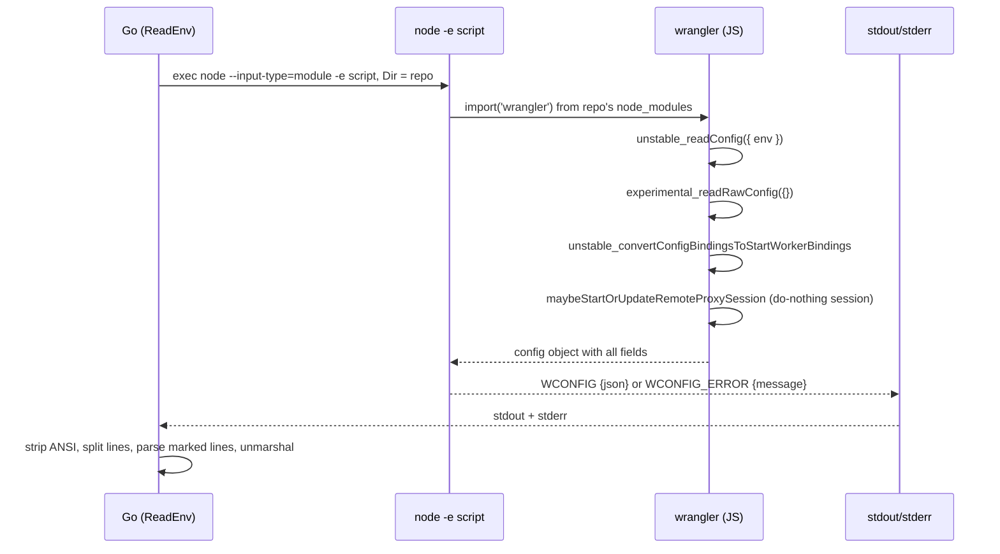

# The wconfig bridge: ask wrangler, never parse its config

Go code in this project never parses a wrangler config file. The bridge in `internal/wconfig` runs the repo's own pinned wrangler. Wrangler reads its own config, converts it, validates it, and prints one marked line. Go parses only that line. This page explains the whole bridge: the embedded JavaScript (JS), the `Config` struct, the marked-line protocol, and the broken-config handling.

## The core idea in one paragraph

A wrangler config (`wrangler.jsonc`, `wrangler.json`, or `wrangler.toml`) is a moving format. Its schema, its validation rules, its binding conversion, and its defaults all change with each wrangler release. If Go parsed the file itself, the tool would drift behind wrangler forever. Instead, Go asks the repo's own pinned wrangler to read the file and report the answer. Whatever wrangler deploys is exactly what the bridge sees.

**Aha: the bridge delegates correctness to the pinned wrangler.** The repo's `package.json` pins one wrangler version. That version owns the schema, the validation, the binding conversion, the remote-binding selection, and the default compatibility date. By asking that version, the bridge stays correct at whatever version the repo pins, forever, with no Go code to update. The alternative, a Go parser, would need to track every wrangler release and every validation rule. The clever move is to not own the format at all.

## The embedded script

The whole read is one JavaScript program embedded as a Go string constant. It imports the repo's own wrangler and calls four of its internal read functions. Source: `internal/wconfig/wconfig.go:50`.

```js
const script = `const w = await import('wrangler');
try {
  const c = w.unstable_readConfig({ env: process.env.CLOUDFLARE_ENV || undefined });
  const r = await w.experimental_readRawConfig({});
  // Older wranglers (4.49) can't convert a block that isn't there, and list a binding with no name (assets without
  // one) under "undefined": neither is a binding the Worker sees.
  const conv = (b) => Object.fromEntries(Object.entries(b ? w.unstable_convertConfigBindingsToStartWorkerBindings(b) ?? {} : {})
    .filter(([n]) => n !== 'undefined'));
  const types = (b) => Object.fromEntries(Object.entries(conv(b)).map(([n, v]) => [n, v.type]));
  // A binding names its resource when wrangler's converted binding has a value besides its type: the fields it was
  // given no value for are there too, undefined.
  const given = (v) => Object.entries(v).some(([k, x]) => k !== 'type' && x !== undefined && x !== null && x !== '');
  const named = (b) => Object.entries(conv(b)).filter(([, v]) => given(v)).map(([n]) => n);
  // wrangler's own pick of the bindings dev runs remotely: asked to update a session of ours, its remote proxy session
  // call hands that session those bindings and starts nothing.
  const session = { ready: Promise.resolve(), updateBindings: async () => {}, dispose: async () => {} };
  const picked = await w.maybeStartOrUpdateRemoteProxySession({ name: c.name ?? 'worker', bindings: conv(c) }, { session, remoteBindings: {} });
  console.log('WCONFIG ' + JSON.stringify({ path: c.configPath, name: c.name, secrets: c.secrets?.required ?? [],
    login: r.rawConfig.name ?? c.name, envs: Object.keys(r.rawConfig.env ?? {}), previews: c.previews !== undefined,
    compatibilityDate: c.compatibility_date ?? '', devDate: w.unstable_getDevCompatibilityDate?.() ?? '',
    bindings: types(c), previewBindings: types(c.previews), named: named(c), previewNamed: named(c.previews),
    remote: Object.keys(picked?.remoteBindings ?? {}).sort() }));
} catch (e) {
  console.log('WCONFIG_ERROR ' + JSON.stringify(String(e?.message ?? e)));
}`
```

The script calls four wrangler functions, in order:

1. `unstable_readConfig` reads the config in one environment and returns the resolved Worker fields. The environment comes from the `CLOUDFLARE_ENV` environment variable, or none. Its answer `c` holds `name`, `configPath`, `secrets`, `previews`, and `compatibility_date`.
2. `experimental_readRawConfig` returns the raw file, unmerged, so the script can see the top-level name and the list of environments. Its answer `r.rawConfig.name` is the top-level name; `r.rawConfig.env` holds every `env.<name>` block.
3. `unstable_convertConfigBindingsToStartWorkerBindings` turns each binding block (`kv_namespaces`, `d1_databases`, `workflows`, and so on) into the shape a Worker actually sees: name to a converted binding object.
4. `maybeStartOrUpdateRemoteProxySession` reports which bindings `wrangler dev` runs remotely. The fake `session` object has a do-nothing `updateBindings`, so wrangler starts no proxy. The script only reads the returned `picked.remoteBindings` names.

Three small helpers shape the converted bindings. `conv` drops any binding named `"undefined"` (older wranglers emit that for an assets block with no name). `types` keeps only each binding's `type` field. `given` decides whether a binding names its resource, by checking whether any field besides `type` has a real value. `named` collects the names that pass `given`.

The result is printed as one line starting with `WCONFIG `, then a JavaScript Object Notation (JSON) object. A failure prints `WCONFIG_ERROR `, then the error message as JSON. These two prefixes are the whole protocol between the script and Go.

## The Config struct, field by field

Go unmarshals the `WCONFIG` line straight into this struct. Source: `internal/wconfig/wconfig.go:19`.

```go
// Config is what the tasks need from a repo's wrangler config, as wrangler reads it.
type Config struct {
	Path    string   `json:"path"`    // the file wrangler read
	Name    string   `json:"name"`    // the Worker's name, as wrangler resolves it (CLOUDFLARE_ENV included)
	Login   string   `json:"login"`   // the top level's name, whichever environment: the repo's one login is named after it
	Secrets []string `json:"secrets"` // secrets.required
	Envs    []string `json:"envs"`    // the environments the file defines (env.<name>)
	// The Worker's bindings and its previews block's, name → type, as wrangler itself converts them (kv_namespace, d1,
	// queue, workflow, …).
	Bindings        map[string]string `json:"bindings"`
	PreviewBindings map[string]string `json:"previewBindings"`
	// Named and PreviewNamed are the bindings that name the resource they use (wrangler's converted binding has more than
	// its type: an id, a database_name, a bucket_name, …): the developer's, never made or deleted here. One that names
	// none is made by wrangler deploy, by the Worker's name.
	Named        []string `json:"named"`
	PreviewNamed []string `json:"previewNamed"`
	Previews     bool     `json:"previews"` // it has a previews block
	// Remote is the bindings wrangler dev runs on Cloudflare even locally (one with no local simulator, as Workers AI,
	// or marked "remote": true), as wrangler itself picks them: they need the repo's login, and their resource there.
	Remote []string `json:"remote"`
	// CompatibilityDate is the config's compatibility_date; DevDate the one this wrangler's dev uses when a config gives
	// none (its runtime's own date in recent wranglers, today's in older ones).
	CompatibilityDate string `json:"compatibilityDate"`
	DevDate           string `json:"devDate"`
	Warnings          string `json:"-"` // what wrangler said about the config reading it, its own validation
}
```

Each field and its meaning:

| Field | Type | Meaning |
|-------|------|---------|
| `Path` | `string` | The config file wrangler read, from `configPath`. Usually `wrangler.jsonc`. |
| `Name` | `string` | The Worker name as wrangler resolves it, including the `CLOUDFLARE_ENV` environment. |
| `Login` | `string` | The top-level name, whichever environment. The repo's single login profile is named after it. |
| `Secrets` | `[]string` | The `secrets.required` list from the active environment. |
| `Envs` | `[]string` | Every `env.<name>` key the raw file defines. |
| `Bindings` | `map[string]string` | Production (top-level) bindings: name to converted type. |
| `PreviewBindings` | `map[string]string` | The `previews` block's bindings: name to converted type. |
| `Named` | `[]string` | Production bindings that name their resource. These belong to the developer. |
| `PreviewNamed` | `[]string` | Preview bindings that name their resource. |
| `Previews` | `bool` | True when the config has a `previews` block. |
| `Remote` | `[]string` | Binding names `wrangler dev` runs on Cloudflare even locally. |
| `CompatibilityDate` | `string` | The config's `compatibility_date`, or empty when none is set. |
| `DevDate` | `string` | The default date this wrangler's `dev` uses when the config sets none. |
| `Warnings` | `string` | Wrangler's own validation text. It has `json:"-"`, so it never comes from the JSON line. |

Two small methods read the struct. Source: `internal/wconfig/wconfig.go:123`.

```go
// HasEnv reports whether the config defines the wrangler environment env (env.<env>).
func (c Config) HasEnv(env string) bool { return slices.Contains(c.Envs, env) }

// Names reports whether the binding names the resource it uses: the developer's, so never made or deleted here.
func (c Config) Names(binding string) bool { return slices.Contains(c.Named, binding) }
```

`HasEnv` answers whether a given environment exists. `Names` answers whether a binding names its own resource. The check rules consume both; see [The check rules](05-the-check-rules.md).

## The PreviewsOwn map

One exported map pairs wrangler's binding types with their short labels. Source: `internal/wconfig/wconfig.go:47`.

```go
// PreviewsOwn is the binding kinds, by wrangler's own types, whose resources previews get of their own from mise-cloudflare
// (wrangler deploy makes them by name for production, wrangler preview makes none): their labels.
var PreviewsOwn = map[string]string{"kv_namespace": "KV", "d1": "D1", "r2_bucket": "R2", "queue": "Queue", "flagship": "Flagship"}
```

The meaning: `wrangler deploy` creates these resources by name for production. `wrangler preview` creates none. So for a preview, the tool creates its own resources and keeps them. The five entries are `kv_namespace` (Cloudflare's key-value store, labeled "KV"), `d1` (Cloudflare's serverless database, labeled "D1"), `r2_bucket` (Cloudflare's object storage, labeled "R2"), `queue` (labeled "Queue"), and `flagship` (labeled "Flagship"). The test harness uses this map to mark a binding as `(named)` when it both belongs to `PreviewsOwn` and names its resource. See `internal/wconfig/wconfig_test.go:222`. The full resource story is in [Secrets and resources](10-secrets-and-resources.md).

## Read and ReadEnv

`Read` is the public entry point. It reads in the `CLOUDFLARE_ENV` environment if that environment variable is set. Source: `internal/wconfig/wconfig.go:77`.

```go
// Read asks the wrangler installed in dir (node_modules) for dir's config, in CLOUDFLARE_ENV's environment if it's set.
func Read(ctx context.Context, dir string) (Config, error) {
	return ReadEnv(ctx, dir, os.Getenv("CLOUDFLARE_ENV"))
}
```

`ReadEnv` does the real work. Source: `internal/wconfig/wconfig.go:84`.

```go
var ansi = regexp.MustCompile(`\x1b\[[0-9;]*m`)

// ReadEnv is Read in the wrangler environment env ("" for none): the Worker that environment deploys.
func ReadEnv(ctx context.Context, dir, env string) (Config, error) {
	var c Config
	cmd := exec.CommandContext(ctx, "node", "--input-type=module", "-e", script)
	cmd.Dir = dir
	cmd.Env = append(os.Environ(), "CLOUDFLARE_ENV="+env)
	var stderr bytes.Buffer
	cmd.Stderr = &stderr
	out, err := cmd.Output()
	if err != nil {
		return c, fmt.Errorf("wrangler couldn't run here (install the repo's dependencies first: its package.json pins wrangler): %w\n%s", err, bytes.TrimSpace(stderr.Bytes()))
	}
	// wrangler prints what it finds wrong in the config (unexpected fields, …) around the marked line.
	var said []string
	found := false
	for _, line := range strings.Split(ansi.ReplaceAllString(string(out)+"\n"+stderr.String(), ""), "\n") {
		if b, ok := strings.CutPrefix(line, "WCONFIG_ERROR "); ok {
			var msg string
			json.Unmarshal([]byte(b), &msg)
			return c, errors.New("wrangler can't read the config: " + strings.TrimSpace(msg))
		}
		if b, ok := strings.CutPrefix(line, "WCONFIG "); ok {
			if err := json.Unmarshal([]byte(b), &c); err != nil {
				return c, err
			}
			found = true
			continue
		}
		if strings.TrimSpace(line) != "" {
			said = append(said, strings.TrimRight(line, " "))
		}
	}
	if !found {
		return c, fmt.Errorf("wrangler printed no config here:\n%s", strings.Join(said, "\n"))
	}
	c.Warnings = strings.Join(said, "\n")
	return c, nil
}
```

The flow, step by step:

1. It builds the command `node --input-type=module -e <script>`. It runs in `dir`, so node's own import resolution finds `wrangler` in `node_modules` in `dir` or a folder above it. The repo's `package.json` pins that wrangler version. Finding wrangler is delegated to node.
2. It appends `CLOUDFLARE_ENV=<env>` to the environment. The script turns an empty value into `undefined`.
3. It runs the command. `cmd.Output()` captures standard output; standard error goes into the `stderr` buffer.
4. On a run error, it returns `wrangler couldn't run here`, with a hint to install the repo's dependencies.
5. It joins standard output and standard error, strips American National Standards Institute (ANSI) escape codes with the `ansi` regular expression, and splits into lines.
6. A `WCONFIG_ERROR` line becomes the error `wrangler can't read the config: <message>`.
7. A `WCONFIG` line is unmarshaled into `Config`. The `found` flag is set.
8. Every other non-empty line is collected into `said`, after trimming trailing spaces.
9. When no `WCONFIG` line appeared, it returns `wrangler printed no config here`, with the collected lines.
10. Otherwise the collected lines become `Warnings`, and it returns the config.

The `ansi` regular expression is `\x1b\[[0-9;]*m`. It matches a standard escape sequence: the escape byte, an open bracket, digits and semicolons, then `m`. Wrangler colors its warnings, so the strip keeps those lines plain before parsing.

## How the JSON maps onto the struct

The `WCONFIG` object is built with exactly these keys, and each matches one struct field.

```mermaid
flowchart TD
    J["WCONFIG line: one JSON object"] --> P["json.Unmarshal into Config"]
    P --> F1["path: c.configPath → Path"]
    P --> F2["name: c.name → Name"]
    P --> F3["login: rawConfig.name ?? c.name → Login"]
    P --> F4["secrets: c.secrets?.required ?? [] → Secrets"]
    P --> F5["envs: Object.keys(rawConfig.env ?? {}) → Envs"]
    P --> F6["previews: c.previews !== undefined → Previews"]
    P --> F7["bindings: types(c) → Bindings"]
    P --> F8["previewBindings: types(c.previews) → PreviewBindings"]
    P --> F9["named: named(c) → Named"]
    P --> F10["previewNamed: named(c.previews) → PreviewNamed"]
    P --> F11["compatibilityDate: c.compatibility_date ?? '' → CompatibilityDate"]
    P --> F12["devDate: unstable_getDevCompatibilityDate?.() ?? '' → DevDate"]
    P --> F13["remote: sorted keys of picked.remoteBindings → Remote"]
    P -. "not in JSON (json:\"-\")" .-> W["Warnings, from the leftover printed lines"]
```

Three things are worth calling out:

- `Login` prefers the raw top-level name over the resolved name. The fallback `?? c.name` covers an older wrangler whose raw read returns nothing.
- `DevDate` uses optional chaining `?.()`. Older wranglers lack `unstable_getDevCompatibilityDate`, so the call is guarded and falls back to empty.
- `Remote` is sorted before it is printed. The order is stable, so tests can compare slices directly.

## The sequence: Go asks node, node asks wrangler



## Broken configs: the testdata files

The test folder holds four configs that exercise the bridge's error handling. Each test runs the read through the template's own wrangler, in a temporary folder with the file named as wrangler expects. The helper `read` symlinks the template's `node_modules` and writes the file as `wrangler<ext>`. Source: `internal/wconfig/wconfig_test.go:24`.

```go
func read(t *testing.T, config, env string) (Config, error) {
	t.Helper()
	modules, _ := filepath.Abs(filepath.Join("..", "..", "templates", "node_modules"))
	if _, err := os.Stat(filepath.Join(modules, "wrangler")); err != nil {
		t.Skip("the template's wrangler isn't installed: mise run template:setup")
	}
	dir := t.TempDir()
	b, err := os.ReadFile(config)
	if err != nil {
		t.Fatal(err)
	}
	os.MkdirAll(filepath.Join(dir, "src"), 0o755)
	os.WriteFile(filepath.Join(dir, "src", "index.js"), []byte("export default {}\n"), 0o644)
	os.WriteFile(filepath.Join(dir, "wrangler"+filepath.Ext(config)), b, 0o644)
	link(t, modules, filepath.Join(dir, "node_modules"))
	return ReadEnv(context.Background(), dir, env)
}
```

The four files:

- `broken-field.jsonc` has an unexpected field, `kv_namespacez`. Wrangler reads it but warns. The warning reaches `Warnings`.
- `broken-type.jsonc` has `"minify": "yes"`, where wrangler wants a boolean. Wrangler refuses to read it. The bridge returns an error containing `wrangler can't read the config` and `minify`.
- `bare.jsonc` has a name, a main, and a compatibility date, and nothing else. It reads with no previews, no bindings, and no warnings.
- `adopted.jsonc` is a full third-party project: a top-level development environment, an `env.production` block, resources named by identifier, a Durable Object, a Workflow, and Workers AI.

`TestBroken` asserts the two failure shapes. Source: `internal/wconfig/wconfig_test.go:105`.

```go
// TestBroken: wrangler's own validation comes through: an unexpected field as its warning, a wrong type as its error.
func TestBroken(t *testing.T) {
	w, err := read(t, filepath.Join("testdata", "broken-field.jsonc"), "")
	if err != nil || !strings.Contains(w.Warnings, "kv_namespacez") {
		t.Errorf("an unexpected field: warnings %q, err %v", w.Warnings, err)
	}
	if _, err := read(t, filepath.Join("testdata", "broken-type.jsonc"), ""); err == nil || !strings.Contains(err.Error(), "wrangler can't read the config") || !strings.Contains(err.Error(), "minify") {
		t.Errorf("a wrong type: err %v", err)
	}
	w, err = read(t, filepath.Join("testdata", "bare.jsonc"), "")
	if err != nil || w.Previews || len(w.Bindings) != 0 || w.Warnings != "" {
		t.Errorf("bare: %+v, %v", w, err)
	}
}
```

The distinction matters: an unexpected field is a warning, not an error. A wrong type is a hard error. Both come from wrangler's own validation, not from Go. The bridge simply passes them through.

The `broken-field.jsonc` file itself is tiny. Source: `internal/wconfig/testdata/broken-field.jsonc:1`.

```jsonc
{
  // An unexpected field: wrangler reads it, and warns.
  "name": "broken-field",
  "main": "src/index.js",
  "compatibility_date": "2026-10-01",
  "kv_namespacez": [{ "binding": "KV" }],
}
```

And the wrong type. Source: `internal/wconfig/testdata/broken-type.jsonc:1`.

```jsonc
{
  // A field of the wrong type: wrangler refuses to read it.
  "name": "broken-type",
  "main": "src/index.js",
  "compatibility_date": "2026-10-01",
  "minify": "yes",
}
```

## The adopted project, read twice

`adopted.jsonc` is the richest test file. Its top level is development, and its `env.production` block is production. Source: `internal/wconfig/testdata/adopted.jsonc:1`.

```jsonc
{
  // A project mise-cloudflare didn't make: the top level is development, env.production is production, and its
  // resources are its own, named by ID. Comments and trailing commas, as real configs have them.
  "name": "adopted-dev",
  "main": "src/index.js",
  "compatibility_date": "2026-10-01",
  "migrations": [{ "tag": "v1", "new_sqlite_classes": ["Limiter"] }],
  "vars": { "MODE": "development" },
  "hyperdrive": [
    { "binding": "DB", "id": "0123456789abcdef0123456789abcdef", "localConnectionString": "postgresql://localhost:5432/app" },
  ],
  // Development uses production's cache, on Cloudflare even locally.
  "kv_namespaces": [{ "binding": "CACHE", "id": "fedcba9876543210fedcba9876543210", "remote": true }],
  "durable_objects": { "bindings": [{ "name": "LIMITER", "class_name": "Limiter" }] },
  "workflows": [{ "name": "index-workflow", "binding": "INDEX", "class_name": "IndexWorkflow" }],
  "ai": { "binding": "AI" },
  "secrets": { "required": ["API_KEY", "SIGNING_KEY"] },
  "env": {
    "production": {
      "name": "adopted",
      "vars": { "MODE": "production" },
      "hyperdrive": [{ "binding": "DB", "id": "0123456789abcdef0123456789abcdef" }],
      "kv_namespaces": [{ "binding": "CACHE", "id": "fedcba9876543210fedcba9876543210" }],
      "durable_objects": { "bindings": [{ "name": "LIMITER", "class_name": "Limiter" }] },
      "workflows": [{ "name": "index-workflow", "binding": "INDEX", "class_name": "IndexWorkflow" }],
      "ai": { "binding": "AI" },
      "triggers": { "crons": ["0 */12 * * *"] },
      "secrets": { "required": ["API_KEY", "SIGNING_KEY"] },
    },
  },
}
```

`TestAdopted` reads it twice: once with no environment and once with `production`. Source: `internal/wconfig/wconfig_test.go:60`.

```go
func TestAdopted(t *testing.T) {
	for _, c := range []struct {
		env, name string
		remote    []string
	}{{"", "adopted-dev", []string{"AI", "CACHE"}}, {"production", "adopted", []string{"AI"}}} {
		w, err := read(t, filepath.Join("testdata", "adopted.jsonc"), c.env)
		if err != nil {
			t.Fatal(err)
		}
		if w.Name != c.name || w.Login != "adopted-dev" || !w.HasEnv("production") || w.HasEnv("staging") || w.Previews || w.Warnings != "" {
			t.Errorf("env %q: name %q, login %q, envs %q, previews %v, warnings %q", c.env, w.Name, w.Login, w.Envs, w.Previews, w.Warnings)
		}
		want := map[string]string{"DB": "hyperdrive", "CACHE": "kv_namespace", "LIMITER": "durable_object_namespace", "INDEX": "workflow"}
		for n, typ := range want {
			if w.Bindings[n] != typ {
				t.Errorf("env %q: binding %s is %q, want %q (all: %v)", c.env, n, w.Bindings[n], typ, w.Bindings)
			}
		}
		if !w.Names("CACHE") || !w.Names("DB") || !slices.Equal(w.Secrets, []string{"API_KEY", "SIGNING_KEY"}) {
			t.Errorf("env %q: named %q, secrets %q", c.env, w.Named, w.Secrets)
		}
		// Workers AI has no local simulator; development's CACHE is marked remote, production's isn't.
		if !slices.Equal(w.Remote, c.remote) {
			t.Errorf("env %q: remote %q, want %q", c.env, w.Remote, c.remote)
		}
	}
}
```

The assertions show the bridge at work:

- The `Name` changes with the environment: `adopted-dev` at the top level, `adopted` in `production`. The `Login` stays `adopted-dev` in both.
- `HasEnv("production")` is true and `HasEnv("staging")` is false.
- The converted binding types are `hyperdrive`, `kv_namespace`, `durable_object_namespace`, and `workflow`.
- `Names("CACHE")` and `Names("DB")` are true, because those bindings name resources by identifier.
- `Remote` differs by environment. Workers AI (`AI`) has no local simulator, so it is remote in both. Development's `CACHE` has `"remote": true`, so it is remote there; production's `CACHE` has no such mark, so it is not.

## The template's config and the repos sweep

`TestTemplate` reads the template's own `wrangler.jsonc`, whose KV, D1, and R2 name nothing. Wrangler deploy makes them by name. Source: `internal/wconfig/wconfig_test.go:89`.

```go
// TestTemplate: the template's own config: its KV, D1 and R2 name nothing, so wrangler deploy makes them.
func TestTemplate(t *testing.T) {
	w, err := read(t, filepath.Join("..", "..", "templates", "wrangler.jsonc"), "")
	if err != nil {
		t.Fatal(err)
	}
	if w.Name != "mise-cloudflare-template" || len(w.Named) != 0 || !w.Previews || len(w.Envs) != 0 || len(w.Remote) != 0 || w.Warnings != "" {
		t.Errorf("name %q, named %q, previews %v, envs %q, remote %q, warnings %q", w.Name, w.Named, w.Previews, w.Envs, w.Remote, w.Warnings)
	}
	for n, typ := range map[string]string{"DB": "d1", "KV": "kv_namespace", "BUCKET": "r2_bucket"} {
		if w.Bindings[n] != typ {
			t.Errorf("binding %s is %q, want %q", n, w.Bindings[n], typ)
		}
	}
}
```

The template's bindings are `DB` of type `d1`, `KV` of type `kv_namespace`, and `BUCKET` of type `r2_bucket`. `len(w.Named) != 0` fails if any names its resource; here none do.

Finally, `TestRepos` reads every wrangler config in third-party repositories, at the top level and in each environment. It runs only under `mise run repos:check`, because it clones. Source: `internal/wconfig/wconfig_test.go:123`.

```go
// TestRepos reads every wrangler config in third-party repos with our wrangler, at the top level and in each
// environment, as the tasks would: the repos named (owner/repo, or owner/repo@commit), else repos.txt's, each cloned
// into repos/<owner>/<repo>. A config the bridge can't read fails; one wrangler warns about, or that asks for a later
// compatibility date than our wrangler's runtime has, is reported.
func TestRepos(t *testing.T) {
	if !*repos {
		t.Skip("mise run repos:check runs it: it clones")
	}
```

This is the bridge's real-world proof: it reads arbitrary configs written by other people, with the tool's own wrangler, and reports what warns or fails. A config the bridge cannot read fails the test. A config wrangler warns about, or one that asks for a compatibility date later than the wrangler runtime has, is reported as a warning. This is the regression net that keeps the bridge honest against the wider wrangler ecosystem.

## Where to go next

The bridge produces a `Config`, but the login is a separate concern. Read [The login model](03-the-login-model.md) for how the repo gets its own wrangler auth profile. Then read [The Cloudflare API and the cf CLI](04-cloudflare-api-and-cf-cli.md) for how the tool calls Cloudflare directly with the login's token.
