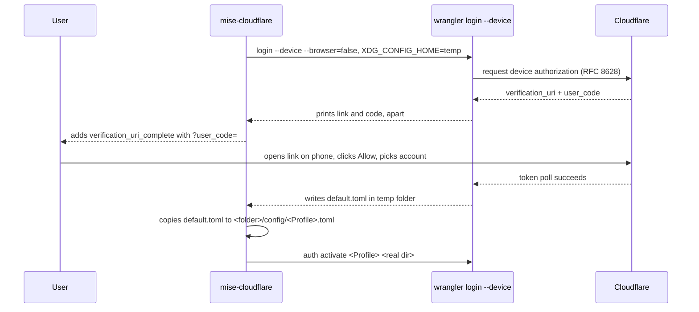
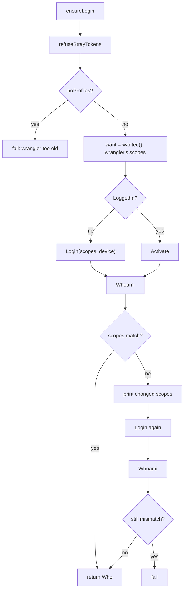

# The login model: one wrangler auth profile per repo folder

Every repo gets its own login. The login is a wrangler auth profile, created with a fixed set of scopes and bound to the repo's folder by its real path. Nothing depends on which login wrangler would pick for the folder. This page explains the profile machinery in `internal/wrangler`, the device login flow, and the login command's decision tree.

## The core idea in one paragraph

A wrangler login normally lives in a machine-global folder and gets picked per folder by wrangler's own rules. This project refuses that ambiguity. It makes one profile per repo, named after the Worker's top-level name, and passes `--profile` to every command. The profile is bound to the repo folder with `wrangler auth activate`. The result: the repo always runs on its own login, no matter what other logins exist on the machine.

**Aha: `whoami` is run without `--profile` on purpose.** The wrangler `whoami` command takes no `--profile`. It reports the folder's active login. So the check runs `whoami` plain, then refuses unless its text says `Active profile: <profile>`. That proves the folder is bound to the repo's profile, not to the machine's global login. If the binding is wrong, the tool stops instead of silently deploying on someone else's account.

## The W struct and finding the binary

`W` is wrangler in one repo folder, on one profile. Source: `internal/wrangler/wrangler.go:21`.

```go
// W is wrangler in a repo folder, on a profile.
type W struct {
	Dir     string // the repo folder: its node_modules holds the pinned wrangler
	Profile string
}
```

`Dir` points at the repo folder. `Profile` is the auth profile name, set in `openRepo` from the config's login name. Source: `cmd/mise-cloudflare/main.go:174`.

```go
	// The login is named after the Worker at the config's top level: one login for the repo, whichever environment
	// wrangler deploys (CLOUDFLARE_ENV), as they're all on its account.
	w.Profile = cmp.Or(wc.Login, wc.Name)
```

`Installed` reports whether the pinned wrangler is present. `bin` finds the wrangler entry file by walking up from the repo folder, the same way node does. Source: `internal/wrangler/wrangler.go:27`.

```go
// Installed reports whether the repo's pinned wrangler is installed (the repo's own install).
func (w W) Installed() bool {
	_, err := os.Stat(w.bin())
	return err == nil
}

// bin is the repo's wrangler, found as node finds it: in node_modules in the repo folder or a folder above it (a
// workspace installs it at its root).
func (w W) bin() string {
	first := ""
	for d := w.Dir; ; d = filepath.Dir(d) {
		p := filepath.Join(d, "node_modules", "wrangler", "bin", "wrangler.js")
		if _, err := os.Stat(p); err == nil {
			return p
		}
		if first == "" {
			first = p
		}
		if d == filepath.Dir(d) {
			return first
		}
	}
}
```

The loop checks `node_modules/wrangler/bin/wrangler.js` in the repo folder, then each parent, up to the filesystem root. It remembers the first path tried, so when nothing exists it returns that path, and the caller's error message names the place it looked. A workspace can install wrangler at its root; the walk finds it there.

## Running wrangler: Plain, Cmd, Interactive, Output

Four helpers wrap process execution. Source: `internal/wrangler/wrangler.go:52`.

```go
// Plain is a wrangler command with no profile: the auth commands, which name the profile themselves, and an older
// wrangler's dev, which has no profiles.
func (w W) Plain(ctx context.Context, args ...string) *exec.Cmd {
	cmd := exec.CommandContext(ctx, "node", append([]string{w.bin()}, args...)...)
	cmd.Dir = w.Dir
	cmd.Env = os.Environ()
	return cmd
}

// Cmd is a wrangler command on the repo's profile.
func (w W) Cmd(ctx context.Context, args ...string) *exec.Cmd {
	return w.Plain(ctx, append(args, "--profile", w.Profile)...)
}

// Interactive runs cmd on this terminal.
func Interactive(cmd *exec.Cmd) error {
	cmd.Stdin, cmd.Stdout, cmd.Stderr = os.Stdin, os.Stdout, os.Stderr
	return cmd.Run()
}
```

`Plain` runs node on the repo's wrangler entry file, in the repo folder, with no profile. It is for the auth commands, which name the profile themselves. `Cmd` is `Plain` plus a trailing `--profile <Profile>`. `Interactive` wires the command to the real terminal and runs it, used for the browser login.

`Output` runs a command with no input and returns standard output; on failure the error carries standard error. Source: `internal/wrangler/wrangler.go:96`.

```go
// Output runs cmd with no input and returns its stdout; on failure the error carries its stderr.
func Output(cmd *exec.Cmd) ([]byte, error) {
	var stderr bytes.Buffer
	cmd.Stdin, cmd.Stderr = nil, &stderr
	out, err := cmd.Output()
	if err != nil {
		return out, fmt.Errorf("wrangler %s: %w\n%s", cmd.Args[2], err, bytes.TrimSpace(stderr.Bytes()))
	}
	return out, nil
}
```

`cmd.Args[2]` is the wrangler subcommand name, because `cmd.Args` starts with `node` and the entry file path.

## Querying wrangler: HasProfiles, Version, LoggedIn, Whoami

`HasProfiles` reports whether this wrangler has auth profiles at all. An older wrangler (4.49.0) has none and refuses `wrangler auth list`. Source: `internal/wrangler/wrangler.go:108`.

```go
// HasProfiles reports whether the repo's wrangler has auth profiles (wrangler auth), which a repo's login is: an older
// wrangler (4.49.0) has none, and refuses wrangler auth list.
func (w W) HasProfiles(ctx context.Context) bool {
	return w.Plain(ctx, "auth", "list").Run() == nil
}
```

`Version` reads the installed wrangler's version from its own `package.json`. Source: `internal/wrangler/wrangler.go:113`.

```go
// Version is the repo's installed wrangler's version, from its own package.json.
func (w W) Version() string {
	var p struct{ Version string }
	b, err := os.ReadFile(filepath.Join(filepath.Dir(filepath.Dir(w.bin())), "package.json"))
	if err != nil || json.Unmarshal(b, &p) != nil || p.Version == "" {
		return "not installed"
	}
	return p.Version
}
```

`LoggedIn` reports whether the profile has a login on this machine, from `wrangler auth list`. Source: `internal/wrangler/wrangler.go:124`.

```go
// LoggedIn reports whether the profile has a login on this machine, from wrangler's own list of them (wrangler auth
// list).
func (w W) LoggedIn(ctx context.Context) bool {
	out, err := w.Plain(ctx, "auth", "list").CombinedOutput()
	return err == nil && listed(out, w.Profile)
}

// listed reports whether wrangler auth list's table has profile in its first column.
func listed(table []byte, profile string) bool {
	return regexp.MustCompile(`(?m)^│ ` + regexp.QuoteMeta(profile) + ` +│`).Match(table)
}
```

`listed` matches the table's first column. The pattern is `(?m)^│ `, then the escaped profile name, then spaces and a box-drawing `│`. This works because `wrangler auth list` draws a table with `│` borders.

`Whoami` is the crucial check. Source: `internal/wrangler/wrangler.go:141`.

```go
// Who is wrangler whoami: the login's email, accounts and OAuth scopes.
type Who struct {
	LoggedIn bool      `json:"loggedIn"`
	Email    string    `json:"email"`
	Accounts []Account `json:"accounts"`
	Scopes   []string  `json:"tokenPermissions"`
}

// Whoami is the profile's login. wrangler whoami takes no --profile (it reports the folder's active login), so this
// runs it on the folder's binding (Activate) and refuses unless wrangler names this profile as the active one.
func (w W) Whoami(ctx context.Context) (Who, error) {
	var who Who
	text, err := Output(w.Plain(ctx, "whoami"))
	if err != nil {
		return who, err
	}
	if !activeProfile(text, w.Profile) {
		return who, fmt.Errorf("wrangler isn't using the login %s in %s, so it would run on another login", w.Profile, w.Dir)
	}
	out, err := Output(w.Plain(ctx, "whoami", "--json"))
	if err != nil {
		return who, err
	}
	return who, json.Unmarshal(out, &who)
}

// activeProfile reports whether wrangler whoami's text names profile as the folder's active login.
func activeProfile(text []byte, profile string) bool {
	for _, line := range bytes.Split(text, []byte("\n")) {
		if string(bytes.TrimSpace(line)) == "Active profile: "+profile {
			return true
		}
	}
	return false
}
```

`Who` carries the login's email, its accounts, and its Open Authorization (OAuth) scopes, under the key `tokenPermissions`. `Whoami` runs the plain `whoami`, then checks that one line reads exactly `Active profile: <profile>`. If not, it returns an error naming the profile and the folder. Only then does it run `whoami --json` and unmarshal the result.

## Token and Scopes

`Token` returns the profile's current OAuth token, for Cloudflare's Application Programming Interface (API). Source: `internal/wrangler/wrangler.go:177`.

```go
// Token is the profile's current OAuth token (wrangler refreshes it when it has expired), for Cloudflare's API.
func (w W) Token(ctx context.Context) (string, error) {
	var t struct{ Type, Token string }
	out, err := Output(w.Cmd(ctx, "auth", "token", "--json"))
	if err == nil {
		err = json.Unmarshal(out, &t)
	}
	if err == nil && t.Token == "" {
		err = errors.New("wrangler auth token: no token")
	}
	return t.Token, err
}
```

It runs `wrangler auth token --json` with the profile, then unmarshals the token. An empty token is an error. Wrangler refreshes an expired token itself.

`Scopes` returns the OAuth scopes wrangler's own login asks for. Source: `internal/wrangler/wrangler.go:191`.

```go
// Scopes are the OAuth scopes wrangler's own login asks for (wrangler login --scopes-list): wrangler keeps them, for
// everything it does, so a repo's login with them can do what wrangler can.
func (w W) Scopes(ctx context.Context) ([]string, error) {
	cmd := w.Plain(ctx, "login", "--scopes-list")
	out, err := cmd.CombinedOutput()
	if err != nil {
		return nil, fmt.Errorf("wrangler login --scopes-list: %w: %s", err, out)
	}
	var scopes []string
	for _, m := range scopeRow.FindAllSubmatch(out, -1) {
		scopes = append(scopes, string(m[1]))
	}
	if len(scopes) == 0 {
		return nil, fmt.Errorf("wrangler login --scopes-list listed no scopes:\n%s", out)
	}
	return scopes, nil
}

// scopeRow is one scope in wrangler's table of them: "│ workers_kv:write │ See and change …".
var scopeRow = regexp.MustCompile(`(?m)^│ ([a-z0-9][a-z0-9_:.-]*) +│`)
```

`scopeRow` matches one table row: `│ `, then a scope token, then spaces and `│`. Each match's first group is the scope name. The scopes come from wrangler itself, not from this project, so a repo login with them can do everything wrangler can.

## Choosing device or browser

`Device` decides whether to use the OAuth device flow instead of a browser. Source: `internal/wrangler/wrangler.go:212`.

```go
// Device reports whether to log in with the OAuth device flow (a link to open on any device, a phone included) instead
// of a browser on this machine: in a Claude Code cloud session, which has no browser, or when CLOUDFLARE_LOGIN=device.
func Device() bool {
	return os.Getenv("CLAUDE_CODE_REMOTE") == "true" || os.Getenv("CLOUDFLARE_LOGIN") == "device"
}
```

It returns true in a Claude Code cloud session, which has no browser, or when the `CLOUDFLARE_LOGIN` environment variable equals `device`. Otherwise the login uses a browser on the machine.

## Login and Activate

`Login` makes the profile's login with exactly the wanted scopes, then binds the profile to the folder. Source: `internal/wrangler/wrangler.go:218`.

```go
// Login makes the profile's login with exactly scopes (in a browser, or with a link for any device), then binds
// the profile to the repo folder.
func (w W) Login(ctx context.Context, scopes []string, device bool) error {
	if device {
		if err := w.deviceLogin(ctx, scopes); err != nil {
			return err
		}
		return w.Activate(ctx)
	}
	fmt.Printf("Logging in %s: your browser opens. Click Allow and pick the account, within wrangler's two minutes.\n", w.Profile)
	if err := Interactive(w.Plain(ctx, append([]string{"auth", "create", w.Profile, "--scopes"}, scopes...)...)); err != nil {
		return fmt.Errorf("wrangler auth create %s: %w: what wrangler said is above (with no Allow in time, it stops waiting). Run this again; or, with CLOUDFLARE_LOGIN=device, a link to open on any device, which waits longer", w.Profile, err)
	}
	return w.Activate(ctx)
}
```

The browser path runs `wrangler auth create <Profile> --scopes <scopes...>` on the terminal. The device path runs `deviceLogin`, then `Activate`. Both end with `Activate`.

`Activate` binds the profile to the repo folder by its real path. Source: `internal/wrangler/wrangler.go:270`.

```go
// Activate binds the profile to the repo folder by its real path, the path wrangler looks a folder up by: bound by a
// path through a symlink (macOS's /var is /private/var), it would never match.
func (w W) Activate(ctx context.Context) error {
	dir, err := filepath.EvalSymlinks(w.Dir)
	if err == nil {
		dir, err = filepath.Abs(dir)
	}
	if err != nil {
		return err
	}
	_, err = Output(w.Plain(ctx, "auth", "activate", w.Profile, dir))
	return err
}
```

`EvalSymlinks` resolves every symbolic link, then `Abs` makes it absolute. On macOS, `/var` is a symbolic link to `/private/var`. If the tool bound the folder by the unresolved path, wrangler would never match it when looking the folder up by the real path. The comment calls this out directly.

## The device login in a temporary folder

`deviceLogin` runs `wrangler login --device` in a temporary folder and copies the resulting login file into the profile's place. It exists because `wrangler auth create` has no device flow as of wrangler 4.152.0. Source: `internal/wrangler/wrangler.go:234`.

```go
// deviceLogin runs wrangler login --device in a temporary wrangler folder, then keeps the login file it leaves as the
// profile's: wrangler auth create has no device flow (as of wrangler 4.152.0).
func (w W) deviceLogin(ctx context.Context, scopes []string) error {
	home, _ := os.UserHomeDir()
	if st, err := os.Stat(filepath.Join(home, ".wrangler")); err == nil && st.IsDir() {
		return fmt.Errorf("%s exists, so wrangler would ignore a temporary folder and overwrite the default login in it: move it away", filepath.Join(home, ".wrangler"))
	}
	tmp, err := os.MkdirTemp("", "cloudflare-login-")
	if err != nil {
		return err
	}
	defer os.RemoveAll(tmp)
	fmt.Printf("Logging in %s: open the link below on any device (your phone works), click Allow and pick the account.\n", w.Profile)
	cmd := w.Plain(ctx, append([]string{"login", "--device", "--browser=false", "--scopes"}, scopes...)...)
	cmd.Env = append(cmd.Env, "XDG_CONFIG_HOME="+tmp)
	if err := RunDeviceLogin(cmd, false); err != nil {
		return fmt.Errorf("wrangler login --device: %w", err)
	}
	b, err := os.ReadFile(filepath.Join(tmp, ".wrangler", "config", "default.toml"))
	if err != nil {
		return fmt.Errorf("the device login left no login file: %w", err)
	}
	// wrangler's own folder: ~/.wrangler if it exists (refused above), else XDG_CONFIG_HOME's, else the OS's.
	folder := filepath.Join(home, ".config", ".wrangler")
	if x := os.Getenv("XDG_CONFIG_HOME"); x != "" {
		folder = filepath.Join(x, ".wrangler")
	} else if runtime.GOOS == "darwin" {
		folder = filepath.Join(home, "Library", "Preferences", ".wrangler")
	}
	file := filepath.Join(folder, "config", w.Profile+".toml")
	if err := os.MkdirAll(filepath.Dir(file), 0o700); err != nil {
		return err
	}
	return os.WriteFile(file, b, 0o600)
}
```

The steps:

1. If `~/.wrangler` exists as a directory, it refuses. Wrangler would ignore the temporary folder and overwrite the default login in `~/.wrangler`. This protects the machine's own login from contamination.
2. It makes a temporary folder named `cloudflare-login-`.
3. It runs `wrangler login --device --browser=false --scopes <scopes...>` with the `XDG_CONFIG_HOME` environment variable pointed at the temporary folder.
4. Wrangler leaves the new login at `<tmp>/.wrangler/config/default.toml`. The tool reads that file.
5. It computes wrangler's real config folder: `~/.config/.wrangler`, or the `XDG_CONFIG_HOME` one, or on macOS `~/Library/Preferences/.wrangler`.
6. It writes the login file to `<folder>/config/<Profile>.toml` with mode `0o600`, owner read and write only.

The temporary folder is removed by `defer os.RemoveAll(tmp)`.

## The device link: devicelink.go

Wrangler's device flow prints the verification Uniform Resource Locator (URL) and the user code separately when no browser opens. `DeviceLink` reads that output and adds a link with the code already in it. Source: `internal/wrangler/devicelink.go:12`.

```go
var (
	verifyURL = regexp.MustCompile(`https://\S+/device/verify\S*`)
	userCode  = regexp.MustCompile(`^\s*([A-Za-z0-9-]{6,12})\s*$`)
)

// DeviceLink copies a device login's output (wrangler's or cf's) to w, and once it has printed the link and the code to
// type there, adds the link with the code already in it (?user_code=, RFC 8628's verification_uri_complete): opened on
// a phone, it needs only Allow. They print the two apart when no browser opens.
func DeviceLink(r io.Reader, w io.Writer) {
	sc := bufio.NewScanner(r)
	link, done := "", false
	for sc.Scan() {
		line := sc.Text()
		fmt.Fprintln(w, line)
		if done {
			continue
		}
		if m := verifyURL.FindString(line); m != "" {
			link = m
		} else if m := userCode.FindStringSubmatch(line); m != nil && link != "" && !strings.Contains(link, "user_code=") {
			u, err := url.Parse(link)
			if err == nil {
				q := u.Query()
				q.Set("user_code", m[1])
				u.RawQuery = q.Encode()
				fmt.Fprintf(w, "\nOr open this link, the code already in it, on any device, and click Allow:\n\n  %s\n\n", u)
				done = true
			}
		}
	}
}
```

Two regular expressions drive it:

- `verifyURL` is `https://\S+/device/verify\S*`. It finds the verification URL in a line of output.
- `userCode` is `^\s*([A-Za-z0-9-]{6,12})\s*$`. It matches a line that is only a code of 6 to 12 letters, digits, or dashes.

When it has seen the URL and then a line that matches the code, it parses the URL, sets the `user_code` query parameter, and prints a second link. That link is Request for Comments (RFC) 8628's `verification_uri_complete`: open it on a phone and it needs only Allow.

The caller wires `DeviceLink` into a running command. Source: `internal/wrangler/wrangler.go:73`.

```go
// RunDeviceLogin runs a device login (wrangler's or cf's) on this terminal, adding to what it prints the link with the
// code already in it. linkOnStderr is where the tool prints the link: wrangler on stdout, cf on stderr (cf prints all
// but a command's result there).
func RunDeviceLogin(cmd *exec.Cmd, linkOnStderr bool) error {
	cmd.Stdin = os.Stdin
	var out io.ReadCloser
	var err error
	to := os.Stdout
	if linkOnStderr {
		cmd.Stdout, to = os.Stdout, os.Stderr
		out, err = cmd.StderrPipe()
	} else {
		cmd.Stderr = os.Stderr
		out, err = cmd.StdoutPipe()
	}
	if err != nil {
		return err
	}
	if err := cmd.Start(); err != nil {
		return err
	}
	DeviceLink(out, to)
	return cmd.Wait()
}
```

Wrangler prints the link on standard output, so `linkOnStderr` is false for wrangler. The `cf` command-line interface (CLI) prints it on standard error, so that caller passes true.

## The device flow end to end



## The login command's decision tree

The command `login` runs `ensureLogin` and shows the account. Source: `cmd/mise-cloudflare/login.go:16`.

```go
// login is the login command: the repo's login made if it isn't yet, and its account shown.
func (r repo) login(ctx context.Context, jsonOut bool) {
	who := r.ensureLogin(ctx)
	if jsonOut {
		emit(who)
		return
	}
	fmt.Printf("✓ %s: %s\n", r.w.Profile, accountNames(who))
}
```

`wanted` is the scopes the repo's login holds: wrangler's own login scopes. Source: `cmd/mise-cloudflare/login.go:26`.

```go
// wanted is the scopes the repo's login holds: wrangler's own login's, which wrangler keeps for everything it does.
func (r repo) wanted(ctx context.Context) []string {
	scopes, err := r.w.Scopes(ctx)
	if err != nil {
		fail(err)
	}
	return scopes
}
```

`ensureLogin` is the decision tree. Source: `cmd/mise-cloudflare/login.go:36`.

```go
// ensureLogin logs the repo in if it isn't yet, and again whenever the login's scopes differ from the repo's (a scope added
// or removed), then checks they match. It refuses a stray token first: one would override every login.
func (r repo) ensureLogin(ctx context.Context) wrangler.Who {
	r.refuseStrayTokens()
	if p := r.noProfiles(ctx); len(p) > 0 {
		fail(errors.New(p[0]))
	}
	want := r.wanted(ctx)
	device := wrangler.Device()
	if !r.w.LoggedIn(ctx) {
		must(r.w.Login(ctx, want, device))
	} else {
		must(r.w.Activate(ctx))
	}
	who, err := r.w.Whoami(ctx)
	if err != nil {
		fail(err)
	}
	add, drop := wrangler.Missing(want, who.Scopes), wrangler.Extra(want, who.Scopes)
	if len(add) == 0 && len(drop) == 0 {
		return who
	}
	msg := "This repo's scopes changed."
	if len(add) > 0 {
		msg += " Needs: " + strings.Join(add, " ") + "."
	}
	if len(drop) > 0 {
		msg += " No longer needs: " + strings.Join(drop, " ") + "."
	}
	fmt.Fprintln(os.Stderr, msg)
	must(r.w.Login(ctx, want, device))
	if who, err = r.w.Whoami(ctx); err != nil {
		fail(err)
	}
	if len(wrangler.Missing(want, who.Scopes))+len(wrangler.Extra(want, who.Scopes)) > 0 {
		fail(fmt.Errorf("the new login's scopes (%s) still don't match the repo's (%s)", strings.Join(who.Scopes, " "), strings.Join(want, " ")))
	}
	return who
}
```

The flow:



Step by step:

1. `refuseStrayTokens` runs first. A stray token overrides every login, so it must be refused before anything else.
2. `noProfiles` fails when the wrangler is too old to have auth profiles.
3. `wanted` fetches wrangler's own login scopes.
4. `device` is chosen once, from the environment.
5. If not logged in, it logs in. If logged in, it just re-activates the binding.
6. `Whoami` proves the folder is on the repo's profile, and returns the held scopes.
7. `Missing` and `Extra` compare held scopes to wanted scopes. When both are empty, the login is done.
8. On a difference, it prints what changed, logs in again, and re-checks. A second mismatch is a hard failure.

## Refusing stray tokens

`refuseStrayTokens` blocks the `CLOUDFLARE_API_TOKEN` environment variable outside continuous integration (CI). Source: `cmd/mise-cloudflare/login.go:84`.

```go
// refuseStrayTokens: a CLOUDFLARE_API_TOKEN beats every login, so outside CI one in the shell or in a .env is refused.
func (r repo) refuseStrayTokens() {
	if inCI() {
		return
	}
	if os.Getenv("CLOUDFLARE_API_TOKEN") != "" {
		fail(fmt.Errorf("refusing: CLOUDFLARE_API_TOKEN is set in this shell, and it would override this repo's own login (%s). Unset it and run again", r.w.Profile))
	}
	if files := tokenEnvFiles(r.dir); len(files) > 0 {
		fail(fmt.Errorf("refusing: %s sets CLOUDFLARE_API_TOKEN, and wrangler would use it instead of this repo's own login (%s). Remove it and run again", strings.Join(files, " "), r.w.Profile))
	}
}
```

A `CLOUDFLARE_API_TOKEN` beats every login, so the tool refuses one found in the shell or in a `.env` file. In CI, the check is skipped, because a token is the correct way to authenticate there.

`tokenEnvFiles` finds the offending files. Source: `cmd/mise-cloudflare/login.go:96`.

```go
var tokenLine = regexp.MustCompile(`(?m)^CLOUDFLARE_API_TOKEN=.`)

func tokenEnvFiles(dir string) []string {
	matches, _ := filepath.Glob(filepath.Join(dir, ".env*"))
	out := []string{}
	for _, m := range matches {
		if b, err := os.ReadFile(m); err == nil && tokenLine.Match(b) {
			out = append(out, filepath.Base(m))
		}
	}
	return out
}
```

`tokenLine` matches a line starting with `CLOUDFLARE_API_TOKEN=` followed by at least one character. `tokenEnvFiles` globs `.env*` files in the repo folder and returns the basenames of any that set the token.

`noProfiles` produces the too-old-wrangler error. Source: `cmd/mise-cloudflare/login.go:76`.

```go
// noProfiles is the problem when the repo's wrangler has no auth profiles, which the repo's login is: nothing that
// needs the login runs on it.
func (r repo) noProfiles(ctx context.Context) []string {
	if r.w.HasProfiles(ctx) {
		return nil
	}
	return []string{fmt.Sprintf("the repo's wrangler, %s, has no auth profiles (wrangler auth), which this repo's login is: move it to a newer one (mise run cloudflare:update moves every pin), then this again", r.w.Version())}
}
```

## Missing and Extra: the scope diff

`Missing` and `Extra` compare two scope lists, ignoring `offline_access`. Wrangler adds `offline_access` to every login, so it never counts as a difference. Source: `internal/wrangler/wrangler.go:290`.

```go
// Missing and Extra compare the scopes a login holds with the scopes the repo wants, ignoring offline_access, which
// wrangler adds to every login.
func Missing(want, have []string) []string { return diff(want, have) }
func Extra(want, have []string) []string   { return diff(have, want) }

func diff(a, b []string) []string {
	var out []string
	for _, s := range a {
		if s != "offline_access" && !slices.Contains(b, s) && !slices.Contains(out, s) {
			out = append(out, s)
		}
	}
	return out
}
```

`Missing(want, have)` returns scopes the repo wants but the login lacks. `Extra(want, have)` returns scopes the login holds but the repo no longer wants. `diff` walks the first list, skips `offline_access`, and keeps each scope absent from the second list and not already added.

## Where to go next

The login's token and scopes feed every direct Cloudflare call. Read [The Cloudflare API and the cf CLI](04-cloudflare-api-and-cf-cli.md) for how the token becomes API requests. Then read [The check rules](05-the-check-rules.md) for how the config and the login combine into the repo's health check.
