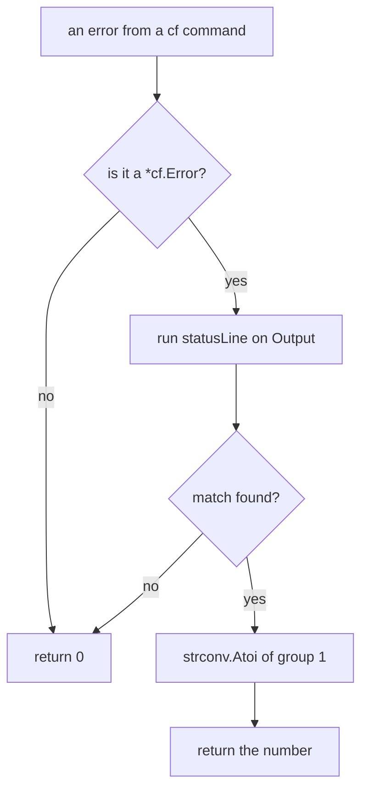
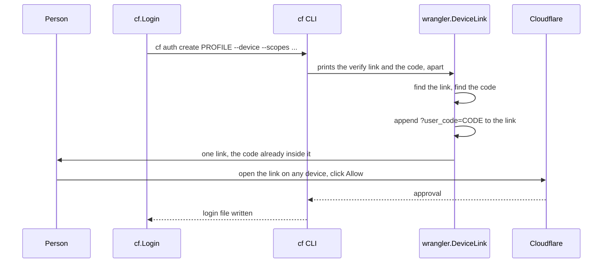

# The Cloudflare application programming interface (API) and the cf command-line interface (CLI)

The project talks to Cloudflare through two thin clients. One calls the Cloudflare application programming interface (API) directly with a token. The other runs Cloudflare's own `cf` command-line interface (CLI) as a child process. Both follow one rule: they decide on the HyperText Transfer Protocol (HTTP) status, never on the words in an error message.

## Two clients, one rule

The project has two files that reach Cloudflare. They are `internal/cfapi/cfapi.go` and `internal/cf/cf.go`.

- `cfapi` calls the Cloudflare API itself. It sends a request and decodes the answer. It is used where no `cf` command does the job. Examples are the delete task and the secrets and resources task.
- `cf` runs Cloudflare's own `cf` CLI. It is used for login and for Workers Builds. The package comment at `internal/cf/cf.go:1-2` says why the separate CLI exists: "wrangler's login can't hold its scope (workers_builds:write)".

Both files share one rule. The package comment at `internal/cfapi/cfapi.go:1-2` states it: "what's decided on is the HTTP status, never its words." The `cf` package repeats the rule at `internal/cf/cf.go:70-71`.

Source: `internal/cfapi/cfapi.go` and `internal/cf/cf.go`

## The direct API client: cfapi

`internal/cfapi/cfapi.go` is 67 lines long. It has one variable, one struct, and three functions. Nothing else.

### Base: the one address

The whole API lives under one address:

```go
// Base is Cloudflare's API.
var Base = "https://api.cloudflare.com/client/v4"
```

Source: `internal/cfapi/cfapi.go:16`

The path of every call starts at `/client/v4`. A caller passes only the part after it. For example, `cmd/mise-cloudflare/resources.go:142` calls with the path `/accounts/` plus the account identifier.

### Result: the envelope every call returns

Cloudflare wraps every answer in one JavaScript Object Notation (JSON) envelope. The `Result` struct mirrors that envelope:

```go
type Result struct {
	Status int
	Errors []struct {
		Code             int    `json:"code"`
		Message          string `json:"message"`
		DocumentationURL string `json:"documentation_url"`
	} `json:"errors"`
	Result json.RawMessage `json:"result"`
}
```

Source: `internal/cfapi/cfapi.go:21-29`

The three fields do three different jobs.

- `Status` is the HTTP status of the call. The code fills it from the response, not from the body. It is the field every decision uses.
- `Errors` holds what Cloudflare says went wrong. Each error has a `Code`, a `Message`, and a `DocumentationURL`.
- `Result` is the payload. It is a `json.RawMessage`, which means the caller decodes it into its own type. The client never has to know what a Worker, a bucket, or a namespace looks like.

The envelope is the same for every Cloudflare product. Only the `result` inside differs. That is why one `Result` type serves the whole project.

### OK: the only success test

```go
// OK reports whether the call succeeded (2xx).
func (a Result) OK() bool { return a.Status/100 == 2 }
```

Source: `internal/cfapi/cfapi.go:32`

`OK` divides the status by 100. A result from 200 to 299 gives 2, so it is a success. Anything else is not. The method reads only the number. It never reads the error words.

### Said: Cloudflare's own words, for humans

When a call does not succeed, the project shows Cloudflare's own words. `Said` builds that message:

```go
func (a Result) Said() string {
	var out []string
	for _, e := range a.Errors {
		s := fmt.Sprintf("%s (code %d)", e.Message, e.Code)
		if e.DocumentationURL != "" {
			s += ": " + e.DocumentationURL
		}
		out = append(out, s)
	}
	return fmt.Sprintf("HTTP %d: %s", a.Status, strings.Join(out, "; "))
}
```

Source: `internal/cfapi/cfapi.go:36-46`

The output looks like `HTTP 404: The thing does not exist (code 7000): https://developers.cloudflare.com/...`. The status comes first. The message, the code, and the documentation link follow. `Said` is for showing, never for deciding.

### Call: the one request function

```go
func Call(ctx context.Context, token, method, path string, body []byte, contentType string) (Result, error) {
	var a Result
	req, err := http.NewRequestWithContext(ctx, method, Base+path, bytes.NewReader(body))
	if err != nil {
		return a, err
	}
	req.Header.Set("Authorization", "Bearer "+token)
	if contentType != "" {
		req.Header.Set("Content-Type", contentType)
	}
	resp, err := (&http.Client{Timeout: 30 * time.Second}).Do(req)
	if err != nil {
		return a, fmt.Errorf("%s %s: %w", method, path, err)
	}
	defer resp.Body.Close()
	json.NewDecoder(resp.Body).Decode(&a) // a body that isn't the envelope leaves only the status
	a.Status = resp.StatusCode
	return a, nil
}
```

Source: `internal/cfapi/cfapi.go:49-67`

`Call` is the whole client. Walk it line by line.

1. `http.NewRequestWithContext` builds the request. The method is any HyperText Transfer Protocol (HTTP) method; this repository uses `GET`, `PATCH`, and `DELETE`. The address is `Base` plus the path.
2. The `Authorization` header is set to `Bearer ` plus the token. This is the login token, described in [The login model](03-the-login-model.md).
3. If the caller passes a `contentType`, the `Content-Type` header is set. A merge patch uses `application/merge-patch+json` at `cmd/mise-cloudflare/resources.go:331`.
4. The request runs with a 30-second timeout. The client is created inline for this one call. No client is shared or reused.
5. On a transport error, the error names the method and the path.
6. The body decodes into `Result`. A body that is not the envelope fails to decode, and only the status remains.
7. `a.Status` is set from `resp.StatusCode`, not from the body. This is the rule again: the number comes from the transport, not from the words.

The sequence below shows the whole call.

```mermaid
sequenceDiagram
    participant T as Caller (resources.go)
    participant C as cfapi.Call
    participant H as http.Client
    participant A as Cloudflare API
    T->>C: Call(ctx, token, method, path, body, contentType)
    C->>H: NewRequestWithContext(method, Base + path)
    C->>C: set Authorization: Bearer token
    C->>C: set Content-Type (when given)
    H->>A: send with a 30-second timeout
    A-->>H: HTTP status plus the JSON envelope
    H-->>C: response
    C->>C: decode the envelope into Result, set Status
    C-->>T: Result; caller calls OK() then Said()
```

## The cf CLI wrapper

`internal/cf/cf.go` is 166 lines long. It wraps Cloudflare's `cf` CLI for two jobs: login and Workers Builds.

### Scopes: what connect-github needs

```go
// Scopes is what connect-github needs: the account and Workers Builds.
var Scopes = []string{"account:read", "user:read", "workers:write", "workers_scripts:write", "workers_builds:write"}
```

Source: `internal/cf/cf.go:23`

These five scopes are what the connect-github task needs. The last one, `workers_builds:write`, is the reason the project uses `cf` at all. Wrangler's login cannot hold that scope. The document [Connect GitHub](09-connect-github.md) covers that task.

### CF: one profile, one folder, one account

```go
type CF struct {
	Dir     string
	Profile string
	Account string
}
```

Source: `internal/cf/cf.go:26-30`

`CF` holds three facts.

- `Dir` is the folder every `cf` command runs in.
- `Profile` is the `cf` profile name. Every command passes it.
- `Account` is the Cloudflare account identifier, once known. It is optional.

### Installed: on the PATH is not enough

```go
func Installed() bool {
	return exec.Command("cf", "--version").Run() == nil
}
```

Source: `internal/cf/cf.go:34-36`

The comment above it explains the trap. Mise leaves a shim for `cf` on the PATH wherever mise has ever installed it. The shim fails with "No version is set for shim: cf" where nothing pins it. So `Installed` runs `cf --version` and checks that it really works.

### cmd: every command, with the profile

```go
func (c CF) cmd(ctx context.Context, args ...string) *exec.Cmd {
	cmd := exec.CommandContext(ctx, "cf", append(args, "--profile", c.Profile)...)
	cmd.Dir = c.Dir
	cmd.Env = os.Environ()
	if c.Account != "" {
		cmd.Env = append(cmd.Env, "CLOUDFLARE_ACCOUNT_ID="+c.Account)
	}
	return cmd
}
```

Source: `internal/cf/cf.go:38-46`

`cmd` builds every `cf` command. It appends `--profile` with the profile name. It runs in `Dir`. When the account is known, it sets the `CLOUDFLARE_ACCOUNT_ID` environment variable.

### Error and the error box

```go
type Error struct {
	Args   []string
	Output string
}
```

Source: `internal/cf/cf.go:49-52`

`Error` holds the arguments and the output of a failed `cf` command. Its `Error()` method trims the noise:

```go
func (e *Error) Error() string {
	out := e.Output
	// A call cf can't take prints its whole help first, then the error in a box: only the box says what went wrong.
	if i := strings.Index(out, "┌ Error"); i >= 0 {
		out = out[i:]
		if j := strings.Index(out, "└"); j >= 0 {
			out = out[:j+len("└")]
		}
	}
	return fmt.Sprintf("cf %s: %s", strings.Join(e.Args, " "), out)
}
```

Source: `internal/cf/cf.go:54-64`

When `cf` cannot take a command, it prints its full help first, then the real error in a box. The box starts at `┌ Error` and ends at `└`. `Error()` keeps only the box. The result names the command and shows the box.

### Status: pulling the number out of the box

The rule "decide on the status, not the words" needs the status number. The `cf` CLI does not hand it back as an exit code. It prints the status inside the error box. So the code reads it with a regular expression (regex):

```go
var statusLine = regexp.MustCompile(`(?m)^\W*([1-5][0-9][0-9]) [A-Za-z][A-Za-z ]* · HTTP `)
```

Source: `internal/cf/cf.go:68`

```go
func Status(err error) int {
	var e *Error
	if !errors.As(err, &e) {
		return 0
	}
	m := statusLine.FindStringSubmatch(e.Output)
	if m == nil {
		return 0
	}
	n, _ := strconv.Atoi(m[1])
	return n
}
```

Source: `internal/cf/cf.go:72-83`

`Status` does three steps.

1. It checks that the error is a `*cf.Error`. Any other error returns 0.
2. It runs the regex on the output. No match means 0.
3. It converts the first capture group to an integer and returns it.

The regex looks for a three-digit number from 100 to 599, then a space, then a reason in letters, then ` · HTTP `. The `(?m)` flag makes `^` match the start of each line. The `\W*` skips the box-drawing character `│` at the start of the line.

The test at `internal/cf/cf_test.go:59-62` shows a real box from `cf 1.0.0-beta.26`:

```go
box := `┌ APIError
│ [12040] No build configuration associated with that script tag was found for this account
│ 404 Not Found · HTTP /accounts/0123456789abcdef0123456789abcdef/builds/workers/0123456789abcdef0123456789abcdef
└`
```

The regex matches `404 Not Found · HTTP ` and captures `404`. The flowchart shows the path:



### NotFound: the one status the tasks check

```go
func NotFound(err error) bool { return Status(err) == http.StatusNotFound }
```

Source: `internal/cf/cf.go:86`

`NotFound` is true when the status is 404. The connect-github task uses it to ignore a delete of a Workers Build that is already gone. It appears at `cmd/mise-cloudflare/connect_github.go:121` and `:201`.

### JSON: run cf and unwrap the envelope

```go
func (c CF) JSON(ctx context.Context, out any, args ...string) error {
	cmd := c.cmd(ctx, args...)
	var stderr bytes.Buffer
	cmd.Stderr = &stderr
	b, err := cmd.Output()
	if err != nil {
		return &Error{Args: args, Output: strings.TrimSpace(stderr.String() + "\n" + string(b))}
	}
	if out == nil {
		return nil
	}
	var env struct {
		Result json.RawMessage `json:"result"`
	}
	if json.Unmarshal(b, &env) == nil && len(env.Result) > 0 {
		b = env.Result
	}
	if err := json.Unmarshal(b, out); err != nil {
		return fmt.Errorf("cf %s printed %.300s: %w", strings.Join(args, " "), b, err)
	}
	return nil
}
```

Source: `internal/cf/cf.go:89-110`

`JSON` runs a `cf` command and decodes its output. It unwraps the same `result` envelope that `cfapi.Result` models. When the output has a `result` field, only that field is decoded into `out`. When `out` is `nil`, the command runs and the output is thrown away. That is the "fire and forget" case for deletes.

### Whoami and HasScopes

```go
type Who struct {
	Authenticated bool     `json:"authenticated"`
	Scopes        []string `json:"scopes"`
	Accounts      []struct {
		ID string `json:"id"`
	} `json:"accounts"`
}
```

Source: `internal/cf/cf.go:113-119`

`Whoami` runs `cf auth whoami`:

```go
func (c CF) Whoami(ctx context.Context) (Who, error) {
	var who Who
	cmd := c.cmd(ctx, "auth", "whoami")
	out, _ := cmd.Output() // not logged in, it still prints JSON, whatever it exits with (1 before cf 1.0.0-beta.26, 0 now)
	if err := json.Unmarshal(out, &who); err != nil {
		return who, fmt.Errorf("cf auth whoami printed %.300s: %w", out, err)
	}
	return who, nil
}
```

Source: `internal/cf/cf.go:122-130`

A logged-out profile still prints JSON. So `Whoami` ignores the exit code and only decodes the output. `Authenticated` is `false` when the profile is not logged in. It is not an error.

```go
func (w Who) HasScopes() bool {
	for _, s := range Scopes {
		if !slices.Contains(w.Scopes, s) {
			return false
		}
	}
	return true
}
```

Source: `internal/cf/cf.go:133-140`

`HasScopes` checks that the login holds every one of the five `Scopes`. It is true only when all five are present.

### Login: the device flow

```go
func (c CF) Login(ctx context.Context, browser bool) error {
	args := append([]string{"auth", "create", c.Profile, "--device", "--scopes"}, Scopes...)
	if !browser {
		args = append(args, "--no-browser")
	}
	cmd := exec.CommandContext(ctx, "cf", args...)
	cmd.Dir, cmd.Env = c.Dir, os.Environ()
	fmt.Printf("Logging %s in to Cloudflare's cf, for Workers Builds: approve it on any device (your phone works).\n", c.Profile)
	if err := wrangler.RunDeviceLogin(cmd, true); err != nil {
		return fmt.Errorf("cf auth create %s: %w", c.Profile, err)
	}
	return nil
}
```

Source: `internal/cf/cf.go:144-156`

`Login` runs `cf auth create PROFILE --device --scopes` with all five scopes. The `--device` flag asks for the Open Authorization (OAuth) device flow. That flow prints a link and a code. The person opens the link on any device and approves. When `browser` is false, `--no-browser` is added so `cf` does not try to open this machine's browser.

### Delete: log the profile out

```go
func (c CF) Delete(ctx context.Context) error {
	cmd := exec.CommandContext(ctx, "cf", "auth", "delete", c.Profile)
	cmd.Dir, cmd.Env = c.Dir, os.Environ()
	if out, err := cmd.CombinedOutput(); err != nil {
		return &Error{Args: []string{"auth", "delete", c.Profile}, Output: strings.TrimSpace(string(out))}
	}
	return nil
}
```

Source: `internal/cf/cf.go:159-166`

`Delete` logs the profile out on Cloudflare and deletes it. This is the logout path, documented in [Delete, clean, logout and update](11-delete-clean-logout-update.md).

## Why the code decides on the status, not the words

The rule appears in both files, so it is worth naming. The reason is simple. Cloudflare changes the words in its error messages between versions. It changes the codes too. The one thing that stays stable across every product is the HTTP status.

The `cf` CLI proves the point. Its error box prints a reason like `404 Not Found` in English. But the box also prints `403 Forbidden` for a different failure. If the code matched the words, it would need a new string match for every Cloudflare message. If it matches the status, one number serves every product and every version.

The test at `internal/cf/cf_test.go:67-73` checks exactly this. It replaces `404 Not Found` with `403 Forbidden` and expects `Status` to change from 404 to 403. It also feeds the words alone, `"the thing was not found"`, and expects 0. The words decide nothing.

## Aha: the code you never have to type

The device flow prints two things: a link and a code. The person normally reads the code and types it into the page. The project removes that typing. The helper at `internal/wrangler/devicelink.go` rebuilds the link with the code already inside it:

```go
verifyURL = regexp.MustCompile(`https://\S+/device/verify\S*`)
userCode  = regexp.MustCompile(`^\s*([A-Za-z0-9-]{6,12})\s*$`)
```

Source: `internal/wrangler/devicelink.go:13-14`

```go
} else if m := userCode.FindStringSubmatch(line); m != nil && link != "" && !strings.Contains(link, "user_code=") {
	u, err := url.Parse(link)
	if err == nil {
		q := u.Query()
		q.Set("user_code", m[1])
		u.RawQuery = q.Encode()
		fmt.Fprintf(w, "\nOr open this link, the code already in it, on any device, and click Allow:\n\n  %s\n\n", u)
		done = true
	}
}
```

Source: `internal/wrangler/devicelink.go:31-40`

**Aha:** the Open Authorization (OAuth) device flow has a standard field called `verification_uri_complete`, from Request for Comments (RFC) 8628. It is the verification link with the user code already appended as `?user_code=`. The CLI prints the plain link and the code apart, but the code recombines them. The result is one link. On a phone, the person opens it and taps Allow. They never type the code.



## Where to go next

The `cfapi` and `cf` clients both carry a login token. Read [The login model](03-the-login-model.md) for how the project stores and scopes that login. Read [The check rules](05-the-check-rules.md) for how the project keeps that token out of the repository.
