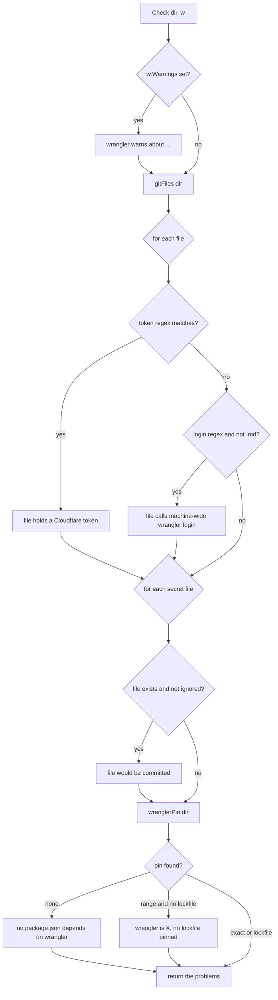
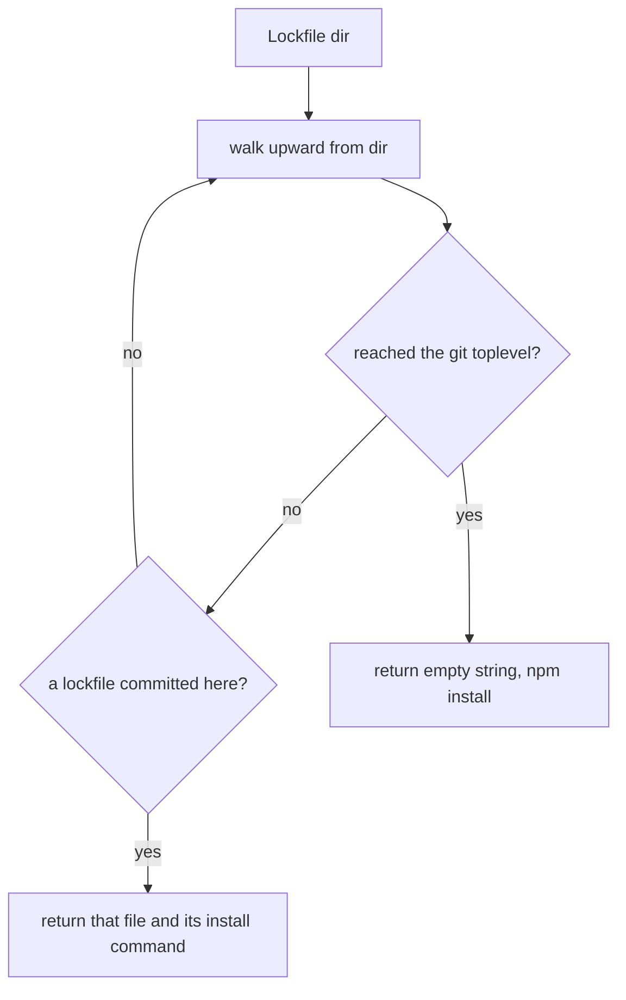
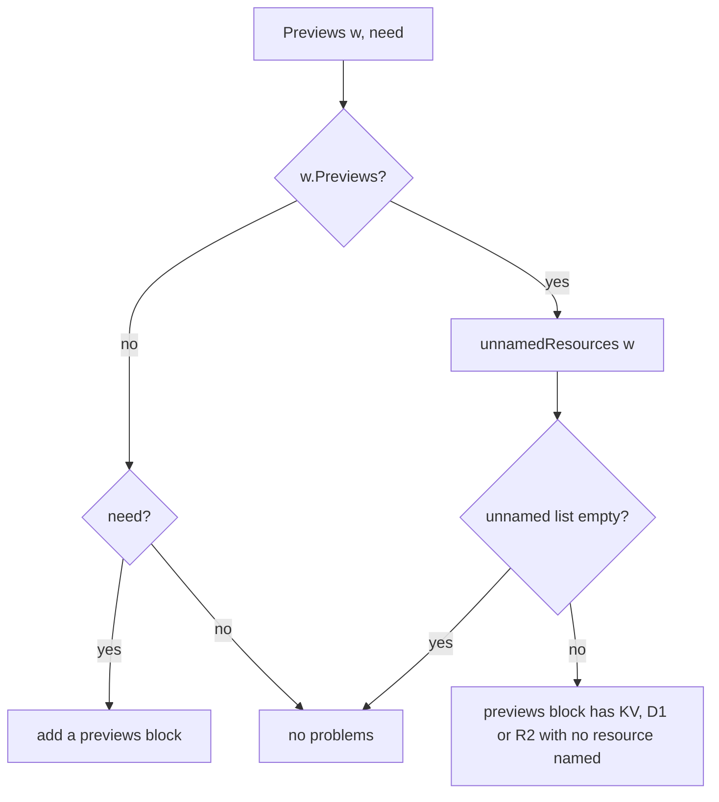

# The check rules

The `check` command reads a repository and lists every problem that could put a Cloudflare login or a secret into it. Each problem is one line. Each line names the file. The rules live in `internal/rules/rules.go` and are tested in `internal/rules/rules_test.go`.

The `check` command itself is a small wrapper. It calls `rules.Check` at `cmd/mise-cloudflare/check.go:12`, then appends two more problem kinds: a stale session (`stale`) and a missing profile (`noProfiles`), at `cmd/mise-cloudflare/check.go:16`. This page covers the rules package. The two extra kinds belong to other documents.

## What the check protects

The package comment at `internal/rules/rules.go:1-2` states the goal: "what a repo must be so that its Cloudflare login and its secrets stay out of it."

The check has five concerns:

1. No file holds a Cloudflare token.
2. No file calls the machine-wide `wrangler login`.
3. No secret file would be committed by git.
4. The wrangler version is pinned.
5. A previews block names its key-value (KV), D1, and R2 resources where a preview runs.

Each problem is one line. The line names the file and says what is wrong. The reader can fix each line one at a time.

Source: `internal/rules/rules.go`

## The three regular expressions

The rules start with three compiled regular expressions (regex):

```go
var (
	token    = regexp.MustCompile(`CLOUDFLARE_API_TOKEN\s*[=:]\s*["']?[A-Za-z0-9_-]{30,}`)
	login    = regexp.MustCompile(`\bwrangler\s+login\b`)
	exactPin = regexp.MustCompile(`^\d+\.\d+\.\d+$`)
)
```

Source: `internal/rules/rules.go:20-24`

The `token` regex matches an assignment of a Cloudflare token. It looks for the name `CLOUDFLARE_API_TOKEN`, then an equals sign or a colon, then an optional quote, then 30 or more characters from letters, digits, underscore, and dash. The 30-character minimum is the Cloudflare token length. A shorter example value never triggers it. The regex catches the token in a shell script, a `.env` file, or any other text file.

The `login` regex matches the exact words `wrangler login`. The `\b` word boundaries stop it from matching `wrangler login-dev` or other longer commands. A file that runs `wrangler login` would log the person in machine-wide, outside the project's own profile.

The `exactPin` regex matches a full three-part version like `4.151.3`. It rejects a caret range like `^4.0.0`. Only an exact pin counts.

## The full check, line by line

```go
func Check(dir string, w wconfig.Config) ([]string, error) {
	problems := Previews(w, false)
	bad := func(format string, a ...any) { problems = append(problems, fmt.Sprintf(format, a...)) }
	if w.Warnings != "" {
		bad("wrangler warns about %s:\n%s", filepath.Base(w.Path), w.Warnings)
	}

	files, err := gitFiles(dir)
	if err != nil {
		return nil, err
	}
	for _, f := range files {
		b, err := os.ReadFile(filepath.Join(dir, f))
		if err != nil || bytes.IndexByte(b, 0) >= 0 {
			continue // gone, a directory, or binary
		}
		if token.Match(b) {
			bad("%s holds a Cloudflare token", f)
		}
		if !strings.HasSuffix(f, ".md") && login.Match(b) {
			bad("%s calls the machine-wide wrangler login", f)
		}
	}
	for _, f := range secretFiles {
		if _, err := os.Stat(filepath.Join(dir, f)); err == nil && !ignored(dir, f) {
			bad("%s would be committed: git-ignore it (%s)", f, "it holds local secrets, or cf's login")
		}
	}

	pin := wranglerPin(dir)
	if lock, install := Lockfile(dir); pin == "" {
		bad("no package.json here or above it depends on wrangler: add it (the tasks run the repo's own), then %s", install)
	} else if lock == "" && !exactPin.MatchString(pin) {
		bad("wrangler is %s in package.json, and no lockfile is committed to pin it: commit the one %s makes, or pin it exactly", pin, install)
	}
	return problems, nil
}
```

Source: `internal/rules/rules.go:27-68`

`Check` runs in order:

1. `Previews(w, false)` adds problems for a previews block whose KV, D1, or R2 resource is unnamed.
2. A `bad` closure appends one formatted line per problem.
3. If wrangler printed warnings about the config, the first problem repeats them. The config comes from the wconfig bridge, described in [The wconfig bridge](02-the-wconfig-bridge.md).
4. `gitFiles(dir)` lists the repository's files. If there is no git repository, `Check` returns the error and nothing else.
5. For each file, the code skips a file that is gone, a directory, or binary. A binary is detected by a null byte.
6. The `token` regex runs on the raw bytes. A match adds "holds a Cloudflare token".
7. The `login` regex runs, but not on Markdown files. A file ending in `.md` may warn about `wrangler login`. Only an executable call is a problem.
8. Each secret file that exists and is not git-ignored adds "would be committed".
9. The wrangler pin is checked last.

The flow below shows the decision tree:



## Which files the check reads

The check reads only the files git would commit or already tracks. `gitFiles` builds that list:

```go
func gitFiles(dir string) ([]string, error) {
	out, err := exec.Command("git", "-C", dir, "ls-files", "--cached", "--others", "--exclude-standard", ".").Output()
	if err != nil {
		return nil, fmt.Errorf("git ls-files in %s: %w (the rules need a git repo)", dir, err)
	}
	var files []string
	for _, f := range strings.Fields(string(out)) {
		if !strings.HasPrefix(f, "node_modules/") && !strings.Contains(f, "/node_modules/") {
			files = append(files, f) // installed packages are not the repo's, git-ignored or not
		}
	}
	return files, nil
}
```

Source: `internal/rules/rules.go:186-198`

The git command uses three flags.

- `--cached` lists tracked files.
- `--others` lists untracked files.
- `--exclude-standard` drops git-ignored files.

So a git-ignored file is not scanned for tokens. That is why the secret-file rule below matters so much. The loop also removes every `node_modules` path, because installed packages are not the repository's own code.

## The secret files

```go
var secretFiles = []string{".dev.vars", ".env", ".cloudflare/"}
```

Source: `internal/rules/rules.go:100`

Each of the three is a secret leak of a different kind.

- `.dev.vars` is where wrangler reads local secrets. It holds real secret values for local development.
- `.env` is a common place for environment variables, including `CLOUDFLARE_API_TOKEN`.
- `.cloudflare/` is where `cf` caches the login. It holds the account the person logged into, its identifier, and its name. The comment at `internal/rules/rules.go:98-99` says this.

The rule for these files does not scan their contents. It checks only that git will not commit them:

```go
func ignored(dir, f string) bool {
	return exec.Command("git", "-C", dir, "-c", "core.excludesFile=", "check-ignore", "-q", f).Run() == nil
}
```

Source: `internal/rules/rules.go:102-104`

`ignored` runs `git check-ignore`. The `-c core.excludesFile=` part is the key. It turns off the developer's global git-ignore file. Only the repository's own `.gitignore` counts.

The comment at `internal/rules/rules.go:51-53` explains why: "by the repo's own ignore files only (another developer doesn't have this machine's global gitignore)." A file ignored only on this machine would be committed by the next developer.

The check only flags a secret file that exists. The test at `internal/rules/rules_test.go:75-77` confirms a `.env` that is not there is not a problem.

### EnsureIgnored: ignore before writing

```go
func EnsureIgnored(dir, f string) error {
	if ignored(dir, f) {
		return nil
	}
	path := filepath.Join(dir, ".gitignore")
	b, _ := os.ReadFile(path)
	if len(b) > 0 && !bytes.HasSuffix(b, []byte("\n")) {
		b = append(b, '\n')
	}
	if err := os.WriteFile(path, append(b, f+"\n"...), 0o644); err != nil {
		return err
	}
	fmt.Printf("✓ %s is git-ignored now (added to .gitignore): it holds local secrets, or cf's login\n", f)
	return nil
}
```

Source: `internal/rules/rules.go:107-121`

`EnsureIgnored` adds the file to the repository's own `.gitignore` before a task writes it. The serve task ignores `.dev.vars` at `cmd/mise-cloudflare/serve.go:59`. The connect-github task ignores `.cloudflare/` at `cmd/mise-cloudflare/connect_github.go:65`.

## The lockfiles map

```go
var lockfiles = []struct{ file, install string }{
	{"pnpm-lock.yaml", "pnpm install --frozen-lockfile"},
	{"bun.lock", "bun install --frozen-lockfile"},
	{"bun.lockb", "bun install --frozen-lockfile"},
	{"yarn.lock", "yarn install --frozen-lockfile"},
	{"package-lock.json", "npm ci"},
}
```

Source: `internal/rules/rules.go:124-130`

The map pairs each package manager's lockfile with the command that installs from it. Every command is frozen. `npm ci` is npm's own frozen install, so it needs no extra flag. The others use `--frozen-lockfile`. A frozen install fails instead of changing the lockfile. That keeps everyone on the same pinned wrangler.

### Lockfile: committed, in the folder or above it

```go
func Lockfile(dir string) (file, install string) {
	for d := range upward(dir) {
		for _, l := range lockfiles {
			if exec.Command("git", "-C", d, "ls-files", "--error-unmatch", l.file).Run() == nil {
				return filepath.Join(d, l.file), l.install
			}
		}
	}
	return "", "npm install"
}
```

Source: `internal/rules/rules.go:134-143`

`Lockfile` walks from `dir` upward. At each folder it asks git whether a lockfile is committed. The first committed lockfile wins. The fallback is an empty file and `npm install`.

The git command `ls-files --error-unmatch` returns success only when the file is tracked and committed. An uncommitted lockfile does not count. The test at `internal/rules/rules_test.go:121-134` proves it: an uncommitted `package-lock.json` returns `npm install`, and a committed one returns `npm ci`.

A lockfile in a folder above `dir` counts too. That is a workspace's lockfile. The test name and comment at `internal/rules/rules_test.go:119-120` state it: "a committed lockfile pins wrangler, in the folder or a workspace's above it".



## The build script

```go
func Build(dir string) string {
	var pkg struct{ Scripts map[string]string }
	if b, err := os.ReadFile(filepath.Join(dir, "package.json")); err != nil || json.Unmarshal(b, &pkg) != nil || pkg.Scripts["build"] == "" {
		return ""
	}
	_, install := Lockfile(dir)
	return strings.Fields(install)[0] + " run build"
}
```

Source: `internal/rules/rules.go:149-156`

`Build` returns the command that runs the package's own `build` script. It reads `package.json` and looks for a `build` entry in `scripts`. If there is none, or no `package.json`, it returns an empty string.

The command uses the package manager from the lockfile. It takes the first word of the install command, so `pnpm install --frozen-lockfile` becomes `pnpm run build`. The test at `internal/rules/rules_test.go:137-150` checks all three cases: no `package.json`, a package with no build script, and a package with one.

The comment at `internal/rules/rules.go:145-148` explains the reason. A Worker built first runs its build before wrangler deploys or previews. Cloudflare's Vite plugin writes the config that wrangler then deploys. The caller in `cmd/mise-cloudflare/run_wrangler.go:34` runs this build first.

## The wrangler pin

```go
func wranglerPin(dir string) string {
	for d := range upward(dir) {
		var pkg struct{ Dependencies, DevDependencies map[string]string }
		if b, err := os.ReadFile(filepath.Join(d, "package.json")); err == nil && json.Unmarshal(b, &pkg) == nil {
			if v := cmpOr(pkg.DevDependencies["wrangler"], pkg.Dependencies["wrangler"]); v != "" {
				return v
			}
		}
	}
	return ""
}
```

Source: `internal/rules/rules.go:159-169`

`wranglerPin` walks upward and reads the nearest `package.json`. It checks `devDependencies` first, then `dependencies`. The first non-empty wrangler version wins. `cmpOr` is the small helper that returns the first non-empty string:

```go
func cmpOr(s ...string) string {
	for _, v := range s {
		if v != "" {
			return v
		}
	}
	return ""
}
```

Source: `internal/rules/rules.go:200-207`

### The pin rule

The pin rule in `Check` has two branches:

1. If `pin == ""`, no `package.json` depends on wrangler at all. The problem line says to add it, then run the install command.
2. If a lockfile is committed, any pin is fine. The lockfile pins the exact version, even when `package.json` says `^4.0.0`.
3. If no lockfile is committed and the pin is not exact, the problem line says to commit the lockfile or pin exactly.

This is why the `exactPin` regex exists. A caret range like `^4.0.0` is acceptable only when a committed lockfile holds the exact version. The test at `internal/rules/rules_test.go:131-133` shows a `^` range with a committed lockfile is pinned.

### upward: walk to the git top

```go
func upward(dir string) func(func(string) bool) {
	return func(yield func(string) bool) {
		top, err := exec.Command("git", "-C", dir, "rev-parse", "--show-toplevel").Output()
		real := func(p string) string { r, _ := filepath.EvalSymlinks(p); return filepath.Clean(r) }
		stop := real(strings.TrimSpace(string(top)))
		for d := dir; ; d = filepath.Dir(d) {
			if !yield(d) || err != nil || real(d) == stop || d == filepath.Dir(d) {
				return
			}
		}
	}
}
```

Source: `internal/rules/rules.go:172-183`

`upward` yields `dir` and each folder above it, up to the git repository's top. It uses Go's iterator form, so `for d := range upward(dir)` walks the chain.

The loop stops in four cases. It stops when the caller says to stop. It stops when there is no git repository. It stops at the git top level, compared by real path after resolving symlinks. It stops at the filesystem root, when the folder above is the same folder.

## The previews block

```go
func Previews(w wconfig.Config, need bool) []string {
	if !w.Previews {
		if need {
			return []string{fmt.Sprintf("add \"previews\": {} to %s: a preview needs it (its KV, D1 and R2 it gets of its own)", filepath.Base(w.Path))}
		}
		return nil
	}
	var problems []string
	if unnamed := unnamedResources(w); len(unnamed) > 0 {
		problems = append(problems, fmt.Sprintf("%s's previews block has %s with no resource named, which wrangler preview sends as it is and Cloudflare refuses: leave it out, and mise run cloudflare:08-deploy gives previews their own, or name an existing one (a KV namespace's id, a D1's database_id, an R2 bucket's bucket_name)", filepath.Base(w.Path), strings.Join(unnamed, ", ")))
	}
	return problems
}
```

Source: `internal/rules/rules.go:72-84`

`Previews` has two modes, set by `need`.

- When `need` is false, a missing previews block is fine. This is what `Check` passes.
- When `need` is true, a missing previews block is a problem. The message says to add `"previews": {}`. The tasks that run a preview pass true. They are the status report at `cmd/mise-cloudflare/show.go:91` and connect-github at `cmd/mise-cloudflare/connect_github.go:165`.

When a previews block exists, `unnamedResources` decides whether it names its KV, D1, and R2:

```go
func unnamedResources(w wconfig.Config) []string {
	var out []string
	for _, n := range slices.Sorted(maps.Keys(w.PreviewBindings)) {
		if kind, own := wconfig.PreviewsOwn[w.PreviewBindings[n]]; own && !slices.Contains(w.PreviewNamed, n) {
			out = append(out, kind+" "+n)
		}
	}
	return out
}
```

Source: `internal/rules/rules.go:88-96`

`PreviewsOwn` lists the binding kinds whose resources previews get on their own:

```go
var PreviewsOwn = map[string]string{"kv_namespace": "KV", "d1": "D1", "r2_bucket": "R2", "queue": "Queue", "flagship": "Flagship"}
```

Source: `internal/wconfig/wconfig.go:47`

The labels are KV, D1, R2, Queue, and Flagship. For a preview, the project gives these their own resources. But `wrangler deploy` makes them by name for production. `wrangler preview` makes none.

So a preview binding of one of these kinds must name an existing resource. `unnamedResources` collects every preview binding whose kind is in `PreviewsOwn` and whose name is not in `PreviewNamed`. The output line lists them, for example `R2 BUCKET, KV KV`.



## What the tests prove

The test suite mirrors the rules exactly. The `good` fixture at `internal/rules/rules_test.go:26-35` is a repository that passes every rule:

```go
func good() map[string]string {
	return map[string]string{
		".dev.vars.example": "GREETING=dummy\n",
		".gitignore":        ".dev.vars\n.env*\n.cloudflare/\nnode_modules/\n",
		"package.json":      `{ "devDependencies": { "wrangler": "4.151.3" } }`,
		"README.md":         "Never run wrangler login here.\n",
		"src/worker.js":     "export default {}\n",
		"notes.txt":         "this machine's other wrangler logins\n",
	}
}
```

Source: `internal/rules/rules_test.go:26-35`

Notice what the fixture teaches.

- The real secret files are absent. Only `.dev.vars.example` is present, and its name does not match `.dev.vars`.
- The `.gitignore` lists `.dev.vars`, `.env*`, and `.cloudflare/`.
- Wrangler is pinned exactly to `4.151.3`.
- The `README.md` warns "Never run wrangler login here" and passes, because `.md` files are exempt from the `login` rule.
- `notes.txt` contains the words "wrangler logins" but not `wrangler login`, so the `login` regex does not match it.

The failing test at `internal/rules/rules_test.go:51-81` breaks every rule at once and checks each line appears:

```go
for _, want := range []string{"wrangler warns about wrangler.jsonc:", `"kv_namespacez"`, "deploy.sh calls",
	"notes.txt holds a Cloudflare token", ".dev.vars would be committed", ".cloudflare/ would be committed", "no lockfile is committed"} {
```

Source: `internal/rules/rules_test.go:69-70`

The test adds `npx wrangler login` to a shell script, a real token to `notes.txt`, a caret range to `package.json`, a `.gitignore` with only `node_modules/`, and the secret files `.dev.vars` and `.cloudflare/account.json`. It then checks that the joined problems contain every expected line.

## Aha: the repo must protect its own secrets, not trust this machine

The token scan skips git-ignored files. `gitFiles` uses `--exclude-standard`, so an ignored file is never read. That means the secret-file rule is the only thing that catches a `.env` with a token inside it.

**Aha:** the check refuses a secret file ignored only by this machine. `ignored()` runs git with `-c core.excludesFile=` (rules.go:103). That flag turns off the developer's global git-ignore file. A `.env` hidden only by that global file still fails the check with "would be committed", because the next developer does not have this machine's global file. The repository's own `.gitignore` is the only ignore that counts.

A second, smaller Aha is in the fixture. The `login` regex exempts `.md` files. That lets the project's own README tell the reader "Never run wrangler login here" without failing the check. A warning about the command is allowed. An actual call is not.

## Where to go next

The check decides what a repository must look like before the tasks run. Read [Templates and init](06-templates-and-init.md) for how a new repository starts already passing these rules. Read [The status report](07-the-status-report.md) for how the check's output appears to the person.
