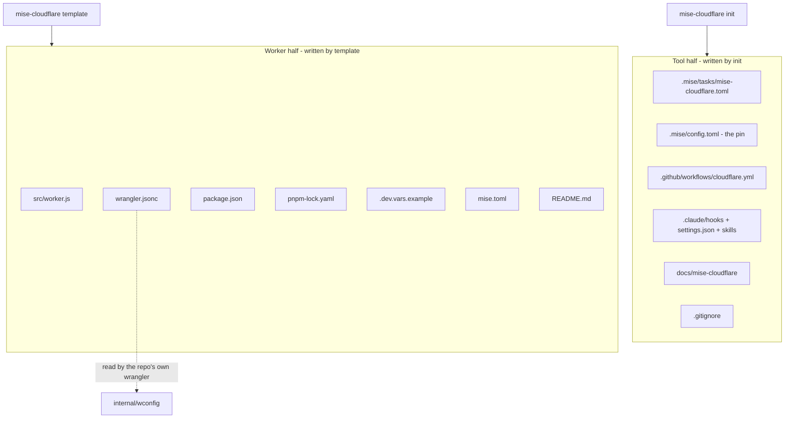
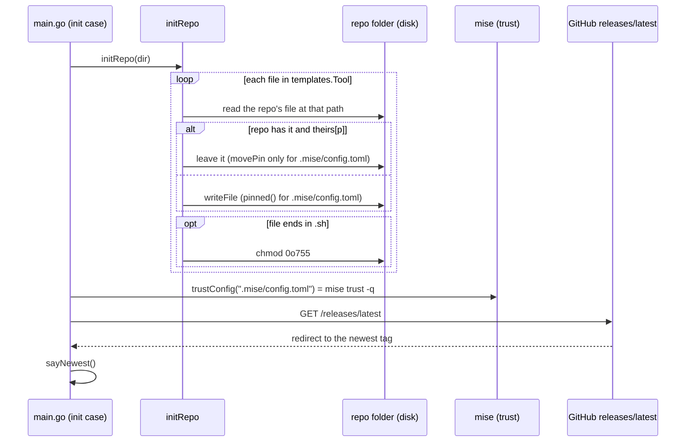

# Templates and init

mise-cloudflare ships a whole repository inside its own binary. The repository has two halves. The `init` command writes one half. The `template` command writes the other. The two halves live in `templates/templates.go`, embedded with Go's `embed` directive.

## The two halves, embedded

The file `templates/templates.go` is the whole package. It declares two embedded file systems and a few names. The tool half goes into any repository. The Worker half is the template's own Worker, for a repository that has none yet.

```go
// templates/templates.go:16
//go:embed .mise/tasks/mise-cloudflare.toml .mise/config.toml
//go:embed .github/workflows/cloudflare.yml
//go:embed .claude/hooks/mise-cloudflare-session-start.sh .claude/settings.json .claude/skills
//go:embed docs/mise-cloudflare
//go:embed .gitignore
var tool embed.FS

// Tool is the template's tool half: the files init writes into a repo, at their paths there.
var Tool fs.FS = tool
```

The Worker half is the template's own runnable Worker:

```go
// templates/templates.go:26
//go:embed src wrangler.jsonc package.json pnpm-lock.yaml .dev.vars.example mise.toml README.md
var worker embed.FS

// Worker is the template's own Worker: the files mise-cloudflare template writes into a repo that has none, at their
// paths there. Its mise.toml installs its wrangler (node, aube, mise run setup), and README.md is the repo's front
// page.
var Worker fs.FS = worker
```

Three exported names carry the constants the rest of the tool uses:

```go
// templates/templates.go:35
const WorkerName = "mise-cloudflare-template"

// Tasks is the repo's mise tasks, .mise/tasks/mise-cloudflare.toml.
var Tasks, _ = fs.ReadFile(Tool, ".mise/tasks/mise-cloudflare.toml")

// HookFile is the Claude Code hook's name in a repo's .claude/hooks.
const HookFile = "mise-cloudflare-session-start.sh"
```

The two halves, file by file:

| Half | File | What it is |
|------|------|------------|
| Tool | `.mise/tasks/mise-cloudflare.toml` | The thirteen numbered tasks (03 through 15) |
| Tool | `.mise/config.toml` | The pin of mise-cloudflare |
| Tool | `.github/workflows/cloudflare.yml` | The check on every push and pull request |
| Tool | `.claude/hooks/mise-cloudflare-session-start.sh` | The session-start hook |
| Tool | `.claude/settings.json` | Runs the hook on session start |
| Tool | `.claude/skills/cloudflare/SKILL.md` | The agent skill |
| Tool | `docs/mise-cloudflare/README.md` | The long manual page |
| Tool | `.gitignore` | Local secrets and caches, never committed |
| Worker | `src/worker.js` | One request touches every binding |
| Worker | `wrangler.jsonc` | The Worker's name, bindings, secrets |
| Worker | `package.json` | Pins wrangler `4.155.0` |
| Worker | `pnpm-lock.yaml` | The committed lockfile |
| Worker | `.dev.vars.example` | A dummy secret for local development |
| Worker | `mise.toml` | Installs node and aube; the `setup` task |
| Worker | `README.md` | The repository's front page |

The split matters. `init` writes only the tool half. `template` writes only the Worker half. A repository that already has its own Worker still gets the tool half from `init`, and never the template's Worker.



The main command dispatches the two:

```go
// cmd/mise-cloudflare/main.go:86
case "init":
    initRepo(dir)
    trustConfig(dir, ".mise/config.toml")
    sayNewest()
    return
case "template": // a repo with no Worker yet; it never writes over a file, so it runs in CI too (the walk there makes a new repo with it)
    if templateRepo(dir) {
        setUpWorker(ctx, dir)
    }
    return
```

So `init` is three steps: walk the tool half, trust the pin, say the newest release. `template` writes the Worker, then installs it.

## init walks the tool half

`initRepo` walks `templates.Tool` and writes each file at the same path in the repository.

```go
// cmd/mise-cloudflare/init.go:41
func initRepo(dir string) {
	must(fs.WalkDir(templates.Tool, ".", func(p string, d fs.DirEntry, err error) error {
		if err != nil || d.IsDir() {
			return err
		}
		to := filepath.Join(dir, filepath.FromSlash(p))
		if b, err := os.ReadFile(to); err == nil && theirs[p] {
			if p == ".mise/config.toml" && movePin(to, b) {
				return nil
			}
			fmt.Printf("✓ %s is the repo's own: left as it is\n", p)
			return nil
		}
		b, err := fs.ReadFile(templates.Tool, p)
		if err == nil {
			if p == ".mise/config.toml" {
				b = pinned(b)
			}
			writeFile(to, b)
		}
		if strings.HasSuffix(p, ".sh") {
			must(os.Chmod(to, 0o755))
		}
		return err
	}))
}
```

The walk skips directories. For every file it joins the path into the repository. Then it asks one question: does the repository already have this file, and is it one of `theirs`? If yes, the file is left alone. One exception exists: `.mise/config.toml` gets `movePin` first.

The `theirs` map names the three files a repository may own already:

```go
// cmd/mise-cloudflare/init.go:19
// theirs are the template's files a repo may have of its own already: init writes them only when it has none.
// .mise/config.toml is mise-cloudflare's pin: written once, then the repo's (cloudflare:update moves it, and so does a
// newer release's init, run by hand: forward only).
var theirs = map[string]bool{".gitignore": true, ".claude/settings.json": true, ".mise/config.toml": true}
```

The three are `.gitignore`, `.claude/settings.json`, and `.mise/config.toml`. A repository with its own `.gitignore` keeps it. A repository with its own `.claude/settings.json` keeps it. The pin is special: it moves forward, never sideways.

Files that end in `.sh` get the executable bit, mode `0o755`. Only the hook file ends in `.sh`. This is why the hook runs at session start.

## The pin: forward only

The pin file is tiny:

```toml
# templates/.mise/config.toml:6
[tools]
"github:joeblew999/mise-cloudflare" = "latest"
```

In the template it says `latest`. When `init` writes it into a real repository, it pins exactly the release that ran `init`. `pinned` does the replacement:

```go
// cmd/mise-cloudflare/init.go:29
func pinned(b []byte) []byte {
	pin := "local"
	if version != "" {
		pin = strings.TrimPrefix(version, "v")
	}
	if !pinLine.Match(b) {
		fail(fmt.Errorf("the template's .mise/config.toml doesn't pin %s", self))
	}
	return pinLine.ReplaceAll(b, []byte(`"`+self+`" = "`+pin+`"`))
}
```

`pin` is `"local"` for a checkout's build. For a release build, it is the version with the leading `v` removed. The value of `version` comes from the release build:

```go
// cmd/mise-cloudflare/main.go:209
// version is set by the release build (goreleaser's -X main.version); otherwise Go's module version, or "(devel)".
var version = ""

func buildVersion() string {
	if version != "" {
		return strings.TrimPrefix(version, "v")
	}
	if bi, ok := debug.ReadBuildInfo(); ok && bi.Main.Version != "" {
		return strings.TrimPrefix(bi.Main.Version, "v")
	}
	return "(devel)"
}
```

`self` is the pin's key:

```go
// cmd/mise-cloudflare/update.go:17
// self is mise-cloudflare as a repo's mise pins it (.mise/config.toml, which init writes).
const self = "github:joeblew999/mise-cloudflare"
```

The regular expression `pinLine` matches the whole line `"github:joeblew999/mise-cloudflare" = "…"`, whatever the value:

```go
// cmd/mise-cloudflare/init.go:25
var pinLine = regexp.MustCompile(regexp.QuoteMeta(`"`+self+`" = "`) + `[^"]*"`)
```

`movePin` handles the repository that already has a pin. It moves an older pin forward. It leaves `local`, the same release, and a newer release alone.

```go
// cmd/mise-cloudflare/init.go:68
// movePin moves the repo's pin of mise-cloudflare in its .mise/config.toml (b) forward to this release, when it pins
// an older one: init at a newer release, run by hand, is the move to it. The rest of the file stays as it is; a pin
// of local, or of this release or a newer one, stays too, as does every pin when this is a checkout's build.
func movePin(path string, b []byte) bool {
	m := pinLine.Find(b)
	at := strings.TrimSuffix(strings.TrimPrefix(string(m), `"`+self+`" = "`), `"`)
	if version == "" || m == nil || at == "local" || !older(at, buildVersion()) {
		return false
	}
	must(os.WriteFile(path, pinLine.ReplaceAll(b, []byte(`"`+self+`" = "`+buildVersion()+`"`)), 0o644))
	fmt.Printf("wrote %s: mise-cloudflare %s → %s\n", path, at, buildVersion())
	return true
}
```

The guard is the whole logic. Four cases return `false`, which means "leave it". `version == ""` means a checkout's build, which never moves a pin. `m == nil` means no matching line. `at == "local"` means the repository pins its own checkout. `!older(at, buildVersion())` means the pin is the same or newer.

`older` compares releases part by part, as numbers, never as text:

```go
// cmd/mise-cloudflare/init.go:82
// older reports whether release a is older than release b, both x.y.z.
func older(a, b string) bool {
	pa, pb := strings.Split(a, "."), strings.Split(b, ".")
	for i := 0; i < len(pa) && i < len(pb); i++ {
		x, errx := strconv.Atoi(pa[i])
		y, erry := strconv.Atoi(pb[i])
		if errx != nil || erry != nil {
			return false
		}
		if x != y {
			return x < y
		}
	}
	return len(pa) < len(pb)
}
```

The test `TestOlder` proves it: `0.1.7` is older than `0.1.36`, which text comparison would get wrong. `TestMovePin` proves the forward-only rule with five cases.

## The newest release, said out loud

After `init` writes the files, `sayNewest` compares the running build with GitHub's newest release.

```go
// cmd/mise-cloudflare/init.go:98
// newestRelease is mise-cloudflare's newest release, as GitHub's page for it names it (…/releases/latest redirects to
// its tag), or "" if GitHub can't say.
func newestRelease() string {
	c := &http.Client{Timeout: 10 * time.Second, CheckRedirect: func(*http.Request, []*http.Request) error { return http.ErrUseLastResponse }}
	resp, err := c.Get("https://github.com/joeblew999/mise-cloudflare/releases/latest")
	if err != nil {
		return ""
	}
	resp.Body.Close()
	_, tag, _ := strings.Cut(resp.Header.Get("Location"), "/releases/tag/")
	return strings.TrimPrefix(tag, "v")
}
```

The trick is `CheckRedirect` returning `http.ErrUseLastResponse`. That makes the HyperText Transfer Protocol (HTTP) client stop at the redirect instead of following it. The `Location` header then names the tag. `newestRelease` cuts the tag off the redirect URL and removes the leading `v`.

`sayNewest` turns that into advice:

```go
// cmd/mise-cloudflare/init.go:113
func sayNewest() {
	if version == "" {
		return
	}
	switch n := newestRelease(); {
	case n == "":
		fmt.Printf("· this is mise-cloudflare %s; GitHub didn't say what its newest release is\n", buildVersion())
	case older(buildVersion(), n):
		fmt.Printf("· this is mise-cloudflare %s, and the newest release is %s: mise takes a release as latest only once it's a day old. For it, which moves the repo's pin to it:\n  mise exec %s@%s -- mise-cloudflare init\n", buildVersion(), n, self, n)
	default:
		fmt.Printf("✓ mise-cloudflare %s, the newest release\n", buildVersion())
	}
}
```

The message explains a mise quirk: `@latest` can run an older release, because mise holds a release back until it is a day old. The advice names the exact release to run.

## stale: files that drifted

`check` calls `stale` to find files `init` wrote that this version would write differently. It compares content, ignoring line endings.

```go
// cmd/mise-cloudflare/init.go:127
// stale names the files init wrote that this version would write differently, and a .claude/settings.json of the
// repo's own that doesn't run the hook.
func (r repo) stale(ctx context.Context) []string {
	var out []string
	fs.WalkDir(templates.Tool, ".", func(p string, d fs.DirEntry, err error) error {
		if err != nil || d.IsDir() || theirs[p] {
			return err
		}
		want, _ := fs.ReadFile(templates.Tool, p)
		// Line endings aside: a Windows checkout of the repo may have \r\n where init wrote \n.
		crlf := func(b []byte) []byte { return bytes.ReplaceAll(b, []byte("\r\n"), []byte("\n")) }
		if b, err := os.ReadFile(filepath.Join(r.dir, filepath.FromSlash(p))); err == nil && !bytes.Equal(crlf(b), crlf(want)) {
			out = append(out, p+" is out of date: run mise run cloudflare:03-init")
		}
		return nil
	})
	if b, err := os.ReadFile(filepath.Join(r.dir, ".claude", "settings.json")); err == nil && !bytes.Contains(b, []byte(templates.HookFile)) {
		out = append(out, ".claude/settings.json doesn't run .claude/hooks/"+templates.HookFile+": add its SessionStart entry (docs/mise-cloudflare/README.md)")
	}
	return out
}
```

It skips the `theirs` files. It normalizes carriage-return line-feed (CRLF) line endings to line-feed only before comparing, so a Windows checkout does not look stale. It also checks the repository's own `.claude/settings.json`: if it does not run the hook, that is a problem.

`writeFile` is the last helper. It prints "up to date" when the content matches, and writes only when it differs:

```go
// cmd/mise-cloudflare/init.go:149
func writeFile(path string, b []byte) {
	if old, err := os.ReadFile(path); err == nil && bytes.Equal(old, b) {
		fmt.Printf("✓ %s is up to date\n", path)
		return
	}
	must(os.MkdirAll(filepath.Dir(path), 0o755))
	must(os.WriteFile(path, b, 0o644))
	fmt.Println("wrote", path)
}
```

## template writes the Worker half

`templateRepo` writes the template's Worker into a repository that has none. It never writes over a file.

```go
// cmd/mise-cloudflare/template.go:19
// workerConfigs are the files that make a folder a Worker's, whatever else it has: its wrangler config first.
var workerConfigs = []string{"wrangler.jsonc", "wrangler.json", "wrangler.toml", "package.json", "package-lock.json", "pnpm-lock.yaml", "yarn.lock", "bun.lock", "bun.lockb"}
```

The list is the union of every file that says "a Worker lives here": the three wrangler config forms, `package.json`, and every package manager's lockfile.

```go
// cmd/mise-cloudflare/template.go:28
func templateRepo(dir string) bool {
	name, err := workerName(filepath.Base(dir))
	if err != nil {
		fail(err)
	}
	var files []string
	must(fs.WalkDir(templates.Worker, ".", func(p string, d fs.DirEntry, err error) error {
		if err == nil && !d.IsDir() && p != "mise.toml" && p != "README.md" {
			files = append(files, p)
		}
		return err
	}))
	readme := filepath.Join(dir, "README.md")
	if _, err := os.Stat(readme); err == nil {
		fmt.Println("✓ README.md is the repo's own: left as it is")
	} else {
		b, _ := fs.ReadFile(templates.Worker, "README.md")
		writeFile(readme, bytes.ReplaceAll(b, []byte(templates.WorkerName), []byte(name)))
	}
	var own []string
	for _, f := range union(files, workerConfigs) {
		if _, err := os.Stat(filepath.Join(dir, f)); err == nil {
			own = append(own, f)
		}
	}
	if len(own) > 0 {
		fmt.Printf("✓ the repo has a Worker of its own (%s): none of the template's written, its mise.toml included\n", strings.Join(own, ", "))
		return false
	}
	for _, f := range files {
		b, _ := fs.ReadFile(templates.Worker, f)
		if f == "wrangler.jsonc" || f == "package.json" {
			b = bytes.ReplaceAll(b, []byte(`"`+templates.WorkerName+`"`), []byte(`"`+name+`"`))
		}
		writeFile(filepath.Join(dir, filepath.FromSlash(f)), b)
	}
	tools, _ := fs.ReadFile(templates.Worker, "mise.toml")
	if _, err := os.Stat(filepath.Join(dir, "mise.toml")); err == nil {
		fmt.Printf("✓ mise.toml is the repo's own: left as it is. The template's Worker installs its wrangler with the template's:\n\n%s\n", indent(tools))
	} else {
		writeFile(filepath.Join(dir, "mise.toml"), tools)
	}
	fmt.Printf("✓ the template's Worker, %s\n", name)
	return true
}
```

The order matters. It walks the Worker half first, but skips `mise.toml` and `README.md`. It writes the README separately, replacing the template's Worker name. Then it checks the union of the Worker files and `workerConfigs`. If any exist, the repository has a Worker of its own, so nothing is written and the function returns `false`.

All-or-nothing is the rule. Either the repository gets all the Worker files, or it gets none. The name in `wrangler.jsonc` and `package.json` is replaced with the repository's own name. The README is the one exception: it goes in whenever the repository has none, Worker or not.

`workerName` turns a folder name into a Worker name:

```go
// cmd/mise-cloudflare/template.go:107
// workerName is a folder's name as a Worker's: lowercase letters, digits and dashes, at most 63 characters.
func workerName(folder string) (string, error) {
	name := strings.Trim(regexp.MustCompile(`[^a-z0-9]+`).ReplaceAllString(strings.ToLower(folder), "-"), "-")
	if name == "" || len(name) > 63 {
		return "", fmt.Errorf("the folder %q makes no Worker name (lowercase letters, digits and dashes, at most 63): rename it", folder)
	}
	return name, nil
}
```

Every character that is not a lowercase letter or digit becomes a dash. Leading and trailing dashes are trimmed. Empty names and names longer than 63 characters fail.

After a Worker is written, `setUpWorker` installs it:

```go
// cmd/mise-cloudflare/template.go:76
func setUpWorker(ctx context.Context, dir string) {
	trustConfig(dir, "mise.toml")
	has := exec.CommandContext(ctx, "mise", "tasks", "info", "setup")
	has.Dir = dir
	if has.Run() != nil {
		fmt.Println("the repo's mise.toml has no setup task: install the Worker's wrangler its own way (package.json pins it), then mise run cloudflare")
		return
	}
	fmt.Println("$ mise run setup")
	cmd := exec.CommandContext(ctx, "mise", "run", "setup")
	cmd.Dir, cmd.Stdin, cmd.Stdout, cmd.Stderr = dir, os.Stdin, os.Stdout, os.Stderr
	if err := cmd.Run(); err != nil {
		fail(fmt.Errorf("mise run setup: %w", err))
	}
	fmt.Println("✓ next: mise run cloudflare")
}
```

It trusts the repository's `mise.toml`, then runs the `setup` task. `trustConfig` is the shared helper `init` also uses for the pin:

```go
// cmd/mise-cloudflare/template.go:93
// trustConfig has mise trust a config file mise-cloudflare wrote into the repo, so its tasks run straight away: mise
// asks first about a config file it hasn't seen. Without mise on PATH, it says what to run.
func trustConfig(dir, file string) {
	path := filepath.Join(dir, filepath.FromSlash(file))
	if _, err := os.Stat(path); err != nil {
		return
	}
	if out, err := exec.Command("mise", "trust", "-q", path).CombinedOutput(); err != nil {
		fmt.Printf("mise didn't trust %s (%v %s): run mise trust %s\n", file, err, strings.TrimSpace(string(out)), file)
		return
	}
	fmt.Printf("✓ %s trusted by mise\n", file)
}
```

mise refuses to run tasks from a config file it has not seen. `trust` marks the file as trusted, so the tasks run straight away.

`hasWorker` is the cheap check the rest of the tool uses before any command:

```go
// cmd/mise-cloudflare/template.go:134
func hasWorker(dir string) bool {
	for _, f := range workerConfigs[:3] {
		if _, err := os.Stat(filepath.Join(dir, f)); err == nil {
			return true
		}
	}
	return false
}
```

Only the first three entries matter here: `wrangler.jsonc`, `wrangler.json`, `wrangler.toml`. A wrangler config is the one file that makes a folder a Worker's.

## The task file: one file, every shell

The task file is the heart of the tool half. Every task's `run` uses mise's own template syntax, never shell syntax.

```toml
# templates/.mise/tasks/mise-cloudflare.toml:8
["cloudflare"]
description = "Start here: what's done for this Worker, and what to run next (mise run cloudflare:show-help: every command)"
tools = { "npm:cf" = "1.0.0-beta.26", gh = "2.103.0" }
usage = 'flag "--json" help="one JSON document on stdout, instead of text"'
run = 'mise-cloudflare --json'
```

The `run` line is a mise template. ` --json` adds the flag only when the person passed `--json`. The `tools` entry pins the tools a task needs. The `cloudflare` task needs `npm:cf` at `1.0.0-beta.26` and `gh` at `2.103.0`.

Arguments pass the same way:

```toml
# templates/.mise/tasks/mise-cloudflare.toml:29
["cloudflare:06-serve"]
description = "06. The Worker locally, with local D1, KV and R2: no Cloudflare account needed, but for a binding wrangler runs on Cloudflare even here (then it logs the repo in)"
usage = 'arg "[args]..." help="passed on to wrangler dev as they are: --ip 127.0.0.1 --port 8787"'
run = 'mise-cloudflare serve "{{a}}"'
```

` "{{a}}"` loops over the arguments and quotes each one. A task with many flags builds its command the same way:

```toml
# templates/.mise/tasks/mise-cloudflare.toml:43
["cloudflare:09-connect-github"]
description = "09. Cloudflare deploys every push: a preview for every pull request, then production (--staging main for staging, --off to stop)"
tools = { "npm:cf" = "1.0.0-beta.26", gh = "2.103.0" }
usage = 'flag "--off" help="turn it off: the Workers Builds setup and the previews resources deleted"; flag "--branch <branch>" help="the branch whose pushes deploy production (default the default branch of the repository, or production with --staging)"; flag "--staging <branch>" help="a staging branch, whose pushes deploy the wrangler environment env.staging"; flag "--build <command>" help="the build command (default installing from the lockfile: npm ci, …)"; flag "--json" help="one JSON document on stdout, instead of text"'
run = 'mise-cloudflare connect-github --off --branch "{{usage.branch}}" --staging "{{usage.staging}}" --build "{{usage.build}}" --json'
```

The file header states the rule plainly:

```toml
# templates/.mise/tasks/mise-cloudflare.toml:4
# Each passes its usage values with mise's own templates ({{usage.<name>}}), never shell syntax, so it runs the same
# under sh, cmd and PowerShell.
```

## The flow of init, end to end



**Aha: one task file runs on every shell because it is not shell.** The task file's `run` values are mise templates, not shell commands. Shell syntax differs between `sh`, `cmd` and PowerShell; mise's `` and `{{usage.x}}` do not. So a single task file works unchanged on Linux, macOS and Windows. The project's own CI proves it: the comment says mise runs each task in each operating system's own shell (`ci.yml:31`), in a matrix on `ubuntu-latest`, `macos-latest` and `windows-latest` (`ci.yml:26`).

## Where to go next

Read [The status report](07-the-status-report.md) for the report that tells the person what to run next. Read [The wconfig bridge](02-the-wconfig-bridge.md) to see how the tool reads the `wrangler.jsonc` the template writes, without parsing it.
