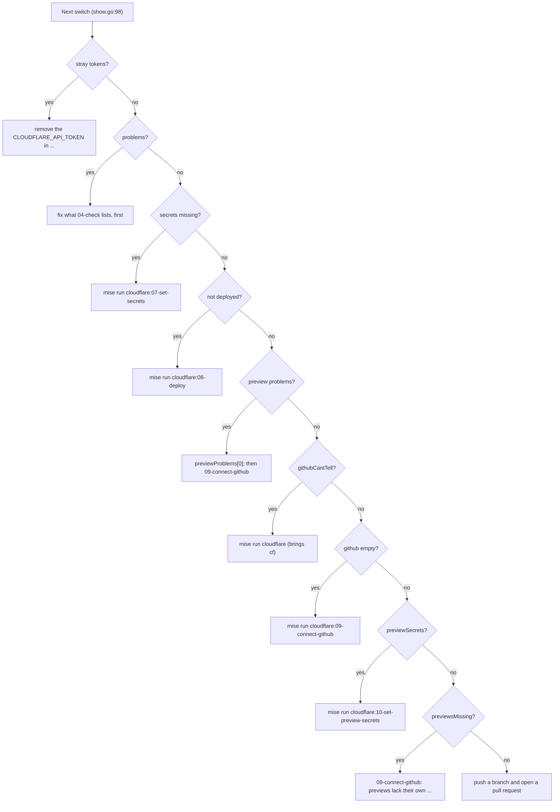
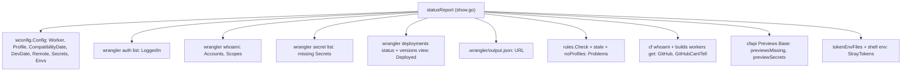

# The status report

The status report is the whole user interface of mise-cloudflare. One command, `mise run cloudflare`, prints what is done and what to run next. The report is a single Go struct, filled by asking the repository's own wrangler, and its `next` field names the next command verbatim.

## The statusReport struct, field by field

The report is `statusReport` in `cmd/mise-cloudflare/show.go`. Every field has a JavaScript Object Notation (JSON) tag, because `mise-cloudflare --json` prints it.

```go
// cmd/mise-cloudflare/show.go:20
// statusReport is mise-cloudflare -json: where the repo is, and what to run next.
type statusReport struct {
	Worker         string             `json:"worker"`
	Profile        string             `json:"profile"`
	LoggedIn       bool               `json:"loggedIn"`
	Profiles       bool               `json:"profiles"` // the repo's wrangler has auth profiles, which the login is
	Accounts       []wrangler.Account `json:"accounts"`
	Scopes         []string           `json:"scopes"` // what the login holds
	Needs          []string           `json:"needs"`  // what it must hold: wrangler's own login's
	Deployed       bool               `json:"deployed"`
	Secrets        []string           `json:"secretsToSet"` // the config's secrets.required not yet on Cloudflare
	URL            string             `json:"url,omitempty"`
	GitHub         string             `json:"github"`                   // "Workers Builds" when it deploys every push, else ""
	GitHubCantTell string             `json:"githubCantTell,omitempty"` // why this machine can't tell whether it does
	// The config's compatibility_date, and the one this wrangler's dev uses when a config gives none.
	CompatibilityDate string   `json:"compatibilityDate"`
	DevDate           string   `json:"devDate"`
	Remote            []string `json:"remote"` // the bindings wrangler runs on Cloudflare even locally: 06-serve needs the login
	Build             string   `json:"build"`  // the package's own build, which runs before wrangler does (rules.Build), or ""
	StrayTokens       []string `json:"strayTokens"`
	Problems          []string `json:"problems"` // cloudflare check's: a deploy would fail on them, or leak
	Next              string   `json:"next"`
}
```

Field by field:

| Field | Type | What it holds |
|-------|------|---------------|
| `Worker` | `string` | The Worker's name, as wrangler resolves it |
| `Profile` | `string` | The login profile, named after the Worker |
| `LoggedIn` | `bool` | Whether the profile has a login on this machine |
| `Profiles` | `bool` | Whether the repo's wrangler has auth profiles at all |
| `Accounts` | `[]wrangler.Account` | The accounts the login can use |
| `Scopes` | `[]string` | What the login holds |
| `Needs` | `[]string` | What the login must hold, wrangler's own list |
| `Deployed` | `bool` | Whether the Worker's code is on Cloudflare |
| `Secrets` | `[]string` | The `secrets.required` not yet on Cloudflare |
| `URL` | `string` | The last deploy's Uniform Resource Locator (URL) |
| `GitHub` | `string` | `"Workers Builds"` when Cloudflare deploys every push |
| `GitHubCantTell` | `string` | Why this machine cannot tell, when it cannot |
| `CompatibilityDate` | `string` | The config's `compatibility_date` |
| `DevDate` | `string` | The date wrangler's local dev uses when none is set |
| `Remote` | `[]string` | Bindings wrangler runs on Cloudflare even locally |
| `Build` | `string` | The package's own build command, or `""` |
| `StrayTokens` | `[]string` | A stray `CLOUDFLARE_API_TOKEN`, in the shell or a `.env` |
| `Problems` | `[]string` | `check`'s problems: a deploy would fail or leak |
| `Next` | `string` | The next command to run, verbatim |

The two account fields deserve a look at their type:

```go
// internal/wrangler/wrangler.go:135
// Account is a Cloudflare account the login can use.
type Account struct {
	Name string `json:"name"`
	ID   string `json:"id"`
}

// Who is wrangler whoami: the login's email, accounts and OAuth scopes.
type Who struct {
	LoggedIn bool      `json:"loggedIn"`
	Email    string    `json:"email"`
	Accounts []Account `json:"accounts"`
	Scopes   []string  `json:"tokenPermissions"`
}
```

`Who` is the shape of `wrangler whoami --json`. `show` reads it to fill `Accounts` and `Scopes`.

## show builds the report

`show` is `mise-cloudflare` with no command, or `mise-cloudflare show`. It never logs in.

```go
// cmd/mise-cloudflare/show.go:43
// show is mise-cloudflare with no command or show (mise run cloudflare, cloudflare:05-show): the steps in order, which are done for this repo, and the
// next one. It never logs in.
func (r repo) show(ctx context.Context, jsonOut bool) {
	rep := statusReport{Worker: r.wc.Name, Profile: r.w.Profile, CompatibilityDate: r.wc.CompatibilityDate, DevDate: r.wc.DevDate, Remote: append([]string{}, r.wc.Remote...), Build: rules.Build(r.dir), Accounts: []wrangler.Account{}, Scopes: []string{},
		Needs: r.wanted(ctx), StrayTokens: tokenEnvFiles(r.dir), Problems: []string{}}
	if os.Getenv("CLOUDFLARE_API_TOKEN") != "" {
		rep.StrayTokens = append([]string{"this shell"}, rep.StrayTokens...)
	}
	// cloudflare check's problems come before deploying: it fails on them, or leaks the login or a secret.
	if problems, err := rules.Check(r.dir, r.wc); err == nil {
		rep.Problems = append(append([]string{}, problems...), r.stale(ctx)...)
	}
	noProfiles := r.noProfiles(ctx)
	rep.Profiles, rep.Problems = len(noProfiles) == 0, append(rep.Problems, noProfiles...)
	rep.LoggedIn = r.w.LoggedIn(ctx)
	if rep.LoggedIn && len(rep.StrayTokens) == 0 {
		must(r.w.Activate(ctx))
		if who, err := r.w.Whoami(ctx); err == nil {
			rep.Accounts, rep.Scopes = who.Accounts, who.Scopes
		}
		rep.Deployed = r.deployed(ctx)
		if rep.Deployed {
			rep.URL = lastDeployURL(r.dir)
		}
	}
```

The first block fills the static fields from the wconfig read, `rules.Build`, `r.wanted`, and `tokenEnvFiles`. A `CLOUDFLARE_API_TOKEN` in the shell is prepended to `StrayTokens` as `"this shell"`. Then `rules.Check` plus `stale` fill `Problems`. `noProfiles` fills `Profiles` and appends to `Problems`. Then, only if logged in and no stray token, it activates the profile, reads `whoami`, checks `deployed`, and reads the URL.

The secrets block runs only when the config requires secrets:

```go
// cmd/mise-cloudflare/show.go:68
	// The secrets the Worker requires that Cloudflare doesn't have yet: a deploy refuses until they're set. wrangler
	// secret put sets one, and makes the Worker if it isn't there yet.
	if len(r.wc.Secrets) > 0 && len(rep.StrayTokens) == 0 {
		var have []struct{ Name string }
		if rep.LoggedIn {
			r.wranglerJSON(ctx, &have, "secret", "list")
		}
		for _, s := range r.wc.Secrets {
			if !slices.ContainsFunc(have, func(h struct{ Name string }) bool { return h.Name == s }) {
				rep.Secrets = append(rep.Secrets, s)
			}
		}
	}
```

It lists the secrets Cloudflare has, then adds every required secret that is missing. `wranglerJSON` runs a wrangler command and decodes its JSON, skipping anything printed before the first `{` or `[`:

```go
// cmd/mise-cloudflare/run_wrangler.go:48
// wranglerJSON runs a wrangler command and decodes its JSON, past anything it prints first (a warning, say).
func (r repo) wranglerJSON(ctx context.Context, v any, args ...string) error {
	out, err := wrangler.Output(r.w.Cmd(ctx, args...))
	if err != nil {
		return err
	}
	if i := regexp.MustCompile(`(?m)^[\[{]`).FindIndex(out); i != nil {
		out = out[i[0]:]
	}
	if err := json.Unmarshal(out, v); err != nil {
		return fmt.Errorf("wrangler %s: %w", strings.Join(args, " "), err)
	}
	return nil
}
```

The GitHub block runs only when the Worker is deployed:

```go
// cmd/mise-cloudflare/show.go:81
	if rep.Deployed {
		var connected bool
		if connected, rep.GitHubCantTell = r.buildsConnected(ctx); connected {
			rep.GitHub = "Workers Builds"
		}
	}
	// What GitHub deploying needs from the wrangler config first (a previews block with the Worker's bindings), and,
	// once Workers Builds deploys, any KV, D1 or R2 added since the previews' own were made.
	var previewProblems, previewsMissing, previewSecrets []string
	if rep.Deployed && rep.GitHub == "" {
		previewProblems = rules.Previews(r.wc, true)
	}
	if rep.GitHub != "" && len(rep.Accounts) == 1 {
		if token, err := r.w.Token(ctx); err == nil {
			previewsMissing, previewSecrets = r.previewsMissing(ctx, token, rep.Accounts[0].ID)
		}
	}
```

`buildsConnected` sets `GitHub` to `"Workers Builds"` when Cloudflare builds the Worker on every push. It also returns `GitHubCantTell`, the reason this machine cannot tell. Preview problems are checked only when the Worker is deployed and GitHub is not yet connected. Preview secrets and missing resources are checked only when GitHub is connected and the login has exactly one account.

## The Next switch: priority order

One `switch` statement produces `Next`. It is the single decision point of the whole tool.

```go
// cmd/mise-cloudflare/show.go:98
	switch {
	case len(rep.StrayTokens) > 0:
		rep.Next = "remove the CLOUDFLARE_API_TOKEN in " + strings.Join(rep.StrayTokens, " and ") + ": it would override the repo's login"
	case len(rep.Problems) > 0:
		rep.Next = "fix what mise run cloudflare:04-check lists, first: " + rep.Problems[0]
	case len(rep.Secrets) > 0:
		rep.Next = "mise run cloudflare:07-set-secrets (it asks for " + strings.Join(rep.Secrets, ", ") + ")"
	case !rep.Deployed:
		rep.Next = "mise run cloudflare:08-deploy"
	case len(previewProblems) > 0:
		rep.Next = previewProblems[0] + "; then mise run cloudflare:09-connect-github"
	case rep.GitHubCantTell != "":
		rep.Next = "mise run cloudflare: it brings cf, and shows whether Workers Builds deploys it yet"
	case rep.GitHub == "":
		rep.Next = "mise run cloudflare:09-connect-github"
	case len(previewSecrets) > 0:
		rep.Next = "mise run cloudflare:10-set-preview-secrets (it asks for " + strings.Join(previewSecrets, ", ") + ": previews don't get the Worker's secrets)"
	case len(previewsMissing) > 0:
		rep.Next = "mise run cloudflare:09-connect-github: previews don't have their own " + strings.Join(previewsMissing, ", ") + " yet"
	default:
		rep.Next = "push a branch and open a pull request: its preview's link comes on the pull request"
	}
```

The order is the lesson. A stray token beats everything, because it would override the login silently. Problems beat secrets, because a deploy would fail or leak. Secrets beat deploy, because a deploy refuses until they are set. Deploy beats GitHub, because Workers Builds attaches to a deployed Worker. Only at the end, when every other case is clear, does the report say to push a branch.



The data sources of the report, in one picture:



## lastDeployURL: the URL from wrangler's own output

The URL is not guessed. It comes from wrangler's output file, one JSON entry per line.

```go
// cmd/mise-cloudflare/show.go:178
// lastDeployURL is the URL wrangler's last deploy reports in its output file, .wrangler/output.json (cloudflare deploy
// has it write there): one JSON entry a line, the deploy's "targets" (its workers.dev one, else the first), or "".
func lastDeployURL(dir string) string {
	b, _ := os.ReadFile(filepath.Join(dir, ".wrangler", "output.json"))
	url := ""
	for _, line := range bytes.Split(b, []byte("\n")) {
		var e struct {
			Type    string   `json:"type"`
			Targets []string `json:"targets"`
		}
		if json.Unmarshal(line, &e) != nil || e.Type != "deploy" {
			continue
		}
		url = ""
		for _, t := range e.Targets {
			if strings.HasPrefix(t, "https://") && (url == "" || strings.HasSuffix(t, ".workers.dev")) {
				url = t
			}
		}
	}
	return url
}
```

It walks the lines. Each line that is a `deploy` entry resets the URL and picks the first `https://` target, but a `workers.dev` target always wins. The last deploy entry is the one returned. The test `TestLastDeployURL` proves the rule with three entries: a session line, an old deploy, and the last deploy whose `workers.dev` target beats `https://example.com` (`main_test.go:164`).

## deployed: the compatibility date as the line

`deployed` checks whether the Worker's code is on Cloudflare. The test is specific: the current version must have a `compatibility_date`.

```go
// cmd/mise-cloudflare/show.go:201
// deployed reports whether the Worker's code is on Cloudflare: its current version has a compatibility date. That's
// wrangler's own line between the two: it won't upload a Worker without one ("A compatibility_date is required when
// uploading a Worker"), and the placeholder wrangler secret put makes for a Worker that isn't there yet has none
// (createDraftWorker, still so in wrangler 4.155.0).
func (r repo) deployed(ctx context.Context) bool {
	var d struct {
		Versions []struct {
			ID string `json:"version_id"`
		} `json:"versions"`
	}
	if r.wranglerJSON(ctx, &d, "deployments", "status", "--json") != nil || len(d.Versions) == 0 {
		return false
	}
	var v struct {
		Resources struct {
			Runtime struct {
				Date string `json:"compatibility_date"`
			} `json:"script_runtime"`
		} `json:"resources"`
	}
	return r.wranglerJSON(ctx, &v, "versions", "view", d.Versions[0].ID, "--json") == nil && v.Resources.Runtime.Date != ""
}
```

The logic: `deployments status --json` returns the deployed versions. If none, the Worker is not deployed. Then `versions view <id> --json` returns the version's resources, including the runtime's `compatibility_date`. The Worker is deployed when that date is non-empty.

## buildsConnected: can this machine tell?

`buildsConnected` reports whether Workers Builds builds the Worker. It can also answer "cannot tell", with a reason.

```go
// cmd/mise-cloudflare/show.go:224
// buildsConnected reports whether Workers Builds builds the Worker, if this machine has cf logged in for the repo, and,
// when cf doesn't run here, that it can't tell and why.
func (r repo) buildsConnected(ctx context.Context) (connected bool, cantTell string) {
	if !cf.Installed() {
		return false, "cf, which reads Workers Builds, doesn't run here (mise run cloudflare brings it)"
	}
	c := cf.CF{Dir: r.dir, Profile: r.w.Profile}
	who, err := c.Whoami(ctx)
	if err != nil {
		return false, err.Error()
	}
	// Not logged in yet, cf's login is made by cloudflare:09-connect-github, which then connects it or says it is.
	if !who.Authenticated || len(who.Accounts) != 1 {
		return false, ""
	}
	c.Account = who.Accounts[0].ID
	tag := findWorker(ctx, c, r.wc.Name)
	return tag != "" && c.JSON(ctx, nil, "builds", "workers", "get", tag) == nil, ""
}
```

It needs `cf`, Cloudflare's own command-line tool. Without `cf`, it cannot tell and says why. Not logged in to `cf` is not a problem: `connect-github` makes that login. One account is required, because the build is looked up on that account. `findWorker` turns the Worker's name into its Cloudflare tag:

```go
// cmd/mise-cloudflare/connect_github.go:262
// findWorker is the Worker's tag on Cloudflare, "" if it isn't there.
func findWorker(ctx context.Context, c cf.CF, name string) string {
	var found []struct {
		ID   string `json:"id"`
		Name string `json:"script_name"`
	}
	if c.JSON(ctx, &found, "workers", "scripts", "search", "--name", name) != nil {
		return ""
	}
	for _, f := range found {
		if f.Name == name {
			return f.ID
		}
	}
	return ""
}
```

## The text output

When `--json` is not passed, `show` prints a human-readable report. The mark characters are `✓` for done and `·` for not done.

```go
// cmd/mise-cloudflare/show.go:124
	mark := map[bool]string{true: "✓", false: "·"}
	fmt.Printf("%s\n", rep.Worker)
	// The environment is chosen as wrangler chooses it: the top level, unless CLOUDFLARE_ENV names one.
	if env := os.Getenv("CLOUDFLARE_ENV"); env != "" {
		fmt.Printf("  wrangler environment %s (CLOUDFLARE_ENV)\n", env)
	} else if len(r.wc.Envs) > 0 {
		fmt.Printf("  %s's top level; it also has %s: CLOUDFLARE_ENV=%s mise run cloudflare shows that one, and the steps deploy it\n",
			filepath.Base(r.wc.Path), "env."+strings.Join(r.wc.Envs, ", env."), r.wc.Envs[0])
	}
	if rep.Build != "" {
		fmt.Printf("  built first: %s (package.json's build script), before 06-serve, 08-deploy, 11-preview and Cloudflare's builds\n", rep.Build)
	}
	file := filepath.Base(r.wc.Path)
	// wrangler itself says when the date is later than its local runtime has (wrangler dev falls back, and says so).
	if rep.CompatibilityDate == "" {
		fmt.Printf("  ✗ no compatibility_date in %s: wrangler won't deploy without one (wrangler dev uses %s)\n", file, rep.DevDate)
	} else {
		fmt.Printf("  compatibility date %s\n", rep.CompatibilityDate)
	}
```

The numbered steps follow: step 06 run locally, step 08 deploy, step 09 deploy every push. Each carries its mark. The final line is always `next:`, the same string the JSON field holds.

The preview check uses `rules.Previews` and the missing-preview resources use `previewsMissing`:

```go
// cmd/mise-cloudflare/resources.go:119
// previewsMissing is what the Previews Base lacks: a KV, D1, R2, Queue or Flagship binding added since, and the Worker's
// required secrets. Nil if it can't tell.
func (r repo) previewsMissing(ctx context.Context, token, account string) (resources, secrets []string) {
	base := r.previewsBase(ctx, token, account)
	if base == nil {
		return nil, nil
	}
	for _, p := range r.previewNeeds() {
		if _, ok := base[p.Binding]; !ok {
			resources = append(resources, p.Kind+" "+p.Binding)
		}
	}
	for _, s := range r.wc.Secrets {
		if _, ok := base[s]; !ok {
			secrets = append(secrets, s)
		}
	}
	return resources, secrets
}
```

## check: the same facts, as an exit code

`check` is the report's older sibling. It shares the same `rules.Check`, `stale` and `noProfiles`. It returns exit code 1 on problems.

```go
// cmd/mise-cloudflare/check.go:11
func (r repo) check(ctx context.Context, jsonOut bool) {
	problems, err := rules.Check(r.dir, r.wc)
	if err != nil {
		fail(err)
	}
	problems = append(append(problems, r.stale(ctx)...), r.noProfiles(ctx)...)
	if jsonOut {
		emit(struct {
			OK       bool     `json:"ok"`
			Problems []string `json:"problems"`
		}{len(problems) == 0, append([]string{}, problems...)})
	} else {
		if len(problems) == 0 {
			fmt.Println("rules: pass")
		}
		for _, p := range problems {
			fmt.Println("FAIL " + p)
		}
	}
	if len(problems) > 0 {
		os.Exit(1)
	}
}
```

The text form prints `rules: pass` or one `FAIL` line per problem. The JSON form prints `ok` and `problems`. Either way, problems exit 1. The difference from `show` is that `check` fails the build; `show` only names the next step. `check` is what GitHub's workflow runs, so a failing repo fails the check there.

**Aha: the `next` field is the whole user interface.** Every command the tool can suggest is one string the person runs verbatim. There is no menu, no interactive prompt, no state machine. The agent skill is small for the same reason: an agent reads `next`, runs it, and reads again. The priority switch encodes the entire onboarding path as a single ordered list of strings.

## Where to go next

Read [Serve and deploy](08-serve-and-deploy.md) for the two steps the report pushes the person toward first. Read [The check rules](05-the-check-rules.md) for the `rules.Check` problems the report surfaces.
