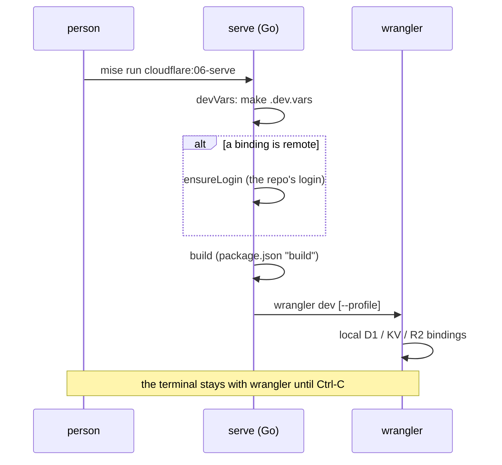
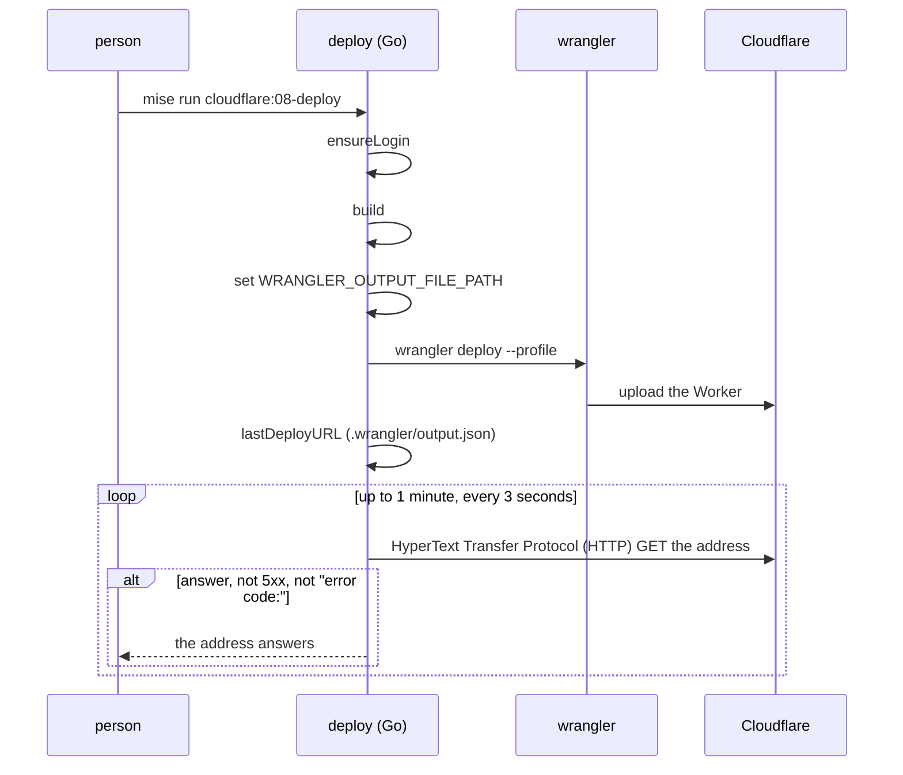

# Serve and deploy

serve, deploy and preview are the three tasks that make the Worker run. serve runs it on your machine. deploy puts it on Cloudflare. preview builds a short-lived copy of what is in the folder now. One shared rule ties the three together: the package's own build runs first, then wrangler runs, on the repo's own login. This page walks each task line by line.

## The three commands at a glance

| Task | Command | Where it runs | Login needed |
|------|---------|---------------|--------------|
| `cloudflare:06-serve` | `wrangler dev` | Your machine, with local Key Value (KV), D1 and R2 bindings | Only when a binding is remote |
| `cloudflare:08-deploy` | `wrangler deploy` | Cloudflare's network | Always |
| `cloudflare:11-preview` | `wrangler preview` | Cloudflare's network, as a preview | Always |

Each task first asks the repo's own wrangler for its config through the bridge. The bridge is described in [The wconfig bridge](02-the-wconfig-bridge.md). Each task that touches Cloudflare logs in the repo's own login first. The login model is described in [The login model](03-the-login-model.md).

## serve: run the Worker locally

The entry point is `serve`, in `cmd/mise-cloudflare/serve.go`. Its order is: make `.dev.vars`, log in when a remote binding needs it, build, then run `wrangler dev` on this terminal.

```go
// cmd/mise-cloudflare/serve.go:22
func (r repo) serve(ctx context.Context, args []string) {
	devVars(r.dir)
	remote := strings.Join(r.wc.Remote, ", ")
	if remote != "" {
		switch {
		case r.w.LoggedIn(ctx):
		case inCI():
			fail(errors.New(remote + ": wrangler runs it on Cloudflare even locally, which needs the repo's login, and in CI there's no one to log in"))
		default:
			fmt.Printf("· %s: wrangler runs it on Cloudflare even here, which needs the repo's login: logging in first\n", remote)
		}
		r.ensureLogin(ctx)
	}
	r.build(ctx)
	dev := r.w.Plain(ctx, append([]string{"dev"}, args...)...)
	if r.w.HasProfiles(ctx) {
		dev = r.w.Cmd(ctx, append([]string{"dev"}, args...)...)
	}
	if err := wrangler.Interactive(dev); err != nil {
		// Not when it was stopped (Ctrl-C).
		if code := exitCode(err); code != -1 && code != 130 && remote != "" {
			fmt.Printf("· %s runs on Cloudflare even here: if wrangler couldn't reach it above, its resource must be there first (mise run cloudflare:08-deploy makes the ones wrangler makes, an AI Search namespace among them; any other you make yourself), then this again\n", remote)
		}
		os.Exit(exitCode(err))
	}
}
```

The `args` slice carries any extra arguments the person typed after the task name. `main.go` forwards them through a `passes` map (`main.go:59`), so `mise run cloudflare:06-serve -- --port 8788` reaches wrangler as `wrangler dev --port 8788`.



### The two wrangler calls

serve builds the `wrangler dev` command in two steps. First it uses `Plain`, which adds no profile. Then it upgrades to `Cmd` when the wrangler has auth profiles. The two methods live in `internal/wrangler/wrangler.go`.

```go
// internal/wrangler/wrangler.go:52
func (w W) Plain(ctx context.Context, args ...string) *exec.Cmd {
	cmd := exec.CommandContext(ctx, "node", append([]string{w.bin()}, args...)...)
	cmd.Dir = w.Dir
	cmd.Env = os.Environ()
	return cmd
}

// internal/wrangler/wrangler.go:60
func (w W) Cmd(ctx context.Context, args ...string) *exec.Cmd {
	return w.Plain(ctx, append(args, "--profile", w.Profile)...)
}
```

Why the two-step dance? A modern wrangler has auth profiles, so `Cmd` adds `--profile` to pin the repo's own login. An old wrangler (4.49.0) has no profiles at all, and `--profile` would make it fail. Local bindings never use a login, so serve still works on the old wrangler with no profile. `HasProfiles` is the test.

```go
// internal/wrangler/wrangler.go:108
func (w W) HasProfiles(ctx context.Context) bool {
	return w.Plain(ctx, "auth", "list").Run() == nil
}
```

### Remote bindings force a login

Most bindings run locally during `wrangler dev`. A few run on Cloudflare even locally. The config's `Remote` list names them: Workers Artificial Intelligence (AI), an AI Search namespace, or any binding the person marked remote. When that list is not empty, serve checks the login:

```go
// cmd/mise-cloudflare/serve.go:24
	remote := strings.Join(r.wc.Remote, ", ")
	if remote != "" {
		switch {
		case r.w.LoggedIn(ctx):
		case inCI():
			fail(errors.New(remote + ": wrangler runs it on Cloudflare even locally, which needs the repo's login, and in CI there's no one to log in"))
		default:
			fmt.Printf("· %s: wrangler runs it on Cloudflare even here, which needs the repo's login: logging in first\n", remote)
		}
		r.ensureLogin(ctx)
	}
```

The switch has three outcomes. Already logged in, do nothing. Inside Continuous Integration (CI), fail, because no person is there to approve a login. Otherwise print a note and call `ensureLogin`. The `ensureLogin` flow itself is covered in [The login model](03-the-login-model.md).

When `wrangler dev` then fails for a remote binding, serve adds one extra hint. The likely cause is that the remote resource does not exist yet on Cloudflare. The hint points the person at `mise run cloudflare:08-deploy`, which makes the resources wrangler makes.

```go
// cmd/mise-cloudflare/serve.go:40
	if err := wrangler.Interactive(dev); err != nil {
		// Not when it was stopped (Ctrl-C).
		if code := exitCode(err); code != -1 && code != 130 && remote != "" {
			fmt.Printf("· %s runs on Cloudflare even here: if wrangler couldn't reach it above, its resource must be there first (mise run cloudflare:08-deploy makes the ones wrangler makes, an AI Search namespace among them; any other you make yourself), then this again\n", remote)
		}
		os.Exit(exitCode(err))
	}
```

A deliberate stop is not a failure. Ctrl-C ends the child process with a signal, which Go's `ExitError.ExitCode()` reports as `-1`; some shells report `130`. Both skip the hint. Any other exit code forwards to the terminal, so the task exits the way wrangler exited.

## .dev.vars: the local secrets

Before any of that, `devVars` makes the file wrangler reads for local secret values. It copies `.dev.vars.example` to `.dev.vars` when the file does not exist, and git-ignores it first.

```go
// cmd/mise-cloudflare/serve.go:50
func devVars(dir string) {
	path := filepath.Join(dir, ".dev.vars")
	if _, err := os.Stat(path); !os.IsNotExist(err) {
		return
	}
	b, err := os.ReadFile(filepath.Join(dir, ".dev.vars.example"))
	if err != nil {
		return
	}
	must(rules.EnsureIgnored(dir, ".dev.vars"))
	must(os.WriteFile(path, b, 0o600))
	fmt.Println("made .dev.vars from .dev.vars.example (git-ignored): put the local values there")
}
```

The order matters. The file is ignored before it is written, so a copy that holds real secrets never gets committed. The mode `0o600` keeps it readable by the owner only. `EnsureIgnored` appends to the repo's own `.gitignore` only when the file is not already ignored:

```go
// internal/rules/rules.go:107
func EnsureIgnored(dir, f string) error {
	if ignored(dir, f) {
		return nil
	}
	path := filepath.Join(dir, ".gitignore")
	b, _ := os.ReadFile(path)
	if len(b) > 0 && !bytes.HasSuffix(b, []byte("\n")) {
		b = append(b, '\n')
	}
	if err := os.WriteFile(path, append(b, f+"\n"...), 0o644); err != nil {
		return err
	}
	fmt.Printf("✓ %s is git-ignored now (added to .gitignore): it holds local secrets, or cf's login\n", f)
	return nil
}
```

When there is no `.dev.vars.example`, `devVars` returns silently. The person can still create `.dev.vars` by hand. When the file already exists, it is never overwritten.

## build: the package's build before wrangler

All three tasks call `build` between login and wrangler. `build` runs the package's own `build` script, with the package manager its lockfile belongs to, then lets wrangler run only if the build passed.

```go
// cmd/mise-cloudflare/run_wrangler.go:33
func (r repo) build(ctx context.Context) {
	run := rules.Build(r.dir)
	if run == "" {
		return
	}
	fmt.Printf("$ %s   (package.json's build script: wrangler runs what it writes)\n", run)
	f := strings.Fields(run)
	cmd := exec.CommandContext(ctx, f[0], f[1:]...)
	cmd.Dir = r.dir
	if err := wrangler.Interactive(cmd); err != nil {
		fmt.Fprintf(os.Stderr, "mise-cloudflare: %s failed: wrangler isn't run on a build that failed\n", run)
		os.Exit(exitCode(err))
	}
}
```

`rules.Build` reads `package.json` and returns the right command, or an empty string when there is no `build` script:

```go
// internal/rules/rules.go:149
func Build(dir string) string {
	var pkg struct{ Scripts map[string]string }
	if b, err := os.ReadFile(filepath.Join(dir, "package.json")); err != nil || json.Unmarshal(b, &pkg) != nil || pkg.Scripts["build"] == "" {
		return ""
	}
	_, install := Lockfile(dir)
	return strings.Fields(install)[0] + " run build"
}
```

`Lockfile` picks the install command that matches the committed lockfile, so the build uses the same package manager the repository pins:

```go
// internal/rules/rules.go:134
func Lockfile(dir string) (file, install string) {
	for d := range upward(dir) {
		for _, l := range lockfiles {
			if exec.Command("git", "-C", d, "ls-files", "--error-unmatch", l.file).Run() == nil {
				return filepath.Join(d, l.file), l.install
			}
		}
	}
	return "", "npm install"
}
```

The lockfile table maps `pnpm-lock.yaml` to `pnpm install --frozen-lockfile`, `yarn.lock` to `yarn install --frozen-lockfile`, `package-lock.json` to `npm ci`, and so on (`internal/rules/rules.go:124`). The first word of the install command is the package manager, so `Build` returns `pnpm run build`, `npm run build`, or `bun run build`.

**Aha: the build runs first because wrangler reads what the build writes.** A Worker that uses Cloudflare's Vite plugin does not commit its generated `wrangler.json`. The Vite plugin writes that config during `npm run build`. If wrangler ran first, it would deploy a stale or missing config. So the tool always runs the package's own build before `wrangler dev`, `wrangler deploy` and `wrangler preview`. This is also why Workers Builds composes the same rule into one line: the install command plus ` && ` plus the build command (`connect_github.go:153`).

## deploy: the Worker goes to Cloudflare

`deploy` is in `cmd/mise-cloudflare/deploy.go`. Its order is: log in, build, tell wrangler where to write its output, deploy, then poll the address until it answers.

```go
// cmd/mise-cloudflare/deploy.go:17
func (r repo) deploy(ctx context.Context, args []string) {
	r.ensureLogin(ctx)
	r.build(ctx)
	if os.Getenv("WRANGLER_OUTPUT_FILE_PATH") == "" {
		os.Setenv("WRANGLER_OUTPUT_FILE_PATH", filepath.Join(".wrangler", "output.json"))
	}
	r.wranglerHere(ctx, append([]string{"deploy"}, args...))
	if url := lastDeployURL(r.dir); url != "" && !slices.Contains(args, "--dry-run") {
		waitTillItAnswers(ctx, url)
	}
}
```

The environment variable `WRANGLER_OUTPUT_FILE_PATH` points wrangler at `.wrangler/output.json`. Wrangler writes one JSON entry per deploy there, including the address of the Worker. The tool sets it only when it is not already set, so a person's own choice wins. `lastDeployURL` reads that file back (`show.go:180`). The `--dry-run` flag skips the poll, because a dry run deploys nothing to poll.

`deploy` runs wrangler through `wranglerHere`, the shared "any wrangler command on the repo's login" path:

```go
// cmd/mise-cloudflare/run_wrangler.go:23
func (r repo) wranglerHere(ctx context.Context, args []string) {
	r.ensureLogin(ctx)
	if err := wrangler.Interactive(r.w.Cmd(ctx, args...)); err != nil {
		os.Exit(exitCode(err))
	}
}
```



### waitTillItAnswers

Right after a first deploy, Cloudflare answers the address with "error code: 1042" for a few seconds while the Worker reaches its network. `waitTillItAnswers` polls until that clears, or gives up after a minute.

```go
// cmd/mise-cloudflare/deploy.go:31
func waitTillItAnswers(ctx context.Context, url string) {
	client := &http.Client{Timeout: 10 * time.Second}
	for deadline := time.Now().Add(time.Minute); time.Now().Before(deadline); time.Sleep(3 * time.Second) {
		req, _ := http.NewRequestWithContext(ctx, http.MethodGet, url, nil)
		if resp, err := client.Do(req); err == nil {
			body, _ := io.ReadAll(io.LimitReader(resp.Body, 64))
			resp.Body.Close()
			if resp.StatusCode < 500 && !strings.HasPrefix(string(body), "error code:") {
				fmt.Printf("✓ %s answers\n", url)
				return
			}
		}
	}
	fmt.Printf("· %s doesn't answer yet: a first deploy can take a minute or two to reach Cloudflare's network; open it again shortly\n", url)
}
```

The loop reads only the first 64 bytes of the body. That is enough to see the "error code:" prefix. A status code of 500 or more, or any body that starts with "error code:", counts as not yet answering. A network error also counts as not yet answering, and the loop tries again three seconds later. After one minute it prints a note and returns normally; the deploy itself already succeeded.

## preview: a throwaway copy

`preview` is in `cmd/mise-cloudflare/preview.go`. It deploys a preview of what is in the folder now, with the previews' own resources made first.

```go
// cmd/mise-cloudflare/preview.go:7
func (r repo) preview(ctx context.Context, args []string) {
	r.ensureLogin(ctx)
	if r.wc.Previews {
		r.previewResources(ctx, false, false)
	}
	r.build(ctx)
	r.wranglerHere(ctx, append([]string{"preview"}, args...))
}
```

The `r.wc.Previews` flag says the config has a previews block. When it does, `previewResources` makes the previews' own KV, D1, R2, Queue and Flagship app (each named `<worker>-previews-<binding>`) and puts them in the Worker's Previews Base. `wrangler preview` itself does not make those. The resources machinery is covered in [Secrets and resources](10-secrets-and-resources.md).

## wranglerJSON: parse past the noise

The shared file `run_wrangler.go` holds one more helper, `wranglerJSON`. It runs a wrangler command and decodes its JavaScript Object Notation (JSON) output, skipping anything the tool prints before the JSON begins (a warning, for example).

```go
// cmd/mise-cloudflare/run_wrangler.go:49
func (r repo) wranglerJSON(ctx context.Context, v any, args ...string) error {
	out, err := wrangler.Output(r.w.Cmd(ctx, args...))
	if err != nil {
		return err
	}
	if i := regexp.MustCompile(`(?m)^[\[{]`).FindIndex(out); i != nil {
		out = out[i[0]:]
	}
	if err := json.Unmarshal(out, v); err != nil {
		return fmt.Errorf("wrangler %s: %w", strings.Join(args, " "), err)
	}
	return nil
}
```

The regular expression `^[\[{]` finds the first line that starts with `[` or `{`, and the decode starts there. This lets the tool use wrangler commands that print a banner before their result.

## verify: replay what GitHub runs

`verify` is a different kind of task. It is `cloudflare:verify`, the command the repo's GitHub workflow runs after checkout. It does what GitHub does, on your machine: the repo's own `setup` and `test` tasks, then `check`.

```go
// cmd/mise-cloudflare/verify.go:18
func verify(ctx context.Context, dir string) {
	if !runTask(ctx, dir, "setup") && !(wrangler.W{Dir: dir}).Installed() {
		_, install := rules.Lockfile(dir)
		fmt.Println("$ " + install)
		f := strings.Fields(install)
		run := exec.CommandContext(ctx, f[0], f[1:]...)
		run.Dir, run.Stdin, run.Stdout, run.Stderr = dir, os.Stdin, os.Stdout, os.Stderr
		if err := run.Run(); err != nil {
			fail(fmt.Errorf("%s: %w", install, err))
		}
	}
	runTask(ctx, dir, "test")
	openRepo(ctx, dir).check(ctx, false)
}
```

The fallback matters on a fresh checkout. When the repo has no `setup` task, and wrangler is not yet installed, verify installs the dependencies from the lockfile directly. The `setup` task is what normally installs wrangler; without one, the lockfile's install command does it. `runTask` returns whether the repo has a task, and runs it when it does.

```go
// cmd/mise-cloudflare/verify.go:36
func runTask(ctx context.Context, dir, task string) bool {
	has := exec.CommandContext(ctx, "mise", "tasks", "info", task)
	has.Dir = dir
	if has.Run() != nil {
		return false
	}
	fmt.Println("$ mise run " + task)
	run := exec.CommandContext(ctx, "mise", "run", task)
	run.Dir, run.Stdin, run.Stdout, run.Stderr = dir, os.Stdin, os.Stdout, os.Stderr
	if err := run.Run(); err != nil {
		fail(fmt.Errorf("mise run %s: %w", task, err))
	}
	return true
}
```

The probe is `mise tasks info <task>`; a non-zero exit means the task does not exist. The run itself attaches standard input, output and error to the terminal, so a failing test prints the way it would in GitHub Actions. `check` is the rules pass from [The check rules](05-the-check-rules.md).

## Where to go next

Read [Connect GitHub](09-connect-github.md) to see how every push deploys without a token. Read [The login model](03-the-login-model.md) for the `ensureLogin` path that serve, deploy and preview all share.
