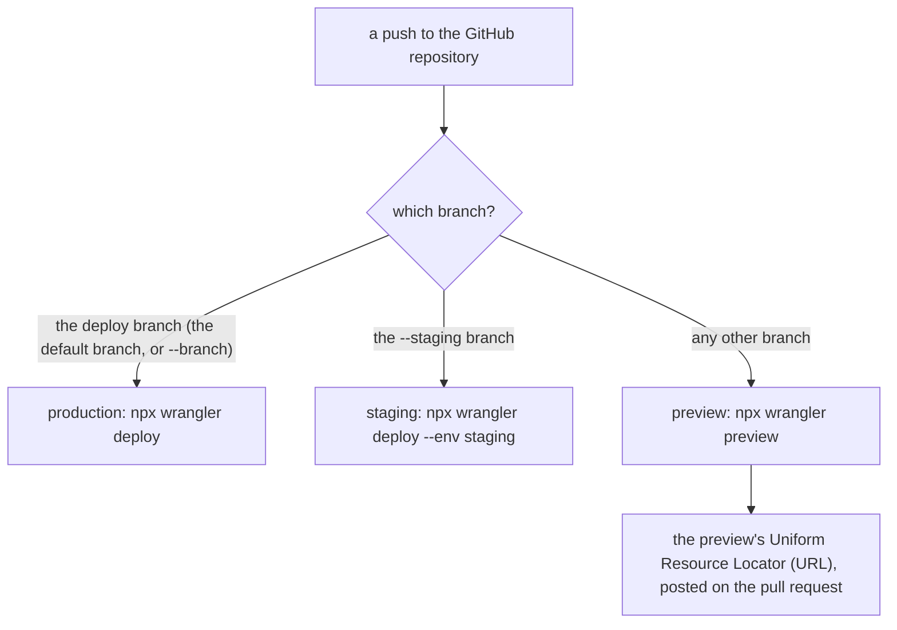
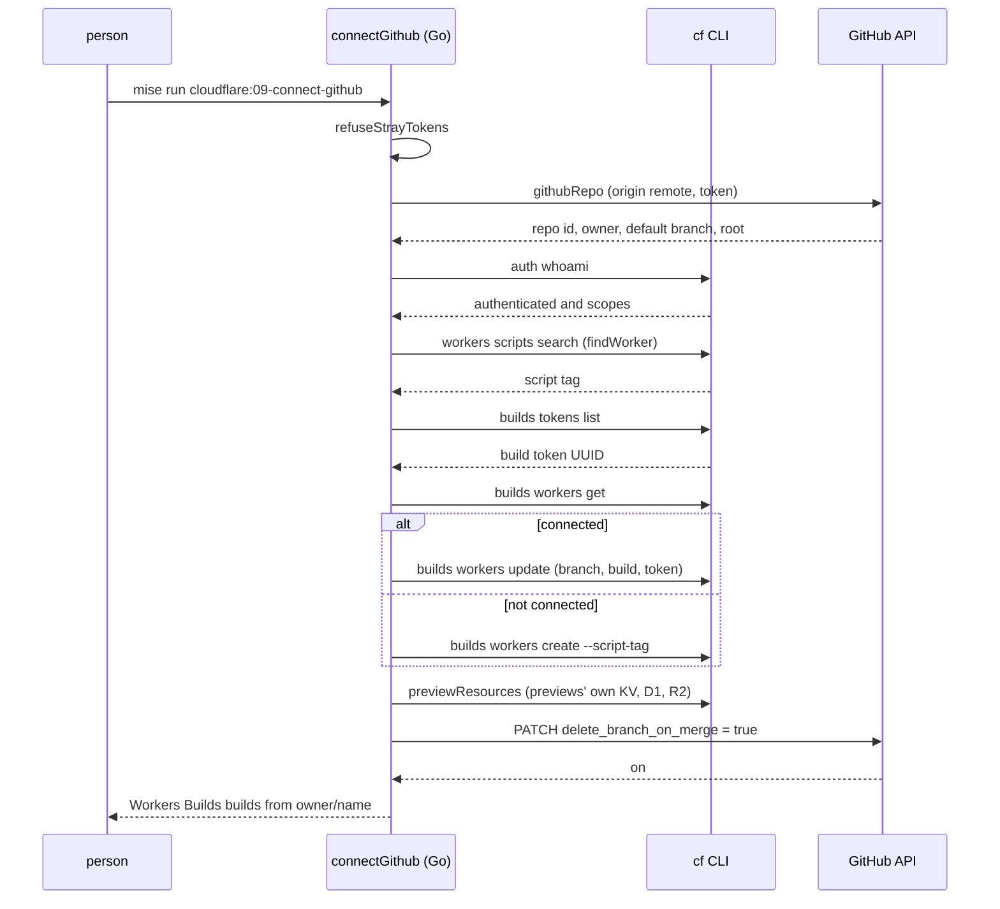

# Connect GitHub

Workers Builds is Cloudflare's Continuous Integration (CI). It builds and deploys a Worker from a GitHub repository on every push. Production comes from the deploy branch. Every pull request gets a preview. `--staging` adds a staging branch. The `cloudflare:09-connect-github` task drives Cloudflare's cf command-line interface (CLI) to set this up, and `--off` removes it all.

## The model in one picture

One repository maps to three kinds of deploy, split by branch.



Production is one Worker. When `--staging` is given, a second Worker deploys a wrangler environment named `staging` from the staging branch. Every other branch is a preview of the production Worker. When `--staging` is set, production's branch becomes `production` instead of the repository's default branch.

## The entry point

`connectGithub` is the largest command in the project, in `cmd/mise-cloudflare/connect_github.go`. It runs in clear phases. The first phase checks that cf is present, refuses stray tokens, and resolves the GitHub repository.

```go
// cmd/mise-cloudflare/connect_github.go:52
func (r repo) connectGithub(ctx context.Context, b builds, off, jsonOut bool) {
	if !cf.Installed() {
		fail(errors.New("cf, which connects Workers Builds, doesn't run here: run mise run cloudflare:09-connect-github, which brings it"))
	}
	r.refuseStrayTokens()
	// The GitHub repository first: without one there's nothing for Workers Builds to build, so no login is asked for.
	var gh ghRepo
	if !off {
		var err error
		if gh, err = githubRepo(ctx, r.dir); err != nil {
			fail(err)
		}
	}
```

The order is deliberate. The GitHub repository is resolved before any Cloudflare login, because without a repository there is nothing to connect. `refuseStrayTokens` is the same guard every login-using command runs: a `CLOUDFLARE_API_TOKEN` in the shell or a `.env` file would override every login, so it is refused (`login.go:84`). See [The login model](03-the-login-model.md).

## Why cf, not wrangler

Workers Builds is managed by Cloudflare's own CLI, `cf`, not by wrangler. The reason is the login's scope. Wrangler's login cannot hold the `workers_builds:write` scope, so the command uses a separate cf login on its own profile.

```go
// internal/cf/cf.go:23
var Scopes = []string{"account:read", "user:read", "workers:write", "workers_scripts:write", "workers_builds:write"}
```

The cf package states the reason in its own header: "wrangler's login can't hold its scope (workers_builds:write)" (`internal/cf/cf.go:1`). The cf profile is named after the repo's login profile, so the two stay one per repository.

`cf.Installed` is careful about a mise trap: a mise shim for cf sits on the PATH wherever mise once installed it, and fails later with "No version is set for shim: cf". So being on the PATH is not enough; cf must actually run.

```go
// internal/cf/cf.go:34
func Installed() bool {
	return exec.Command("cf", "--version").Run() == nil
}
```

The next phase makes or checks the cf login, then pins the account:

```go
// cmd/mise-cloudflare/connect_github.go:65
	must(rules.EnsureIgnored(r.dir, ".cloudflare/")) // cf caches the account it logs into there
	c := cf.CF{Dir: r.dir, Profile: r.w.Profile}
	who, err := c.Whoami(ctx)
	if err != nil {
		fail(err)
	}
	if !who.Authenticated || !who.HasScopes() {
		must(c.Login(ctx, !wrangler.Device()))
		if who, err = c.Whoami(ctx); err != nil {
			fail(err)
		}
		if !who.Authenticated || !who.HasScopes() {
			fail(fmt.Errorf("the cf login %s doesn't hold %s", c.Profile, strings.Join(cf.Scopes, " ")))
		}
	}
	if len(who.Accounts) != 1 {
		fail(fmt.Errorf("the cf login %s can use %d accounts; log it in again and pick one", c.Profile, len(who.Accounts)))
	}
	c.Account = who.Accounts[0].ID
	if b == (builds{}) && !off {
		b = r.currentBuilds(ctx, c)
	}
```

The `.cloudflare/` folder is git-ignored first, because cf caches the account it logged into there. The login is checked with `Whoami`, and remade through `cf auth create` when it is missing or missing a scope. The account must be unambiguous: more than one account is an error, not a choice. `HasScopes` walks the required scope list:

```go
// internal/cf/cf.go:133
func (w Who) HasScopes() bool {
	for _, s := range Scopes {
		if !slices.Contains(w.Scopes, s) {
			return false
		}
	}
	return true
}
```

## The Workers and their script tags

Workers Builds attaches to an already-deployed Worker by its script tag. The command builds a list of Workers: production (the config's `name`, plus the `CLOUDFLARE_ENV` it picks), and staging when `--staging` is set.

```go
// cmd/mise-cloudflare/connect_github.go:89
	env := os.Getenv("CLOUDFLARE_ENV")
	envFlag := func(e string) string {
		if e == "" {
			return ""
		}
		return " --env " + e
	}
	workers := []githubWorker{{Env: env, Worker: r.wc.Name}}
	if b.Staging != "" {
		if !r.wc.HasEnv("staging") {
			fail(fmt.Errorf("a staging branch needs the wrangler environment staging in %s (env.staging, with its own bindings)", filepath.Base(r.wc.Path)))
		}
		sc, err := wconfig.ReadEnv(ctx, r.dir, "staging")
		if err != nil {
			fail(err)
		}
		workers = append(workers, githubWorker{Env: "staging", Worker: sc.Name, Branch: b.Staging, Deploy: "npx wrangler deploy --env staging"})
	}
	for i := range workers {
		if off {
			workers[i].ScriptTag = findWorker(ctx, c, workers[i].Worker) // "" if it isn't deployed: then nothing builds it
		} else {
			workers[i].ScriptTag = workerTag(ctx, c, workers[i].Worker, workers[i].Env)
		}
	}
	rep := githubReport{Workers: workers}
```

Staging is not magic. The wrangler config must declare an `env.staging` with its own bindings, and its name comes from that environment, not from the production name. The deploy command is hard-coded as `npx wrangler deploy --env staging`.

`workerTag` and `findWorker` both search Cloudflare for the Worker's tag. The search matches names partly, so only an exact name match counts.

```go
// cmd/mise-cloudflare/connect_github.go:250
func workerTag(ctx context.Context, c cf.CF, name, env string) string {
	if tag := findWorker(ctx, c, name); tag != "" {
		return tag
	}
	deploy := "mise run cloudflare:08-deploy"
	if env != "" {
		deploy += " -- --env " + env
	}
	fail(fmt.Errorf("Workers Builds attaches to a deployed Worker, and %s isn't deployed: deploy it once first (%s), then run this again", name, deploy))
	return ""
}
```

`workerTag` fails with a concrete next step when the Worker is not deployed. `findWorker` is the lenient version that returns an empty string instead of failing.

```go
// cmd/mise-cloudflare/connect_github.go:263
func findWorker(ctx context.Context, c cf.CF, name string) string {
	var found []struct {
		ID   string `json:"id"`
		Name string `json:"script_name"`
	}
	if c.JSON(ctx, &found, "workers", "scripts", "search", "--name", name) != nil {
		return ""
	}
	for _, f := range found {
		if f.Name == name {
			return f.ID
		}
	}
	return ""
}
```

## --off: the undo

With `--off`, the command deletes each Workers Builds connection it finds, then the previews' own resources, and stops.

```go
// cmd/mise-cloudflare/connect_github.go:116
	if off {
		for _, w := range workers {
			if w.ScriptTag == "" {
				continue
			}
			if err := c.JSON(ctx, nil, "builds", "workers", "delete", w.ScriptTag, "--force"); err != nil && !cf.NotFound(err) {
				fail(err)
			}
		}
		rep.Removed = true
		rep.Previews = r.previewResources(ctx, true, jsonOut)
		if jsonOut {
			emit(rep)
		} else {
			fmt.Println("✓ Workers Builds no longer builds " + workerNames(workers))
		}
		return
	}
```

A Worker with no script tag (not deployed) has nothing to delete, so it is skipped. A `404 Not Found` from Cloudflare means the connection was already gone, and is not an error. `cf.NotFound` extracts that status from the error text (`internal/cf/cf.go:86`).

## The build token

Workers Builds deploys with a build token that Cloudflare itself made. The command lists the account's tokens and takes the first one.

```go
// cmd/mise-cloudflare/connect_github.go:138
	tokens, err := buildTokens(ctx, c)
	if err != nil {
		fail(err)
	}
	var tokenName string
	if len(tokens) > 0 {
		rep.Token, tokenName = tokens[0].UUID, tokens[0].Name
	}
	if rep.Token == "" {
		fail(errors.New("the account has no Workers Builds token yet: connect any repository once in Cloudflare's dashboard (a Worker's Settings, Builds), which makes one, then run this again"))
	}
	rep.Repository = gh.Owner.Login + "/" + gh.Name
	rep.Root = gh.root
	_, install := rules.Lockfile(r.dir)
	if run := rules.Build(r.dir); run != "" {
		install += " && " + run // the package's own build, before wrangler deploys what it writes
	}
	rep.Build = orDefault(b.Build, install)
```

The token's universally unique identifier (UUID) is what Cloudflare stores; its name is what the report shows. GitHub holds no Cloudflare credential. The token covers Workers Scripts, KV, R2 and Workers Routes; a Worker binding anything else needs that permission added to the token in the dashboard.

The build command is the lockfile's install command, plus ` && ` plus the package's own build when one exists. This is the same build-first rule that `build` applies in [Serve and deploy](08-serve-and-deploy.md), but composed into one Workers Builds command.

```go
// cmd/mise-cloudflare/connect_github.go:397
func buildTokens(ctx context.Context, c cf.CF) ([]buildToken, error) {
	var tokens []buildToken
	err := c.JSON(ctx, &tokens, "builds", "tokens", "list")
	return tokens, err
}
```

## Branches and deploy commands

The next phase decides the branch and the exact commands, then checks the previews block.

```go
// cmd/mise-cloudflare/connect_github.go:156
	prodBranch := gh.DefaultBranch
	if b.Staging != "" {
		prodBranch = "production"
	}
	workers[0].Branch = orDefault(b.Branch, prodBranch)
	workers[0].Deploy = "npx wrangler deploy" + envFlag(env)
	workers[0].Preview = "npx wrangler preview" + envFlag(env)
	// Worker Previews (wrangler preview) need a previews block, and one whose KV, D1 or R2 names no resource Cloudflare
	// refuses; wrangler preview itself names the bindings a preview lacks.
	if problems := rules.Previews(r.wc, true); len(problems) > 0 {
		fail(errors.New(strings.Join(problems, "\n")))
	}
	if len(workers) > 1 && workers[0].Branch == workers[1].Branch {
		fail(fmt.Errorf("production and staging both deploy from %s: give them different branches", workers[0].Branch))
	}
```

Two guards protect against a broken setup. The previews block must exist and be valid, because `wrangler preview` needs it. And production and staging must not deploy from the same branch; the tool refuses rather than let both fight over one branch.

## Create or update

The core loop handles each Worker. It reads Cloudflare's current state first, then updates or creates.

```go
// cmd/mise-cloudflare/connect_github.go:171
	for _, w := range workers {
		previews := w.Preview != ""
		// Which repository: create takes it, update can't change it (cf builds workers update has only the branch).
		repository := []string{
			"--git-repository-provider-type", "github",
			"--git-repository-provider-account-id", fmt.Sprint(gh.Owner.ID),
			"--git-repository-provider-account-name", gh.Owner.Login,
			"--git-repository-repo-id", fmt.Sprint(gh.ID),
			"--git-repository-repo-name", gh.Name,
		}
		settings := []string{
			"--git-repository-branch", w.Branch,
			"--production-settings-build-command", rep.Build,
			"--production-settings-deploy-command", w.Deploy,
			"--production-settings-build-token-uuid", rep.Token,
			"--production-settings-root-directory", rep.Root,
			fmt.Sprintf("--previews-enabled=%v", previews),
			"--previews-base-config-build-command", rep.Build,
			"--previews-base-config-deploy-command", orDefault(w.Preview, "npx wrangler preview"+envFlag(w.Env)),
			"--previews-base-config-build-token-uuid", rep.Token,
			"--previews-base-config-root-directory", rep.Root,
		}
```

The repository details go only on create. The update command cannot change the repository, only the branch and build settings. So the comment splits the two argument lists. The `--production-settings-root-directory` carries the monorepo subfolder path, computed by `githubRepo`.

```go
// cmd/mise-cloudflare/connect_github.go:193
		var now struct {
			Git struct {
				RepoID json.RawMessage `json:"repo_id"`
			} `json:"git_repository"`
		}
		connected := c.JSON(ctx, &now, "builds", "workers", "get", w.ScriptTag) == nil
		if id := strings.Trim(string(now.Git.RepoID), `"`); connected && id != "" && id != fmt.Sprint(gh.ID) {
			// It builds from another repository (this one moved, say), which update can't change: made afresh.
			if err := c.JSON(ctx, nil, "builds", "workers", "delete", w.ScriptTag, "--force"); err != nil && !cf.NotFound(err) {
				fail(fmt.Errorf("%s builds from another repository, and its connection couldn't be removed to connect %s: %w", w.Worker, rep.Repository, err))
			}
			connected = false
		}
		if connected {
			if err := c.JSON(ctx, nil, append([]string{"builds", "workers", "update", w.ScriptTag}, settings...)...); err != nil {
				fail(fmt.Errorf("%s: %w", w.Worker, err))
			}
		} else if err := c.JSON(ctx, nil, append(append([]string{"builds", "workers", "create", "--script-tag", w.ScriptTag}, repository...), settings...)...); err != nil {
			fail(fmt.Errorf("%s: %w\nIf Cloudflare can't see the repository, give Cloudflare's GitHub app access to %s on GitHub (Settings, Applications, Cloudflare Workers and Pages), then run this again", w.Worker, err, rep.Repository))
		}
	}
```

A connection that builds from a different repository is handled specially. Update cannot change the repository, so the old connection is deleted and made fresh. The `create` failure message carries the most likely fix: grant Cloudflare's GitHub app access to the repository.

The final phase makes the previews' own resources and flips the branch-deletion switch, then prints the report.

```go
// cmd/mise-cloudflare/connect_github.go:214
	// Previews get their own KV, D1 and R2, which wrangler preview doesn't make.
	rep.Previews = r.previewResources(ctx, false, jsonOut)
	// A branch's preview goes when the branch does; GitHub deletes a pull request's branch when it merges, with this on.
	rep.DeleteMergedBranches = deleteMergedBranches(ctx, gh)
	if jsonOut {
		emit(rep)
		return
	}
	fmt.Printf("✓ Workers Builds builds from %s, in %s, with %s:\n", rep.Repository, rep.Root, rep.Build)
	for _, w := range workers {
		name := "production"
		if w.Env != "" {
			name = w.Env
		}
		fmt.Printf("  %-10s %s: a push to %s runs %s\n", name, w.Worker, w.Branch, w.Deploy)
	}
	fmt.Printf("  previews   any other branch: %s, its URL on the pull request\n", workers[0].Preview)
	fmt.Printf("  with the account's build token %q; GitHub holds no Cloudflare credential\n", tokenName)
	fmt.Printf("  · a build that fails for a permission says which in its log: give the build token %q it (Cloudflare's dashboard: Manage account, Account API tokens, %s, Edit)\n", tokenName, tokenName)
```

## The idempotent heart: currentBuilds

The cleverest part is the two lines near the top. When the flags are empty, the command reads what Cloudflare has now and reuses it.

```go
// cmd/mise-cloudflare/connect_github.go:84
	if b == (builds{}) && !off {
		b = r.currentBuilds(ctx, c)
	}
```

`builds` is the flags struct; empty means the person gave no `--branch`, `--staging` or `--build`.

```go
// cmd/mise-cloudflare/connect_github.go:280
func (r repo) currentBuilds(ctx context.Context, c cf.CF) builds {
	var b builds
	get := func(worker string) (branch, build string) {
		var w struct {
			Git struct {
				Branch string `json:"branch"`
			} `json:"git_repository"`
			Production struct {
				Build string `json:"build_command"`
			} `json:"production_settings"`
		}
		if tag := findWorker(ctx, c, worker); tag != "" && c.JSON(ctx, &w, "builds", "workers", "get", tag) == nil {
			return w.Git.Branch, w.Production.Build
		}
		return "", ""
	}
	b.Branch, b.Build = get(r.wc.Name)
	if r.wc.HasEnv("staging") {
		if sc, err := wconfig.ReadEnv(ctx, r.dir, "staging"); err == nil {
			b.Staging, _ = get(sc.Name)
		}
	}
	return b
}
```

**Aha: run again with no flags, and it keeps what is set.** The command is idempotent. It reads the current branch and build command from Cloudflare first, then writes them back. So a second run with no flags is an update, not a new connection. The same read-then-write idea appears in the create/update loop, where `connected` is decided by reading `builds workers get` before choosing update or create.

## The flags

| Flag | Meaning | Default |
|------|---------|---------|
| `--off` | Delete the Workers Builds connections and previews' resources | off |
| `--branch <branch>` | The production deploy branch | the default branch, or `production` with staging |
| `--staging <branch>` | A staging branch, deployed as the `staging` environment | none |
| `--build <command>` | Override the build command | lockfile install, plus ` && ` plus the package's build |
| `--json` | Print the report as JavaScript Object Notation (JSON) | off |

The `--json` report is the `githubReport` struct. Its fields are the repository, the root path, the build command, the token, each Worker, the previews' resources, and whether merged branches are deleted.

```go
// cmd/mise-cloudflare/connect_github.go:23
type githubReport struct {
	Repository string         `json:"repository"`
	Root       string         `json:"root"`
	Build      string         `json:"build"`
	Token      string         `json:"token"`
	Workers    []githubWorker `json:"workers"`
	Removed    bool           `json:"removed,omitempty"`
	// The previews' own KV, D1 and R2, in the Worker's Previews Base.
	Previews []resource `json:"previews,omitempty"`
	// GitHub deletes merged pull requests' branches, and Workers Builds their previews with them.
	DeleteMergedBranches bool `json:"deleteMergedBranches"`
}
```

## Finding the GitHub repository

`githubRepo` answers one question: which repository does this folder live in, and where inside it? It reads the `origin` remote, matches the GitHub address, and computes the folder's path inside the repository for a monorepo subfolder.

```go
// cmd/mise-cloudflare/connect_github.go:328
func githubRepo(ctx context.Context, dir string) (ghRepo, error) {
	var g ghRepo
	out, err := exec.CommandContext(ctx, "git", "-C", dir, "remote", "get-url", "origin").Output()
	if err != nil {
		return g, errors.New("this repo has no origin remote: Workers Builds builds from a GitHub repository")
	}
	m := githubURL.FindStringSubmatch(strings.TrimSpace(string(out)))
	if m == nil {
		return g, fmt.Errorf("origin isn't a GitHub repository (%s): Workers Builds here builds from GitHub", strings.TrimSpace(string(out)))
	}
	top, err := exec.CommandContext(ctx, "git", "-C", dir, "rev-parse", "--show-toplevel").Output()
	if err != nil {
		return g, err
	}
	realTop, _ := filepath.EvalSymlinks(strings.TrimSpace(string(top)))
	realDir, _ := filepath.EvalSymlinks(dir)
	rel, err := filepath.Rel(realTop, realDir)
	if err != nil {
		return g, err
	}
	g.root = "/" // as Cloudflare writes it, the repository's root
	if rel != "." {
		g.root = "/" + filepath.ToSlash(rel)
	}
	for _, token := range []string{githubToken(ctx), ""} {
		req, _ := http.NewRequestWithContext(ctx, http.MethodGet, "https://api.github.com/repos/"+m[1]+"/"+m[2], nil)
		req.Header.Set("Accept", "application/vnd.github+json")
		if token != "" {
			req.Header.Set("Authorization", "Bearer "+token)
		}
		resp, err := (&http.Client{Timeout: 30 * time.Second}).Do(req)
		if err != nil {
			return g, err
		}
		err = json.NewDecoder(resp.Body).Decode(&g)
		resp.Body.Close()
		if resp.StatusCode == http.StatusOK && err == nil && g.ID != 0 {
			return g, nil
		}
	}
	return g, fmt.Errorf("GitHub doesn't show the repository %s/%s: a private one needs a GitHub login that can read it: gh auth login (mise exec gh -- gh auth login where gh isn't installed), then run this again (or set GITHUB_TOKEN to such a token)", m[1], m[2])
}
```

The root path is written the way Cloudflare writes it: `/` for the repository root, or `/packages/my-worker` for a subfolder. Symlinks are resolved on both sides before computing the relative path, so a folder reached through a link still gets the right root. The GitHub application programming interface (API) call is tried twice: once with a token, once without, so a private repository falls back to the public path and gives a helpful error.

The token comes from three places, in order:

```go
// cmd/mise-cloudflare/connect_github.go:372
func githubToken(ctx context.Context) string {
	if token := cmpOrEnv("GITHUB_TOKEN", "GH_TOKEN"); token != "" {
		return token
	}
	if out, err := exec.CommandContext(ctx, "gh", "auth", "token").Output(); err == nil {
		return strings.TrimSpace(string(out))
	}
	return ""
}
```

## Deleting merged branches

A preview should die when its pull request merges. GitHub deletes the branch on merge only when the setting is on, so the command flips it with a PATCH request and reports the result.

```go
// cmd/mise-cloudflare/connect_github.go:405
func deleteMergedBranches(ctx context.Context, g ghRepo) bool {
	token := githubToken(ctx)
	if token == "" {
		return false
	}
	req, _ := http.NewRequestWithContext(ctx, http.MethodPatch, "https://api.github.com/repos/"+g.Owner.Login+"/"+g.Name,
		strings.NewReader(`{"delete_branch_on_merge":true}`))
	req.Header.Set("Accept", "application/vnd.github+json")
	req.Header.Set("Authorization", "Bearer "+token)
	resp, err := (&http.Client{Timeout: 30 * time.Second}).Do(req)
	if err != nil {
		return false
	}
	defer resp.Body.Close()
	var r struct {
		On bool `json:"delete_branch_on_merge"`
	}
	return resp.StatusCode == http.StatusOK && json.NewDecoder(resp.Body).Decode(&r) == nil && r.On
}
```

Without a GitHub login it returns false and leaves the switch to the person. The report prints the reminder: log in with `gh auth login`, or turn on "Automatically delete head branches" in the repository's settings (`connect_github.go:236`).

## The whole flow



## Where to go next

Read [Secrets and resources](10-secrets-and-resources.md) for the previews' own KV, D1, R2, Queue and Flagship resources that `connectGithub` makes. Read [Serve and deploy](08-serve-and-deploy.md) for the `build` rule that the build command here mirrors.
