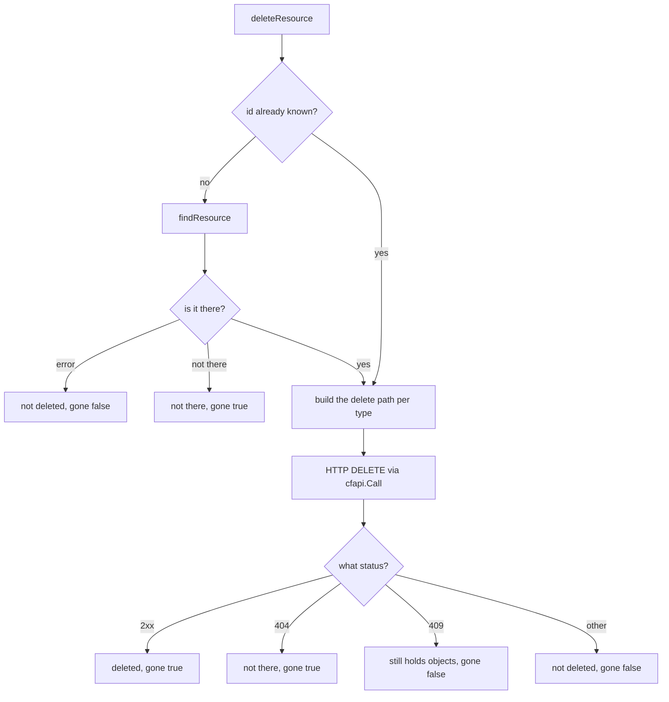
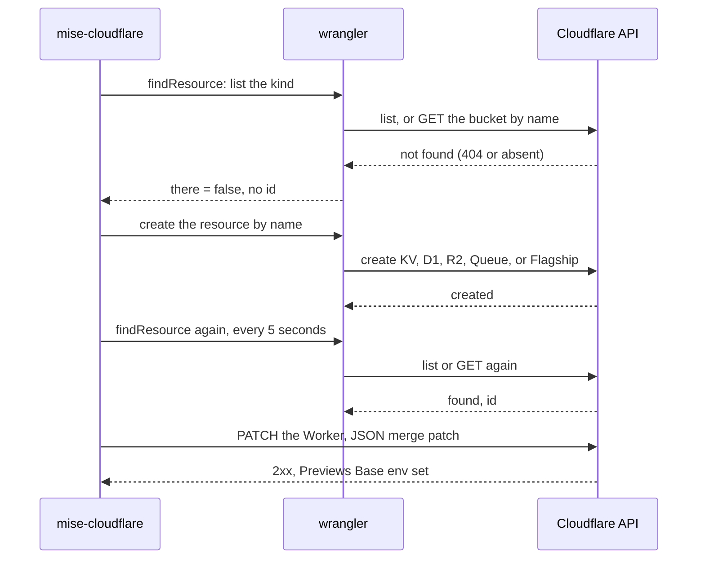

# Secrets and resources

Two commands prepare what the Worker needs to run on Cloudflare that a plain deploy does not give it. `set-secrets` puts the secret values on Cloudflare. `set-preview-secrets` puts the previews' secret values in the Previews Base. The `previewResources` helper, which the `delete` command also uses, makes each preview its own Key-Value (KV) namespace, Data-1 (D1) database, R2 object storage (R2) bucket, Queue, and Flagship app. This page reads three files: `set_secrets.go`, `set_preview_secrets.go`, and `resources.go`.

Source: `cmd/mise-cloudflare/set_secrets.go`, `cmd/mise-cloudflare/set_preview_secrets.go`, `cmd/mise-cloudflare/resources.go`.

## What the two secret commands share

Both secret commands call one function. `setSecrets` takes a `previews` flag that picks the production path or the previews path.

```go
// cmd/mise-cloudflare/set_secrets.go:18
func (r repo) setSecrets(ctx context.Context, previews bool) {
	who := r.ensureLogin(ctx)
	where, whose, put := r.wc.Name, r.wc.Name+"'s", []string{"secret", "put"}
	var missing []string
```

`setPreviewSecrets` is one line that calls the same function with `previews` set to true.

```go
// cmd/mise-cloudflare/set_preview_secrets.go:7
func (r repo) setPreviewSecrets(ctx context.Context) {
	r.setSecrets(ctx, true)
}
```

The two share the asking and the writing. They differ only in which list of missing secrets they build and where they put each value. This is the pattern of the whole codebase: one function carries the shared logic, a flag picks the branch.

## Where the required secrets come from

The Worker's config declares the secrets it needs in `secrets.required`. The wconfig bridge reads that list into the `Secrets` field of its `Config` struct.

```go
// internal/wconfig/wconfig.go:23
	Secrets []string `json:"secrets"` // secrets.required
```

The bridge is explained in [The wconfig bridge](02-the-wconfig-bridge.md). Here the point is small: `r.wc.Secrets` is the config's `secrets.required` list, as wrangler itself reads it. The tool never parses the config file.

## The production path: what Cloudflare lacks

For production, the tool lists the secrets Cloudflare already has and keeps the ones that are missing. It asks wrangler for the current list.

```go
// cmd/mise-cloudflare/set_secrets.go:33
	} else {
		// A Worker that isn't on Cloudflare yet has none: wrangler secret put makes it.
		var have []struct{ Name string }
		r.wranglerJSON(ctx, &have, "secret", "list")
		for _, s := range r.wc.Secrets {
			if !slices.ContainsFunc(have, func(h struct{ Name string }) bool { return h.Name == s }) {
				missing = append(missing, s)
			}
		}
	}
```

The comment names the trick. A Worker that is not on Cloudflare yet has no secrets, and `wrangler secret put` makes the Worker as a draft when it puts the first secret. So the tool does not need to check whether the Worker exists. It lists, compares, and puts only what is absent.

If nothing is missing, the tool prints one line and returns.

```go
// cmd/mise-cloudflare/set_secrets.go:43
	if len(missing) == 0 {
		fmt.Printf("✓ %s has every secret it requires\n", where)
		return
	}
```

## Hidden typing, line by line

Each missing secret is asked for one at a time. On a terminal, the value is typed unseen. Not on a terminal, the tool reads one line from standard input (stdin).

```go
// cmd/mise-cloudflare/set_secrets.go:47
	tty, in := term.IsTerminal(int(os.Stdin.Fd())), bufio.NewReader(os.Stdin)
	for _, name := range missing {
		var value string
		if tty {
			fmt.Fprintf(os.Stderr, "%s %s (hidden): ", whose, name)
			b, err := term.ReadPassword(int(os.Stdin.Fd()))
			fmt.Fprintln(os.Stderr)
			must(err)
			value = string(b)
		} else {
			line, _ := in.ReadString('\n')
			value = strings.TrimRight(line, "\r\n")
		}
		if value == "" {
			fail(fmt.Errorf("no value for %s %s", whose, name))
		}
		cmd := r.w.Cmd(ctx, append(slices.Clone(put), name)...)
		cmd.Stdin = strings.NewReader(value)
		if out, err := cmd.CombinedOutput(); err != nil {
			fail(fmt.Errorf("wrangler %s %s: %w\n%s", strings.Join(put, " "), name, err, out))
		}
		fmt.Printf("✓ %s %s is set\n", whose, name)
	}
```

Four details matter here.

1. The prompt goes to standard error (stderr), not standard output (stdout). `term.ReadPassword` turns off the terminal echo, so the value never shows. The prompt on stderr still shows because stderr is not the secret's channel.
2. An empty value fails immediately with `no value`. The tool refuses to write an empty secret.
3. The value goes to wrangler through `cmd.Stdin`, a pipe. It never lands in a command argument, so it never shows in a process list.
4. The write command is `secret put` for production and `preview base-config secret put` for previews. The `put` slice changes earlier, at `set_secrets.go:20` and `set_secrets.go:32`.

## The previews path: deploy first, one account

Previews do not inherit the Worker's secrets. Each preview starts from the Previews Base. So preview secrets go there. The previews branch checks two things before it asks.

```go
// cmd/mise-cloudflare/set_secrets.go:22
	if previews {
		if !r.deployed(ctx) {
			fail(errors.New("previews' secrets go in the Worker's Previews Base: deploy it first (mise run cloudflare:08-deploy)"))
		}
		if len(who.Accounts) != 1 {
			fail(fmt.Errorf("the login %s can use %d accounts; log it in again and pick one", r.w.Profile, len(who.Accounts)))
		}
		token, err := r.w.Token(ctx)
		must(err)
		_, missing = r.previewsMissing(ctx, token, who.Accounts[0].ID)
		where, whose, put = r.wc.Name+"'s previews", r.wc.Name+"'s previews'", []string{"preview", "base-config", "secret", "put"}
	}
```

The Previews Base lives on the deployed Worker, so the Worker must be deployed first. The Cloudflare application programming interface (API) needs exactly one account, so the tool refuses a login that can use several. Then `previewsMissing` returns the missing secret names, and `put` becomes the four-word preview command.

## The resource struct

`resources.go` is the deeper half of this page. Its central type is `resource`, one struct for all five resource kinds.

```go
// cmd/mise-cloudflare/resources.go:22
type resource struct {
	Binding string `json:"binding"`
	Type    string `json:"type"` // wrangler's: kv_namespace, d1, r2_bucket, queue or flagship
	Kind    string `json:"kind"` // KV, D1, R2, Queue or Flagship
	Name    string `json:"name"`
	ID      string `json:"id,omitempty"` // a KV namespace's, a D1's, a Queue's or a Flagship app's; an R2 bucket goes by its name
	Done    string `json:"done"`         // made, there already, deleted
	Gone    bool   `json:"gone"`         // off: deleted, or not there
}
```

Each field is a JSON (JavaScript Object Notation) tag, so the same struct prints for `--json`. `Type` is wrangler's own type string. `Kind` is the human label. `ID` is empty for an R2 bucket, because an R2 bucket is addressed by its name, not an identifier (ID). `Done` and `Gone` report the delete result.

## Why previews get their own of each kind

Cloudflare's preview deploy does not make KV, D1, R2, Queue, or Flagship resources. Production deploy does, by name. So a preview that uses those bindings has nothing to point at. The kinds are listed in one map in the wconfig package.

```go
// internal/wconfig/wconfig.go:47
var PreviewsOwn = map[string]string{"kv_namespace": "KV", "d1": "D1", "r2_bucket": "R2", "queue": "Queue", "flagship": "Flagship"}
```

`previewNeeds` walks the Worker's bindings and keeps each one whose type is in `PreviewsOwn` and whose previews block does not already declare it.

```go
// cmd/mise-cloudflare/resources.go:107
func (r repo) previewNeeds() []resource {
	var out []resource
	for _, n := range slices.Sorted(maps.Keys(r.wc.Bindings)) {
		typ := r.wc.Bindings[n]
		kind, own := wconfig.PreviewsOwn[typ]
		if _, declared := r.wc.PreviewBindings[n]; own && !declared {
			out = append(out, resource{Binding: n, Type: typ, Kind: kind, Name: previewName(r.wc.Name, n)})
		}
	}
	return out
}
```

The condition is precise. `own` is true only for the five kinds. `!declared` is true only when the previews block does not name the binding. A previews block that declares a binding already points at a resource the developer named, so the tool leaves it alone.

## The name that stores nothing

The Aha of this file is in the naming. The previews' resource is named from the Worker name and the binding name, by a fixed rule.

```go
// cmd/mise-cloudflare/resources.go:172
func previewName(worker, binding string) string { return worker + "-previews-" + slug(binding) }

// slug is s lowercase, with dashes for anything but letters and digits: what a resource's or a file's name allows.
func slug(s string) string {
	return strings.Trim(regexp.MustCompile(`[^a-z0-9]+`).ReplaceAllString(strings.ToLower(s), "-"), "-")
}
```

`slug` lowercases and turns anything that is not a letter or digit into a dash. R2 bucket names allow nothing else. Production uses `<worker>-<binding>`, as wrangler names it. Previews use `<worker>-previews-<binding>`. Both are derivable from the config alone.

**Aha: the `<worker>-previews-<binding>` name means nothing goes into the repo.** The tool can find, make, and delete each preview resource by computing its name, so it never stores an ID, a state file, or a mapping anywhere. There is no `.mise-cloudflare` folder to drift out of sync with what is actually on Cloudflare. The name is the record. The only IDs the tool ever holds are the ones it just read from Cloudflare in this run, in `withIDs`.

## Reading and patching the Previews Base

The Previews Base is a part of the Worker's config on Cloudflare. `previewsBase` reads it with a GET (HyperText Transfer Protocol method GET) on the Worker.

```go
// cmd/mise-cloudflare/resources.go:141
func (r repo) previewsBase(ctx context.Context, token, account string) map[string]map[string]any {
	got, err := cfapi.Call(ctx, token, http.MethodGet, "/accounts/"+account+"/workers/workers/"+url.PathEscape(r.wc.Name), nil, "")
	var res struct {
		Base struct {
			Env map[string]map[string]any `json:"env"`
		} `json:"previews_base_config"`
	}
	if err != nil || !got.OK() || json.Unmarshal(got.Result, &res) != nil {
		return nil
	}
	if res.Base.Env == nil {
		return map[string]map[string]any{}
	}
	return res.Base.Env
}
```

It returns `nil` when it cannot tell, which means the Worker is not deployed or the call failed. Callers treat `nil` as "do not know". A nil result is not an error and not an empty map; it is a third state. That matters in `previewsMissing`, which returns nothing when it cannot tell.

Writing to the Base is a patch, not a full write.

```go
// cmd/mise-cloudflare/resources.go:329
func patchPreviewsBase(ctx context.Context, token, account, worker string, env map[string]any) error {
	body, _ := json.Marshal(map[string]any{"previews_base_config": map[string]any{"env": env}})
	got, err := cfapi.Call(ctx, token, http.MethodPatch, "/accounts/"+account+"/workers/workers/"+url.PathEscape(worker), body, "application/merge-patch+json")
	switch {
	case err != nil:
		return err
	case got.OK():
		return nil
	case got.Status == http.StatusNotFound:
		return fmt.Errorf("%s %w: deploy it once first (mise run cloudflare:08-deploy), then this again", worker, errNotOnCloudflare)
	}
	return fmt.Errorf("Cloudflare refused %s's Previews Base: %s", worker, got.Said())
}
```

The content type is `application/merge-patch+json`. A JSON merge patch changes only the keys it names and leaves the rest. So the tool sends only the bindings it touches. The Base's other bindings and secrets stay. A HyperText Transfer Protocol (HTTP) status 404 means the Worker is not on Cloudflare, and the error tells the person to deploy once first.

The field each binding names its resource by, in the Previews Base, differs per kind. Two small maps hold that.

```go
// cmd/mise-cloudflare/resources.go:100
var (
	previewsBaseField = map[string]string{"kv_namespace": "namespace_id", "d1": "database_id", "r2_bucket": "bucket_name", "queue": "queue_name", "flagship": "app_id"}
	byName            = map[string]bool{"r2_bucket": true, "queue": true}
)
```

KV and D1 and Flagship are named by an ID field. R2 and Queue are named by a name field. `byName` records which. The code that builds the patch entry uses both.

```go
// cmd/mise-cloudflare/resources.go:56
		// In a preview's bindings, as wrangler sends them: R2 and a Queue by name, the others by id.
		id := out[i].ID
		if byName[p.Type] {
			id = p.Name
		}
		env[p.Binding] = map[string]string{"type": p.Type, previewsBaseField[p.Type]: id}
```

## Making a resource: find, then create, then poll

`makeResource` is idempotent. It finds first. If the resource is there, it returns its ID and the word `there already`. If not, it creates it with the right wrangler command per kind.

```go
// cmd/mise-cloudflare/resources.go:225
func (r repo) makeResource(ctx context.Context, p resource, token, account string) (string, string, error) {
	if there, id, err := r.findResource(ctx, p, token, account); err != nil || there {
		return id, "there already", err
	}
	create := map[string][]string{"kv_namespace": {"kv", "namespace", "create", p.Name}, "d1": {"d1", "create", p.Name}, "r2_bucket": {"r2", "bucket", "create", p.Name},
		"queue": {"queues", "create", p.Name}, "flagship": {"flagship", "apps", "create", p.Name, "--json"}}
	out, err := wrangler.Output(r.w.Cmd(ctx, create[p.Type]...))
```

After a create, Cloudflare's own list can lag what was just made. The Flagship list does, for minutes. So `makeResource` polls.

```go
// cmd/mise-cloudflare/resources.go:240
	// Cloudflare's list can lag what was just made (Flagship's does): it looks again every few seconds, for up to a minute.
	for until := time.Now().Add(time.Minute); ; time.Sleep(5 * time.Second) {
		there, id, err := r.findResource(ctx, p, token, account)
		switch {
		case err != nil:
			return "", "", err
		case there:
			return id, "made", nil
		case time.Now().After(until):
			return "", "", fmt.Errorf("made the previews' %s %s, then couldn't find it in Cloudflare's list for a minute", p.Kind, p.Name)
		}
	}
```

The loop waits five seconds, looks again, and stops after a minute. The Flagship create command prints its ID as JSON immediately, and the code above this loop grabs it, so Flagship usually skips the poll. The poll is the fallback for kinds whose create prints no ID.

## Finding a resource, per kind

`findResource` answers two questions: is it there, and what is its ID. Each kind has its own way.

```go
// cmd/mise-cloudflare/resources.go:182
func (r repo) findResource(ctx context.Context, p resource, token, account string) (bool, string, error) {
	switch p.Type {
	case "kv_namespace":
		var list []struct{ ID, Title string }
		if err := r.wranglerJSON(ctx, &list, "kv", "namespace", "list"); err != nil {
			return false, "", err
		}
		for _, n := range list {
			if n.Title == p.Name {
				return true, n.ID, nil
			}
		}
	case "d1":
		var list []struct{ UUID, Name string }
		if err := r.wranglerJSON(ctx, &list, "d1", "list", "--json"); err != nil {
			return false, "", err
		}
		for _, d := range list {
			if d.Name == p.Name {
				return true, d.UUID, nil
			}
		}
	case "queue":
		return inList(ctx, token, "/accounts/"+account+"/queues", "queue_name", "queue_id", p.Name)
	case "flagship":
		return inList(ctx, token, "/accounts/"+account+"/flagship/apps", "name", "id", p.Name)
	case "r2_bucket":
		got, err := cfapi.Call(ctx, token, http.MethodGet, "/accounts/"+account+"/r2/buckets/"+url.PathEscape(p.Name), nil, "")
		switch {
		case err != nil:
			return false, "", err
		case got.Status == http.StatusNotFound:
			return false, "", nil
		case !got.OK():
			return false, "", fmt.Errorf("R2 bucket %s: %s", p.Name, got.Said())
		}
		return true, "", nil
	}
	return false, "", nil
}
```

KV and D1 use wrangler's own lists. Queue and Flagship use the Cloudflare API through `inList`, which scans a JSON list for a matching name field. R2 is the special one: it GETs the bucket's own address, where an HTTP 200 means "there" and an HTTP 404 means "not there". R2 returns no ID because its name is its address.

## Deleting a resource, by status

`deleteResource` decides everything on the HTTP status, never on Cloudflare's words. That is the rule of the whole API layer, shown in [The Cloudflare API and the cf CLI](04-cloudflare-api-and-cf-cli.md).

```go
// cmd/mise-cloudflare/resources.go:258
func (r repo) deleteResource(ctx context.Context, p resource, token, account string) (done string, gone bool) {
	id := p.ID
	if id == "" {
		there, found, err := r.findResource(ctx, p, token, account)
		switch {
		case err != nil:
			return "not deleted: " + err.Error(), false
		case !there:
			return "not there", true
		}
		id = found
	}
	path := map[string]string{
		"kv_namespace": "/storage/kv/namespaces/" + url.PathEscape(id),
		"d1":           "/d1/database/" + url.PathEscape(id),
		"r2_bucket":    "/r2/buckets/" + url.PathEscape(p.Name),
		"queue":        "/queues/" + url.PathEscape(id),
		"flagship":     "/flagship/apps/" + url.PathEscape(id),
	}[p.Type]
	got, err := cfapi.Call(ctx, token, http.MethodDelete, "/accounts/"+account+path, nil, "")
	switch {
	case err != nil:
		return "not deleted: " + err.Error(), false
	case got.OK():
		return "deleted", true
	case got.Status == http.StatusNotFound:
		return "not there", true
	case got.Status == http.StatusConflict:
		return "not deleted: it still holds objects; delete them, then this again", false
	}
	return "not deleted: " + got.Said(), false
}
```

Three status outcomes map to two booleans. A 2xx means `deleted`, gone. A 404 means `not there`, which is also gone, because the goal is that the resource no longer exists. A 409 means the R2 bucket still holds objects, so it is not gone and the person must empty it and run again. Any other status returns Cloudflare's own words and gone is false.

The flow of that decision is drawn below.



## Carrying IDs over with withIDs

When `delete` runs, it already holds the Worker's bindings and its Previews Base. `withIDs` fills each resource's ID from those, so `deleteResource` skips the find step.

```go
// cmd/mise-cloudflare/resources.go:160
func withIDs(rs []resource, bindings map[string]map[string]any) []resource {
	for i, p := range rs {
		b := bindings[p.Binding]
		if id, ok := b[previewsBaseField[p.Type]].(string); ok && id != "" && b["type"] == p.Type && !byName[p.Type] {
			rs[i].ID = id
		}
	}
	return rs
}
```

The comment above it explains why the find step still exists as a fallback. A list can lag what was just made, so an ID the tool would otherwise find may not be in the list yet. Passing it in from the bindings avoids that lag.

## ownResources and kept: the developer's stays

Delete removes what deploy made, not what the developer named. `ownResources` splits the Worker's bindings of the deletable kinds into two lists.

```go
// cmd/mise-cloudflare/resources.go:350
func (r repo) ownResources() (own []resource, kept []string) {
	for _, n := range slices.Sorted(maps.Keys(r.wc.Bindings)) {
		typ := r.wc.Bindings[n]
		kind, ok := deletes[typ]
		switch {
		case !ok:
		case r.wc.Names(n):
			kept = append(kept, kind+" "+n)
		default:
			own = append(own, resource{Binding: n, Type: typ, Kind: kind, Name: r.wc.Name + "-" + slug(n)})
		}
	}
	return own, kept
}
```

`deletes` is just `wconfig.PreviewsOwn` again, at `resources.go:345`. A binding the config names, with an ID or a `database_name` or a `bucket_name`, is the developer's and goes to `kept`. A binding that names none is made by wrangler deploy as `<worker>-<binding>`, and goes to `own`. The tool never deletes a `kept` resource.

## previewsMissing feeds the secret command

The two halves of this page meet in `previewsMissing`, the function `setSecrets` calls in its previews branch.

```go
// cmd/mise-cloudflare/resources.go:121
func (r repo) previewsMissing(ctx context.Context, token, account string) (resources, secrets []string) {
	base := r.previewsBase(ctx, token, account)
	if base == nil {
		return nil, nil
	}
	for _, p := range r.previewNeeds() {
		if _, ok := base[p.Binding]; !ok {
			resources = append(resources, p.Kind+" "+p.Binding)
		}
	}
	for _, s := range r.wc.Secrets {
		if _, ok := base[s]; !ok {
			secrets = append(secrets, s)
		}
	}
	return resources, secrets
}
```

It reports two kinds of absence at once: resources the Previews Base lacks, and secrets it lacks. `setSecrets` uses only the second return value. The `show` status report uses both, as covered in [The status report](07-the-status-report.md).

## The full make flow, in one picture



## Where to go next

Read [Delete, clean, logout and update](11-delete-clean-logout-update.md) to see these same resource functions used to undo a deploy. Read [Connect GitHub](09-connect-github.md) for the previews these resources exist to serve.
