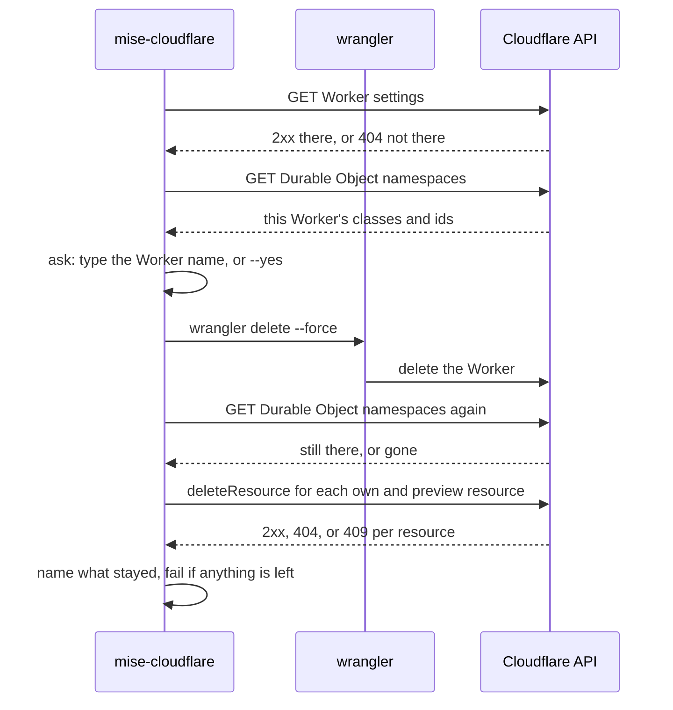
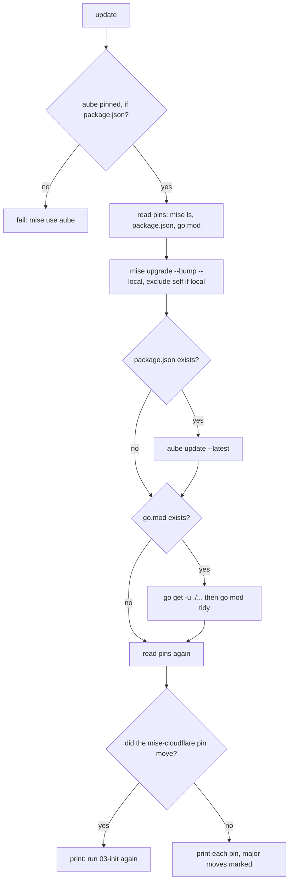

# Delete, clean, logout and update

Four commands undo state at four levels. `delete` undoes a deploy on Cloudflare. `clean` undoes local state on disk. `logout` undoes the logins. `update` does the opposite of the other three: it moves the repo's pins forward. This page reads four files: `delete.go`, `clean.go`, `logout.go`, and `update.go`.

Source: `cmd/mise-cloudflare/delete.go`, `cmd/mise-cloudflare/clean.go`, `cmd/mise-cloudflare/logout.go`, `cmd/mise-cloudflare/update.go`.

## Delete is deploy undone

The doc comment on `delete` states the whole contract in one block.

```go
// cmd/mise-cloudflare/delete.go:23
// delete is deploy undone: the Worker deleted with wrangler, and with it its own Durable Objects and all their data
// (it says so when it asks), then the KV, D1 and R2 that deploy made for it and its previews' own, each found by the
// name deploy and preview give it (wrangler delete leaves them). A resource the config names is the developer's: it
// stays, and it says so. It never deletes what's in an R2 bucket: one that still holds objects stays, and it says so.
// Every other binding it names as left as it is: it's never silent about one. It asks first, unless yes.
```

Four promises sit in that comment. Delete removes the Worker and its own Durable Objects. It removes the Key-Value (KV), Data-1 (D1), R2 object storage (R2), Queue, and Flagship resources that deploy made. It leaves the developer's own named resources. And it names every binding it does not touch.

## Whether the Worker is there

Delete first asks Cloudflare whether the Worker exists, by its settings.

```go
// cmd/mise-cloudflare/delete.go:30
	got, err := cfapi.Call(ctx, token, http.MethodGet, "/accounts/"+account+"/workers/scripts/"+url.PathEscape(r.wc.Name)+"/settings", nil, "")
	switch {
	case err != nil:
		fail(err)
	case got.Status != http.StatusNotFound && !got.OK():
		fail(fmt.Errorf("the Worker %s: %s", r.wc.Name, got.Said()))
	}
	there := got.OK()
```

The HyperText Transfer Protocol (HTTP) status decides. A 404 means the Worker is not there. Any other non-2xx status fails. `there` is a plain boolean used through the rest of the function.

## The Durable Objects that go with it

If the Worker is there, the tool lists its own Durable Object namespaces and matches them to the Worker's bindings by identifier (ID).

```go
// cmd/mise-cloudflare/delete.go:152
func (r repo) durableObjects(ctx context.Context, token, account string) ([]string, map[string]bool, error) {
	got, err := cfapi.Call(ctx, token, http.MethodGet, "/accounts/"+account+"/workers/durable_objects/namespaces?per_page=1000", nil, "")
	var list []struct {
		ID     string `json:"id"`
		Class  string `json:"class"`
		Script string `json:"script"`
	}
	if err == nil && !got.OK() {
		err = fmt.Errorf("Cloudflare's Durable Object namespaces: %s", got.Said())
	}
	if err == nil {
		err = json.Unmarshal(got.Result, &list)
	}
	var classes []string
	ids := map[string]bool{}
	for _, n := range list {
		if n.Script == r.wc.Name {
			classes, ids[n.ID] = append(classes, n.Class), true
		}
	}
	return classes, ids, err
}
```

The list is every Durable Object namespace on the account, up to 1000 per page. The filter keeps only the ones whose `Script` is this Worker. The function returns the class names and a set of their IDs. Back in `delete`, the IDs connect to the Worker's bindings.

```go
// cmd/mise-cloudflare/delete.go:53
		for _, b := range s.Bindings {
			name, _ := b["name"].(string)
			bindings[name] = b
			if id, _ := b["namespace_id"].(string); ids[id] {
				goneWith[name] = true
			}
		}
```

`goneWith` holds the bindings whose Durable Object is the Worker's own, so they go when the Worker goes.

## The confirmation asks for the Worker name

Delete refuses to run silently. Without `--yes`, it asks the person to type the Worker name.

```go
// cmd/mise-cloudflare/delete.go:63
	if !yes {
		if !term.IsTerminal(int(os.Stdin.Fd())) {
			fail(errors.New("delete asks first, and there's no terminal to ask on: run it with --yes"))
		}
		fmt.Printf("Delete the Worker %s%s? Type its name: ", r.wc.Name, r.deleting(classes))
		line, _ := bufio.NewReader(os.Stdin).ReadString('\n')
		if strings.TrimSpace(line) != r.wc.Name {
			fail(errors.New("not deleted"))
		}
	}
```

No terminal means no way to ask, and the tool fails instead of guessing. The question itself lists what goes, through `deleting`.

```go
// cmd/mise-cloudflare/delete.go:116
func (r repo) deleting(classes []string) string {
	var what []string
	if len(classes) > 0 {
		what = append(what, "its Durable Objects ("+strings.Join(classes, ", ")+")")
	}
	own, _ := r.ownResources()
	for _, p := range append(own, r.previewNeeds()...) {
		what = append(what, p.Kind+" "+p.Name)
	}
	if len(what) == 0 {
		return ""
	}
	return ", with " + strings.Join(what, ", ") + " and all their data"
}
```

The person sees the Durable Object classes and every resource, by name, before agreeing. The prompt is the disclosure.

## The delete, then the verify

The actual delete is one wrangler command. Then the tool verifies the Durable Objects are gone.

```go
// cmd/mise-cloudflare/delete.go:77
		if _, err := wrangler.Output(r.w.Cmd(ctx, "delete", "--force")); err != nil {
			fail(err)
		}
		fmt.Printf("✓ the Worker %s is deleted\n", r.wc.Name)
		// wrangler delete deletes the Worker's own Durable Objects with it: Cloudflare's list says whether it did.
		still, _, err := r.durableObjects(ctx, token, account)
		if err != nil {
			fail(err)
		}
		for _, c := range classes {
			if slices.Contains(still, c) {
				fmt.Printf("✗ Durable Object %s: still on Cloudflare\n", c)
				left = append(left, "Durable Object "+c)
			} else {
				fmt.Printf("✓ Durable Object %s: deleted with the Worker, all its data too\n", c)
			}
		}
```

`wrangler delete --force` deletes the Worker and its own Durable Objects. The tool does not trust that; it asks Cloudflare's list again and compares. Each class still present is marked with an X and added to `left`, the list that makes the command fail at the end.

## Deleting the resources deploy made

After the Worker is gone, the tool deletes the Worker's own resources and the previews' resources, using `deleteResource` from [Secrets and resources](10-secrets-and-resources.md).

```go
// cmd/mise-cloudflare/delete.go:95
	for _, p := range append(own, previews...) {
		done, gone := r.deleteResource(ctx, p, token, account)
		mark := "✓"
		if !gone {
			mark, left = "✗", append(left, p.Kind+" "+p.Binding+", "+p.Name)
		}
		fmt.Printf("%s %s %s, %s: %s\n", mark, p.Kind, p.Binding, p.Name, done)
	}
```

Every resource is reported, deleted or not. The `kept` resources are named too.

```go
// cmd/mise-cloudflare/delete.go:103
	for _, k := range kept {
		fmt.Printf("· %s is the one %s names: yours, so it stays\n", k, filepath.Base(r.wc.Path))
	}
```

## Every binding left is named

The final honesty pass is `notDeleted`. It lists every binding the command leaves alone and says why.

```go
// cmd/mise-cloudflare/delete.go:138
func (r repo) notDeleted(goneWith map[string]bool) []string {
	var out []string
	for _, n := range slices.Sorted(maps.Keys(r.wc.Bindings)) {
		typ := r.wc.Bindings[n]
		if _, own := deletes[typ]; own || goesWithWorker[typ] || goneWith[n] {
			continue
		}
		out = append(out, n+" ("+typ+")")
	}
	return out
}
```

The skip set is three things: the kinds delete removes, the kinds that go with the Worker, and the bindings to the Worker's own Durable Objects. Everything else is printed.

```go
// cmd/mise-cloudflare/delete.go:133
var goesWithWorker = map[string]bool{"plain_text": true, "json": true, "secret_text": true, "assets": true}
```

The kinds that go with the Worker are its variables (`plain_text`, `json`), its secrets (`secret_text`), and its static assets (`assets`). They live inside what the Worker uploads, so deleting the Worker deletes them. A binding that is none of those, like a Hyperdrive config, is named as left, and the person is told it may still hold its own state on Cloudflare.

```go
// cmd/mise-cloudflare/delete.go:106
	if left := r.notDeleted(goneWith); len(left) > 0 {
		fmt.Printf("· not deleted here: %s. What any of them has on Cloudflare of its own (a Hyperdrive config, say; Workers AI has none) is still there\n", strings.Join(left, ", "))
	}
```

**Aha: delete names every binding it leaves, so honesty is the safety mechanism.** Most delete commands are silent about what they skip. This one treats "not deleted" as an outcome worth printing. A person who deletes sees exactly what stays and why: the config-named resources are theirs, the var and secret bindings went with the Worker, and the rest are named one by one. If anything the tool does delete is still on Cloudflare, the command ends in failure, not a green check.

## The delete flow, in one picture



## Clean is the local state undone

`clean` removes two folders on disk and nothing else. It never touches Cloudflare and never touches the logins.

```go
// cmd/mise-cloudflare/clean.go:17
func (r repo) clean(yes bool) {
	var here []string
	for _, p := range []string{".wrangler", ".dev.vars"} {
		if _, err := os.Stat(filepath.Join(r.dir, p)); err == nil {
			here = append(here, p)
		}
	}
	if len(here) == 0 {
		fmt.Println("✓ nothing to clean: no .wrangler/ or .dev.vars")
		return
	}
	if !yes {
		if !term.IsTerminal(int(os.Stdin.Fd())) {
			fail(errors.New("clean asks first, and there's no terminal to ask on: run it with --yes"))
		}
		fmt.Printf("Delete %s: the local D1, KV and R2, and your local secret values? [y/N] ", strings.Join(here, " and "))
		line, _ := bufio.NewReader(os.Stdin).ReadString('\n')
		if !strings.EqualFold(strings.TrimSpace(line), "y") {
			fail(errors.New("not cleaned"))
		}
	}
	for _, p := range here {
		must(os.RemoveAll(filepath.Join(r.dir, p)))
		fmt.Printf("✓ %s deleted\n", p)
	}
}
```

`.wrangler/` holds wrangler's local D1, KV, and R2 simulators, plus what each deploy and preview wrote there. `.dev.vars` holds the local secret values that `serve` makes from `.dev.vars.example`. Removing both makes the next serve start from nothing. The prompt asks a yes-or-no question and defaults to no.

## Logout removes the logins

`logout` undoes the logins on this machine, both wrangler's and the `cf` command-line interface (CLI)'s.

```go
// cmd/mise-cloudflare/logout.go:11
func (r repo) logout(ctx context.Context) {
	if r.w.LoggedIn(ctx) {
		r.refuseStrayTokens()
		must(r.w.Delete(ctx))
	}
	if !cf.Installed() {
		fmt.Printf("✓ %s's wrangler login is logged out and deleted\n", r.w.Profile)
		fmt.Printf("· cf doesn't run here, so its login for Workers Builds, if there is one, is still there: mise run cloudflare:14-logout brings cf and logs out both\n")
		return
	}
	c := cf.CF{Dir: r.dir, Profile: r.w.Profile}
	if who, err := c.Whoami(ctx); err == nil && who.Authenticated {
		must(c.Delete(ctx))
	}
	fmt.Printf("✓ %s is logged out and deleted (wrangler's login and cf's)\n", r.w.Profile)
}
```

`r.w.Delete` calls `wrangler auth delete`, which logs the profile out on Cloudflare and removes it, with its folder bindings. The `cf` login is for Workers Builds, made by [Connect GitHub](09-connect-github.md). If the `cf` CLI does not run here, the tool says so and names the command that would bring it. The login model itself is in [The login model](03-the-login-model.md).

## Update moves the repo's pins forward

`update` is the only command here that changes things toward newer, not toward nothing. Its doc comment states the mechanism.

```go
// cmd/mise-cloudflare/update.go:20
// update moves the repo's own pins to their newest releases, each with its own tool (mise reads no parent folder's
// config, so nothing outside the repo moves): its mise tools (mise upgrade --bump), its packages (aube, which writes
// whichever lockfile the repo has) and its Go modules (go get -u, go mod tidy) when it has them. mise-cloudflare at
// local, a checkout's build, stays there; moved to a newer release, it says to write init's files again (03-init),
// which it doesn't do itself: in the template, a release's init would write its own older files over the template's.
```

Three tools, three kinds of pin. The mise tool bumps mise's own tools. The aube tool bumps the packages and writes the lockfile. The Go tool bumps the Go modules. The self-pin for mise-cloudflare is the constant it checks against.

```go
// cmd/mise-cloudflare/update.go:18
const self = "github:joeblew999/mise-cloudflare"
```

## The update steps, in order

```go
// cmd/mise-cloudflare/update.go:27
func (r repo) update(ctx context.Context) {
	if r.exists("package.json") && r.mise(ctx, "which", "aube") == "" {
		fail(errors.New("the packages update with aube, which writes whichever lockfile the repo has, and the repo's mise doesn't pin it: mise use aube"))
	}
	before := r.pins(ctx)
	upgrade := []string{"upgrade", "--bump", "--local"}
	if selfPin(before) == "local" {
		upgrade = append(upgrade, "--exclude", self)
	}
	r.runOwnMise(ctx, upgrade...)
	if r.exists("package.json") {
		r.runOwnMise(ctx, "exec", "--", "aube", "update", "--latest")
	}
	if r.exists("go.mod") {
		r.runOwnMise(ctx, "exec", "--", "go", "get", "-u", "./...")
		r.runOwnMise(ctx, "exec", "--", "go", "mod", "tidy")
	}
```

First it fails if the repo has a `package.json` but does not pin aube, because aube is what updates the packages. Then it reads the pins, runs `mise upgrade --bump --local`, then aube, then Go. The `--exclude self` keeps a locally built checkout of mise-cloudflare at `local` instead of bumping it to a release. Each command runs through `runOwnMise`.

```go
// cmd/mise-cloudflare/update.go:183
func (r repo) runOwnMise(ctx context.Context, args ...string) {
	fmt.Println("$ mise " + strings.Join(args, " "))
	cmd := exec.CommandContext(ctx, "mise", args...)
	cmd.Dir, cmd.Env, cmd.Stdin, cmd.Stdout, cmd.Stderr = r.dir, r.ownMise(), os.Stdin, os.Stdout, os.Stderr
	if err := cmd.Run(); err != nil {
		fail(fmt.Errorf("mise %s: %w", strings.Join(args, " "), err))
	}
}
```

`runOwnMise` echoes the command it runs, then runs it on the person's terminal. A failure stops the whole update.

## Reading every pin, by file

`pins` builds a map of every version the repo pins, keyed by file and name.

```go
// cmd/mise-cloudflare/update.go:65
func (r repo) pins(ctx context.Context) map[string]string {
	p := map[string]string{}
	var tools map[string][]struct {
		Version string
		Source  struct{ Path string }
	}
	if json.Unmarshal([]byte(r.mise(ctx, "ls", "--local", "--json")), &tools) == nil {
		for name, vs := range tools {
			for _, v := range vs {
				if v.Source.Path != "" { // a file names it, installed yet or not
					p[filepath.Base(v.Source.Path)+" "+name] = v.Version
				}
			}
		}
	}
```

The mise tools come from `mise ls --local --json`, keyed as `mise.toml node` or `go.mod go`. The packages come from reading `package.json` directly, keyed as `package.json wrangler`. The Go modules come from `go mod edit -json`, keyed as `go.mod golang.org/x/term`. Each key names the file that pins it.

## What moved, and what is a major move

`moved` compares the before and after maps.

```go
// cmd/mise-cloudflare/update.go:112
func moved(before, after map[string]string) ([]string, int) {
	all := maps.Clone(before)
	maps.Copy(all, after)
	var lines []string
	n := 0
	for _, k := range slices.Sorted(maps.Keys(all)) {
		file, name, _ := strings.Cut(k, " ")
		b, a := before[k], after[k]
		if a == b {
			lines = append(lines, fmt.Sprintf("%s %s (%s)", name, a, file))
			continue
		}
		major := ""
		if b != "" && a != "" && breaking(b, a) {
			major = ", a major move"
		}
		lines = append(lines, fmt.Sprintf("%s %s → %s (%s)%s", name, cmp.Or(b, "none"), cmp.Or(a, "none"), file, major))
		n++
	}
	return lines, n
}
```

A pin that stayed prints as `aube 2.8.4 (mise.toml)`. One that moved prints as `node 26.12.1 → 26.13.0 (mise.toml)`. A pin that appears only before or after gets `none` for the other side. A major move is flagged with `, a major move`.

```go
// cmd/mise-cloudflare/update.go:136
func breaking(b, a string) bool {
	parts := func(v string) []string {
		return strings.SplitN(strings.TrimLeft(v, "^~=<>v "), ".", 3)
	}
	pb, pa := parts(b), parts(a)
	if pb[0] != pa[0] {
		return true
	}
	return pb[0] == "0" && len(pb) > 1 && len(pa) > 1 && pb[1] != pa[1]
}
```

`breaking` counts a major move the way semantic versioning (semver) counts it. A change in the first number is major. For a `0.x` version, a change in the second number is major, so `esbuild 0.19 → 0.28` is flagged. The versions are trimmed of the `^`, `~`, `=`, `<`, `>`, and `v` prefixes their files write.

## Keeping mise to the repo's own config

The subtle part of `update` is that mise must not read a parent folder's config. `ownMise` builds the environment that enforces that.

```go
// cmd/mise-cloudflare/update.go:157
func (r repo) ownMise() []string {
	forms := []string{r.dir, longPath(r.dir)}
	if real, err := filepath.EvalSymlinks(r.dir); err == nil {
		forms = append(forms, real, longPath(real))
	}
	var ceilings []string
	for _, f := range forms {
		if d := filepath.Dir(f); !slices.Contains(ceilings, d) {
			ceilings = append(ceilings, d)
		}
	}
	return append(os.Environ(), "MISE_CEILING_PATHS="+strings.Join(ceilings, string(filepath.ListSeparator)))
}
```

The comment above it explains the why. mise stops at a ceiling equal to a parent of its working folder, exactly as the operating system (OS) reports it. On macOS and Linux that is the real path, links resolved, because `/tmp` is `/private/tmp` on macOS. On Windows it is the path as given, in long or short form. So the ceiling is set to each of those forms, and mise stops at whichever it sees.

## The update flow, in one picture



## Where to go next

Read [Testing and release](12-testing-and-release.md) for how these commands are tested and released. Read [Secrets and resources](10-secrets-and-resources.md) for the resource functions `delete` reuses.
