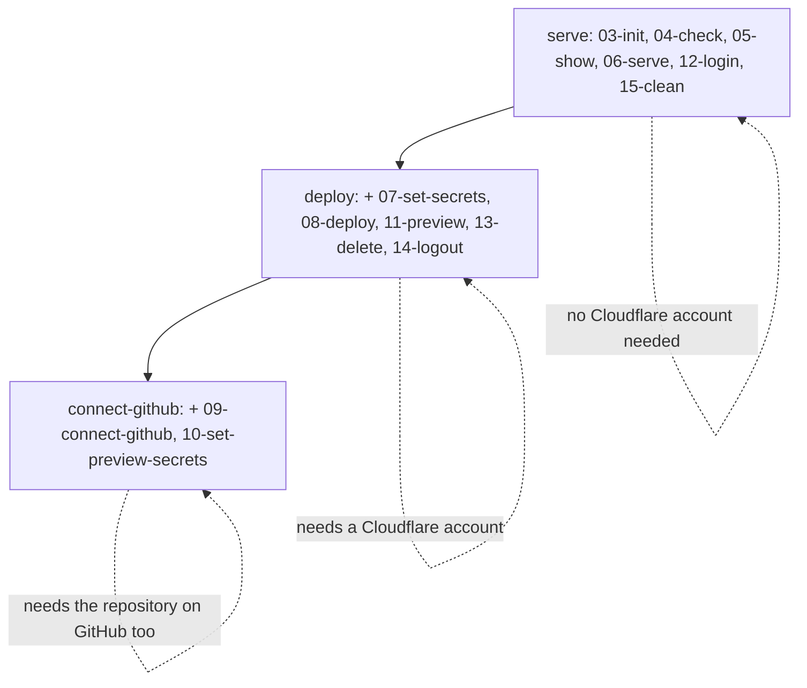
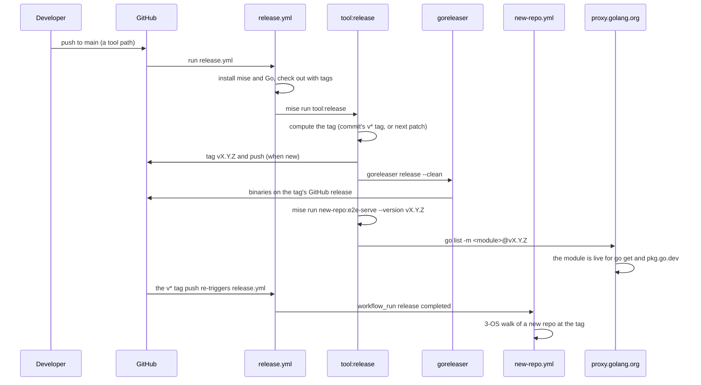

# Testing and release

This document explains the test strategy and the release pipeline. The test strategy is a walk, not a mock. It deploys the tool for real, to a real account, and then asserts nothing is left behind. The release pipeline is GoReleaser, GitHub Actions, and the Go module proxy, all driven from the root `mise.toml`.

The tests live in the package `e2e` (end-to-end), at the top of the repository, beside the root `mise.toml`. The package comment names each file and its job (`e2e_walk_test.go:1-15`):

```go
// Package e2e is this repo's end-to-end test: a walk of a repo's numbered tasks, through the repo's own mise file. It
// sits at the top of this repo, beside the root mise.toml whose tasks run it, in a file for each thing it does:
//
//   - e2e_walk_test.go, this file: TestWalk, the test the root's tasks run (which repo, REPO_PATH, and how far,
//     E2E_STAGE), the stages, and walking the steps.
//   - e2e_steps_test.go: the steps, the repo's numbered tasks in their order, each with its check.
//   - e2e_mise_test.go: the repo, and the calls into its own mise file, made in it as a person there makes them.
//   - e2e_cloudflare_test.go: what the walk looks at besides, as a person does: the Worker's URL, the account's D1, KV
//     and R2, Cloudflare's builds.
//   - e2e_os_test.go, e2e_os_windows_test.go: what each OS does its own way: the local Worker's processes, and a
//     path's long name (Windows' C:\Users\RUNNER~1 is C:\Users\runneradmin).
//
// tool_test.go is the release (mise run tool:release), and mise_test.go checks that the mise files and the Go line up,
// both ways.
```

This page reads the seven `e2e_*` test files, `mise_test.go`, `tool_test.go`, the root `mise.toml`, `.goreleaser.yaml`, the three GitHub Actions workflow files, and `repos.txt`. Every line number points at the source at commit `24301bb`.

## The walk: one test, one repo, one stage

`TestWalk` is the single test that the root tasks run. It walks one repository, as far as one stage, through that repository's own mise file. The environment variables pick which repository and how far. The root task sets both, so a plain `go test ./...` never touches Cloudflare (`e2e_walk_test.go:30-49`):

```go
func TestWalk(t *testing.T) {
	name := os.Getenv("E2E_STAGE")
	if name == "" {
		t.Skip("E2E_STAGE is how far to walk, and the root's task sets it: mise run template:e2e-serve")
	}
	upTo := slices.Index(stageNames, name)
	if upTo < 0 {
		t.Fatalf("E2E_STAGE=%s: the stages are %s", name, strings.Join(stageNames, ", "))
	}
	path, adopt := os.Getenv("REPO_PATH"), *adoptFlag != ""
	if adopt {
		path = *adoptFlag
	}
	r := repoAt(t, path)
	stamped, pin := os.Getenv("E2E_STAMPED") == "true", *releaseFlag
```

Four inputs shape the walk:

- `REPO_PATH` names the repository to walk. It is a folder of this repository: `templates`. The root task `mise run template:e2e-serve` sets `REPO_PATH=templates` (`mise.toml:51`).
- `E2E_STAGE` names how far to walk: `serve`, `deploy`, or `connect-github`. Without it, the test skips (`e2e_walk_test.go:36-39`).
- `E2E_STAMPED=true` makes the walk run on a fresh copy stamped out from the template, in its own folder that is deleted when the walk ends. The root task `new-repo:e2e-serve` sets it (`mise.toml:86`).
- The `-version` flag pins that stamped copy at a release; the `-adopt` flag walks a third-party Worker of the corpus instead. Both are Go test flags, passed after `-args` (`e2e_walk_test.go:68-74`).

```go
var releaseFlag = flag.String("version", "", "the release a stamped copy runs at (default this checkout's build)")

var adoptFlag = flag.String("adopt", "", "a third-party Worker's folder in repos/ to adopt and walk (repos:e2e-adopt)")
```

The switch that follows chooses which repository form to walk (`e2e_walk_test.go:50-63`). An adopted copy walks alone, as far as `deploy`. A stamped copy walks as far as `deploy`. The `connect-github` stage walks a checkout of this repository at `HEAD`. Each combination has a guard that fails with a plain reason when the flags conflict. After the choice, the walk runs `r.miseSetUp()` and `walkSteps(t, r, stage(upTo))`.

### The three stages

A stage is a distance, not a mode. Each stage runs every step the stages before it run, plus its own steps (`e2e_walk_test.go:77-86`):

```go
type stage int

const (
	serve         stage = iota // as far as 06-serve: the Worker locally, needing nothing, CI included
	deploy                     // as far as 08-deploy: deployed from here, needing a Cloudflare account (and an Allow, the first time)
	connectGithub              // as far as 09-connect-github: Cloudflare deploying every push, needing the repo on GitHub too
)

var stageNames = []string{"serve", "deploy", "connect-github"}
```

The three stages nest. `serve` runs the tasks numbered 03 through 06, plus 12 and 15. `deploy` adds 07, 08, 11, 13, and 14. `connect-github` adds 09 and 10 on top of both.



### `walkSteps`: the loop that runs and checks

`walkSteps` builds a `walk` value and runs the `steps` slice in order, as far as `upTo` (`e2e_walk_test.go:103-137`). A walk that reaches `deploy` first deletes everything a stopped walk may have left on Cloudflare. It registers a cleanup that does the same if the walk fails. Then, for each step, it passes, skips, or checks:

```go
	for _, s := range steps {
		switch {
		case s.stage > upTo:
			w.pass("cloudflare:%s: for the stage %s, not this walk's (%s)", s.task, s.stage, upTo)
		case s.skip != "":
			w.pass("cloudflare:%s: %s", s.task, s.skip)
		default:
			w.heading("cloudflare:%s", s.task)
			s.check(w)
		}
	}
	fmt.Println("\nALL PASSED")
```

Every step prints either `PASS cloudflare:<task> …` or the reason it is out of this walk's reach. The walk ends with `ALL PASSED`. This makes a run's output a readable trail of what a person would have done.

### `snapshot` and `diff`: hashing the repository before and after

Before the steps that deploy, the walk takes a snapshot of the repository's files, keyed by path, each value the Secure Hash Algorithm 256 (SHA-256) of the file's bytes (`e2e_walk_test.go:141-170`). The snapshot skips four names: `.git`, `node_modules`, `.wrangler`, and `.dev.vars`. These are the repository's own git history, its installed packages, and the local state that `06-serve` and `15-clean` make and undo:

```go
		switch d.Name() {
		case ".git", "node_modules", ".wrangler", ".dev.vars":
			if d.IsDir() {
				return filepath.SkipDir
			}
			return nil
		}
		if d.IsDir() {
			return nil
		}
		b, err := os.ReadFile(p)
		if err != nil {
			return err
		}
		rel, _ := filepath.Rel(w.dir, p)
		out[rel] = sha256.Sum256(b)
		return nil
```

`diff` compares two snapshots and returns the sorted list of paths that were added, removed, or changed (`e2e_walk_test.go:173-187`):

```go
func diff(a, b map[string][32]byte) []string {
	var changed []string
	for p, h := range b {
		if a[p] != h {
			changed = append(changed, p)
		}
	}
	for p := range a {
		if _, ok := b[p]; !ok {
			changed = append(changed, p)
		}
	}
	slices.Sort(changed)
	return changed
}
```

Two steps use the snapshot. `03-init` asserts that init changed nothing, because the repository already is what init writes (`e2e_steps_test.go:28-35`). `08-deploy` asserts that deploying wrote nothing into the repository — no IDs, no state (`e2e_steps_test.go:115-118`).

## The steps: thirteen numbered tasks, in order

A `step` is one numbered task of the repository's own mise file. It also holds the first stage that runs it, an optional `skip` reason, and the `check` closure that runs it and asserts what a person would see (`e2e_steps_test.go:18-23`):

```go
type step struct {
	task  string
	stage stage
	skip  string
	check func(w *walk)
}
```

The `steps` slice is the walk's source of truth (`e2e_steps_test.go:27-270`). It holds thirteen tasks, numbered 03 through 15. The numbering starts at 03 because `cloudflare:01` and `cloudflare:02` do not exist in the template; the first numbered task is `03-init`.

`TestSteps` proves the slice is exactly the template's numbered tasks, in their order (`e2e_steps_test.go:274-289`):

```go
func TestSteps(t *testing.T) {
	b, err := os.ReadFile("templates/.mise/tasks/mise-cloudflare.toml")
	if err != nil {
		t.Fatal(err)
	}
	var tasks, ours []string
	for _, m := range regexp.MustCompile(`(?m)^\["cloudflare:(\d\d-[a-z-]+)"\]`).FindAllStringSubmatch(string(b), -1) {
		tasks = append(tasks, m[1])
	}
	for _, s := range steps {
		ours = append(ours, s.task)
	}
	if !slices.Equal(ours, tasks) {
		t.Errorf("the steps %v aren't the template's numbered tasks, in their order: %v", ours, tasks)
	}
}
```

The regular expression reads only the numbered headers, so the template's helper tasks (`verify`, `update`, `template`, `run-wrangler`, `show-version`, `show-help`) are outside the walk's steps. The walk runs those helpers through the numbered tasks that call them, such as `04-check` running `verify`.

The thirteen steps, in order, with what each check asserts:

| Step | Stage | What its `check` asserts |
|------|-------|--------------------------|
| `03-init` | serve | init changed no file: the repo already is what init writes |
| `04-check` | serve | the rules pass; then `verify` passes from nothing installed, as a fresh checkout is |
| `05-show` | serve | `cloudflare:05-show` says the correct next task |
| `06-serve` | serve | the local Worker answers, with D1, Key-Value (KV), R2, and the secret working |
| `07-set-secrets` | deploy | the secrets are set, or none are required |
| `08-deploy` | deploy | deployed on the repo's login; live; wrote nothing; stray tokens refused |
| `09-connect-github` | connect-github | Workers Builds deploys every push; running again keeps what is set |
| `10-set-preview-secrets` | connect-github | preview secrets set; production build, preview, and branch delete all checked |
| `11-preview` | deploy | a preview from here works, with its own D1, KV, R2, and secret |
| `12-login` | serve | in CI a login stops at once; otherwise the repo's own login |
| `13-delete` | deploy | Workers Builds off; Worker and preview gone; nothing left on the account |
| `14-logout` | deploy | the login is gone, or kept unless `DEPLOY_CLEAN=true` |
| `15-clean` | serve | no `.wrangler/` and no `.dev.vars` remain |

The `08-deploy` check is the densest. It asserts the deployment, then refuses two ways a stray `CLOUDFLARE_API_TOKEN` could sneak in — as a shell variable and as a line in `.env` (`e2e_steps_test.go:125-136`). Each must stop with `refusing:` in the output.

## The repository helpers

The walk never calls the root `mise.toml`. It calls the repository's own mise file, as a person in that repository would. The helpers that do this live in `e2e_mise_test.go`.

### The `repo` value

A `repo` carries what the walk needs to know about the repository it walks (`e2e_mise_test.go:31-40`):

```go
type repo struct {
	t       *testing.T
	top     string
	name    string
	dir     string
	worker  string
	login   string   // the repo's login: named after its top level's Worker, whichever environment the walk deploys
	secrets []string // the Worker's required secrets
	adopted bool     // a third-party Worker adopted (adoptedCopy), not the template's
}
```

`repoAt` resolves the path to its real, long form. This matters because mise stops only at a ceiling given as the real path, and macOS's `/var` is `/private/var`, while Windows' `C:\Users\RUNNER~1` is `C:\Users\runneradmin` (`e2e_mise_test.go:43-56`).

### `stampedCopy`: a brand-new repo, made as a person makes one

`stampedCopy` builds a new repository the way the README says a person builds one: an empty folder, its own git, `mise-cloudflare init` at a version, then the repository's own `cloudflare:template` (`e2e_mise_test.go:93-126`). The stamped Worker is always named `mise-cloudflare-new`, so its walk never touches the template's Worker (`e2e_mise_test.go:86`):

```go
const stampedWorker = "mise-cloudflare-new"
```

The init runs as `mise exec github:joeblew999/mise-cloudflare@<version> -- mise-cloudflare init` (`e2e_mise_test.go:200`). When `version` is empty, the init pins `local`, this checkout's build. `miseInit` then asserts init pinned itself in `.mise/config.toml` (`e2e_mise_test.go:207-210`). The stamped copy is made in a temporary folder that the test harness removes when the walk ends.

### `adoptedCopy` and `checkoutOfHead`: the other two repository forms

`adoptedCopy` takes a third-party Worker folder from the corpus and copies it into a repo of its own, with its own git (`e2e_mise_test.go:217-251`). It then runs `mise-cloudflare init` at `local`, installs the dependencies by the lockfile's command, and moves its wrangler to one with auth profiles when it has none. The copy helper `copyRepo` skips the same four names the snapshot skips, and also skips symlinks (`e2e_mise_test.go:255-288`).

`checkoutOfHead` makes a detached worktree of this repository at `HEAD`, and copies the machine's uncommitted `.mise/config.local.toml` into it, so the checkout runs this checkout's build rather than the release the template pins (`e2e_mise_test.go:60-82`). The `connect-github` stage walks this checkout, because Cloudflare builds exactly what GitHub has.

### `miseSetUp`, `runMiseTask`, `miseShowJSON`

`miseSetUp` runs `mise install` and `mise run setup` in the repository, then reads the Worker's name, login, and required secrets through the bridge (`e2e_mise_test.go:130-146`). It reads them with `wconfig.Read`, the same bridge documented in [The wconfig bridge](02-the-wconfig-bridge.md).

`runMiseTask` runs the repository's own task, named in full, on its own mise only, with stdin fed to it for a secret's value (`e2e_mise_test.go:332-336`):

```go
func (r repo) runMiseTask(env []string, input, task string, args ...string) (string, error) {
	fmt.Printf("$ mise run %s %s   (in %s)\n", task, strings.Join(args, " "), r.name)
	env = append([]string{"MISE_CEILING_PATHS=" + filepath.Dir(r.dir), "MISE_TRUSTED_CONFIG_PATHS=" + r.dir, "MISE_YES=1"}, env...)
	return r.runIn(r.dir, env, input, "mise", append([]string{"run", task}, args...)...)
}
```

`miseShowJSON` runs `cloudflare:05-show --json` and decodes its JSON into a `shown` value. The struct's fields are the single source of what `05-show` reports (`e2e_mise_test.go:364-392`):

```go
type shown struct {
	Profile  string   `json:"profile"`
	LoggedIn bool     `json:"loggedIn"`
	Profiles bool     `json:"profiles"`
	Needs    []string `json:"needs"`
	Deployed bool     `json:"deployed"`
	URL      string   `json:"url"`
	GitHub   string   `json:"github"`
	Next     string   `json:"next"`
}
```

`miseShowSaysNext` fails unless `05-show` says to run the expected next task. Nearly every step ends by checking the `Next` field, so the walk proves the tool's own guidance stays in step with reality (`e2e_mise_test.go:395-401`).

## The bindings walk: extras and environments

The template itself stays minimal: one D1 database, one KV namespace, one R2 bucket, one secret. The walk proves the tool also handles bindings beyond that, and wrangler environments, without putting those into the template. `e2e_bindings_test.go` adds them to a stamped copy only when a root task asks.

### The `extras`

An `extra` is one binding kind the walk adds: the top-level config text, its binding name, where Cloudflare's application programming interface (API) lists what `wrangler deploy` made, and whether wrangler runs it on Cloudflare even locally (`e2e_bindings_test.go:27-39`):

```go
var extras = []extra{
	{add: `"queues": { "producers": [{ "binding": "JOBS" }] }`, binding: "JOBS", list: "/queues", field: "queue_name", id: "queue_id", suffix: "jobs"},
	{add: `"flagship": [{ "binding": "FLAGS" }]`, binding: "FLAGS", list: "/flagship/apps", field: "name", id: "id", suffix: "flags"},
	{add: `"ai": { "binding": "AI" }`, binding: "AI", remote: true}, // Workers AI: wrangler runs it on Cloudflare even locally
}
```

The three extras are a Queue, a Flagship app, and Workers AI. The comment above the slice explains what is deliberately absent: Dispatch Namespaces, which this account cannot make, and AI Search and Agent Memory namespaces, which `13-delete` would leave on the account (`e2e_bindings_test.go:32-34`).

`made` counts how many extras `wrangler deploy` actually creates a resource for — the two with a `list` path, not Workers AI (`e2e_bindings_test.go:42-50`). `withExtras` reads `E2E_EXTRAS=true`; `remoteExtras` reports whether any extra is `remote` (`e2e_bindings_test.go:53-58`).

`addExtras` writes each extra into `wrangler.jsonc` before the closing brace, as a developer would (`e2e_bindings_test.go:61-76`). `extrasSettle` polls Cloudflare's lists every five seconds for up to a minute, because a list can lag what was just made or deleted (`e2e_bindings_test.go:108-117`).

### The environment walk

`withEnv` reads `E2E_ENV`. The root task `new-repo:e2e-env` sets `E2E_ENV=staging` (`mise.toml:105`). `addEnv` writes an `env.staging` block into `wrangler.jsonc`, with its own D1, KV, R2, and secret, because wrangler inherits none of those into an environment, and then sets `CLOUDFLARE_ENV=staging` so every step runs in it (`e2e_bindings_test.go:144-161`). The login stays the repo's one, named after the top level's Worker; the deployed Worker is `mise-cloudflare-new-staging`. The `08-deploy` check then asserts the top level's Worker was never deployed (`e2e_steps_test.go:109-113`).

## The Cloudflare assertions

`e2e_cloudflare_test.go` holds the checks the walk makes against Cloudflare itself, as a person would look at them.

### `allWork`, `get`, `waitTillItWorks`, `gone`

`allWork` is the template Worker's answer when D1, KV, R2, and the secret all work (`e2e_cloudflare_test.go:22-25`):

```go
func allWork(body []byte) bool {
	var v struct{ D1, KV, R2, Secret bool }
	return json.Unmarshal(body, &v) == nil && v.D1 && v.KV && v.R2 && v.Secret
}
```

`get` fetches a URL until it answers with every binding working, up to a minute, because a freshly deployed Worker can answer 500 and then 404 before it is live everywhere (`e2e_cloudflare_test.go:29-42`). `waitTillItWorks` calls `get` in a loop until the limit (`e2e_cloudflare_test.go:45-55`). `answers` does the same for a third-party Worker, which says what it says, so only "not a server error" is required (`e2e_cloudflare_test.go:59-70`). `gone` waits until a URL no longer answers 200 (`e2e_cloudflare_test.go:73-85`).

### `d1ID`, `kvID`, `hasR2`, `api`

`d1ID` reads `wrangler d1 list --json` and returns the universally unique identifier (UUID) of the Worker's D1 database, named `<worker>-db` (`e2e_cloudflare_test.go:88-100`). `kvID` does the same for the KV namespace `<worker>-kv` (`e2e_cloudflare_test.go:103-115`). `hasR2` asks Cloudflare's API directly whether the bucket `<worker>-bucket` exists (`e2e_cloudflare_test.go:119-125`). `api` obtains the login's Open Authorization (OAuth) token from `wrangler auth token --json`, and its account from Cloudflare's API. The token is never printed (`e2e_cloudflare_test.go:129-144`).

### `leftOnCloudflare`, `nothingOnCloudflare`

`leftOnCloudflare` names the Worker's D1, KV, and R2 that still exist, and its previews', and with the extras theirs too (`e2e_cloudflare_test.go:148-158`). `durableObjectsLeft` adds the Durable Object namespaces whose script is the Worker (`e2e_cloudflare_test.go:162-175`). `left` recurses once for the previews, named `<worker>-previews` (`e2e_cloudflare_test.go:178-195`).

`nothingOnCloudflare` fails unless the Worker and everything of it is gone from the account. It checks the Worker's own existence by Cloudflare's API status 404 (`e2e_cloudflare_test.go:198-215`). `13-delete` ends by calling `leftOnCloudflare` and failing on anything left (`e2e_steps_test.go:241-248`).

### `buildOutcome`, `previewOn`, `jsonPart`

`buildOutcome` waits for Cloudflare's own record of a Workers Builds build from a branch, and returns its outcome (`success` or `failure`), or what it waited for. It uses the Cloudflare command-line interface tool (`cf`) with `--profile` for the repo's login (`e2e_cloudflare_test.go:219-264`). `previewOn` returns a preview's URL and its latest deployment's bindings by Cloudflare's API (`e2e_cloudflare_test.go:268-295`). `previewAlias` turns a branch name into the lowercase-dashes form Cloudflare uses in a preview address (`e2e_cloudflare_test.go:298-300`).

`jsonPart` cuts wrangler's output down to the JSON, past anything it prints before it, such as a `▲ [WARNING]` line that itself contains brackets. `TestJSONPart` pins that behavior with a concrete input (`e2e_cloudflare_test.go:315-320`).

## The operating system differences

Two files split the parts each operating system (OS) does its own way. On everything but Windows, `ownGroup` starts the Worker in its own process group with `Setpgid`, and `killGroup` kills that group with `SIGKILL` (`e2e_os_test.go:12-15`). On Windows, `ownGroup` uses `CREATE_NEW_PROCESS_GROUP` and `killGroup` runs `taskkill /T /F /PID`, which kills the tree (`e2e_os_windows_test.go:11-18`). This matters because `06-serve` starts wrangler and workerd; killing only mise would leak the Worker process.

Windows also gets `longPath`, which converts a path like `C:\Users\RUNNER~1` to `C:\Users\runneradmin` with `GetLongPathName`, because mise compares a ceiling by its real path (`e2e_os_windows_test.go:21-32`). Everywhere else, `longPath` returns the path unchanged (`e2e_os_test.go:18`).

## The bidirectional checker: mise files against Go

`mise_test.go` holds `TestMise`, a checker of a mise file against the Go it runs, both ways. It knows nothing of this repository; the root task that runs it names what to check with four environment variables (`mise_test.go:40-77`):

- `MISE_FILE` — the mise file. Without it, the test skips.
- `GO_CMD` and `GO_LAYOUT` — the folder of the Go binaries the tasks run, and how their commands are laid out (`file` or `folder`). Give both, or neither.
- `GO_CALLERS` — the folder of Go that runs the tasks by name. Optional.

The mise side reads any mise file. The other side reads only Go: `.go` files, the binary folders, and Go's `flag` package. What the checker cannot read fails; it never passes over it silently (`mise_test.go:36-39`).

### The two forms of a `run` line

`runsOf` splits a run line command by command, on `&&`, `||`, and `;`, and reads each command in one of two forms (`mise_test.go:103-143`):

```go
		switch {
		case words[0] == "go" && len(words) > 1 && slices.Contains([]string{"run", "test", "build"}, words[1]):
			var paths []string
			for _, w := range words[2:] {
				if w == "." || strings.HasPrefix(w, "./") {
					paths = append(paths, strings.TrimSuffix(strings.TrimSuffix(w, "..."), "/"))
				}
			}
			if len(paths) == 0 {
				paths = []string{"."}
			}
			for _, p := range paths {
				rans = append(rans, ran{place: abs(filepath.Join(dir, p)), binary: g.binaryAt(abs(filepath.Join(dir, p)))})
			}
		case g.cmd != "" && slices.Contains(g.binaries, words[0]):
			place := filepath.Join(g.cmd, words[0])
			if len(words) > 1 && regexp.MustCompile(`^[a-z][a-z-]*$`).MatchString(words[1]) {
				if g.layout == "file" {
					place = filepath.Join(place, strings.ReplaceAll(words[1], "-", "_")+".go")
				} else {
					place = filepath.Join(place, words[1])
				}
			}
			rans = append(rans, ran{place: abs(place), binary: words[0]})
		default:
			rans = append(rans, ran{notGo: strings.TrimSpace(command)})
		}
```

Form one is Go from its source: `go run ./path`, `go test ./path`, `go build ./path`. Form two is a built binary: `<binary> <command>`, where the layout says whether the command is a file `<cmd>/<binary>/<command>.go` or a folder `<cmd>/<binary>/<command>/`. Anything else — `go vet`, `go tool`, shell, other programs — is neither form, and is reported as not checked.

### The four checks

`checkMiseToGo` walks mise to Go: every place of Go a task runs must exist and be Go. A task with nothing in either form is reported; a mise file whose tasks run no Go at all fails (`mise_test.go:159-180`).

`checkGoToMise` walks Go to mise: every entry point of a binary under `GO_CMD` must be a command some task runs. `commandsIn` finds those entry points by the layout (`mise_test.go:184-206`). In the `file` layout, a command file must hold the function named for it: `set_secrets.go` holds `setSecrets`. Go reserves two names, so `main.go` and `init.go` go by their names alone (`mise_test.go:454-473`).

`checkUsage` enforces the golden rule (`mise_test.go:215-272`). A task declares its flags and arguments in mise's `usage` spec. Its run line passes each by name with mise's templates, `{{usage.<name>}}`. Nothing passes undeclared. Nothing is read the deprecated way, `{{flag(…)}}`. No run line has portable operating system interface (POSIX) shell syntax, which Windows' `cmd` does not read. Flags go both ways at each binary: every flag a task declares must be one its Go defines with `flag.Bool("yes", …)`, and every flag its Go defines must be declared by some task.

`checkGoCallsMise` walks the other mapping: Go that runs tasks must name each in full, `"<namespace>:<task>"`, never glued together from pieces, and every name must be a real task of the mise file (`mise_test.go:278-318`). A name glued from two parts cannot be checked, so it fails.

`TestMise`'s own tests pin what it reads: `TestReadTasks` covers every way mise writes a task (`mise_test.go:537-585`), and `TestRunForms` covers the two forms with concrete run lines (`mise_test.go:588-611`).

## The release: `TestToolRelease`

`TestToolRelease` releases mise-cloudflare from the commit checked out, exactly as `release.yml` runs it on GitHub. It runs only from its own root task, so `go test ./...` never releases (`tool_test.go:113-118`):

```go
func onlyFrom(t *testing.T, task string) {
	t.Helper()
	if os.Getenv("MISE_TASK_NAME") != task {
		t.Skip("mise run " + task)
	}
}
```

The test reads `MISE_TASK_NAME`, which mise sets to the task that ran it. Only `mise run tool:release` sets it to `tool:release`.

`releaseTag` computes the tag to release: the commit's own `v*` tag, or the next patch version after the newest `v*` tag (`tool_test.go:57-72`). `parseTag` reads `vMAJOR.MINOR.PATCH`, and anything else is not a release tag (`tool_test.go:75-89`). With `--dry-run`, the test tags and publishes nothing; goreleaser builds a snapshot into `dist/`.

The real run, after the optional tag and push, does four things in order (`tool_test.go:43-49`):

```go
	runShown(t, []string{"GORELEASER_CURRENT_TAG=" + tag}, "goreleaser", "release", "--clean")
	runShown(t, nil, "mise", "run", "new-repo:e2e-serve", "--version", tag)
	out, err := exec.Command("go", "list", "-m").Output()
	if err != nil {
		t.Fatalf("go list -m: %v", err)
	}
	runShown(t, []string{"GOPROXY=https://proxy.golang.org", "GOFLAGS=-mod=mod"}, "go", "list", "-m", strings.TrimSpace(string(out))+"@"+tag)
```

First, goreleaser publishes the binaries on that tag's GitHub release. Second, a new repository stamped out pinning the release is walked, as a person tries it: `mise run new-repo:e2e-serve --version <tag>`. Third, `go list -m` reads the module path. Fourth, the same path at the tag is fetched from `proxy.golang.org`, so `go get` and `pkg.go.dev` have the version at once.

## The root `mise.toml`: the tasks and the tools

The root `mise.toml` drives everything, from the top (`mise.toml:1-29`). Its comment names each task group: `template:`, `repos:`, `new-repo:`, `tool:`, and `root:`. The pinned tools (`mise.toml:37-41`):

```toml
[tools]
node = "26.13.0"   # runs cf, an npm package (a walked repo runs its wrangler on its own node)
usage = { version = "7.1.3", workflow = "publish-cli.yml" }    # --help and tab-completion for the tasks' flags
goreleaser = "2.19.0"   # the release's binaries (.goreleaser.yaml)
"npm:cf" = "1.0.0-beta.26"   # Cloudflare's own CLI: the walk asks it about a repo's cf login and its Workers Builds builds
```

The tasks, grouped by what they act on:

| Task | What it runs |
|------|--------------|
| `template:check-mise` | `TestMise` on the template's mise file against the tool's Go |
| `template:e2e-serve` | `TestWalk` on `templates`, as far as `serve` |
| `template:e2e-deploy` | `TestWalk` on `templates`, as far as `deploy` |
| `template:e2e-connect-github` | `TestWalk` on `templates`, as far as `connect-github` |
| `template:update` | the template's pins at their newest releases, by `cloudflare:update` |
| `template:setup` | the template's own `mise run setup` |
| `repos:check` | every wrangler config in the third-party repos, read by the bridge |
| `repos:e2e-adopt` | `TestWalk` on an adopted third-party Worker, as far as `deploy` |
| `new-repo:e2e-serve` | `TestWalk` on a stamped copy, as far as `serve` |
| `new-repo:e2e-deploy` | `TestWalk` on a stamped copy, as far as `deploy` |
| `new-repo:e2e-extras` | the same, with the extras added first |
| `new-repo:e2e-env` | the same, deploying `env.staging` |
| `tool:build` | `go build -o bin/ ./cmd/mise-cloudflare` |
| `tool:install` | the build as the mise version `local` |
| `tool:test` | `go vet ./... && go test -count=1 ./... && goreleaser check` |
| `tool:release` | `TestToolRelease` |
| `root:check-mise` | `TestMise` on this file, the mise side only |
| `root:update` | this repo's own pins at their newest |

Each task's `env` block is what wires the walk. For example, `template:e2e-serve` sets `REPO_PATH=templates` and `E2E_STAGE=serve` (`mise.toml:48-52`), and `new-repo:e2e-serve` sets `E2E_STAMPED=true` and passes `-version` only when the flag is given (`mise.toml:82-87`).

## The Continuous Integration workflow

`ci.yml` runs every check that needs no Cloudflare account, on three operating systems side by side (`ci.yml:22-27`). Cloudflare credentials never come here. Two deliberate choices stand out.

First, the checkout uses plain shell, not `actions/checkout` (`ci.yml:37-43`):

```yaml
      - name: Check out with git (no actions/checkout)
        run: |
          git init -q .
          git remote add origin "https://github.com/${GITHUB_REPOSITORY}.git"
          git fetch -q --depth 1 "https://github.com/${GITHUB_REPOSITORY}.git" "$GITHUB_SHA"
          git checkout -q --detach FETCH_HEAD
          git log --oneline -1
```

Second, the branch filter ignores the walk's throwaway branches: `branches-ignore: ["e2e-*"]` (`ci.yml:9`). Those branches exist for Workers Builds, not for this Continuous Integration (CI). The push and pull request events both run; the job skips a pull request that comes from the same repository, because the push already covers it (`ci.yml:22`).

The job runs, in order (`ci.yml:61-75`): `mise run template:setup`, `mise run tool:test`, `mise run template:check-mise`, `mise run root:check-mise`, `mise run repos:check`, `mise run template:e2e-serve`, and `mise run new-repo:e2e-serve`. The first four are the tool's own checks plus the two checker runs. Then the corpus is read, and the walk runs on the template and on a stamped copy, both as far as `serve`.

## The release workflow

`release.yml` releases on every change to what the tool is, merged to `main` (`release.yml:8-13`):

```yaml
  push:
    branches: [main]
    # Not the template's own pin of mise-cloudflare, nor a test: neither changes anything in the tool.
    paths: ["cmd/**", "internal/**", "templates/**", "!templates/.mise/config.toml", "!**/*_test.go", "go.mod", "go.sum", ".goreleaser.yaml", ".github/workflows/release.yml"]
    tags: ["v*"]
```

The path filter means a push that changes only the template's own pin of mise-cloudflare, or only tests, does not release. A `v*` tag pushed by hand releases that version. The job checks out with the tags, installs mise and Go, and runs `mise run tool:release` (`release.yml:47`), the same command as on any machine.

## The new-repo workflow

`new-repo.yml` runs after the release workflow has completed, or by hand (`new-repo.yml:7-15`). It walks a new repository, made the README's way at the release just made, on all three operating systems (`new-repo.yml:22-27`). The final step (`new-repo.yml:70-71`):

```yaml
      - name: A new repo, made the README's way at the release, walked as far as serve (mise run new-repo:e2e-serve --version)
        run: mise run --skip-deps new-repo:e2e-serve --version "$VERSION"
```

`--skip-deps` matters: it skips `tool:install`, because the release is what is tried, not a build of this checkout. The version is the workflow input, or the commit's own tag read with `git describe --tags --exact-match` (`new-repo.yml:46-50`). This keeps releases fast — the full walk runs after the release, not before it.

## The release pipeline, end to end



## GoReleaser: the binaries

`.goreleaser.yaml` declares the build for every machine (`.goreleaser.yaml:5-13`):

```yaml
builds:
  - id: mise-cloudflare
    main: ./cmd/mise-cloudflare
    binary: mise-cloudflare
    env: [CGO_ENABLED=0]
    goos: [linux, darwin, windows]
    goarch: [amd64, arm64]
    flags: [-trimpath]
    ldflags: ["-s -w -X main.version={{ .Version }}"]
```

`CGO_ENABLED=0` makes a static binary. The linker flags strip symbols (`-s -w`) and stamp the version into `main.version` (`-X main.version={{ .Version }}`). The matrix is three operating systems — Linux, macOS (darwin), and Windows — times two architectures, 64-bit (amd64) and 64-bit Arm (arm64). The changelog uses the GitHub source, listing every commit since the previous tag, because most changes go straight to `main` and GitHub's own pull-request notes would be nearly empty (`.goreleaser.yaml:26-34`).

## The corpus

`repos.txt` names the third-party repositories with wrangler configs that `repos:check` reads, one per line (`repos.txt:1-5`):

```
cloudflare/realtime-examples
coldter/slopnote-rag
cloudflare/realtimekit-web-examples
```

Each is cloned into `repos/`, which is git-ignored. `repos:check` reads every wrangler config in them with the bridge, and `repos:e2e-adopt` adopts one of their Workers and walks it as far as `deploy`.

## Aha moments

**Aha: the test is a walk, not a mock.** The obvious way to test a deploy tool is to mock Cloudflare and assert the commands. This test does the opposite: it deploys for real, to a real account, and then asserts that nothing is left behind. That is why the delete and clean paths are themselves tested end to end — `13-delete` and `15-clean` are steps in the walk, not separate cleanup code. A mock would never catch a leak; the walk cannot miss one, because `leftOnCloudflare` fails on anything still on the account.

**Aha: the checker enforces symmetry, not just presence.** `TestMise` does not check that the mise file works. It checks two mappings agree in both directions: what the mise file names must be in the Go, and what the Go has must be in the mise file. A flag declared in `usage` but absent from the Go fails; a flag defined in the Go but undeclared fails. This makes drift impossible in either direction, and turns the rule "no POSIX shell syntax" into a test rather than a convention.

**Aha: the release is tried, not just published.** `tool:release` does not stop at publishing binaries. It stamps a new repository at the release and walks it, and it fetches the version from `proxy.golang.org`. A release that a fresh `mise use` could not install, or that the proxy had not yet indexed, fails the release task itself. The release pipeline is an end-to-end test of the release.

## Where to go next

Read [Critical assessment](13-critical-assessment.md) for what this design gets right and its honest limits. Read [Delete, clean, logout and update](11-delete-clean-logout-update.md) for the tasks the walk proves: `13-delete`, `14-logout`, and `15-clean`. The bridge the helpers read, `wconfig.Read`, is in [The wconfig bridge](02-the-wconfig-bridge.md).
