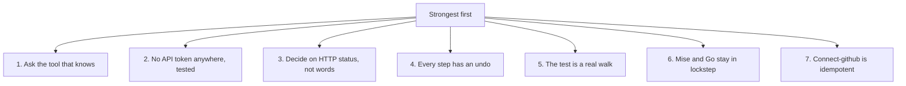
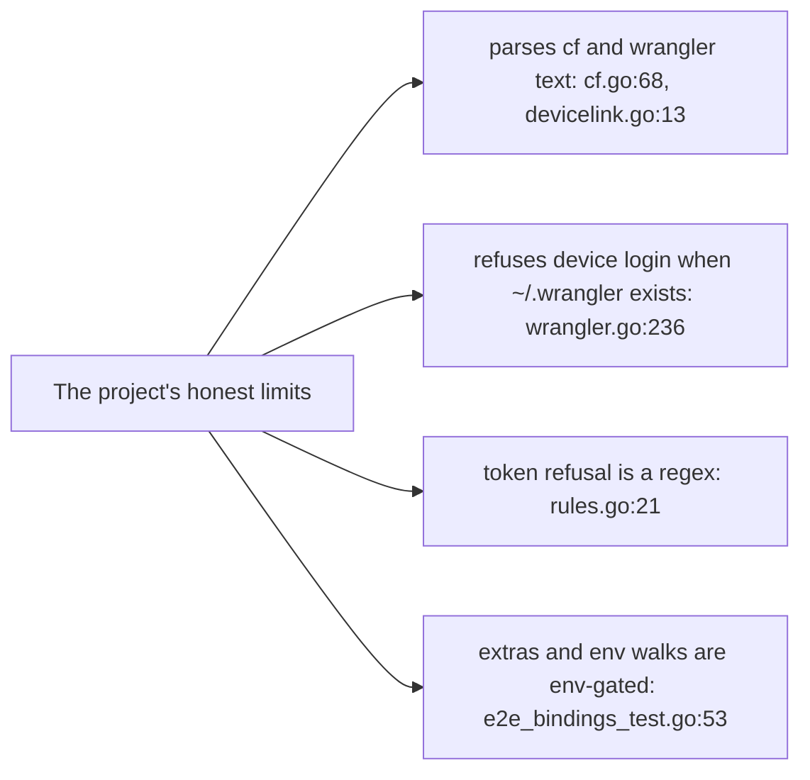

# Critical assessment

This page ranks what mise-cloudflare does wrong, what it does right, and where a reader can learn from it. Every claim cites the source at `path:line`.

## The verdict in one line

mise-cloudflare is a task layer that refuses to do the hard work itself. It delegates parsing, login, deploy and delete to a repo's own pinned wrangler and to Cloudflare's cf tool. Its real value is the discipline around those tools, not the tools. Its honest limit is the same as its design: it lives or dies on the text output of two external command-line tools.

## Strengths, ranked



1. **Ask the tool that knows, never parse the config.** The whole bridge is one script that runs the repo's own wrangler and reads what it resolves. `wconfig.go:50` loads wrangler as a module and asks it for the converted bindings, the environments, and the remote bindings. The package comment states the rule at `wconfig.go:1`: "nothing here parses one." This is the strongest idea in the project. It makes every wrangler feature and every wrangler version work for free.

   ```js
   // internal/wconfig/wconfig.go:50
   const script = `const w = await import('wrangler');
   try {
     const c = w.unstable_readConfig({ env: process.env.CLOUDFLARE_ENV || undefined });
     const r = await w.experimental_readRawConfig({});
   ```

2. **"No application programming interface (API) token anywhere" is a first-class, tested refusal.** The rule is not a note in a readme. It is a function that every login path calls first. `login.go:84` refuses a token in the shell or in a `.env` file, and `login.go:96` gives the detection pattern. The test `e2e_steps_test.go:125` asserts that a stray token is refused before a deploy. This is the project's contract with its users, enforced in code.

   ```go
   // cmd/mise-cloudflare/login.go:84
   func (r repo) refuseStrayTokens() {
       if inCI() {
           return
       }
       if os.Getenv("CLOUDFLARE_API_TOKEN") != "" {
           fail(fmt.Errorf("refusing: CLOUDFLARE_API_TOKEN is set in this shell, and it would override this repo's own login (%s). Unset it and run again", r.w.Profile))
       }
   ```

3. **Decide on the HTTP status, not the wording.** Cloudflare's cf tool prints its failures in a box of human words. `cf.go:68` extracts only the HTTP status from that box, and `cf.go:86` turns it into a decision: not found is `404`. The API package says the same rule at `cfapi.go:1`. This is the correct fix for the oldest bug in tool automation: matching on prose that changes.

   ```go
   // internal/cf/cf.go:68
   var statusLine = regexp.MustCompile(`(?m)^\W*([1-5][0-9][0-9]) [A-Za-z][A-Za-z ]* · HTTP `)
   ```

4. **Every step has an undo.** Delete undoes deploy. Clean undoes local state. Logout undoes login. The strongest one is `delete.go:28`, which deletes the Worker, then checks that the Durable Objects went with it, then deletes what deploy made, and finally fails if anything is left. `delete.go:110` makes the command fail with the list of what remains. Nothing is silent.

   ```go
   // cmd/mise-cloudflare/delete.go:110
   fail(fmt.Errorf("not all deleted: %s is still on Cloudflare (what Cloudflare said is above)", strings.Join(left, "; ")))
   ```

5. **The test is a real walk, not a mock.** The walk deploys to a throwaway account and asserts nothing is left behind. `e2e_walk_test.go:106` deletes everything on Cloudflare before the walk starts, and `e2e_walk_test.go:107` registers a cleanup that deletes again if the walk fails. The test never touches a fake API. This is expensive and slow, but it is the only test that can catch a real Cloudflare change.

   ```go
   // e2e_walk_test.go:106
   w.miseDeleteEverythingOnCloudflare()
   t.Cleanup(func() {
       if t.Failed() {
           w.heading("Cleaning up after the failure")
           w.miseDeleteEverythingOnCloudflare()
       }
   })
   ```

6. **The mise and Go checker keeps the task file and the CLI in lockstep.** `TestMise` at `mise_test.go:40` checks both directions: what the mise file names must exist in the Go, and what the Go has must exist in the mise file. `mise_test.go:26` states the rule. This is a genuinely reusable idea: a build file and a program that drift apart is a common bug, and this catches it mechanically.

7. **Connect-github is idempotent.** `connect_github.go:198` reads the current connection, and then `connect_github.go:207` updates it if it exists, or `connect_github.go:210` creates it if it does not. It also detects a connection to the wrong repository and removes it first at `connect_github.go:199`. Running the command twice does not double-connect. This is the correct shape for a setup command.

## Weaknesses

1. **Brittle regexes over human output.** The project's core dependency is the text that wrangler and cf print. `devicelink.go:13` and `devicelink.go:14` parse the verification URL and the user code from a login prompt. `cf.go:68` parses a status from an error box. Any upstream wording or layout change breaks these silently. The project accepts this cost, but it is a real cost.

2. **The update flow needs mise, aube and go to be present.** `update.go:28` checks for aube and fails with instructions, but `update.go:35` and `update.go:41` call mise and go directly. There is no same-style check for mise itself or for the Go toolchain. The readme installs mise first, but `update` can still fail late on a machine without Go, after it has already moved the mise pins.

3. **The device login refuses when `~/.wrangler` exists.** `wrangler.go:236` returns an error if the home folder already has a `.wrangler` directory. The reason is real: wrangler would ignore the temporary folder and overwrite the default login. But a user who already has a machine-wide wrangler login gets a refusal with no automatic fallback. The workaround is "move it away," which a user may not want.

4. **No Python Worker support, stated openly.** The readme says a Python Worker deploys with pywrangler and is "not handled yet" (`README.md:93`). This is honest, but it is a hard boundary. Any repo that uses a Python Worker cannot use this tool's deploy path at all.

5. **The remote-extras and env walk variants do not run in the default CI matrix.** `ci.yml` runs only the `serve` stage. The extras walk is gated by `E2E_EXTRAS=true` at `e2e_bindings_test.go:53`, and the environment walk by `E2E_ENV` at `e2e_bindings_test.go:139`. Those are the walks that exercise a Queue, a Flagship app, Workers AI, and a wrangler environment. A regression there lands only when a developer runs the task by hand.

## Risks

1. **The token refusal relies on a regex that can miss unusual token forms.** `rules.go:21` matches `CLOUDFLARE_API_TOKEN` followed by 30 or more characters from a small set. A token in a shell function, a shorter value, or a different quoting shape is missed. The refusal is a safety net, not a guarantee. The tests cover the common forms only.

2. **cf is an external dependency whose output the code parses.** `cf.go:68` reads a status from an error box, and `devicelink.go:13` reads a URL from a login prompt. A single upstream change to cf's output formatting breaks connect-github and every device login. The project pins nothing about that format.

3. **The `~/.wrangler` refusal can block a legitimate user.** `wrangler.go:236` refuses the device login when the home folder has a `.wrangler` directory. A user who keeps a personal wrangler login there cannot use the repo's login without moving their own data.



## What to copy, what to leave

| Copy | Leave |
|------|-------|
| The wconfig bridge: ask the repo's own tool | Any attempt to parse a wrangler config by hand |
| The refusal of a stray API token, as code plus a test | The specific token regex as a security guarantee |
| The decide-on-status rule for an external CLI | Matching on the same CLI's human words |
| The delete-checks-it-went undo pattern | The specific Durable Object API calls |
| The real-walk test that cleans up after itself | The throwaway Cloudflare account budget, for small teams |
| The bidirectional mise and Go checker | The single-line-mise-file rule, if a team wants shell logic |
| The idempotent connect-github shape | The specific cf `builds workers` commands |

## How and where we can really learn

A reader should study four places. First, `internal/wconfig/wconfig.go` is the whole design in one file. It shows how to delegate to a tool you do not control, instead of re-implementing it. Second, `cmd/mise-cloudflare/delete.go` shows how an undo command earns trust: it deletes, then verifies, then fails loudly on anything left. Third, `e2e_walk_test.go` shows what a real test looks like when a mock would prove nothing. Fourth, `mise_test.go` shows a mechanical lock between two representations of the same commands. Reproduce these four patterns in any tool that wraps an external CLI.

## Aha moments

**Aha: the tool's main feature is a refusal, not a capability.** The most valuable code path in the project is `login.go:84`, which refuses a `CLOUDFLARE_API_TOKEN`. The project earns trust by what it will not do, not by what it can do.

**Aha: the delete command is a proof, not a fire-and-forget call.** `delete.go:82` re-reads the Durable Object list after the delete and marks each one as gone or still there. The undo command tests itself. That is why it can promise "nothing is left."

**Aha: "ask the tool that knows" also means "inherit its bugs."** `wconfig.go:50` imports wrangler's unstable API. The bridge is tiny because it delegates everything, but it is only as stable as wrangler's unstable functions. The project trades its own maintenance for a dependency on upstream.

## Where to go next

Read [Architecture](01-architecture.md) for how the packages connect. Read [The wconfig bridge](02-the-wconfig-bridge.md) for the delegation trick in full. Read [The login model](03-the-login-model.md) for the refusal rule in context. See [Glossary](14-glossary.md) for every term defined in one place.
