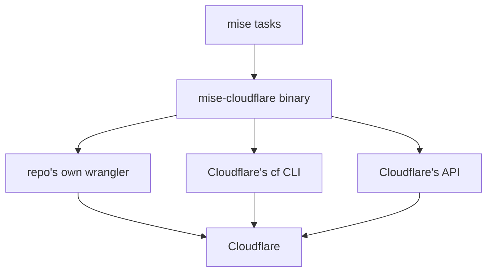

# Glossary

This page defines every term and abbreviation the documentation uses. Each entry gives the full form first, then a definition. The entries are grouped by where they belong. The source of truth is the code at commit `24301bb`.

## Host and tasks

- **mise** — a version and task manager for development tools. It pins tools per project and runs named tasks. mise-cloudflare is a set of mise tasks plus a Go binary that those tasks call. Source: `README.md:22`.
- **Task** — one named unit of work in a mise file. A task name is `noun:verb`, such as `cloudflare:08-deploy`. Source: `README.md:138`.
- **Command** — one action of the `mise-cloudflare` binary. Each command is a task, and each task runs one command. Source: `templates/docs/mise-cloudflare/README.md:105`.
- **Pin** — a fixed version of a tool or package, written in a file. The repo pins wrangler, Node, and mise-cloudflare itself. Source: `templates/docs/mise-cloudflare/README.md:46`.
- **Monorepo** — a repository that holds several Workers or several projects in one place. The project does not handle a repo of several Workers yet. Source: `README.md:94`.
- **Worktree** — a git working tree, the folder where a repository is checked out. The walks use throwaway worktrees and branches. Source: `e2e_mise_test.go:67`.
- **Environment variable** — a named value the operating system passes to a program. `CLOUDFLARE_ENV` picks a wrangler environment. Source: `internal/wconfig/wconfig.go:76`.
- **Staging** — a deployment environment one step before production. `connect-github --staging main` deploys staging from the `main` branch. Source: `templates/docs/mise-cloudflare/README.md:183`.
- **Production** — the live deployment environment. A push to the deploy branch deploys production. Source: `templates/docs/mise-cloudflare/README.md:185`.
- **Continuous integration (CI)** — an automated check that runs on every push and pull request. The CI here runs only checks that need no Cloudflare account. Source: `.github/workflows/ci.yml:1`.
- **Command-line interface (CLI)** — a program a person runs by typing commands in a terminal. `mise-cloudflare` and `cf` are both CLIs.

## Cloudflare platform

- **Cloudflare Worker** — a serverless function that runs on Cloudflare's edge. A repo's Worker is the thing this tool serves, deploys, and deletes. Source: `README.md:9`.
- **wrangler** — Cloudflare's own CLI for Workers. The repo pins one version, and this tool always runs that version. Source: `README.md:120`.
- **cf** — Cloudflare's newer CLI. `connect-github` uses cf because wrangler's login cannot hold the Workers Builds scope. Source: `internal/cf/cf.go:1`.
- **Workers Builds** — Cloudflare's service that builds and deploys a Worker from a Git repository on every push. Source: `templates/docs/mise-cloudflare/README.md:179`.
- **Workers Preview** — a temporary deployment of a Worker for a branch other than the deploy branch. Its Uniform Resource Locator (URL) goes on the pull request. Source: `templates/docs/mise-cloudflare/README.md:190`.
- **Previews Base** — the Cloudflare settings that every new preview starts from. The previews' own KV, D1 and R2 resources live there. Source: `templates/docs/mise-cloudflare/README.md:204`.
- **D1** — Cloudflare's serverless Structured Query Language (SQL) database. A Worker binds to it with a name such as `DB`. Source: `internal/wconfig/wconfig.go:47`.
- **KV** — Cloudflare's key-value store. A Worker binds to it with a name. Source: `internal/wconfig/wconfig.go:47`.
- **R2** — Cloudflare's object storage. A Worker binds to it with a name. Source: `internal/wconfig/wconfig.go:47`.
- **Queue** — Cloudflare's message queue. Wrangler deploy makes one when the config names none. Source: `e2e_bindings_test.go:36`.
- **Flagship app** — a Cloudflare Workers application made of many Workers. Deploy makes one when the config names none. Source: `e2e_bindings_test.go:37`.
- **Durable Object** — a Cloudflare object with its own storage and one instance per object. `wrangler delete` deletes the Worker's own Durable Objects with it. Source: `cmd/mise-cloudflare/delete.go:24`.
- **Workers AI** — Cloudflare's machine-learning inference service. Wrangler runs it on Cloudflare even locally, so it needs the repo's login. Source: `e2e_bindings_test.go:38`.
- **Hyperdrive** — Cloudflare's service that speeds up database connections. It appears in the third-party config corpus. Source: `README.md:92`.
- **Dispatch Namespace** — a Cloudflare Workers for Platforms namespace. It needs a purchase, so the walk does not exercise it. Source: `e2e_bindings_test.go:32`.
- **Container** — a Cloudflare container deployment. Previews get containers from Cloudflare. Source: `templates/docs/mise-cloudflare/README.md:202`.
- **Rate limit** — a limit on how many requests a Worker accepts. It appears in the third-party config corpus. Source: `README.md:92`.
- **Static asset** — a file served as-is, not computed. It goes with the Worker when it is deleted. Source: `cmd/mise-cloudflare/delete.go:133`.
- **Binding** — a connection between a Worker and a Cloudflare resource, given a name in the config. Source: `internal/wconfig/wconfig.go:25`.
- **Secret** — a value a Worker needs at run time, such as an API key. It is set on Cloudflare and kept out of git. Source: `templates/docs/mise-cloudflare/README.md:113`.
- **Var** — a plain-text variable a Worker reads, not secret. It goes with the Worker when it is deleted. Source: `cmd/mise-cloudflare/delete.go:133`.

## Wrangler and logins

- **Auth profile** — a named wrangler login stored on one machine. The repo's login is an auth profile named after the Worker. Source: `templates/docs/mise-cloudflare/README.md:166`.
- **Device-authorization flow (RFC 8628)** — an OAuth flow where a device shows a code and a person approves it on another device. The code in this project is Request for Comments (RFC) 8628. Source: `internal/wrangler/devicelink.go:18`.
- **verification_uri_complete** — the RFC 8628 field that holds the full approval link, code included. The tool builds this link from the printed parts. Source: `internal/wrangler/devicelink.go:18`.
- **OAuth** — Open Authorization, the standard the wrangler login uses. The login holds OAuth scopes. Source: `internal/wrangler/wrangler.go:189`.
- **Scope** — one permission an OAuth login holds, such as `workers_scripts:write`. The repo's login takes wrangler's own scopes. Source: `internal/wrangler/wrangler.go:189`.
- **Application programming interface (API)** — a program's way to talk to another program. The tool calls Cloudflare's API directly for some checks. Source: `internal/cfapi/cfapi.go:1`.
- **Representational state transfer (REST)** — a style of API over HTTP. Cloudflare's API is a REST API. Source: `internal/cfapi/cfapi.go:49`.
- **Hypertext Transfer Protocol (HTTP) status** — the number a server returns for a request, such as 404 for not found. The tool decides on this number, never on the words. Source: `internal/cf/cf.go:70`.
- **API token** — a secret string that grants access to Cloudflare's API. The tool refuses one because it would override the repo's login. Source: `cmd/mise-cloudflare/login.go:83`.

## The tool's internals

- **Bridge** — the one place where the tool talks to wrangler's internals. `wconfig` is the bridge. Source: `README.md:120`.
- **Config** — the Worker's wrangler configuration file. The tool never parses it; wrangler reads it. Source: `internal/wconfig/wconfig.go:18`.
- **Go embed** — a Go language feature that puts files into the binary. The template files ship inside the binary. Source: `templates/templates.go:16-26`.
- **Build tag** — a Go language marker that includes a file only on one platform. `paths.go` is excluded on Windows by `//go:build !windows`; `paths_windows.go` is chosen by its `_windows.go` filename suffix. Source: `cmd/mise-cloudflare/paths.go:1`.
- **Aha moment** — a non-obvious design decision that is worth reading the code for. Each document surfaces at least one. Source: `documentation_directive.md:130`.

## Release and test

- **Walk** — the end-to-end test that runs the repo's numbered tasks in order, on Cloudflare itself. Source: `e2e_walk_test.go:1`.
- **Corpus** — the set of third-party repositories whose wrangler configs `check` reads. Source: `README.md:209`.
- **goreleaser** — a Go tool that builds release binaries. It puts the binary on the GitHub release. Source: `README.md:245`.
- **Go module proxy** — a service that caches Go modules. `proxy.golang.org` holds the release so `go get` finds it at once. Source: `README.md:246`.
- **Lockfile** — a file that pins every package version. The repo commits it so everyone runs the same wrangler. Source: `internal/rules/rules.go:123`.
- **SHA-256** — a Secure Hash Algorithm with a 256-bit output. It turns file content into a fixed-size digest. The walk hashes repo files to prove deploy changes none of them. Source: `e2e_walk_test.go:18`.
- **JSON merge-patch** — a JavaScript Object Notation (JSON) way to update part of a resource with one object. `connect-github` uses one to turn on GitHub's delete-branch setting. Source: `cmd/mise-cloudflare/connect_github.go:410`.
- **ASD-STE100** — the Simplified Technical English specification. These documents follow it. Source: `documentation_directive.md:8`.
- **Simplified Technical English (STE)** — a controlled English for technical documents. It limits sentence length and words. Source: `documentation_directive.md:8`.

## Where to go next

Return to [Overview](00-overview.md) for what the project is. Read [Critical assessment](13-critical-assessment.md) for the ranked verdict on the same code.
