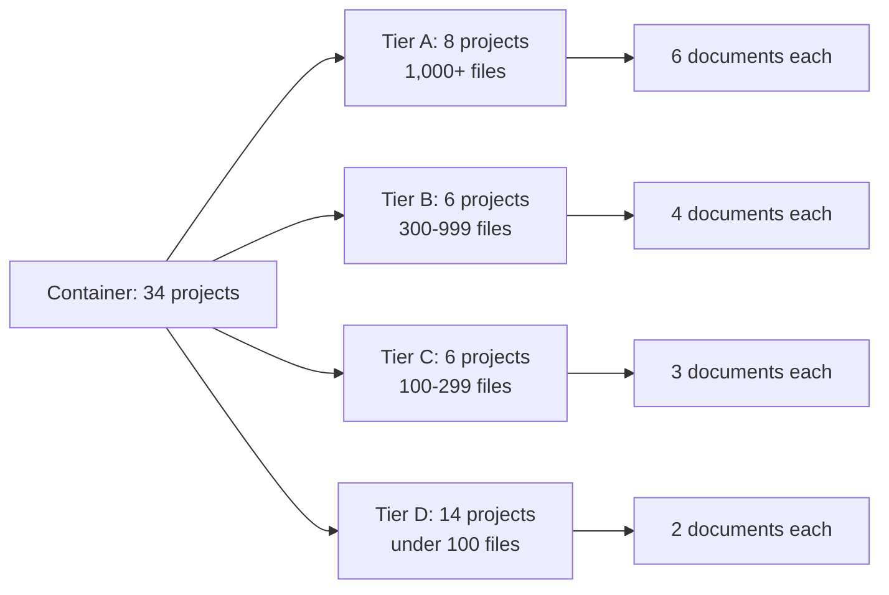
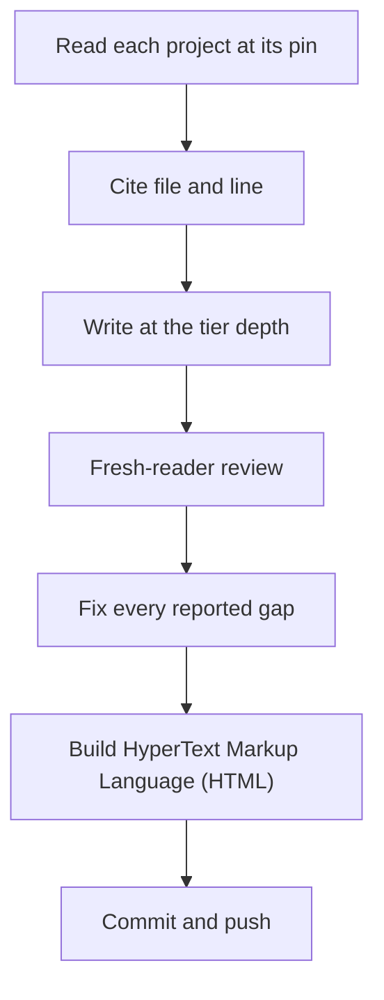

# AI design tooling: package explorations

This directory explores `/Users/darkvoid/GitSources/src.aidesign`, a container of 34 separate
projects about design and agents. The projects do different jobs. Some are skills that a coding
agent loads. Some are libraries that a page imports. Some are applications, demos, or curated
lists. They share a folder, not a codebase.

The thesis of the set is that "AI design tooling" is not one product. It is a set of narrow
contracts. A skill states what an agent must look at. A library states what a component must
render. An application states what a user must see. This set reads each project as its own
contract and compares the contracts where they touch.

## How the set is organised

Each project gets its own directory with a `spec.md` and a `markdown/` tree. The depth follows the
size of the project, because a ten-file skill does not carry fifteen documents of substance.

| Tier | Size | Documents |
|------|------|-----------|
| A | 1,000 files or more | README plus five deep dives |
| B | 300 to 999 files | README plus three |
| C | 100 to 299 files | README plus two |
| D | under 100 files | README profile plus spec |

The full inventory, the order, and the per-package pins are in the [spec](spec.md).

## Package explorations

One package is published. The table fills one row at a time, in the order given in the spec.

| Package | Tier | Start here |
|---------|------|------------|
| [open-design](open-design/html/README.html) | A | [Overview](open-design/html/00-overview.html), then [core mechanism](open-design/html/02-core-mechanism.html) |

## Reading order

A reader who wants the big picture should start with
[open-design](open-design/html/README.html). It is the largest project and it uses the vocabulary
of skills and plugins that the smaller projects reuse.
A reader who wants one specific tool should open the table row for that tool.

A reader who wants to compare the projects should read the limits section of each README. The
limits show where the projects differ, because each one names the thing that it cannot do.

## What this set does not claim

The exploration does not run the projects. It does not build their packages, render their output,
or evaluate their visual quality. Every statement comes from the source at the pinned revision,
the tests, or the project documents. Where a project states a limit, the exploration repeats the
limit and names the file.

