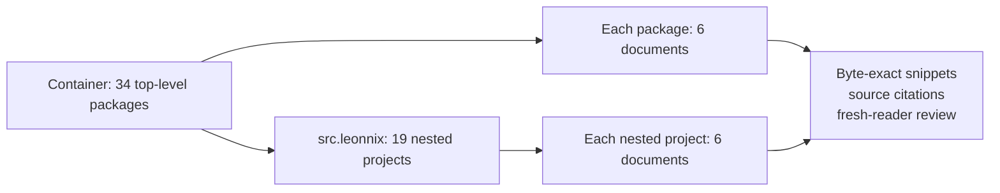
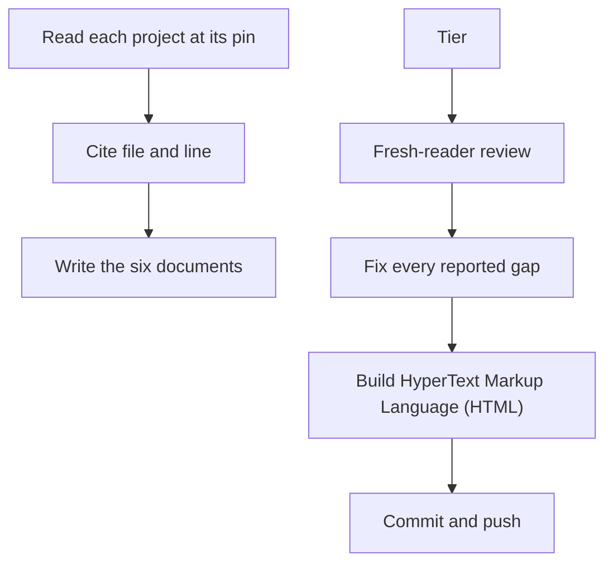

# AI design tooling: package explorations

This directory explores `/Users/darkvoid/GitSources/src.aidesign`, a container of 34 separate
projects about design and agents. The projects do different jobs. Some are skills that a coding
agent loads. Some are libraries that a page imports. Some are applications, demos, or curated
lists. They share a folder, not a codebase.

The thesis of the set is that "AI design tooling" is not one product. It is a set of narrow
contracts. A skill states what an agent must look at. A library states what a component must
render. An application states what a user must see. This set reads each project as its own
contract and compares the contracts where they touch.

## How the set is organised

Each project gets its own directory with a `spec.md` and a `markdown/` tree. Every project
receives the same full exploration: six documents that cover the overview, the architecture, the
core mechanism, the workflow and quality checks, and the limits. Depth does not follow size. A
small skill divides a small surface into those five parts.

| Level | Documents |
|-------|-----------|
| Every package | README plus five deep dives |

One package, `src.leonnix`, is itself a container of nineteen separate Git checkouts. It holds one
index and one specification at its top level, and every nested project has its own package of six
documents.

The full inventory, the order, and the per-package pins are in the [spec](spec.md).

## Package explorations

Two packages are open. `open-design` is complete. `src.leonnix` is in progress and holds nineteen
nested projects. The table fills in the order given in the spec.

| Package | Start here |
|---------|------------|
| [open-design](open-design/html/README.html) | [Overview](open-design/html/00-overview.html), then [core mechanism](open-design/html/02-core-mechanism.html) |
| [src.leonnix](src.leonnix/html/README.html) | In progress: 12 of 19 projects. Published: [tastecode](src.leonnix/tastecode/html/README.html), [taste-skill](src.leonnix/taste-skill/html/README.html), [cinetic](src.leonnix/cinetic/html/README.html), [valle-morta](src.leonnix/valle-morta/html/README.html), [afterglow](src.leonnix/afterglow/html/README.html), [earshot](src.leonnix/earshot/html/README.html), [unsung-vale](src.leonnix/unsung-vale/html/README.html), [athenaion](src.leonnix/athenaion/html/README.html), [casa-ocaso](src.leonnix/casa-ocaso/html/README.html), [shanshui](src.leonnix/shanshui/html/README.html), [golden-temple](src.leonnix/golden-temple/html/README.html) and [needle-drop](src.leonnix/needle-drop/html/README.html) |

## Reading order

A reader who wants the big picture should start with
[open-design](open-design/html/README.html). It is the largest project and it uses the vocabulary
of skills and plugins that the smaller projects reuse.
A reader who wants one specific tool should open the table row for that tool.

A reader who wants to compare the projects should read the limits section of each README. The
limits show where the projects differ, because each one names the thing that it cannot do.

## What this set does not claim

The exploration does not run the projects. It does not build their packages, render their output,
or evaluate their visual quality. Every statement comes from the source at the pinned revision,
the tests, or the project documents. Where a project states a limit, the exploration repeats the
limit and names the file.

