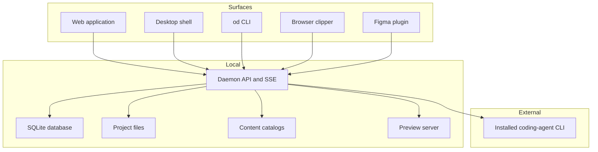
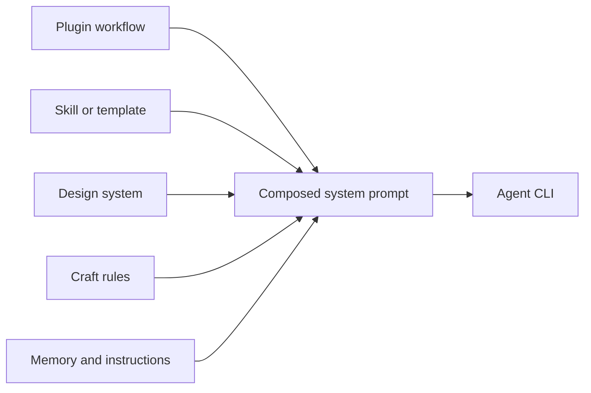

# 00 Overview: what OpenDesign is

## Thesis

OpenDesign is a local-first design workspace. It ships no model and no coding agent. It finds a coding-agent Command Line Interface (CLI) that the user already installed. It builds a large system prompt from four content planes. Then it starts the CLI in a project directory and lets that CLI write the design files. The product is the control surface, the content library, and the quality gate around an agent that somebody else owns.

The package version is 0.27.2. The license is Apache License 2.0. The package is a private pnpm monorepo. The module system is ECMAScript modules. The Node.js engine range is `~24`.

## The problem that the product addresses

A designer can ask a general coding agent to make a page. The result is often inconsistent. The agent does not know the brand. It does not know which layout library the team uses. It does not know which colors are banned. It does not know which output format the preview needs.

OpenDesign puts those facts into the prompt. It keeps the facts in portable directories. A design system holds the brand. A functional skill holds the working method. A design template holds the rendering blueprint. A plugin holds the workflow and the pipeline. The agent still writes the files. The product supplies the context and the constraints.

This is the central design choice. The product does not compete with the agent on model quality. It competes on context quality, content coverage, local control, and preview integration.

## The product surface

The same daemon serves several surfaces.

- The web application is a Next.js application. It renders the composer, the project view, the file viewer, and the preview.
- The desktop application is an Electron shell. It packages the daemon as a sidecar process. It adds desktop trust features such as a native folder picker.
- The `od` CLI is a machine-readable surface over the daemon HyperText Transfer Protocol (HTTP) Application Programming Interface (API). It can start the daemon, install Model Context Protocol (MCP) entries, and call project and file operations.
- The MCP server exposes projects, files, and skills to an external agent over standard input and standard output.
- The browser clipper is a Manifest Version 3 extension. It captures a page, extracts design evidence, and sends it to the local daemon.
- A Figma plugin reads design data and sends it to the daemon.

The web application and the desktop application use the same daemon API. This reduces duplicate behavior. The desktop shell adds trust and lifecycle features that a browser cannot provide.



Server-Sent Events (SSE) carry the run stream to the browser. The daemon writes structured events. The browser updates the chat and the artifact view. The agent output is not polled.

## The four content planes

The README states the four planes at `README.md:240`. The source confirms that they are separate directory formats with separate loaders.

| Plane | Directory shape | Job |
|---|---|---|
| Plugin | `open-design.json`, plus `SKILL.md` or another payload | Runnable workflow, pipeline, inputs, capabilities |
| Functional skill | `SKILL.md` with frontmatter and references | Agent behavior for a class of work |
| Design template | `SKILL.md`, assets, references | Rendering blueprint and seed files |
| Design system | `manifest.json`, `DESIGN.md`, `tokens.css`, optional components | Brand contract and token source |

The planes compose. A run can use one plugin, one skill or template, one design system, several craft sections, project memory, user instructions, and a pipeline stage. A craft section is a shared rule set such as typography or color. A pipeline stage is one named step with a list of atoms. The prompt composer receives all of them as separate inputs.



All five inputs enter the composer. The composer does not chain them. The order and the precedence are composer decisions, not directory relationships.

The planes are plain directories. A user can author one. A team can publish one. The daemon can discover one. No database migration is needed to add content.

### Plugins

A plugin is a directory with `open-design.json`. The manifest declares the plugin specification version, the kind, the task kind, the context references, the pipeline, the inputs, and the capabilities. The official default scenario shows the full shape. The shown excerpt starts at `compat` and stops after the capability list. It omits `specVersion` at line 3 and `inputs` at line 137.

```text
# plugins/_official/scenarios/od-default/open-design.json:62-129
  "compat": {
    "agentSkills": [
      {
        "path": "./SKILL.md"
      }
    ]
  },
  "od": {
    "kind": "scenario",
    "taskKind": "new-generation",
    "scenario": "default-router",
    "mode": "scenario",
    "hidden": true,
    "context": {
      "craft": [
        "typography",
        "color",
        "anti-ai-slop"
      ],
      "skills": [
        {
          "path": "./SKILL.md"
        }
      ]
    },
    "pipeline": {
      "stages": [
        {
          "id": "discovery",
          "atoms": [
            "discovery-question-form"
          ]
        },
        {
          "id": "plan",
          "atoms": [
            "direction-picker",
            "todo-write"
          ]
        },
        {
          "id": "generate",
          "atoms": [
            "file-write",
            "media-image",
            "media-video",
            "media-audio",
            "live-artifact"
          ]
        },
        {
          "id": "critique",
          "atoms": [
            "critique-theater"
          ],
          "repeat": true,
          "until": "critique.score>=4 || iterations>=3"
        }
      ]
    },
    "capabilities": [
      "prompt:inject",
      "pipeline:*",
      "media:image",
      "media:video",
      "media:audio",
      "fs:write"
    ],
```

The pipeline is a small state machine. Each stage names atoms. An atom is an injectable prompt block. The critique stage repeats until the score reaches 4 or the run reaches 3 iterations. That expression belongs to this plugin. The critique configuration in `packages/contracts/src/critique.ts` defaults to a 10-point scale and a threshold of 8.0. The plugin expression and the configuration are separate controls.

### Functional skills

A functional skill is a `SKILL.md` file. The frontmatter uses the Agent Skills format plus an `od` block. The daemon reads the file, parses the frontmatter, normalizes the mode, surface, platform, and scenario, and reads the body.

```text
# apps/daemon/src/skills.ts:64-106
export interface SkillInfo {
  id: string;
  name: string;
  displayName?: Record<string, string>;
  description: string;
  descriptionI18n?: Record<string, string>;
  triggers: unknown[];
  mode: SkillMode;
  surface: SkillSurface;
  source: SkillSource;
  craftRequires: string[];
  platform: SkillPlatform;
  scenario: string;
  // Optional human-readable category (e.g. "image-generation", "video",
  // "design-systems"). Surfaced as a filter pill in Settings → Skills so a
  // large pre-loaded catalogue (e.g. curated design/creative skills from the
  // upstream awesome-* lists) stays scannable. Not part of system-prompt
  // composition; purely a UI hint.
  category: string | null;
  previewType: string;
  designSystemRequired: boolean;
  defaultFor: string[];
  upstream: string | null;
  featured: number | null;
  fidelity: "wireframe" | "high-fidelity" | null;
  speakerNotes: boolean | null;
  animations: boolean | null;
  examplePrompt: string;
  examplePromptI18n?: Record<string, string>;
  aggregatesExamples: boolean;
  /**
   * Per-skill Critique Theater override declared via `od.critique.policy`
   * in the skill's SKILL.md frontmatter. The daemon's rollout resolver
   * uses this as the highest-priority signal when deciding whether to
   * wire the critique pipeline for a generation: `required` forces the
   * panel on regardless of project / env / phase defaults, `opt-out`
   * forces it off, `opt-in` lets the panel run only at M2+ rollout
   * phases, `null` means the skill has no opinion and the lower-priority
   * tiers (project override, env override, phase default) decide.
   */
  critiquePolicy: SkillCritiquePolicy;
  body: string;
  dir: string;
```

The interface shows that a skill carries more than prompt text. It carries selection metadata, preview expectations, craft requirements, and a critique policy. Selection metadata is the `mode`, `surface`, `platform`, and `scenario` fields. Preview expectations are `previewType`, `designSystemRequired`, and `defaultFor`. Craft requirements are the `craftRequires` list of rule identifiers. The critique policy is one of `required`, `opt-in`, `opt-out`, or `null`. Those fields drive the User Interface (UI) and the run.

### Design templates

A design template is also a skill, but it carries rendering assets. The web prototype template shows the common shape. The frontmatter names the mode, the platform, the scenario, the preview type, and the required design-system sections.

```text
# design-templates/web-prototype/SKILL.md:1-25
---
name: web-prototype
description: |
  General-purpose desktop web prototype. Single self-contained HTML file built
  by copying the seed `assets/template.html` and pasting section layouts from
  `references/layouts.md`. Default for any landing / marketing / docs / SaaS
  page when no more specific skill matches.
triggers:
  - "prototype"
  - "mockup"
  - "landing"
  - "single page"
  - "marketing page"
  - "homepage"
od:
  mode: prototype
  platform: desktop
  scenario: design
  preview:
    type: html
    entry: index.html
  design_system:
    requires: true
    sections: [color, typography, layout, components]
---
```

The body then tells the agent to read the seed before writing. It tells the agent to paste layouts instead of writing Cascading Style Sheets (CSS) from scratch. It tells the agent to write project files and not to emit a second source block. This is a rendering contract, not only advice.

### Design systems

A design system is a brand package. The rich form has a `manifest.json`, a `DESIGN.md`, a `tokens.css`, and optional component fixtures. The Stripe package shows the manifest shape.

```text
# design-systems/stripe/manifest.json:1-28
{
  "schemaVersion": "od-design-system-project/v1",
  "id": "stripe",
  "name": "Stripe",
  "category": "Fintech & Crypto",
  "description": "Bundled OpenDesign package for Stripe, derived from curated DESIGN.md, tokens.css, and components.html fixtures.",
  "source": {
    "type": "bundled",
    "origin": "OpenDesign curated bundled fixture"
  },
  "files": {
    "design": "DESIGN.md",
    "tokens": "tokens.css",
    "designTokens": "design-tokens.json",
    "tailwind": "tailwind-v4.css",
    "components": "components.html"
  },
  "usage": "USAGE.md",
  "componentsManifest": "components.manifest.json",
  "importMode": "normalized",
  "craft": {
    "applies": [],
    "suggested": [
      "color",
      "accessibility-baseline"
    ],
    "exemptions": []
  },
```

The manifest declares files, usage text, component metadata, import mode, craft suggestions, preview pages, and source evidence. The daemon can load the prose, tokens, components, and preview from one package.

The design-system README states the minimum shape at `design-systems/README.md:8`. The minimum shape is three files: `manifest.json`, `DESIGN.md`, and `tokens.css`. A legacy package can contain only `DESIGN.md`. The README calls that fallback a compatibility path, not the authoring target. The daemon still discovers both.

## Repository map

The top-level directories have distinct jobs.

| Path | Job |
|---|---|
| `apps/web` | Next.js web application |
| `apps/desktop` | Electron desktop shell |
| `apps/daemon` | HTTP API, run engine, prompt composer, preview server |
| `packages` | Shared contracts, plugin runtime, host, platform, sidecar, and other libraries |
| `skills` | Functional skill catalog |
| `design-templates` | Rendering templates and deck assets |
| `design-systems` | Brand packages |
| `craft` | Shared craft rules such as typography and anti-slop |
| `prompt-templates` | Reusable prompt records |
| `plugins` | Plugin specification and official catalog |
| `clipper` | Manifest Version 3 browser extension |
| `e2e` | Playwright and Vitest end-to-end tests |
| `deploy` | Docker, compose, Azure, and install scripts |
| `charts` | Helm chart |
| `docs` | Architecture, protocol, and operating documents |
| `.claude-plugin` | Claude Code plugin marketplace entry |
| `scripts` | Guard, postinstall, and maintenance scripts |

The monorepo uses pnpm workspaces. The root package exposes the `od` binary at `package.json:9`. The binary points to `apps/daemon/bin/od.mjs`.

```text
# package.json:1-20
{
  "name": "open-design",
  "version": "0.27.2",
  "private": true,
  "packageManager": "pnpm@10.33.2",
  "type": "module",
  "description": "Local-first design product: detects your installed code-agent CLI, runs design skills + design systems, streams artifacts into a sandboxed preview.",
  "license": "Apache-2.0",
  "bin": {
    "od": "./apps/daemon/bin/od.mjs"
  },
  "scripts": {
    "postinstall": "node ./scripts/postinstall.mjs",
    "bootstrap": "node ./scripts/postinstall.mjs",
    "tools-dev": "pnpm exec tools-dev",
    "tools-pack": "pnpm exec tools-pack",
    "tools-release": "pnpm exec tools-release",
    "tools-serve": "pnpm exec tools-serve",
    "guard": "tsx ./scripts/guard.ts",
    "lint:craft": "tsx ./scripts/lint-craft-references.ts",
```

## The runtime catalog

The daemon ships 27 runtime definitions. A definition is not an agent. It is a description of how to find, probe, start, and read one agent CLI.

```text
# apps/daemon/src/runtimes/registry.ts:40-68
export const SHIPPED_AGENT_DEFS: RuntimeAgentDef[] = [
  amrAgentDef,
  claudeAgentDef,
  codexAgentDef,
  devinAgentDef,
  opencodeAgentDef,
  byokOpenCodeAgentDef,
  hermesAgentDef,
  traeCliAgentDef,
  grokBuildAgentDef,
  kimiAgentDef,
  cursorAgentDef,
  qwenAgentDef,
  qoderAgentDef,
  copilotAgentDef,
  ampAgentDef,
  piAgentDef,
  kiroAgentDef,
  kiloAgentDef,
  vibeAgentDef,
  deepseekAgentDef,
  deepseekHarnessAgentDef,
  aiderAgentDef,
  antigravityAgentDef,
  reasonixAgentDef,
  codebuddyAgentDef,
  mimoAgentDef,
  atomcodeAgentDef,
];
```

The list mixes commercial agents, open agents, and local harnesses. A local profile can add more definitions. The registry rejects duplicate identifiers at load time. The shipped list answers the question "what does this build ship". The combined list answers "what can this machine run".

Each definition declares a primary binary and fallback binaries. It also declares version arguments, an authentication probe, help arguments, capability flags, and model discovery. The remaining fields cover argument construction, standard input shape, stream format, MCP injection style, and session resume support. The Claude definition is a full example. It also shows that capability detection is probe based.

```text
# apps/daemon/src/runtimes/defs/claude.ts:20-45
export const claudeAgentDef = {
    id: 'claude',
    name: 'Claude Code',
    bin: 'claude',
    // Drop-in forks that ship a CLI argv-compatible with `claude`. Tried in
    // order if `claude` itself isn't on PATH, so users on a single-binary
    // install (e.g. only OpenClaude — https://github.com/Gitlawb/openclaude
    // — issue #235) get auto-detected without writing wrapper scripts.
    fallbackBins: ['openclaude'],
    versionArgs: ['--version'],
    authProbe: {
      args: ['auth', 'status'],
      timeoutMs: 5000,
    },
    helpArgs: ['-p', '--help'],
    capabilityFlags: {
      // Flag string -> capability key. After probing `--help`, we set
      // `agentCapabilities[id][key] = true` for each substring that matches.
      // `--add-dir` and `--include-partial-messages` live under `claude -p`
      // subcommand, so we probe `claude -p --help` instead of `claude --help`.
      // Fixes issue #430: --add-dir never detected because it wasn't in global help.
      '--include-partial-messages': 'partialMessages',
      '--forward-subagent-text': 'forwardSubagentText',
      '--agents': 'customAgents',
      '--add-dir': 'addDir',
    },
```

The registry has 27 entries. Confirmed here means that the shipped array has 27 elements. No definition was executed. The README says 26 distinct executables. This exploration did not confirm the distinct executable count.

## Two execution profiles

The daemon has two ways to receive the result of a run.

- The `filesystem` profile is for an agent that can write project files. The preview follows the files.
- The `text_artifact` profile is for an agent that cannot write files. The agent returns one complete artifact block in text.

The mapping is a small pure function. A run gets the text profile only when the stream format is `plain`.

```text
# packages/contracts/src/execution-profile.ts:1-7
export type ExecutionProfile = 'filesystem' | 'text_artifact';

export function executionProfileFromStreamFormat(
  streamFormat: string | null | undefined,
): ExecutionProfile {
  return streamFormat === 'plain' ? 'text_artifact' : 'filesystem';
}
```

This function looks small. It controls which prompt variant the agent receives. It also controls how the result is saved and previewed. A plain stream cannot use the filesystem workflow. A structured stream usually can.

## Packaging

The web application builds to a static export. The daemon serves the export and the API from one container. The Dockerfile shows the two-stage build.

```text
# deploy/Dockerfile:87-122
FROM ${RUNTIME_IMAGE}

RUN apk add --no-cache tini poppler-utils bash git && \
    addgroup -S -g 1001 open-design && \
    adduser -S -D -H -u 1001 -G open-design open-design

WORKDIR /app
COPY --from=build --chown=open-design:open-design /app/deploy/daemon ./apps/daemon
COPY --from=build --chown=open-design:open-design /app/apps/web/out ./apps/web/out
COPY --from=build --chown=open-design:open-design /app/skills ./skills
COPY --from=build --chown=open-design:open-design /app/design-systems ./design-systems
COPY --from=build --chown=open-design:open-design /app/craft ./craft
COPY --from=build --chown=open-design:open-design /app/prompt-templates ./prompt-templates
COPY --from=build --chown=open-design:open-design /app/data ./data
COPY --from=build --chown=open-design:open-design /app/assets/frames ./assets/frames
COPY --from=build --chown=open-design:open-design /app/assets/community-pets ./assets/community-pets
# Plan §3.J4 / spec §23.3.5 — bundled atom plugins registered on
# daemon boot. The directory contains `plugins/_official/atoms/<atom>/`
# pairs (SKILL.md + open-design.json); registerBundledPlugins() walks
# it on startup so the container ships with first-party atoms reachable
# via the same registry path third-party plugins use.
COPY --from=build --chown=open-design:open-design /app/plugins/_official ./plugins/_official

RUN mkdir -p /app/.od && \
    chown -R open-design:open-design /app

ENV NODE_ENV=production
ENV NODE_OPTIONS=--max-old-space-size=192
ENV OD_BIND_HOST=0.0.0.0
ENV OD_PORT=7456

EXPOSE 7456

USER open-design
ENTRYPOINT ["/sbin/tini", "--"]
CMD ["node", "apps/daemon/dist/cli.js", "--no-open"]
```

The container runs as a non-root user. It binds to all interfaces inside the container. The deployment documentation requires authentication for bridge traffic. The default local daemon binds to `127.0.0.1`. The comment in the shown excerpt names plan section 3.J4 and specification section 23.3.5. `registerBundledPlugins` walks the copied directory on startup, so first-party atoms use the same registry path as third-party plugins.

## The browser clipper

The clipper is a separate subproject. It has no build step. It loads unpacked. Loading unpacked means that the browser reads the directory directly, without a package store or a signed archive. It sends data to the local daemon at `127.0.0.1:7456`.

```text
# clipper/manifest.json:1-14
{
  "manifest_version": 3,
  "name": "__MSG_extensionName__",
  "version": "0.2.0",
  "default_locale": "en",
  "description": "__MSG_extensionDescription__",
  "permissions": ["scripting", "storage", "contextMenus", "tabs", "downloads"],
  "host_permissions": ["<all_urls>"],
  "background": {
    "service_worker": "background.js",
    "scripts": ["background.js"]
  },
  "action": {
    "default_popup": "popup.html",
```

The `<all_urls>` host permission is broad. The extension uses it to read the current page and extract design evidence. The daemon trust rule reduces the risk of a remote page calling the local API. That rule is the API-token middleware at `apps/daemon/src/server.ts:3307-3345`. A loopback peer skips the token check. Any other request must present a matching bearer token or matching Basic credentials. The rule controls the API, not the extension's page access. The extension itself still has broad page access.

## The agent install path

The product can be installed into an agent instead of the agent being installed into the product. The Claude Code marketplace entry points at a plugin. The plugin starts an MCP server over standard input and standard output.

```text
# .claude-plugin/marketplace.json:9-15
  "plugins": [
    {
      "name": "open-design",
      "source": "./plugins/open-design",
      "description": "OpenDesign MCP server (stdio). 139 skills + projects/files/preview tools, served by your local `od` daemon. Requires `od` on PATH (brew / npm / DMG)."
    }
  ]
```

The MCP server is a thin bridge. It calls the local daemon. The daemon still owns projects, files, and runs. The agent gets tools, not a second implementation.

## Testing layout

The end-to-end suite uses Playwright for browser tests and Vitest for other tests. The Playwright configuration excludes visual and sandbox suites from the functional run. It uses one Chromium project and two workers by default.

```text
# e2e/playwright.config.ts:16-33
export default defineConfig({
  testDir: './ui',
  // This is the functional config. Strict-visual specs (`visual-*.test.ts`)
  // are owned by `playwright.visual.config.ts` (its own `testMatch`,
  // snapshot/output settings, and the `playwright_visual` CI lane), so they
  // must never be picked up here — otherwise a bare `pnpm test:ui` or the
  // generic full-pool shard run would execute them without their visual
  // config. Excluding them at the config level keeps every functional
  // consumer (full pool, `test:ui*`, ui_p0 groups) aligned.
  testIgnore: ['visual-*.test.ts', 'workspace-depletion-sandbox.test.ts', 'api-security-view016.test.ts', 'workspace-free-concurrency-sandbox.test.ts', 'workspace-manual-retry-sandbox.test.ts', 'workspace-funding-sandbox.test.ts', 'qa-bill001.private.test.ts', 'workspace-notice-sandbox.test.ts', 'workspace-free-wallet-sandbox.test.ts', 'workspace-switch-billing-sandbox.test.ts', 'workspace-concurrency-sandbox.test.ts', 'workspace-concurrency-retry-sandbox.test.ts', 'workspace-api-wallet-sandbox.test.ts', 'workspace-api-wallet-readback-sandbox.test.ts', 'link-closure-sandbox.test.ts', 'link-f04-sandbox.test.ts', 'link-run013-sandbox.test.ts', 'link-run011-matrix-sandbox.test.ts', 'link-run003-latency-sandbox.test.ts', 'link-run012-checkout-sandbox.test.ts', 'link-run010-reconnect-sandbox.test.ts', 'link-run012-controlled-sandbox.test.ts'],
  outputDir: './ui/reports/test-results',
  timeout: Number(process.env.OD_PLAYWRIGHT_TIMEOUT) || 45_000,
  retries: process.env.CI ? 1 : 0,
  expect: {
    timeout: 10_000,
  },
  fullyParallel: process.env.OD_PLAYWRIGHT_FULLY_PARALLEL === '1',
  workers: parseWorkerCount(process.env.OD_PLAYWRIGHT_WORKERS),
```

The long exclusion list is a design signal. Visual and sandbox behavior need separate configuration and separate lanes. A generic functional run must not pick them up.

## What the package does not ship

The package does not ship a model. It does not ship an inference server. It does not ship an agent. It does not ship a hosted account system in the local build. It does not ship a Linux desktop installer in the official release, according to the README.

The user must supply an agent CLI, credentials for that agent, and a local Node.js runtime for source use. The desktop build supplies its own runtime. The Docker image supplies Node.js inside the container. It does not include an agent CLI.

This is the main trade. The product avoids model cost and model lock-in. It inherits the user's agent installation, authentication, permissions, and failure modes.

## Aha

**Aha:** OpenDesign is not a design tool that calls an Artificial Intelligence (AI) model. It is a prompt compiler and a content registry for agents that already exist. The product's most important code is not a renderer. It is the composition of the system prompt and the runtime definition that tells the daemon how to speak to each CLI.

That inversion explains most of the architecture. The daemon is an orchestrator. The runtime registry is an adapter layer. The catalogs are the product's real asset. The preview is a verification surface. The agent does the generation.

## Summary

OpenDesign is a local-first workspace around installed coding agents. It has four content planes, a runtime registry with 27 shipped definitions, two execution profiles, and a daemon that owns projects, runs, and previews. The web and desktop applications are clients of the same daemon. The product ships content, not intelligence.

The next document, [01-architecture.md](01-architecture.md), explains the process and storage architecture. It shows where state lives and how the daemon starts an agent safely. The [README index](README.md) lists all six documents.
