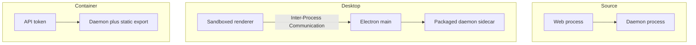
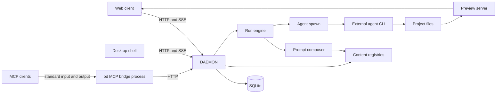
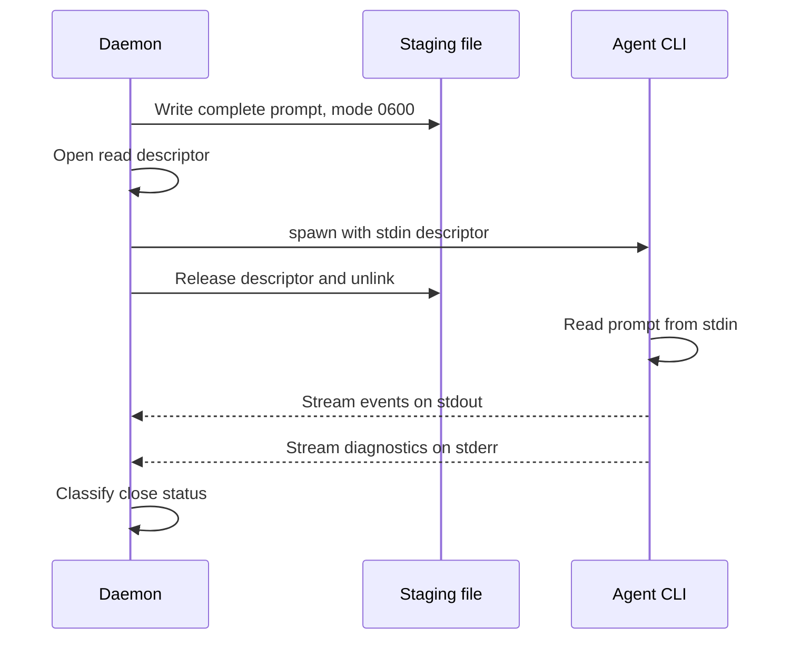

# 01 Architecture: process, storage, and trust

## Thesis

OpenDesign uses one local daemon as the center of the system. The web application and the desktop application are clients. The daemon owns the database, the project files, the content catalogs, the run engine, and the preview. The daemon starts an external coding-agent Command Line Interface (CLI) for each run. The agent writes into a project directory. The daemon observes the files and serves a preview.

This document explains the process topology, the data root, the runtime adapter layer, the spawn invariant, and the trust boundaries.

## Runtime shapes

The package supports three runtime shapes. The source shape is the development shape. The packaged shape is the desktop shape. The container shape is the deployment shape.

### Source development

`pnpm install` prepares the workspace. `tools-dev run web` starts the development services. Ports are allocated dynamically unless the user gives explicit flags. The web application and the daemon run as separate Node.js processes on the same machine.

### Packaged desktop

The Electron main process starts a packaged daemon as a sidecar. The renderer is sandboxed. The main process owns native capabilities such as the folder picker and the updater. The sidecar listens on a loopback address.

### Container and headless deployment

One Alpine container runs the daemon. The daemon serves the static web export and the HyperText Transfer Protocol (HTTP) Application Programming Interface (API). The container binds to `0.0.0.0` on port 7456. An API token protects requests from a non-loopback peer. The default local daemon binds to `127.0.0.1`.



The three shapes share the daemon API. They differ in process ownership and trust.

## Component topology

The main components are:

- The web client.
- The desktop shell.
- The daemon.
- The daemon database.
- The project file store.
- The content registries.
- The runtime registry.
- The preview server.
- The external agent.



The run engine is the only path that starts an agent. The prompt composer is a library inside the daemon. The content registries are read from disk. The database stores metadata, and the project directory stores deliverables.

## The web application

The web application is a Next.js App Router application. It uses React 18 and Tailwind version 4. The versions are 18.3.1 and 4.3.0 in `apps/web/package.json`. It has three main jobs.

1. Collect the brief and the project settings.
2. Open a run and read the Server-Sent Events (SSE) stream.
3. Render the artifact and the preview.

The web application does not start agents. It does not read project files directly from the file system. It calls the daemon API. The daemon applies authorization and path checks.

The file viewer is the most sensitive client component. It must decide between two preview strategies. The decision function is pure and testable.

```text
# apps/web/src/components/file-viewer-render-mode.ts:104-137
export function shouldUrlLoadHtmlPreview(d: UrlLoadDecision): boolean {
  if (d.mode !== 'preview') return false;
  if (d.isDeck) return false;
  if (d.commentMode && !(d.urlCommentBridge || d.urlModeBridge)) return false;
  // Inspect needs the selection bridge injected via buildSrcdoc; a raw
  // URL-loaded iframe has no listener to apply per-element overrides.
  if (d.inspectMode) return false;
  if (d.editMode) return false;
  // Palette tweaks need the srcDoc-side bridge — `<iframe src=URL>` has
  // no parent-injected listener to recolor against.
  if (d.paletteActive) return false;
  // Draw can stay on the URL-loaded iframe once the raw preview route has
  // injected its snapshot bridge; otherwise fall back to srcDoc so capture
  // still has a bridge to talk to.
  if (d.drawMode && !d.urlSnapshotBridge) return false;
  // The class based tweaks template relies on the srcDoc tweaks bridge
  // emitting `od:tweaks-available` on mount; on the URL load path the bridge
  // is never injected, so the toolbar toggle would stay disabled even though
  // the artifact ships a `.tw-panel`.
  if (d.tweaksBridge) return false;
  if (d.forceInline) return false;
  if (d.needsLocalInteractionBridge) return false;
  if (d.needsSandboxShim && !d.urlSandboxGuard) return false;
  if (d.needsFocusGuard && !d.urlFocusGuard) return false;
  // A self-redirecting document needs the redirect-loop guard on whichever
  // transport owns the document, or the iframe can reload itself forever
  // (nexu-io/open-design#710).
  if (d.needsRedirectGuard && !d.urlRedirectGuard) return false;
  // Root-relative project asset refs only resolve after the srcDoc pipeline
  // normalizes them (normalizeRootRelativeProjectAssetRefs); the URL-load
  // path serves the document untouched and the browser 404s each asset.
  if (d.projectRootAssetRefs) return false;
  return true;
}
```

The function returns false when the preview needs a host bridge. A bridge is an injected script that listens for viewer events or applies overrides. A bridge can inject a selection listener, a tweaks palette, a draw snapshot tool, a focus guard, or a redirect guard. The inline `srcDoc` path can inject those. A plain `src` load cannot. `UrlLoadDecision` is the argument object. Each field is a boolean fact about the source or the active viewer mode.

## The desktop shell

The desktop package is `@open-design/desktop`. It depends on Electron, the host package, the sidecar package, the platform package, and the release package. It builds a main process from `apps/desktop/src/main`.

The desktop shell adds four capabilities.

- It starts and stops the daemon sidecar.
- It provides a trusted folder picker.
- It stores the daemon connection settings.
- It checks for updates.

The folder picker matters for security. The generic project creation route rejects a client-supplied `metadata.baseDir`. Only the folder import route can set it. The desktop main process is the trusted caller for that route.

```text
# apps/daemon/src/routes/project/index.ts:3936-3964
  app.post('/api/projects', async (req, res) => {
    try {
      // One request-wide deadline covers every asynchronous read before the
      // transaction. Resetting a full timeout for each stage would still let a
      // sequence of merely slow reads outlive the Web's optimistic route.
      const projectCreatePreparationDeadline =
        Date.now() + projectCreatePreparationTimeoutMs;
      // A complete Workspace attribution must still name a currently active
      // member before we bind the new private project to that Workspace.
      // Headerless/partial local creates remain unbound.
      const createWorkspace = {
        context: await resolveCreatedProjectHome(req),
      };
      learnAssertedWorkspaceType(createWorkspace.context);
      const { id, name, projectLocationId, skillId, designSystemId, pendingPrompt, metadata, customInstructions, skipDiscoveryBrief } =
        req.body || {};
      if (typeof id !== 'string' || !isSafeId(id)) {
        return sendApiError(res, 400, 'BAD_REQUEST', 'invalid project id');
      }
      const requestedConversationId = req.body?.conversationId;
      if (
        requestedConversationId !== undefined
        && (typeof requestedConversationId !== 'string' || !isSafeId(requestedConversationId))
      ) {
        return sendApiError(res, 400, 'BAD_REQUEST', 'invalid conversation id');
      }
      if (typeof name !== 'string' || !name.trim()) {
        return sendApiError(res, 400, 'BAD_REQUEST', 'name required');
      }
```

The route validates identifiers and the project name. It also checks metadata fields. The `baseDir` rejection follows the shown block. The checks for `baseDir`, `fromTrustedPicker`, and `orchestratorWorkspace` are at `apps/daemon/src/routes/project/index.ts:3966-3990`. They are not shown here. The import route has the real path checks.

## The daemon

The daemon is an Express 5 application. It uses better-sqlite3 for the database. It serves the API, the SSE streams, the static web export, and the raw project files.

The daemon has these responsibilities:

- Detect agent CLIs.
- Store projects, conversations, runs, artifacts, skills, and settings.
- Compose the system prompt.
- Start the agent process.
- Parse the agent stream.
- Save artifacts and update project metadata.
- Validate deliverables.
- Run artifact lint.
- Serve previews.
- Expose Model Context Protocol (MCP) tools.

The daemon is stateless for prompt content. The prompt is built per run from current files. A change to a design system or a skill changes the next run without a daemon restart.

## The data root

The daemon needs a writable data directory. The default is `.od` under the package root. The package root is two levels above `apps/daemon`, not the project that the user edits. The environment variable `OD_DATA_DIR` can override it. In sandbox mode, the variable is mandatory.

```text
# apps/daemon/src/daemon-paths.ts:125-163
export function resolveDataDir(
  raw: string | undefined,
  projectRoot: string,
  options: ResolveDataDirOptions = {},
): string {
  const value = raw?.trim();
  if (!value) {
    if (options.requireExplicit) {
      throw new Error('OD_DATA_DIR is required when OD_SANDBOX_MODE is enabled');
    }
    return path.join(projectRoot, '.od');
  }

  const resolved = resolveProjectRelativePath(value, projectRoot);
  try {
    fs.mkdirSync(resolved, { recursive: true });
    fs.accessSync(resolved, fs.constants.W_OK);
  } catch (err) {
    const e = err as Error;
    const currentUser = (() => {
      try {
        return os.userInfo().username;
      } catch {
        return process.env.USER ?? process.env.LOGNAME ?? 'unknown';
      }
    })();
    const parentDir = path.dirname(resolved);
    throw new Error(
      [
        `OD_DATA_DIR "${resolved}" is not writable: ${e.message}`,
        `Current user: ${currentUser}`,
        'Check whether the folder or one of its parents is owned by another user, is a symlink to a protected location, or was previously created with sudo.',
        `Try: ls -ld "${parentDir}" "${resolved}"`,
        `If the folder should belong to you, fix ownership/permissions, for example: sudo chown -R "${currentUser}":staff "${parentDir}" && chmod -R u+rwX "${parentDir}"`,
      ].join(' '),
    );
  }
  return resolved;
}
```

The function resolves relative paths, creates the directory, and tests write access. It gives a detailed error when the directory is not writable. That detail is important because a directory created by `sudo` is a common local failure.

The daemon computes the data root once at startup. It also computes a canonical real path. The canonical path is `fs.realpathSync(RUNTIME_DATA_DIR)` at `apps/daemon/src/server.ts:1448`. The daemon uses it when it compares a user-supplied path with the data root. On macOS, `/var` is a symlink to `/private/var`. A comparison without the canonical form fails.

```text
# apps/daemon/src/server.ts:1431-1434
const SANDBOX_MODE_ENABLED = isSandboxModeEnabled(process.env);
const RUNTIME_DATA_DIR = resolveDataDir(process.env.OD_DATA_DIR, PROJECT_ROOT, {
  requireExplicit: SANDBOX_MODE_ENABLED,
});
```

The data root contains the database, the run workspace, artifact blobs, the plugin lock file, diagnostics, and other runtime state. Project deliverables live under the projects root. The two roots are separate.

## The bind address

The daemon default is loopback. A separate function normalizes the configured host. An empty value becomes the default.

```text
# apps/daemon/src/daemon-startup.ts:31-36
export const DEFAULT_DAEMON_BIND_HOST = '127.0.0.1';

export function normalizeDaemonBindHost(input: unknown): string {
  const host = String(input ?? '').trim();
  return host || DEFAULT_DAEMON_BIND_HOST;
}
```

The default port is 7456. A user can change the port with `OD_PORT`. The desktop sidecar and the MCP configuration both use the same default Uniform Resource Locator (URL).

Loopback is a security control. A local process can still call the API. The daemon adds request checks for local callers, origin checks, and tokens in deployment modes. Loopback is not a complete defense against a malicious local process.

## The runtime registry

The runtime registry is a static list plus optional local profiles. The list answers a product question. The combined list answers a machine question.

```text
# apps/daemon/src/runtimes/registry.ts:31-40
/**
 * The agents this build ships, before anything a particular machine adds.
 *
 * `AGENT_DEFS` below appends whatever local profiles the user has declared, so
 * it answers "what can this machine run" — a different question from "what do
 * we ship", and the wrong list for anything that must hold everywhere. A local
 * profile id is required not to collide with one of these (see
 * `createLocalAgentDef`), so it is always an id we have never heard of.
 */
export const SHIPPED_AGENT_DEFS: RuntimeAgentDef[] = [
```

The registry appends local definitions and rejects duplicate identifiers. A duplicate is a startup error, not a warning. The check is `registry.ts:82-89`. The source has no silent override path.

## Runtime detection and launch

Detection is per binary. The daemon inspects the configured environment and the process `PATH`. It resolves a selected path. It also builds a list of directories to put at the front of the child `PATH`.

```text
# apps/daemon/src/runtimes/launch.ts:15-38
export function resolveAgentLaunch(
  def: RuntimeAgentDef,
  configuredEnv: Record<string, string> = {},
  options: { skipPathCandidates?: readonly string[] } = {},
): AgentLaunchResolution {
  const resolution = inspectAgentExecutableResolution(def, configuredEnv, options);
  if (!resolution.selectedPath) {
    return { ...resolution, launchPath: null, launchKind: 'selected', childPathPrepend: [], diagnostic: null };
  }
  const childPathPrepend = path.isAbsolute(resolution.selectedPath)
    ? [path.dirname(resolution.selectedPath)]
    : [];
  if (def.id !== 'codex') {
    return { ...resolution, launchPath: resolution.selectedPath, launchKind: 'selected', childPathPrepend, diagnostic: null };
  }
  const native = tryResolveCodexNativeBinary(resolution.selectedPath);
  return {
    ...resolution,
    launchPath: native.path ?? resolution.selectedPath,
    launchKind: native.path ? 'codex-native' : 'selected',
    childPathPrepend: [...childPathPrepend, ...native.childPathPrepend],
    diagnostic: native.diagnostic,
  };
}
```

Most agents use the selected wrapper or binary. A wrapper is a script that starts the real binary. Codex has a special path. The Codex npm wrapper can hide a native binary. The daemon tries to find the native binary, because the wrapper can fail in a Graphical User Interface (GUI) launch environment.

The child environment must contain the correct Node.js directory and the correct toolchain directories. A GUI launch often has a smaller `PATH` than a shell launch.

```text
# apps/daemon/src/runtimes/launch.ts:40-87
export function applyAgentLaunchEnv(
  env: NodeJS.ProcessEnv,
  launch: Pick<AgentLaunchResolution, 'childPathPrepend'>,
  nodeBinDir: string = path.dirname(process.execPath),
  appendPathDirs: string[] = userToolchainBinDirs(),
): NodeJS.ProcessEnv {
  // Build the ordered list of directories to guarantee are at the front of
  // PATH: the running Node binary directory first (so npm .cmd shims on
  // Windows that invoke bare "node" find the correct binary even when the
  // daemon was GUI-launched without a nodejs entry on PATH), then the agent
  // wrapper/shim directory.  Using process.execPath as the default means
  // every call site — detectAgents, connection tests, and chat runs —
  // consistently reaches the correct Node binary without each caller having
  // to duplicate the dirname(process.execPath) prepend independently.
  //
  // `appendPathDirs` adds the user toolchain bin dirs (Homebrew, ~/.bun/bin,
  // version-manager dirs, …) to the END of PATH so a resolved binary's shebang
  // interpreter is findable at spawn time even when the daemon's own PATH is
  // minimal (GUI launch). Without this, an agent like Pi — a `#!/usr/bin/env
  // bun` script — resolves but the version probe / run spawn fails with exit
  // 127 ("env: bun: No such file or directory"), so detection wrongly marks it
  // unavailable. Defaults to the real toolchain dirs; tests pass [] for
  // determinism.
  const toPrepend = [...(nodeBinDir ? [nodeBinDir] : []), ...launch.childPathPrepend];
  if (toPrepend.length === 0 && appendPathDirs.length === 0) return env;
  // Case-insensitive key lookup — Windows uses 'Path', not 'PATH'.
  // Using env.PATH directly would be undefined on Windows, yielding a
  // one-entry PATH that contains only toPrepend and discards all system
  // paths.  Find the actual key name so we update in place rather than
  // adding a conflicting duplicate key.
  const pathKey = Object.keys(env).find((k) => k.toLowerCase() === 'path') ?? 'PATH';
  const existing = typeof env[pathKey] === 'string' ? (env[pathKey] as string) : '';
  const normalize = (p: string) => {
    const trimmed = p.replace(/[/\\]+$/, '');
    return process.platform === 'win32' ? trimmed.toLowerCase() : trimmed;
  };
  const existingParts = existing.split(delimiter).filter((e) => e.length > 0);
  const seen = new Set<string>();
  const merged: string[] = [];
  for (const entry of [...toPrepend, ...existingParts, ...appendPathDirs]) {
    const n = normalize(entry);
    if (!seen.has(n)) {
      seen.add(n);
      merged.push(entry);
    }
  }
  return { ...env, [pathKey]: merged.join(delimiter) };
}
```

The function handles the Windows `Path` key. It removes duplicates. It keeps order. The order is: Node.js directory, wrapper directory, existing `PATH`, then user toolchain directories. A shebang interpreter is findable, but an existing `PATH` entry still wins over a toolchain directory.

## The spawn invariant

The most important runtime rule is the prompt delivery rule. The daemon writes the complete prompt to a file before it starts the child. The child receives that file as its standard input descriptor. The file has mode `0600`. The name includes a random identifier. The open uses the exclusive `wx` flag.

```text
# apps/daemon/src/runtimes/agent-process.ts:94-121
export function openCompletePromptAsStdin(runDir: string, prompt: string): StagedPromptStdin {
  fs.mkdirSync(runDir, { recursive: true });
  const filePath = path.join(runDir, `${STAGED_PROMPT_PREFIX}${randomUUID()}${STAGED_PROMPT_SUFFIX}`);
  fs.writeFileSync(filePath, prompt, { encoding: 'utf8', mode: 0o600, flag: 'wx' });
  let fd: number;
  try {
    fd = fs.openSync(filePath, 'r');
  } catch (error) {
    try { fs.unlinkSync(filePath); } catch { /* best-effort */ }
    throw error;
  }
  let fdOpen = true;
  const remove = () => {
    try { fs.unlinkSync(filePath); } catch { /* already gone, or still open on Windows */ }
  };
  return {
    fd,
    filePath,
    releaseAfterSpawn() {
      if (fdOpen) {
        fdOpen = false;
        try { fs.closeSync(fd); } catch { /* best-effort */ }
      }
      remove();
    },
    remove,
  };
}
```

If the write fails, no child exists. That is the safe half of the invariant. If the spawn fails, the staging function releases the descriptor and removes the file.

```text
# apps/daemon/src/runtimes/agent-process.ts:276-315
export function spawnAgentProcess(request: SpawnAgentProcessRequest): SpawnedAgentProcess {
  const detached = process.platform !== 'win32';
  const staged = typeof request.stdin === 'object'
    ? openCompletePromptAsStdin(request.runDir, request.stdin.prompt)
    : null;
  const stdin = staged ? staged.fd : (request.stdin as 'pipe' | 'ignore');
  const spawnedAtMs = Date.now();
  let child: ChildProcess;
  try {
    child = spawn(request.command, [...request.args], {
      env: request.env,
      stdio: [stdin, 'pipe', 'pipe'],
      cwd: request.cwd,
      shell: false,
      detached,
      // Required when invocation wraps a Windows .cmd/.bat shim through
      // cmd.exe; without this, Node re-escapes the inner command line and
      // breaks paths containing spaces (issue #315).
      windowsVerbatimArguments: request.windowsVerbatimArguments,
    });
  } finally {
    staged?.releaseAfterSpawn();
  }
  const spawnReturnedAtMs = Date.now();
  if (staged) {
    // Windows cannot always unlink a file the child still holds open.
    child.once('close', staged.remove);
    child.once('error', staged.remove);
  }
  const processGroupId = detached && typeof child.pid === 'number' ? child.pid : null;
  recordAgentProcessUntilGroupExits(child, {
    processGroupId,
    runDir: request.runDir,
    runId: request.runId,
    launchPath: request.command,
    spawnedAtMs,
    spawnReturnedAtMs,
  });
  return { child, processGroupId, promptDeliveredAtSpawn: staged != null };
}
```

The child uses `stdio: [stdin, 'pipe', 'pipe']`. Standard input is the staged file. Standard output and standard error are pipes. The child is detached on POSIX. It leads its own process group. Cancellation can signal the whole tree. On Windows the child is not detached, because the process group model differs.

The daemon records the process group. A later daemon start can reap a leftover process from a previous crash. The record contains the process identifier (PID), the process group identifier, the run identifier, the launch path, and timestamps.



The sequence avoids two operating system limits. Linux limits one argument string to about 128 kilobytes. Windows limits the full command line to about 32 kilobytes. A large prompt does not fit in either limit. A file descriptor has no such limit.

## Run close classification

A process exit code alone is not enough. An agent can exit non-zero after it produced a valid artifact. An agent can be stopped by the daemon after a clean turn. An agent can be canceled by the user.

The classifier uses several signals.

```text
# apps/daemon/src/runtimes/chat-run-lifecycle.ts:67-101
export function classifyChatRunCloseStatus(params: {
  cancelRequested: boolean;
  code: number | null;
  signal: NodeJS.Signals | string | null;
  acpCleanCompletion: boolean;
  /** The daemon began terminating this ACP attempt after its prompt completed. */
  acpCompletionShutdownRequested?: boolean;
  artifactQuietShutdownRequested: boolean;
  turnCompletedCleanly: boolean;
  artifactProducedThisRun: boolean;
}): 'canceled' | 'succeeded' | 'failed' {
  if (params.cancelRequested) return 'canceled';
  if (params.code === 0) return 'succeeded';
  const acpForcedShutdown =
    params.acpCleanCompletion &&
    (
      (params.code === null && params.signal === 'SIGTERM') ||
      (params.code === 130 && params.signal === null)
    );
  if (acpForcedShutdown) return 'succeeded';
  // Once the daemon itself is shutting down a completed attempt, the exit
  // status reflects that shutdown, not the turn: Windows reports a child
  // killed by pid as code 1 with no signal.
  if (params.acpCleanCompletion && params.acpCompletionShutdownRequested) return 'succeeded';
  const artifactQuietShutdown =
    params.artifactQuietShutdownRequested &&
    params.code === null &&
    (params.signal === 'SIGTERM' || params.signal === 'SIGKILL');
  if (artifactQuietShutdown) return 'succeeded';
  if (params.code != null && params.code !== 0 && params.artifactProducedThisRun) {
    return 'succeeded';
  }
  if (params.turnCompletedCleanly) return 'succeeded';
  return 'failed';
}
```

The classifier is deliberately generous after a clean turn or an artifact. The user cares about the result, not the exit code. A crash before any result is a failure.

Several parameters need a definition. ACP is the Agent Client Protocol. `acpCleanCompletion` means the ACP attempt reported a completed prompt. `acpCompletionShutdownRequested` means the daemon itself began terminating the attempt after that completion. `artifactQuietShutdownRequested` means the daemon closed the process after the artifact quiet period. The quiet period is a short wait after an artifact registration. It lets the daemon settle the file before it stops the process.

## The HTTP and SSE boundary

The daemon exposes a Representational State Transfer (REST) style HTTP API. Runs use SSE. A run creation request returns identifiers and a stream endpoint. The client subscribes to the stream. The stream sends agent events, artifact events, status events, and a terminal event.

The API has route groups for projects, files, runs, skills, design systems, plugins, media, deployment, handoff, memory, automation, telemetry, and MCP. The route registration block is large. The ordering matters. A specific route must be registered before a parameterized route that could capture it. This exploration found no written ordering rule. A reader who changes the block must check the order in the source.

A run creation request passes through several checks before it reaches the run engine.

```text
# apps/daemon/src/routes/runs.ts:1412-1438
  const handleRunCreate = async (req: ApiRequest, res: ApiResponse, stream = false) => {
    if (ctx.lifecycle.isDaemonShuttingDown()) {
      return sendApiError(res, 503, 'UPSTREAM_UNAVAILABLE', 'daemon is shutting down');
    }
    const requestBody = toJsonRecord(req.body);
    const submission = requestBody.submission as { id?: unknown; source?: unknown } | undefined;
    if (submission !== undefined && (!submission || typeof submission.id !== 'string'
      || !isSafeId(submission.id) || !['user', 'system', 'queue'].includes(String(submission.source)))) {
      return sendApiError(res, 400, 'BAD_REQUEST', 'invalid submission');
    }
    const requestAnalyticsContext = readAnalyticsContext(req);
    const mediaExecution = parseMediaExecutionPolicyInput(requestBody.mediaExecution);
    if (!mediaExecution.ok) {
      return sendApiError(res, 400, 'BAD_REQUEST', mediaExecution.message);
    }
    const toolBundle = parseRunToolBundleForRequest(requestBody.toolBundle);
    if (!toolBundle.ok) {
      return sendApiError(res, 400, 'BAD_REQUEST', toolBundle.message);
    }
    if (!hasCompleteByokOpenCodeConfig(requestBody)) {
      return sendApiError(
        res,
        400,
        'VALIDATION_FAILED',
        BYOK_OPENCODE_PROVIDER_REQUIRED_MESSAGE,
      );
    }
```

The handler checks daemon shutdown, idempotency submission, media policy, tool bundle, and Bring Your Own Key (BYOK) configuration. Later code checks conversation ownership, project authorization, design-system conflicts, and strategy handoff. A strategy handoff is a request that continues a previous strategy task. It carries the prior task state instead of a fresh brief.

The route wrapper is small. It converts an unexpected exception into a structured failure.

```text
# apps/daemon/src/routes/runs.ts:947-960
export function registerRunCreateRoute(
  app: Express,
  handleRunCreate: (req: ApiRequest, res: ApiResponse) => Promise<unknown>,
  sendApiError: RegisterRunRoutesDeps['http']['sendApiError'],
): void {
  app.post('/api/runs', async (req: ApiRequest, res: ApiResponse) => {
    try {
      return await handleRunCreate(req, res);
    } catch (error) {
      if (res.headersSent) throw error;
      return sendStructuredRunCreateFailure(res, sendApiError, error);
    }
  });
}
```

The `headersSent` check prevents a second response. If the stream already started, the handler must not send a JavaScript Object Notation (JSON) error. It rethrows.

The actual start call passes a callback. The callback runs the chat run after the run record and the response metadata are ready.

```text
# apps/daemon/src/routes/runs.ts:2916-2917
      () => startChatRun(executionMeta, run),
    );
```

This callback is the handoff from the HTTP layer to the run engine. The HTTP layer does not block on the agent. The run engine owns the process and the stream.

## The preview architecture

A preview can use two transports.

- A URL load. The iframe uses `src="/api/projects/:id/raw/:file"`. The browser fetches each asset as a separate request.
- An inline document. The iframe uses `srcDoc`. The host builds one document and injects bridges.

The URL load is the default for multi-file artifacts. Source maps work. Developer tools show real file names. Per-asset caching works. One broken file does not destroy the whole document.

The inline path is necessary for host bridges and for root-relative asset rewriting. It is also necessary when the source needs a focus guard or a redirect guard. The decision function lists those cases.

The daemon can also serve some guards on the URL path. A settled, bounded file can receive the sandbox shim, the focus guard, or the redirect guard from the raw route. A large streaming file stays on the inline path.

The preview is a security boundary. The iframe is sandboxed. The default sandbox allows scripts but not same-origin access. A "powered preview" path adds same-origin and cross-origin isolation for WebAssembly, Workers, or WebGL2. That path increases the trust surface. It is opt-in through detection. Detection means a source pattern test. A match, such as `SharedArrayBuffer` or a worker constructor, sends the artifact to the powered path. The path never runs unless a pattern matches.

## Trust boundaries

The system has five main trust boundaries.

1. The browser to the daemon. The daemon checks origin, host, peer address, and token.
2. The daemon to the agent. The agent runs with the user's permissions and often with permission bypass flags.
3. The agent to the project files. The agent can write project files. A file tool is a daemon-side read or write endpoint. The daemon resolves the real path and rejects a path outside the project root. A shell tool is not bounded by the root.
4. The artifact to the viewer. The iframe sandbox and the content security policy bound the artifact.
5. The imported folder to the data root. Real path checks prevent a project from pointing into daemon state.

The second boundary is the most serious. The daemon starts the agent with a permission bypass in 10 of the 27 shipped definitions. The agent can run shell commands. The agent inherits the user's authority. The product cannot fully sandbox an agent that is installed and trusted by the user. The user must trust the agent.

## Aha

**Aha:** The daemon's most important security property is not a sandbox around the agent. It is the rule that the complete prompt exists as a private file before the child exists. This rule removes argument-size failure, keeps the prompt off the process list, and makes a failed spawn leave no child. It is a small invariant with large operational value.

## Summary

OpenDesign has one daemon, two clients, one database, one project store, and one external agent per run. The data root is explicit and checked. The runtime registry is an adapter layer. The spawn path stages the prompt as a private file. The preview chooses between a URL load and an inline document. The trust boundaries are clear, but the agent boundary remains the user's responsibility.

The next document, [02-core-mechanism.md](02-core-mechanism.md), explains the prompt composition and the plugin manifest path. Those are the two mechanisms that turn content into agent behavior. The [README index](README.md) lists all six documents.
