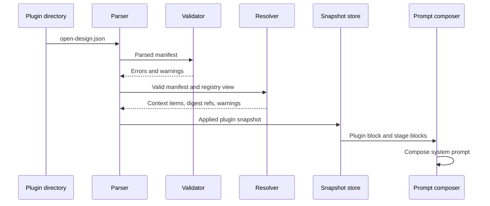
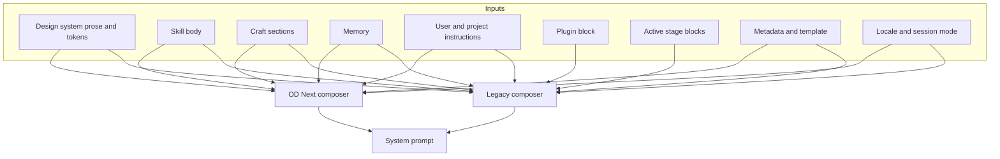

# 02 Core mechanism: prompt composition and plugin resolution

## Thesis

OpenDesign turns content into agent behavior in two stages. First, the prompt composer combines many inputs into one system prompt. Second, the plugin runtime turns a plugin manifest into typed context, a pipeline, and prompt blocks. The two stages meet in the daemon. The composer reads what the resolver produced.

This document explains the input surface and the early fork between two prompt implementations. It also explains the classic and slim variants, the ordering rules, and the manifest path from `open-design.json` to an agent prompt.

## The composition problem

A general agent needs a clear role, a task, a brand, a rendering method, and a quality bar. A single user message rarely contains all of these. OpenDesign injects them as a layered system prompt.

The layers can conflict. A skill can ask for a decorative hero. A design system can forbid gradients. A craft rule can require a readable type scale. A plugin can require a critique stage. The composer must establish precedence. The layer comment at `apps/daemon/src/prompts/system.ts:1-40` puts the design system above the skill. A token rule therefore outranks a skill layout rule. The composer must also keep the prompt stable enough for prompt caching.

The composer has more than 40 inputs. An input is one named field in `ComposeInput`. The destructuring at `system.ts:899-982` names 41 fields. The input interface is the contract between the daemon and the prompt text.

## The input surface

The `ComposeInput` interface contains these groups:

- Run identity: agent identifier, session mode, locale, execution profile.
- Skill: body, name, mode, modes.
- Design system: body, title, usage text, tokens, component manifest, fixture, pull index, import mode.
- Craft: body and section list.
- Memory: body and hooks.
- Metadata and template.
- Audio voice options.
- Critique configuration.
- Plugin block and active stage blocks.
- Stream format.
- User instructions and project instructions.
- Media execution and media defaults.
- Signals: freeform deck, deck framework mode, prompt core variant, media hint, platform hint.

The composer destructures these inputs at the top of the function. It then takes an early branch for the OpenDesign (OD) Next strategy recipe. The comment calls this the fork point.

```text
# apps/daemon/src/prompts/system.ts:899-982
export function composeSystemPrompt({
  odNextStrategyRecipe,
  agentId,
  planToolNote,
  skillBody,
  skillName,
  skillMode,
  skillModes,
  designSystemBody,
  designSystemTitle,
  designSystemUsageMd,
  designSystemTokensCss,
  designSystemComponentsManifest,
  designSystemFixtureHtml,
  designSystemPullIndex,
  designSystemImportMode,
  craftBody,
  craftSections,
  memoryBody,
  memoryHooks,
  metadata,
  template,
  audioVoiceOptions,
  audioVoiceOptionsError,
  critique,
  critiqueBrand,
  critiqueSkill,
  pluginBlock,
  activeStageBlocks,
  streamFormat,
  locale,
  sessionMode,
  userInstructions,
  projectInstructions,
  mediaExecution,
  byokMediaDefaults,
  executionProfile,
  freeformDeckSignal,
  deckFrameworkMode,
  promptCoreVariant,
  mediaHintSignal,
  platformHintSignal,
}: ComposeInput): string {
  // ── FORK POINT: two independent prompt implementations ──────────────────
  // Everything below this early return is the legacy stack; OD Next runs never
  // reach it. Their content comes from
  // `plugins/_official/scenarios/od-next-strategy/assets/**` plus the
  // TypeScript in `@open-design/contracts` `od-next-strategy.ts`, which is
  // where OD Next carries host runtime contracts. The two sides share no
  // composition floor, so a rule added below holds only for the runs that take
  // this branch, and eligibility is re-evaluated per run
  // (`../strategies/od-next/rollout.ts`). Read `docs/prompt-composition.md`
  // before changing prompt text on either side.
  if (odNextStrategyRecipe) {
    return composeOdNextStrategyRequestPromptV2(odNextStrategyRecipe, {
      agentId,
      // The plan-tool fact has to cross the fork with everything else. Without
      // it an OD Next run keeps the pre-fix behaviour the slim charter no
      // longer has: a plan step whose tool is never named, and a sanctioned
      // prose branch to fall into instead. Resolved by the caller (see
      // `planToolNote` on ComposeInput) so this fork and its contracts mirror
      // stay byte-identical.
      planToolNote,
      sessionMode,
      locale,
      deckIntent: odNextStrategyRecipe.taskType !== 'ppt' && freeformDeckSignal === true,
      deckFrameworkMode,
      metadata,
      template,
      designSystemBody,
      designSystemTitle,
      designSystemUsageMd,
      designSystemTokensCss,
      designSystemComponentsManifest,
      designSystemFixtureHtml,
      designSystemPullIndex,
      designSystemImportMode,
      craftBody,
      craftSections,
      memoryBody,
      userInstructions,
      projectInstructions,
    });
  }
```

The v2 branch returns before any legacy code runs. The legacy stack is the code below the branch. The two stacks do not share a composition floor. A rule added to one stack does not affect the other.

The server decides which branch to take. It builds a system prompt input object. Then it chooses between the strategy core prompt and the classic composer.

```text
# apps/daemon/src/server.ts:11418-11420
    const prompt = odNextStrategyRecipe
      ? composeOdNextStrategyCorePromptV2(odNextStrategyRecipe)
      : composeSystemPrompt(systemPromptInputs);
```

This is a second fork. The strategy recipe can reach the v2 composer through two different entry points. The server calls `composeOdNextStrategyCorePromptV2` at `packages/contracts/src/prompts/od-next-strategy.ts:785-789`. That function calls `composeOdNextStrategyRequestPromptV2(input, {})`. The early return in `composeSystemPrompt` calls `composeOdNextStrategyRequestPromptV2` directly with extra fields. The daemon must keep the inputs and the branches consistent.

## The two prompt stacks

The legacy stack has a layered design. The documentation at the top of `system.ts` lists the layers.

1. The official designer prompt. This prompt defines identity, workflow, and content philosophy.
2. The discovery and planning layer. This layer adds question forms, direction picks, brand extraction, TodoWrite reinforcement, critique, and a direction library.
3. The active design system. The `DESIGN.md` prose and tokens are authoritative.
4. The active skill. The `SKILL.md` body defines the method for the artifact type.
5. The deck framework directive for deck runs. It is pinned last so it overrides softer slide rules.

The v2 stack uses a strategy recipe and plugin assets. It sends a canonical Extensible Markup Language (XML) tree, not the legacy Markdown string. The server comment at `apps/daemon/src/server.ts:11421-11424` says the tree has a cache-stable head and a per-task identity.

A reader must not assume that a rule in the legacy stack applies to a v2 run. The code comments say this directly. The two stacks are independent implementations.

## Classic and slim variants

Within the legacy stack there are two prompt core variants. The `classic` variant keeps the layered composition. The `slim` variant collapses the discovery layer, the designer charter, and the tail overrides into one charter document.

The slim variant exists to improve prompt caching. A stable prefix can be reused across conversations. The ordering comment explains the rule.

```text
# apps/daemon/src/prompts/system.ts:1021-1046
  const parts: string[] = isSlimCharterHead
    ? [
        ...(streamFormat === 'plain' ? [API_MODE_OVERRIDE, '\n\n---\n\n'] : []),
        renderSlimCoreCharter(
          executionProfile ?? executionProfileFromStreamFormat(streamFormat),
        ),
        '\n\n---\n\n',
      ]
    : isSlimCore && isAskModeEarly
      ? [
          // Ask mode on a plain stream still leads with the API override so
          // its "overrides every rule below" scope covers the chat charter,
          // matching classic's authority order (API before CHAT).
          ...(streamFormat === 'plain' ? [API_MODE_OVERRIDE, '\n\n---\n\n'] : []),
          CHAT_MODE_OVERRIDE,
          '\n\n---\n\n',
          PROMPT_INJECTION_RESISTANCE,
          '\n\n---\n\n',
        ]
      : isSlimCore
        ? [
            // Slim MEDIA runs (non-ask): no design charter and no Ask charter
            // either — CHAT_MODE_OVERRIDE forbids creating media, which would
            // contradict the media-generation contract appended below as the
            // sole workflow authority. Keep classic's skeleton: API override
            // first on plain streams, then injection resistance.
```

The snippet shows only the slim branches. It is cut before the closing brackets, so the classic branch is not shown. The order is a security decision as well as a cache decision. In the classic stack, the layer comment puts the API override and the injection resistance before the content layers. In the slim design stack, the static charter comes first. The charter embeds the security section. In slim ask mode, the ask override comes first. In plain streams, the Application Programming Interface (API) mode override comes before the charter.

The code comments call the slim ask order "identity-first". The order keeps the document hierarchy consistent: top-level heading first, second-level sections after.

The slim variant has three heads, not three variants. The heads are design, ask, and media. They are not cosmetic. They change which instruction has authority. A later block can override an earlier block only when the earlier block permits it. The API override says that later instructions are overridden. Its position must be early enough to cover the charter.

## Execution profile

The execution profile changes the prompt and the output contract. A `filesystem` run can write project files. A `text_artifact` run returns one complete artifact block.

```text
# packages/contracts/src/execution-profile.ts:1-7
export type ExecutionProfile = 'filesystem' | 'text_artifact';

export function executionProfileFromStreamFormat(
  streamFormat: string | null | undefined,
): ExecutionProfile {
  return streamFormat === 'plain' ? 'text_artifact' : 'filesystem';
}
```

Only the `plain` stream format gets the text profile. A plain stream has no structured tool events. The daemon cannot observe file writes. The prompt must ask for one block.

The profile is an input to the slim charter renderer. It changes the charter text. The profile also changes the workflow section. The same run can thus receive a different file contract without a different skill.

## The design-system input

The design system contributes several kinds of text:

- The `DESIGN.md` prose.
- The token Cascading Style Sheets (CSS) file.
- The component manifest.
- A fixture document.
- A pull index.
- The import mode.
- The usage text.

The daemon can also pass the design-system identifier and a digest. The digest is useful for cache keys and telemetry. The composer treats the design system as authoritative. The skill must map its layout to the design tokens, not invent new tokens.

The Stripe manifest showed how a package declares its files and import mode. The import mode changes the guidance. A normalized package expects the agent to use the provided tokens. A different mode can expect the agent to pull values from a source.

## The skill input

The skill contributes a body and metadata. The metadata includes the mode, the surface, the platform, the scenario, the preview type, and the craft requirements.

The daemon finds a skill by identifier. The registry reads the user root first and the built-in root second. The first root wins on an identifier collision. This lets a user shadow a built-in skill without deleting it.

```text
# apps/daemon/src/skills.ts:232-263
export async function listSkills(
  skillsRoots: string | readonly string[],
  options: ListSkillsOptions = {},
): Promise<SkillInfo[]> {
  const roots = Array.isArray(skillsRoots) ? skillsRoots : [skillsRoots];
  const out: SkillInfo[] = [];
  const seenIds = new Set<string>();
  for (let rootIdx = 0; rootIdx < roots.length; rootIdx += 1) {
    const skillsRoot = roots[rootIdx];
    if (!skillsRoot) continue;
    const source: SkillSource = rootIdx === 0 ? "user" : "built-in";
    let entries: Dirent[] = [];
    try {
      entries = await readdir(skillsRoot, { withFileTypes: true });
    } catch {
      continue;
    }
    for (const entry of entries) {
      if (!entry.isDirectory() && !entry.isSymbolicLink()) continue;
      const dir = path.join(skillsRoot, entry.name);
      const skillPath = path.join(dir, "SKILL.md");
      try {
        const stats = await stat(skillPath);
        if (!stats.isFile()) continue;
        const raw = await readFile(skillPath, "utf8");
        const { data: parsedData, body } = parseFrontmatter(raw) as {
          data: unknown;
          body: string;
        };
        const data = asSkillFrontmatter(parsedData);
        const parentId =
          typeof data.name === "string" && data.name ? data.name : entry.name;
```

The loader ignores a directory without `SKILL.md`. It also ignores a file that cannot be read. It does not stop the whole catalog for one bad entry. That behavior is important for a user-authored catalog.

The loader normalizes the mode, surface, platform, and scenario. A missing `od` block does not fail. The normalizer derives values from the body and the description. The calls are at `apps/daemon/src/skills.ts:286-288`, and they use optional chaining on `data.od`. This makes a plain Agent Skills folder usable without OD metadata.

A skill also carries hard constraints. The web prototype skill states them at the end of its body. The constraints are prompt rules, not renderer settings. The agent must obey them while it writes.

```text
# design-templates/web-prototype/SKILL.md:84-89
- **Single accent, used at most twice per screen.** Eyebrow + primary CTA is the default budget.
- **Display font is serif** (Iowan Old Style / Charter / Georgia in the seed). Sans for body. Mono for numerics, captions, eyebrows.
- **Real imagery, never remote hotlinks.** `.ph-img` is temporary layout scaffolding, not the default final treatment. For a named real-world referent, search/fetch the correct real image, copy it into the project, and reference it relatively; never generate, draw, or invent a substitute. For illustrative or atmospheric subjects, prefer suitable fetched real photography and use image generation only as a fallback. If no compliant asset can be acquired, keep an intentional labeled `.ph-img` and disclose the limitation in the delivery summary.
- **Preserve real-image geometry.** Inspect each acquired image's intrinsic width and height, replace the entire `.ph-img` scaffold with an ``, and set matching `width` and `height` attributes. Never copy `.ph-img`, `.wide`, `.portrait`, or `.square` onto a real image. Content images must show the full frame; `object-fit: cover` is only for intentionally croppable decorative fills. The seed's `.content-img` rule bounds unusually tall or wide images to the viewport while keeping the other axis automatic.
- **Mobile reflow already works** via the seed's media query at 920px. Don't break it by adding fixed widths.
- **`data-od-id` on every `<section>`** so comment mode can target it.
```

## The craft input

Craft files are short, reusable design rules. Examples are typography, color, and anti-slop. A skill or a design system can request them.

The resolver has a deck fallback. A deck run always gets typography, even when no skill declares it. The reason is a concrete rendering defect from the source comment. Chinese headings can use Latin poster leading and overlap. Poster leading is the large line spacing that display type uses.

```text
# apps/daemon/src/craft.ts:45-69
export function resolveCraftRequirements({
  isWebCloneRun = false,
  metadataKind,
  skillModes,
  freeformDeckSignal = false,
  skillRequires = [],
  designSystemApplies = [],
  designSystemExemptions = [],
}: ResolveCraftRequirementsInput): string[] {
  if (isWebCloneRun) return [];

  const modes = new Set(normalizeCraftSlugs(skillModes));
  const isDeckProject = metadataKind === "deck" || modes.has("deck");
  const isFreeformDeck =
    modes.size === 0
    && (!metadataKind || metadataKind === "other")
    && freeformDeckSignal;
  const requested = normalizeCraftSlugs([
    ...skillRequires,
    ...designSystemApplies,
    ...(isDeckProject || isFreeformDeck ? ["typography"] : []),
  ]);
  const excluded = new Set(normalizeCraftSlugs(designSystemExemptions));
  return requested.filter((slug) => !excluded.has(slug));
}
```

A web clone run gets no craft sections. A web clone run copies an existing site instead of authoring a new design. The clone must copy the source, not apply the product's taste. A deck project or a skill with mode `deck` gets typography. A freeform deck gets typography when no skill mode exists and the freeform signal is true.

The loader reads each requested file. It validates the slug. It prefixes a level-three heading. It joins sections with a horizontal rule.

```text
# apps/daemon/src/craft.ts:78-103
export async function loadCraftSections(craftDir: string, requested: unknown[]) {
  if (!craftDir || !Array.isArray(requested) || requested.length === 0) {
    return { body: "", sections: [] };
  }
  const seen = new Set<string>();
  const parts: string[] = [];
  const sections: string[] = [];
  for (const raw of requested) {
    if (typeof raw !== "string") continue;
    const slug = raw.trim().toLowerCase();
    if (!SLUG_RE.test(slug) || seen.has(slug)) continue;
    seen.add(slug);
    try {
      const filePath = path.join(craftDir, `${slug}.md`);
      const text = await readFile(filePath, "utf8");
      const trimmed = text.trim();
      if (!trimmed) continue;
      parts.push(`### ${slug}\n\n${trimmed}`);
      sections.push(slug);
    } catch {
      // File doesn't exist or unreadable — skip silently. Skills can
      // forward-reference future craft sections without breaking.
    }
  }
  return { body: parts.join("\n\n---\n\n"), sections };
}
```

A missing file is silent. A skill can name a future section. The run still works. The returned `sections` list lets the caller record what was actually included.

## Memory and instructions

Memory is a separate body. It carries remembered preferences and facts. User instructions are the user's own rules. Project instructions are the project's rules.

The prompt order puts conversation-stable content before turn-variable content. The layer list in "The two prompt stacks" is that order. The order improves caching. It also gives a clear authority order. A project rule should not silently disappear under a later generated block.

## The plugin block and the pipeline

A plugin can add a `pluginBlock`. It can also add active stage blocks. A stage block is the prompt text for one pipeline stage. The daemon selects the active stage and passes its block.

The stage blocks are separate from the plugin block. The plugin block describes the workflow. The stage block describes the current step. This separation lets the daemon advance the pipeline without recomposing the whole plugin.

The scenario manifest showed the pipeline shape. Each stage has an identifier and an atom list. A repeat stage has an `until` expression. The validator requires the expression when `repeat` is true. The expression text is data. This exploration did not find the evaluator that reads it. The daemon selects the active stage and builds its blocks at `apps/daemon/src/server.ts:11155-11199`.

## The plugin manifest path

A plugin starts as a directory with `open-design.json`. The daemon reads the file and parses it. The parser first parses JavaScript Object Notation (JSON). Then it validates the object with a Zod schema.

```text
# packages/plugin-runtime/src/parsers/manifest.ts:25-56
export function parseManifest(raw: string): ManifestParseResult {
  let json: unknown;
  try {
    json = JSON.parse(raw);
  } catch (err) {
    return {
      ok: false,
      warnings: [],
      errors: [`open-design.json is not valid JSON: ${(err as Error).message}`],
    };
  }
  return parseManifestObject(json);
}

export function parseManifestObject(value: unknown): ManifestParseResult {
  const result = PluginManifestSchema.safeParse(value);
  if (!result.success) {
    return {
      ok: false,
      warnings: [],
      errors: result.error.issues.map((issue) => `${issue.path.join('.') || '<root>'}: ${issue.message}`),
    };
  }
  return {
    ok: true,
    manifest: {
      specVersion: OPEN_DESIGN_PLUGIN_SPEC_VERSION,
      ...result.data,
    },
    warnings: [],
  };
}
```

The schema is permissive for unknown fields. A future field survives a parse. The parser sets the current specification constant first. The spread of the parsed data comes second. A declared `specVersion` therefore wins, because the spread overwrites the constant. A manifest without the field gets the constant. The schema marks the field optional at `packages/contracts/src/plugins/manifest.ts:140-142`.

The validator adds cross-field rules. The schema cannot express these rules.

```text
# packages/plugin-runtime/src/validate.ts:43-62
export function validateSafe(manifest: PluginManifest): ValidateResult {
  const warnings: string[] = [];
  const errors: string[] = [];

  const od = manifest.od;
  if (od) {
    const stages = od.pipeline?.stages ?? [];
    for (const stage of stages) {
      if (stage.repeat && !stage.until) {
        errors.push(`pipeline.stages[${stage.id}]: repeat=true requires an 'until' expression`);
      }
    }

    const caps = od.capabilities ?? [];
    for (const cap of caps) {
      if (cap.startsWith('connector:')) continue;
      if (!KNOWN_CAPABILITIES.has(cap)) {
        warnings.push(`capability '${cap}' is not in the v1 vocabulary; doctor will surface this to the operator`);
      }
    }
```

A missing `until` is an error. An unknown capability is a warning. The difference is deliberate. A forward specification patch can add a capability without breaking existing installs. The warning text names "doctor". Doctor is the daemon diagnostic path that reports plugin health. The atom catalog at `apps/daemon/src/plugins/atoms.ts` lists each atom with a status field.

The validator also checks connector references and Model Context Protocol (MCP) references for Generative User Interface (GenUI) surfaces. A route that names a connector must name a declared connector. A route that names an MCP server must name a declared server.

## Context resolution

The resolver is pure. It receives a manifest and a registry view. It does not read the file system. It turns references into typed context items.

```text
# packages/plugin-runtime/src/resolve.ts:61-100
export function resolveContext(manifest: PluginManifest, opts: ResolveOptions): ResolveResult {
  const warnings: string[] = [];
  const items: ContextItem[] = [];
  const digestRefs: Array<{ kind: string; ref: string }> = [];

  const ctx = manifest.od?.context;
  const registry = opts.registry;

  if (ctx) {
    // Skills
    for (const ref of ctx.skills ?? []) {
      const id = (ref.ref ?? ref.path ?? '').trim();
      if (!id) continue;
      const skill = registry.skills.find((s) => s.id === id || s.id === stripDotSlash(id));
      if (!skill) {
        if (opts.warnOnMissing) warnings.push(`Unknown skill ref: '${id}'`);
        continue;
      }
      items.push({ kind: 'skill', id: skill.id, label: skill.title ?? skill.id });
      digestRefs.push({ kind: 'skill', ref: skill.id });
    }

    // Design system
    if (ctx.designSystem) {
      const dsRef = ctx.designSystem;
      const explicitRef = typeof dsRef.ref === 'string' ? dsRef.ref.trim() : '';
      if (explicitRef) {
        const ds = registry.designSystems.find((d) => d.id === explicitRef);
        if (ds) {
          items.push({ kind: 'design-system', id: ds.id, label: ds.title ?? ds.id, primary: true });
          digestRefs.push({ kind: 'design-system', ref: ds.id });
        } else if (opts.warnOnMissing) {
          warnings.push(`Unknown design-system ref: '${explicitRef}'`);
        }
      } else if (registry.activeProjectDesignSystem) {
        const ds = registry.activeProjectDesignSystem;
        items.push({ kind: 'design-system', id: ds.id, label: ds.title ?? ds.id, primary: true });
        digestRefs.push({ kind: 'design-system', ref: ds.id });
      }
    }
```

A missing reference is a warning when `warnOnMissing` is true. The daemon prefers warnings. The web preview prefers a strict drop. A strict drop discards the item instead of warning about it. The resolver returns both the items and a flat digest list.

The digest list includes pipeline atoms. A stage can add an atom that is not in the context list. The digest must still change when the pipeline changes. That prevents two different manifests from sharing a cache key.

The resolver handles skills, design systems, craft, assets, MCP servers, Claude plugins, and atoms. An asset path stays as given. The resolver does not check it. `buildAssetRefs` copies the string and marks it `stageAt: 'run-start'` at `apps/daemon/src/plugins/apply.ts:312-319`. This exploration did not confirm a later asset path validator. An MCP item carries a name and an optional command. A Claude plugin item carries an identifier.

## The Claude plugin adapter

OpenDesign can install a Claude Code plugin folder. The adapter reads `.claude-plugin/plugin.json` and synthesizes an OD manifest. The adapter is intentionally small.

```text
# packages/plugin-runtime/src/adapters/claude-plugin.ts:23-72
export function adaptClaudePlugin(
  rawJson: string,
  opts: ClaudePluginAdapterOptions,
): ClaudePluginAdapterResult {
  const warnings: string[] = [];
  let parsed: unknown;
  try {
    parsed = JSON.parse(rawJson);
  } catch (err) {
    return {
      manifest: synthesizeFallback(opts.folderId, opts.compatPath ?? './.claude-plugin/plugin.json'),
      warnings: [`Failed to parse .claude-plugin/plugin.json: ${(err as Error).message}`],
    };
  }

  if (!parsed || typeof parsed !== 'object' || Array.isArray(parsed)) {
    return {
      manifest: synthesizeFallback(opts.folderId, opts.compatPath ?? './.claude-plugin/plugin.json'),
      warnings: ['.claude-plugin/plugin.json must be a JSON object'],
    };
  }
  const obj = parsed as Record<string, unknown>;
  const compatPath = opts.compatPath ?? './.claude-plugin/plugin.json';
  const name = typeof obj['name'] === 'string' && obj['name'].trim().length > 0
    ? obj['name'].trim()
    : opts.folderId;
  const safeName = name.toLowerCase().replace(/[^a-z0-9._-]/g, '-').replace(/^[._-]+/, '') || opts.folderId;
  if (safeName !== name) {
    warnings.push(`claude-plugin name '${name}' was sanitized to '${safeName}' to fit the OD plugin id pattern`);
  }
  const version = typeof obj['version'] === 'string' ? obj['version'] : '0.0.0';
  const description = typeof obj['description'] === 'string' ? obj['description'] : undefined;
  const commands = Array.isArray(obj['commands']) ? obj['commands'].length : 0;
  if (commands > 0) {
    warnings.push(`claude-plugin declares ${commands} command(s); v1 OD apply does not auto-register hooks. Add them via od.context.claudePlugins[].`);
  }
  const manifest: PluginManifest = {
    specVersion: OPEN_DESIGN_PLUGIN_SPEC_VERSION,
    name: safeName,
    title: typeof obj['title'] === 'string' ? obj['title'] : safeName,
    version,
    description: description ?? undefined,
    compat: { claudePlugins: [{ path: compatPath }] },
    od: {
      kind: 'skill',
      taskKind: 'new-generation',
    },
  };
  return { manifest, warnings };
}
```

The adapter does not map commands, agents, or hooks. It records the compatibility path. It sets the kind to `skill` and the task kind to `new-generation`. A plugin with commands gets a warning. This is a phase-one adapter, not a full compatibility layer.

## From manifest to prompt

The full path has these steps.

1. Read `open-design.json`.
2. Parse JSON and validate the schema.
3. Apply cross-field validation.
4. Adapt a Claude plugin if needed.
5. Resolve context references against the registries.
6. Build a plugin snapshot with a digest.
7. Select the pipeline and the active stage.
8. Compose the plugin block and the stage block.
9. Pass both blocks to the prompt composer.



The diagram shows the success path. A parse failure stops at the parser and returns errors. A validation failure stops at the validator and returns errors. The numbered list also has an adapter step. The diagram does not draw that step.

The snapshot is the durable form. A run refers to a snapshot, not to a live directory. A later edit to the plugin does not change an existing run. The snapshot is stored in the daemon database with a snapshot identifier and a source digest. A doctor pass marks a snapshot stale when its digest changes. That pass is at `apps/daemon/src/plugins/doctor.ts:171-187`. The digest changes when the resolved context changes.

The composer receives the plugin block and the active stage blocks as separate inputs. The legacy composer places them in the layer order. The v2 composer maps them into the strategy recipe. The two paths handle the same content but produce different prompt shapes.



The OD Next branch receives a subset of the legacy inputs. It does not receive the plugin block or the active stage blocks. It receives the strategy recipe, the design-system fields, the craft fields, memory, instructions, metadata, template, locale, and session mode.

## Aha

**Aha:** The two prompt stacks share no composition floor. This is not a refactoring detail. It is a product risk. A designer can fix a rule in the classic stack and see no change in an OD Next run. The code comment tells the reader to read `docs/prompt-composition.md` before editing either side. The most important prompt work is therefore coordination, not wording.

## Summary

The prompt composer combines run identity, content, memory, instructions, and plugin blocks. The legacy stack layers its content. The slim variant reorders it for caching. The OD Next branch replaces the whole stack. The plugin runtime parses, validates, resolves, and snapshots a manifest. The composer receives the result as a plugin block and stage blocks.

The next document, [03-workflow-and-quality.md](03-workflow-and-quality.md), follows one brief through the HyperText Transfer Protocol (HTTP) API, the run engine, the artifact manifest, the preview, and the quality gates. The [README index](README.md) lists all six documents.
