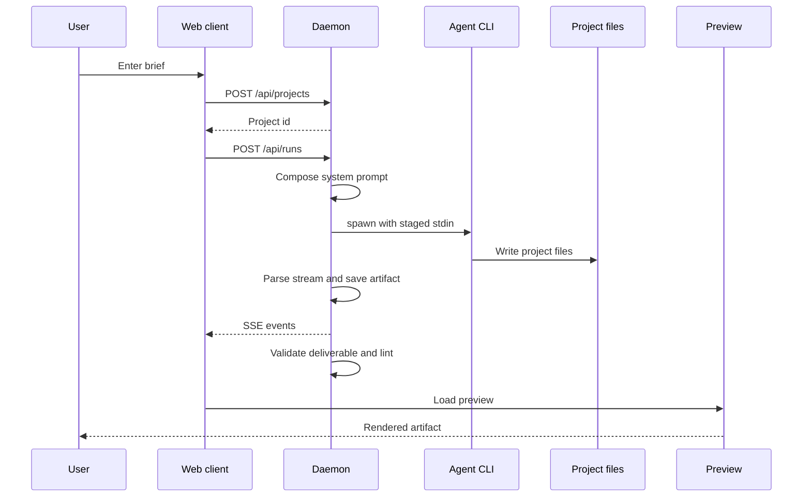
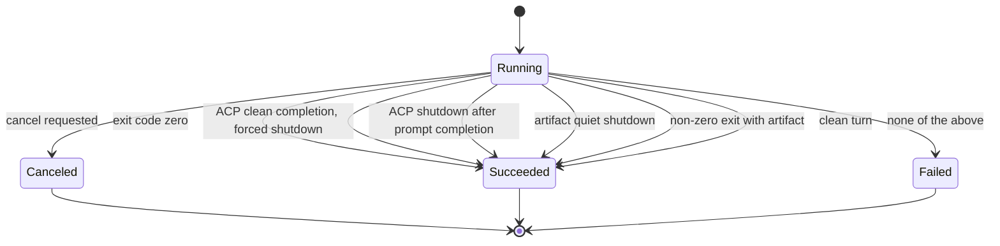

# 03 Workflow and quality: one brief to one preview

## Thesis

This document follows one run. A user types a brief in the web application. The web application creates a project. It creates a run. The daemon composes a prompt, starts an agent, reads the stream, saves the artifact, and serves a preview. Quality controls run at several points. The journey ends when the daemon saves an artifact and runs the deliverable check.

The document explains the close classifier and the separate deliverable check. The classifier calls a zero exit a success, even when no artifact exists. The deliverable check then reports whether a usable file exists.

## The cast

- The user. The user writes the brief and chooses a skill or plugin.
- The web client. The client sends HyperText Transfer Protocol (HTTP) requests and reads Server-Sent Events (SSE).
- The daemon. The daemon owns the project, the run, the prompt, the agent process, the artifact, and the preview.
- The agent. The agent is an external coding-agent Command Line Interface (CLI).
- The project directory. The directory holds the deliverables.
- The database. The database holds metadata and run state.

## Step 0: create the project

The web client calls `POST /api/projects`. The request contains an identifier, a name, an optional skill, an optional design system, metadata, custom instructions, and a discovery flag.

The route validates the identifier and the name. It also blocks privileged metadata fields.

```text
# apps/daemon/src/routes/project/index.ts:3936-3964
  app.post('/api/projects', async (req, res) => {
    try {
      // One request-wide deadline covers every asynchronous read before the
      // transaction. Resetting a full timeout for each stage would still let a
      // sequence of merely slow reads outlive the Web's optimistic route.
      const projectCreatePreparationDeadline =
        Date.now() + projectCreatePreparationTimeoutMs;
      // A complete Workspace attribution must still name a currently active
      // member before we bind the new private project to that Workspace.
      // Headerless/partial local creates remain unbound.
      const createWorkspace = {
        context: await resolveCreatedProjectHome(req),
      };
      learnAssertedWorkspaceType(createWorkspace.context);
      const { id, name, projectLocationId, skillId, designSystemId, pendingPrompt, metadata, customInstructions, skipDiscoveryBrief } =
        req.body || {};
      if (typeof id !== 'string' || !isSafeId(id)) {
        return sendApiError(res, 400, 'BAD_REQUEST', 'invalid project id');
      }
      const requestedConversationId = req.body?.conversationId;
      if (
        requestedConversationId !== undefined
        && (typeof requestedConversationId !== 'string' || !isSafeId(requestedConversationId))
      ) {
        return sendApiError(res, 400, 'BAD_REQUEST', 'invalid conversation id');
      }
      if (typeof name !== 'string' || !name.trim()) {
        return sendApiError(res, 400, 'BAD_REQUEST', 'name required');
      }
```

The route also rejects `metadata.baseDir`, `metadata.fromTrustedPicker`, and `metadata.orchestratorWorkspace`. Those fields belong to the import path or the working-directory path. A generic create request must not set them. The shown excerpt stops before those checks. The checks are at `apps/daemon/src/routes/project/index.ts:3966-3990`.

The project row stores the skill, the design system, the custom instructions, and the metadata. The project directory is created under the projects root. It is the future working directory for the agent. The run workspace is separate. It lives under the data root.

## Step 1: create the run

The web client calls `POST /api/runs`. The request contains the project identifier, the conversation identifier, the prompt, the agent identifier, the skill, the design system, and optional run options.

The route checks daemon shutdown, submission identity, media policy, tool bundle, and Bring Your Own Key (BYOK) configuration. The media policy and the tool bundle are run options from the request. Their exact contents are outside the shown excerpt.

```text
# apps/daemon/src/routes/runs.ts:1412-1438
  const handleRunCreate = async (req: ApiRequest, res: ApiResponse, stream = false) => {
    if (ctx.lifecycle.isDaemonShuttingDown()) {
      return sendApiError(res, 503, 'UPSTREAM_UNAVAILABLE', 'daemon is shutting down');
    }
    const requestBody = toJsonRecord(req.body);
    const submission = requestBody.submission as { id?: unknown; source?: unknown } | undefined;
    if (submission !== undefined && (!submission || typeof submission.id !== 'string'
      || !isSafeId(submission.id) || !['user', 'system', 'queue'].includes(String(submission.source)))) {
      return sendApiError(res, 400, 'BAD_REQUEST', 'invalid submission');
    }
    const requestAnalyticsContext = readAnalyticsContext(req);
    const mediaExecution = parseMediaExecutionPolicyInput(requestBody.mediaExecution);
    if (!mediaExecution.ok) {
      return sendApiError(res, 400, 'BAD_REQUEST', mediaExecution.message);
    }
    const toolBundle = parseRunToolBundleForRequest(requestBody.toolBundle);
    if (!toolBundle.ok) {
      return sendApiError(res, 400, 'BAD_REQUEST', toolBundle.message);
    }
    if (!hasCompleteByokOpenCodeConfig(requestBody)) {
      return sendApiError(
        res,
        400,
        'VALIDATION_FAILED',
        BYOK_OPENCODE_PROVIDER_REQUIRED_MESSAGE,
      );
    }
```

Later checks cover conversation ownership, project authorization, design-system enrichment conflicts, strategy handoff, and workspace scope. A strategy handoff is a request that continues a previous strategy task. The handler resolves the effective agent identifier when the request omits one. It calls `detectAgents` and uses the first available agent in registry order.

The run response contains the run identifier, the conversation identifier, the assistant message identifier, the stream Uniform Resource Locator (URL), and status fields. The client uses those identifiers to subscribe.

## Step 2: compose the prompt

The run engine loads the project, the skill, the design system, the craft sections, the memory, the instructions, the plugin block, and the active stage blocks. It builds a `systemPromptInputs` object. The object names the agent, the skill body, the design-system body and tokens, the craft body, the memory, the instructions, and the metadata.

Then the server chooses the prompt implementation.

```text
# apps/daemon/src/server.ts:11418-11420
    const prompt = odNextStrategyRecipe
      ? composeOdNextStrategyCorePromptV2(odNextStrategyRecipe)
      : composeSystemPrompt(systemPromptInputs);
```

The legacy composer combines the layers. The slim variant can reorder the head for caching. The OpenDesign (OD) Next branch uses a strategy recipe.

The prompt is not sent as a command-line argument. It is written to a private file and passed as standard input. The next step explains that handoff.

## Step 3: start the agent

The daemon resolves the launch path, builds the environment, and opens the run workspace. It stages the prompt as a file. It starts the child process.

```text
# apps/daemon/src/runtimes/agent-process.ts:276-315
export function spawnAgentProcess(request: SpawnAgentProcessRequest): SpawnedAgentProcess {
  const detached = process.platform !== 'win32';
  const staged = typeof request.stdin === 'object'
    ? openCompletePromptAsStdin(request.runDir, request.stdin.prompt)
    : null;
  const stdin = staged ? staged.fd : (request.stdin as 'pipe' | 'ignore');
  const spawnedAtMs = Date.now();
  let child: ChildProcess;
  try {
    child = spawn(request.command, [...request.args], {
      env: request.env,
      stdio: [stdin, 'pipe', 'pipe'],
      cwd: request.cwd,
      shell: false,
      detached,
      // Required when invocation wraps a Windows .cmd/.bat shim through
      // cmd.exe; without this, Node re-escapes the inner command line and
      // breaks paths containing spaces (issue #315).
      windowsVerbatimArguments: request.windowsVerbatimArguments,
    });
  } finally {
    staged?.releaseAfterSpawn();
  }
  const spawnReturnedAtMs = Date.now();
  if (staged) {
    // Windows cannot always unlink a file the child still holds open.
    child.once('close', staged.remove);
    child.once('error', staged.remove);
  }
  const processGroupId = detached && typeof child.pid === 'number' ? child.pid : null;
  recordAgentProcessUntilGroupExits(child, {
    processGroupId,
    runDir: request.runDir,
    runId: request.runId,
    launchPath: request.command,
    spawnedAtMs,
    spawnReturnedAtMs,
  });
  return { child, processGroupId, promptDeliveredAtSpawn: staged != null };
}
```

The child working directory is the project directory. The run workspace is a separate directory under the data root. It holds the staged prompt and the process record. The child also receives extra allowed directories. Those directories let the agent read the skill assets and the design-system files outside the project root. The runtime definition turns them into flags such as `--add-dir`.

The daemon records the process group. Cancellation signals the group, not only the direct child. A wrapper script can start another process. The group signal reaches that process too.

## Step 4: read the stream

The runtime definition declares a stream format. The daemon selects a parser for that format. The parser converts raw bytes into structured events. The events flow to the database, the analytics layer, and the SSE stream. Each stream format has a parser module under `apps/daemon/src/runtimes/`.

A plain stream is different. The agent returns text. The daemon extracts one artifact block. That run uses the `text_artifact` profile.

The stream can contain tool calls, tool results, assistant text, reasoning, usage records, and errors. The daemon must separate agent progress from its own bookkeeping. A close event that the daemon writes is not agent progress.

The close classifier uses the turn state and the artifact state.

```text
# apps/daemon/src/runtimes/chat-run-lifecycle.ts:67-101
export function classifyChatRunCloseStatus(params: {
  cancelRequested: boolean;
  code: number | null;
  signal: NodeJS.Signals | string | null;
  acpCleanCompletion: boolean;
  /** The daemon began terminating this ACP attempt after its prompt completed. */
  acpCompletionShutdownRequested?: boolean;
  artifactQuietShutdownRequested: boolean;
  turnCompletedCleanly: boolean;
  artifactProducedThisRun: boolean;
}): 'canceled' | 'succeeded' | 'failed' {
  if (params.cancelRequested) return 'canceled';
  if (params.code === 0) return 'succeeded';
  const acpForcedShutdown =
    params.acpCleanCompletion &&
    (
      (params.code === null && params.signal === 'SIGTERM') ||
      (params.code === 130 && params.signal === null)
    );
  if (acpForcedShutdown) return 'succeeded';
  // Once the daemon itself is shutting down a completed attempt, the exit
  // status reflects that shutdown, not the turn: Windows reports a child
  // killed by pid as code 1 with no signal.
  if (params.acpCleanCompletion && params.acpCompletionShutdownRequested) return 'succeeded';
  const artifactQuietShutdown =
    params.artifactQuietShutdownRequested &&
    params.code === null &&
    (params.signal === 'SIGTERM' || params.signal === 'SIGKILL');
  if (artifactQuietShutdown) return 'succeeded';
  if (params.code != null && params.code !== 0 && params.artifactProducedThisRun) {
    return 'succeeded';
  }
  if (params.turnCompletedCleanly) return 'succeeded';
  return 'failed';
}
```

A non-zero exit with an artifact is a success. A clean turn is a success. A forced shutdown after a clean Agent Client Protocol (ACP) completion is a success. A cancel is a cancel. A zero exit returns success before any artifact check, so a zero exit with no artifact is still a success.

The classifier is a policy, not a process fact. It encodes the product's judgment about what the user received.

The Claude stream needs extra bookkeeping. A terminal turn event closes standard input. An error result frame ends the turn, but it must not mark the turn clean.

```text
# apps/daemon/src/runtimes/chat-run-lifecycle.ts:114-148
export function applyClaudeStreamJsonRunBookkeeping(
  run: ClaudeStreamJsonBookkeepingRun,
  ev: unknown,
) {
  if (!ev || typeof ev !== 'object') return;
  const event = ev as {
    type?: unknown;
    name?: unknown;
    id?: unknown;
    stopReason?: unknown;
    isError?: unknown;
  };

  const terminalTurn =
    (event.type === 'turn_end' && event.stopReason !== 'tool_use') ||
    (event.type === 'usage' && event.stopReason !== 'tool_use');
  if (!terminalTurn) return;

  // An error termination (is_error result frame) ends the turn — stdin must
  // still close — but it is NOT a clean completion: marking it clean lets
  // classifyChatRunCloseStatus translate the CLI's non-zero exit into
  // 'succeeded' and the failure never reaches the user. A SessionEnd-hook
  // non-zero exit after a normal result (#3373) carries no isError flag and
  // keeps taking the clean path.
  const errorTermination = event.type === 'usage' && event.isError === true;
  if (!errorTermination) {
    run.turnCompletedCleanly = true;
  }
  if (run.stdinOpen) {
    if (run.child?.stdin && !run.child.stdin.destroyed) {
      try { run.child.stdin.end(); } catch {}
    }
    run.stdinOpen = false;
  }
}
```

This code shows a subtle failure mode. If an error frame marked the turn clean, the classifier would turn a non-zero exit into a success. The user would never see the error. The code prevents that.

## Step 5: save the artifact

An artifact is a project file with metadata. The metadata is the artifact manifest. The manifest states the kind, the renderer, the entry file, the exports, the status, and the supporting files.

The manifest contract is bounded. It has a fixed version, a set of allowed kinds, a set of allowed renderers, a set of allowed export formats, and a set of allowed status values.

```text
# apps/daemon/src/artifacts/manifest.ts:22-47
const ALLOWED_KINDS = new Set<string>([
  'html',
  'deck',
  'react-component',
  'markdown-document',
  'svg',
  'diagram',
  'code-snippet',
  'mini-app',
  'design-system',
]);

const ALLOWED_RENDERERS = new Set<string>([
  'html',
  'deck-html',
  'react-component',
  'markdown',
  'svg',
  'diagram',
  'code',
  'mini-app',
  'design-system',
]);

const ALLOWED_EXPORTS = new Set<string>(['html', 'pdf', 'zip', 'jsx', 'md', 'svg', 'txt']);
const ALLOWED_STATUS = new Set<string>(['streaming', 'complete', 'error']);
```

The validator rejects an unknown kind or renderer. It rejects an empty export list, an unknown export format, an unknown status, and a non-plain metadata object. It rejects metadata larger than 16 kibibytes. The limit is `MAX_METADATA_BYTES = 16 * 1024` at `apps/daemon/src/artifacts/manifest.ts:10`. It also rejects path traversal and absolute paths in supporting files. Those checks are at `apps/daemon/src/artifacts/manifest.ts:70-81`. The shown excerpt covers kind and renderer.

```text
# apps/daemon/src/artifacts/manifest.ts:86-116
export function validateArtifactManifestInput(
  manifest: unknown,
  entry: unknown,
  options: ValidationOptions = {},
): ValidationResult {
  if (manifest == null) return { ok: true, value: null };
  if (!isPlainObject(manifest)) {
    return { ok: false, error: 'artifactManifest must be an object' };
  }

  const kindErr = validateBoundedString(manifest.kind, 'artifactManifest.kind', 64);
  if (kindErr) return { ok: false, error: kindErr };
  if (typeof manifest.kind !== 'string') {
    return { ok: false, error: 'artifactManifest.kind must be a string' };
  }
  if (!ALLOWED_KINDS.has(manifest.kind)) {
    return { ok: false, error: 'artifactManifest.kind is not allowed' };
  }

  const rendererErr = validateBoundedString(manifest.renderer, 'artifactManifest.renderer', 64);
  if (rendererErr) return { ok: false, error: rendererErr };
  if (typeof manifest.renderer !== 'string') {
    return { ok: false, error: 'artifactManifest.renderer must be a string' };
  }
  if (!ALLOWED_RENDERERS.has(manifest.renderer)) {
    return { ok: false, error: 'artifactManifest.renderer is not allowed' };
  }

  if (!Array.isArray(manifest.exports) || manifest.exports.length === 0) {
    return { ok: false, error: 'artifactManifest.exports must be a non-empty array' };
  }
```

The save function then normalizes the manifest. It sets the version, the title, the status, and the timestamps. It normalizes slashes in supporting file paths. It does not verify that those files exist.

```text
# apps/daemon/src/artifacts/manifest.ts:217-249
export function sanitizeManifest(
  manifest: JsonRecord,
  entry: string,
  options: ValidationOptions = {},
): JsonRecord {
  const now = new Date().toISOString();
  return {
    version: MANIFEST_VERSION,
    kind: manifest.kind,
    title: manifest.title || entry,
    entry,
    renderer: manifest.renderer,
    status: typeof manifest.status === 'string' && ALLOWED_STATUS.has(manifest.status) ? manifest.status : 'complete',
    exports: manifest.exports,
    primary:
      manifest.primary === true
        ? true
        : typeof manifest.primary === 'string'
          ? manifest.primary.replace(/\\/g, '/')
          : undefined,
    supportingFiles: Array.isArray(manifest.supportingFiles)
      ? manifest.supportingFiles.map((x) => String(x).replace(/\\/g, '/'))
      : undefined,
    createdAt: typeof manifest.createdAt === 'string' ? manifest.createdAt : now,
    updatedAt:
      options.preserveUpdatedAt && typeof manifest.updatedAt === 'string'
        ? manifest.updatedAt
        : now,
    sourceSkillId: manifest.sourceSkillId,
    designSystemId: manifest.designSystemId ?? undefined,
    metadata: manifest.metadata,
  };
}
```

A legacy file can lack a manifest. The daemon infers one from the extension and the file name. An `.html` file becomes `html` or `deck`. The deck rule checks for `deck`, `slides`, or `pitch` in the file name. A `.md` file becomes `markdown-document`. A `.svg` file becomes `svg`. The inferred manifest carries `metadata.inferred` set to true. The inference is a compatibility path, not a new contract.

The shared create helper resolves the manifest before it writes the file.

```text
# apps/daemon/src/artifacts/create.ts:55-67
export function resolveCreateArtifactManifest(input: CreateProjectArtifactInput): unknown {
  const manifest = input.artifactManifest !== undefined && input.artifactManifest !== null
    ? input.artifactManifest
    : inferLegacyManifest(input.name);
  if (manifest) {
    const validated = validateArtifactManifestInput(manifest, input.name);
    if (!validated.ok) {
      throw new ArtifactManifestInvalidError(validated.error);
    }
    return validated.value;
  }
  throw new ArtifactManifestRequiredError(input.name);
}
```

A file with no manifest and no safe inference fails. The error code is `ARTIFACT_MANIFEST_REQUIRED`. The daemon does not invent a default for an unknown type.

## Step 6: show the preview

The file viewer receives the artifact kind, the source, the project file list, and the active viewer modes. It decides between a URL load and an inline document. `UrlLoadDecision` is the argument object. Each field is a boolean fact about the source or the active viewer mode.

The decision function has a list of disqualifiers for the URL path. A bridge is an injected script that listens for viewer events or applies overrides. Host injection means that the host frame inserts that script into the document. A deck needs the deck bridge. Comment mode needs a comment bridge. Inspect mode, edit mode, the palette, and the tweaks template need host injection. A focus guard or a redirect guard needs injection unless the daemon serves the guard. A root-relative asset reference needs rewriting.

```text
# apps/web/src/components/file-viewer-render-mode.ts:104-137
export function shouldUrlLoadHtmlPreview(d: UrlLoadDecision): boolean {
  if (d.mode !== 'preview') return false;
  if (d.isDeck) return false;
  if (d.commentMode && !(d.urlCommentBridge || d.urlModeBridge)) return false;
  // Inspect needs the selection bridge injected via buildSrcdoc; a raw
  // URL-loaded iframe has no listener to apply per-element overrides.
  if (d.inspectMode) return false;
  if (d.editMode) return false;
  // Palette tweaks need the srcDoc-side bridge — `<iframe src=URL>` has
  // no parent-injected listener to recolor against.
  if (d.paletteActive) return false;
  // Draw can stay on the URL-loaded iframe once the raw preview route has
  // injected its snapshot bridge; otherwise fall back to srcDoc so capture
  // still has a bridge to talk to.
  if (d.drawMode && !d.urlSnapshotBridge) return false;
  // The class based tweaks template relies on the srcDoc tweaks bridge
  // emitting `od:tweaks-available` on mount; on the URL load path the bridge
  // is never injected, so the toolbar toggle would stay disabled even though
  // the artifact ships a `.tw-panel`.
  if (d.tweaksBridge) return false;
  if (d.forceInline) return false;
  if (d.needsLocalInteractionBridge) return false;
  if (d.needsSandboxShim && !d.urlSandboxGuard) return false;
  if (d.needsFocusGuard && !d.urlFocusGuard) return false;
  // A self-redirecting document needs the redirect-loop guard on whichever
  // transport owns the document, or the iframe can reload itself forever
  // (nexu-io/open-design#710).
  if (d.needsRedirectGuard && !d.urlRedirectGuard) return false;
  // Root-relative project asset refs only resolve after the srcDoc pipeline
  // normalizes them (normalizeRootRelativeProjectAssetRefs); the URL-load
  // path serves the document untouched and the browser 404s each asset.
  if (d.projectRootAssetRefs) return false;
  return true;
}
```

A simple single-file HyperText Markup Language (HTML) artifact with no bridges takes the URL path. A React prototype with many files also takes the URL path. A deck or an artifact with a tweaks panel takes the inline path.

The preview is not a proof of quality. It is a proof that the file can render. The next section covers the quality controls.

## Step 7: close the run and validate the deliverable

The daemon closes the run. It classifies the close status. It finalizes the run. It checks the canonical deliverable.

The deliverable check asks a specific question. Does the project hold a usable entry file for this run?

```text
# apps/daemon/src/run-deliverable-validation.ts:231-252
export async function validateRunDeliverable(
  input: ValidateRunDeliverableInput,
): Promise<RunDeliverableValidationResult> {
  const primary = await resolveDeliverable({ ...input, scope: 'run' });
  if (primary.valid || !input.allowIndependentOutput || !input.touchedPaths?.length
    || !['entry_missing', 'entry_not_touched', 'type_mismatch'].includes(primary.validation)) {
    return primary;
  }
  const independent = await resolveDeliverable({ ...input, scope: 'run', independentOutput: true });
  if (!input.allowMultipleOutputCandidates || input.touchedPaths.length < 2) return independent;
  // Validate every current-run candidate separately. A stable representative is
  // used by the existing entry/syntax surface; it does not prove Query coverage
  // or visual quality for the other deliverables and never changes project metadata.
  const candidates = [...new Set(input.touchedPaths)].sort();
  let representative: RunDeliverableValidationResult | undefined;
  for (const candidate of candidates) {
    const result = await resolveDeliverable({ ...input, touchedPaths: [candidate], scope: 'run', independentOutput: true });
    if (!result.valid) return result;
    representative ??= result;
  }
  return representative ?? independent;
}
```

The function has two scopes. The run scope asks whether this run delivered a file. The project scope asks whether the project has a usable file now. The shown excerpt uses run scope. The project scope exists in the resolver but is not shown. A canonical file is the entry file named by the manifest or the inference rule. An independent output is a different file that the same run wrote. A "continue" turn that changes nothing can fail the run scope while the project remains valid.

The check validates the declared entry, the file type, and readability. It can accept an independent output when the declared entry is missing. It can validate multiple candidates. It does not prove visual quality.

## Quality control: artifact lint

The artifact lint is a static scan of generated HyperText Markup Language (HTML). It looks for known low-quality patterns. Examples are purple gradients, trust gradients, and default indigo accents. A trust gradient is a two-stop blue or cyan gradient on a hero surface. The lint fix text names that pattern.

```text
# apps/daemon/src/lint-artifact.ts:120-147
export function lintArtifact(rawHtml: unknown): LintFinding[] {
  const out: LintFinding[] = [];
  if (typeof rawHtml !== 'string' || rawHtml.length === 0) return out;

  // Strip HTML comments before any pattern matching — comments often contain
  // pedagogical examples ("paste a `<section class="slide">` here") that
  // would otherwise fire false positives for the section / slide checks.
  const html = rawHtml.replace(/<!--[\s\S]*?-->/g, '');
  const lower = html.toLowerCase();

  // ── P0-1: purple gradient backgrounds ─────────────────────────────
  for (const hex of PURPLE_HEXES) {
    const re = new RegExp(
      `linear-gradient\\([^)]*${escapeRe(hex)}[^)]*\\)`,
      'i',
    );
    const m = re.exec(html);
    if (m) {
      out.push({
        severity: 'P0',
        id: 'purple-gradient',
        message: `Found a violet/purple gradient using ${hex} — anti-slop list says no.`,
        fix: 'Replace the gradient with a flat surface (var(--bg) or var(--surface)) or use the active accent at a single intensity, not in a gradient.',
        snippet: clip(m[0]),
      });
      break;
    }
  }
```

The lint removes comments before it scans. A comment can contain an example that would cause a false positive. The lint assigns a severity. `P0` means must fix. `P1` means should fix. `P2` means nice to have.

The findings are rendered as an `<artifact-lint>` block for the agent. The block asks for a corrected artifact in the next turn. The exact delivery channel is not shown in this excerpt. It does not ask for a separate explanation.

```text
# apps/daemon/src/lint-artifact.ts:519-537
export function renderFindingsForAgent(findings: LintFinding[]): string {
  if (findings.length === 0) return '';
  const sorted = [...findings].sort((a, b) => severity(a) - severity(b));
  const lines = [
    '<artifact-lint>',
    'The artifact you just produced has the following anti-slop / design-token issues.',
    `${findings.filter((f) => f.severity === 'P0').length} P0 (must fix), ${findings.filter((f) => f.severity === 'P1').length} P1 (should fix), ${findings.filter((f) => f.severity === 'P2').length} P2 (nice to have).`,
    'Re-emit a corrected `<artifact>` in your next turn — do not write a separate explanation; the user has the previous version already.',
    '',
  ];
  for (const f of sorted) {
    lines.push(`**[${f.severity}] ${f.id}** — ${f.message}`);
    lines.push(`  Fix: ${f.fix}`);
    if (f.snippet) lines.push(`  Snippet: \`${f.snippet}\``);
    lines.push('');
  }
  lines.push('</artifact-lint>');
  return lines.join('\n');
}
```

This format is deliberate. It gives the agent a structured task. It names the rule, the reason, the fix, and the source snippet. It keeps the user out of a long repair conversation.

## Quality control: critique and tests

The critique stage is part of a plugin pipeline. The default scenario has a critique stage with a repeat rule. Five panelists score the artifact: designer, critic, brand, accessibility, and copy. The composite score is weighted. The stage asks for critique until the score reaches 4 or the run reaches 3 rounds. The pipeline runner evaluates the `until` expression. The evaluator is not shown in this excerpt.

The critique feature has its own configuration. A skill can require it, opt in, opt out, or express no opinion. The configuration defaults to a 10-point scale, a threshold of 8.0, 3 rounds, and `enabled: false`. The plugin expression and the configuration are separate controls. The daemon rollout decides whether the feature runs.

The end-to-end suite uses Playwright for browser behavior and Vitest for other tests. The Playwright configuration has one Chromium project. It runs two workers by default. It retries once in continuous integration.

```text
# e2e/playwright.config.ts:16-33
export default defineConfig({
  testDir: './ui',
  // This is the functional config. Strict-visual specs (`visual-*.test.ts`)
  // are owned by `playwright.visual.config.ts` (its own `testMatch`,
  // snapshot/output settings, and the `playwright_visual` CI lane), so they
  // must never be picked up here — otherwise a bare `pnpm test:ui` or the
  // generic full-pool shard run would execute them without their visual
  // config. Excluding them at the config level keeps every functional
  // consumer (full pool, `test:ui*`, ui_p0 groups) aligned.
  testIgnore: ['visual-*.test.ts', 'workspace-depletion-sandbox.test.ts', 'api-security-view016.test.ts', 'workspace-free-concurrency-sandbox.test.ts', 'workspace-manual-retry-sandbox.test.ts', 'workspace-funding-sandbox.test.ts', 'qa-bill001.private.test.ts', 'workspace-notice-sandbox.test.ts', 'workspace-free-wallet-sandbox.test.ts', 'workspace-switch-billing-sandbox.test.ts', 'workspace-concurrency-sandbox.test.ts', 'workspace-concurrency-retry-sandbox.test.ts', 'workspace-api-wallet-sandbox.test.ts', 'workspace-api-wallet-readback-sandbox.test.ts', 'link-closure-sandbox.test.ts', 'link-f04-sandbox.test.ts', 'link-run013-sandbox.test.ts', 'link-run011-matrix-sandbox.test.ts', 'link-run003-latency-sandbox.test.ts', 'link-run012-checkout-sandbox.test.ts', 'link-run010-reconnect-sandbox.test.ts', 'link-run012-controlled-sandbox.test.ts'],
  outputDir: './ui/reports/test-results',
  timeout: Number(process.env.OD_PLAYWRIGHT_TIMEOUT) || 45_000,
  retries: process.env.CI ? 1 : 0,
  expect: {
    timeout: 10_000,
  },
  fullyParallel: process.env.OD_PLAYWRIGHT_FULLY_PARALLEL === '1',
  workers: parseWorkerCount(process.env.OD_PLAYWRIGHT_WORKERS),
```

The suite uses fake agents and isolated namespaces. A fake agent is a local script that plays an agent stream. An isolated namespace is an identifier from `OD_E2E_RUN_NAMESPACE` plus a worker index. That design lets a test control the agent stream without a real model. The browser test can then assert the User Interface (UI) behavior.

## The full sequence



The run can end in several states. The state diagram shows the close policy.



The classifier tests the rules in a fixed order. A cancel wins first. A zero exit wins next, before any artifact check. Then three shutdown rules follow. A non-zero exit with an artifact wins next. A clean turn is the last success rule.

The diagram is a policy view. The process may exit before the daemon has finished saving the artifact. The quiet period is the wait after an artifact registration. It equals `artifactQuietPeriodMs` when that value is positive. Otherwise it equals the inactivity timeout. The wait lets the daemon settle before it closes the run.

## Aha

**Aha:** A zero exit is always a success, even when no artifact exists. The artifact check only applies to a non-zero exit. That order is the surprise. A crashed or empty run with a zero exit still reports success. Only the separate deliverable validator reports that no usable file exists. This is why the close classifier and the deliverable validator are separate components. One judges the process. The other judges the result. A reader who assumes that success means a good artifact will misread the run record.

## Summary

A run moves through project creation, run creation, prompt composition, spawn, stream parsing, artifact saving, preview selection, and deliverable validation. Quality controls add artifact lint, critique, and end-to-end tests. The daemon uses several independent signals to decide whether the user received a result.

The next document, [04-limits-and-comparison.md](04-limits-and-comparison.md), explains the limits of this design, the failure modes, and a property comparison with other design tools. The [README index](README.md) lists all six documents.
