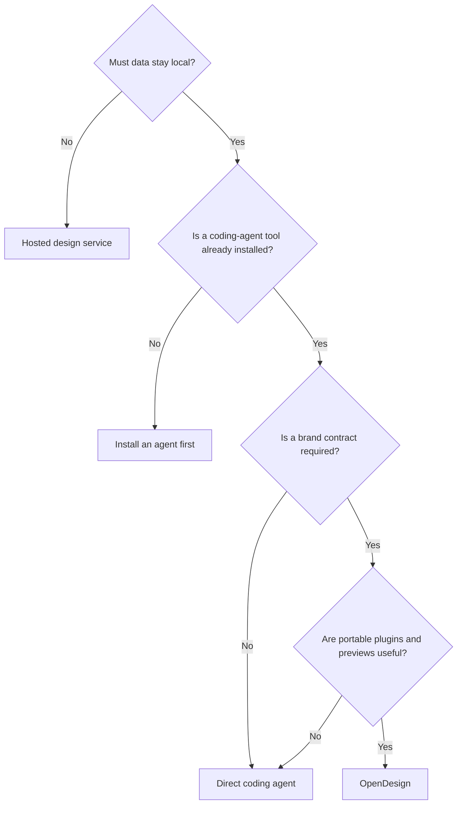
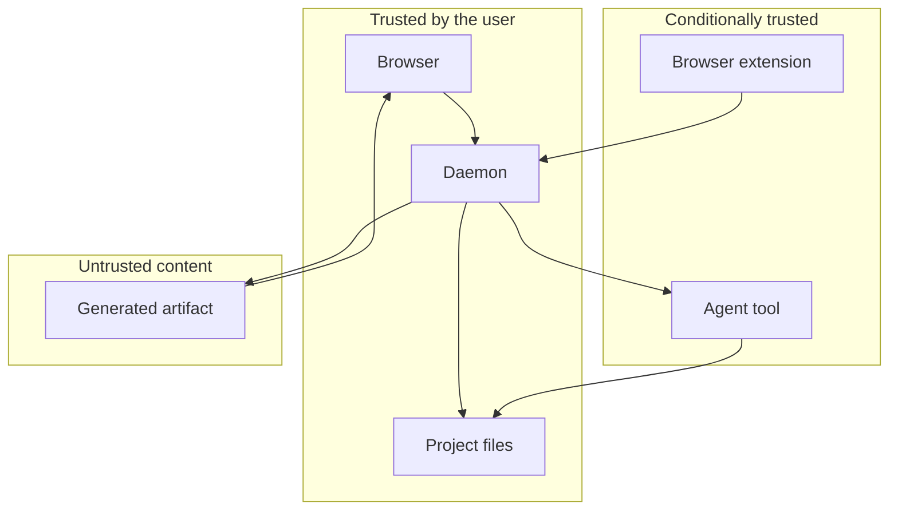

# 04 Limits and comparison

## Thesis

OpenDesign has a coherent design, but the design has costs. It does not own the model or the agent. It depends on the local environment. It keeps two prompt stacks in parallel. It trusts an agent that can run shell commands. Its content counts drift from its documentation. Its quality checks are heuristics, not proofs.

This document states those limits. It then compares the product with nearby categories on properties that the snapshot can support. It does not rank products that were not tested.

## Limit 1: no agent and no model

The README states the position directly. The agent is the design engine. OpenDesign supplies context and control.

```text
# README.md:237
- 🤖 **Agent-native, model-agnostic.** We don't ship an agent. The `claude` / `codex` / `cursor-agent` / `copilot` / `hermes` / `kimi` already on your `PATH` are the design engine. Swap with one click.
```

This is a product advantage and a product risk. The advantage is that the user keeps model choice, model billing, and model updates. The risk is that the product cannot guarantee the agent behavior. It cannot fix a model regression. It cannot control the agent's tool policy. It cannot ship a known model version.

The local build also needs a Node.js runtime for source use. The desktop build packages Node.js. The container packages Node.js. The user still needs an agent binary and credentials.

## Limit 2: environment drift

The runtime registry ships 27 definitions. Each definition describes an external binary. The binary can change its flags, its help text, its output format, or its authentication flow.

```text
# apps/daemon/src/runtimes/registry.ts:31-40
/**
 * The agents this build ships, before anything a particular machine adds.
 *
 * `AGENT_DEFS` below appends whatever local profiles the user has declared, so
 * it answers "what can this machine run" — a different question from "what do
 * we ship", and the wrong list for anything that must hold everywhere. A local
 * profile id is required not to collide with one of these (see
 * `createLocalAgentDef`), so it is always an id we have never heard of.
 */
export const SHIPPED_AGENT_DEFS: RuntimeAgentDef[] = [
```

A capability probe reduces the risk. The Claude definition probes `claude -p --help` and sets a flag only when the help text contains a known option. A hidden option is probed by value rejection. Value rejection passes a value that no build can accept. A build that knows the flag rejects the value. A build that does not know the flag rejects the option. The two errors differ, so the daemon can tell them apart without a model call. A new option is invisible until the definition adds it.

```text
# apps/daemon/src/runtimes/defs/claude.ts:55-66
    // `claude` has no list-models subcommand. Prefer local mmd/MMS routes
    // when present so proxy-backed Claude-compatible models appear in the
    // picker, then keep the built-in aliases as fallback hints.
    fallbackModels: CLAUDE_FALLBACK_MODELS,
    fetchModels: async (_resolvedBin, env) => loadMmdRouteModels(env, CLAUDE_FALLBACK_MODELS),
    // Prompt delivered via stdin to avoid both Linux `spawn E2BIG`
    // (MAX_ARG_STRLEN caps a single argv entry at ~128 KB) and Windows
    // `spawn ENAMETOOLONG` (CreateProcess caps the full command line at
    // ~32 KB direct, ~8 KB via .cmd shim). `claude -p` with no positional
    // prompt reads the prompt from stdin under `--input-format text` (the
    // default), which has no length cap. Mirrors the codex/gemini/opencode/
    // cursor/qwen entries below.
```

The stdin rule removes a size risk. It does not remove the drift risk. A fork can reject a flag. A vendor can rename a mode. An agent can change its stream schema. The definition must then change.

The 27-definition claim was verified. Verified here means that the source array has 27 entries. No definition was executed. The 26-distinct-executable claim was not verified. The registry can also add local profiles at runtime. A local profile is a user extension, not a tested path.

## Limit 3: two prompt stacks

The legacy stack and the OpenDesign (OD) Next stack share no composition floor. A rule can exist in one stack and not the other.

This is a maintenance limit. It is also a correctness limit. A designer who edits the legacy prompt can believe that the change applies to all runs. The code comment says it does not.

The project mitigates the limit with documentation. `docs/prompt-composition.md` describes the variant axes and the editing rules. Documentation reduces the risk. It does not remove the duplicate implementation.

The source comment is explicit about the split. It tells a reader that a rule added below the fork holds only for the legacy branch. It also points to the rollout code that decides which branch a run takes.

```text
# apps/daemon/src/prompts/system.ts:942-951
  // ── FORK POINT: two independent prompt implementations ──────────────────
  // Everything below this early return is the legacy stack; OD Next runs never
  // reach it. Their content comes from
  // `plugins/_official/scenarios/od-next-strategy/assets/**` plus the
  // TypeScript in `@open-design/contracts` `od-next-strategy.ts`, which is
  // where OD Next carries host runtime contracts. The two sides share no
  // composition floor, so a rule added below holds only for the runs that take
  // this branch, and eligibility is re-evaluated per run
  // (`../strategies/od-next/rollout.ts`). Read `docs/prompt-composition.md`
  // before changing prompt text on either side.
```

The classic and slim variants add a second axis. The same legacy stack can render in two orders. The order changes authority and cache behavior. A test of one variant does not prove the other.

## Limit 4: the agent trust boundary

The daemon starts the agent with the user's permissions. Several definitions add a permission bypass flag. The Claude definition adds `--permission-mode bypassPermissions` at `apps/daemon/src/runtimes/defs/claude.ts:116`.

The agent can run shell commands. It can read files outside the project root. The `--add-dir` flag adds paths to the agent's allowed set. It does not remove the user's broader authority. A sandbox around the artifact does not sandbox the agent.

The product's security model therefore depends on the user trusting the agent. The daemon can check its own paths. It can reject a project root that points into its data directory. It cannot make an untrusted agent safe.

The progress clock has a related limit. The progress clock is the timestamp of the last agent byte. The inactivity measure is the time since that byte. Its default limit is 10 minutes. The clock excludes daemon-made events. That design is correct for analytics. It also means a silent agent can look active only if it emits bytes, and a daemon-side close cannot reset the clock.

```text
# apps/daemon/src/runtimes/chat-run-lifecycle.ts:188-195
export function runtimeEmissionCountsAsAgentProgress(
  channel: string,
  meta?: { hostSynthesized?: boolean },
): boolean {
  if (channel === 'error') return false;
  if (meta?.hostSynthesized === true) return false;
  return true;
}
```

The local Application Programming Interface (API) is also a trust surface. The default bind is loopback. A local process can still call the API. The daemon adds peer, host, origin, and token checks for deployment. Loopback is not a defense against a malicious local program.

The browser clipper has broad host permissions. It can read every page. It sends data only to the local daemon by design. The extension's permissions are still broad.

```text
# clipper/manifest.json:7-8
  "permissions": ["scripting", "storage", "contextMenus", "tabs", "downloads"],
  "host_permissions": ["<all_urls>"],
```

The user must review those permissions before installing the extension.

## Limit 5: data root and sandbox mode

The data root is a single local directory. The default is `.od` under the installed package root. The package root is two levels above `apps/daemon`. It is not the project that the user edits. Sandbox mode requires an explicit directory.

```text
# apps/daemon/src/daemon-paths.ts:132-135
    if (options.requireExplicit) {
      throw new Error('OD_DATA_DIR is required when OD_SANDBOX_MODE is enabled');
    }
    return path.join(projectRoot, '.od');
```

The requirement reduces accidental writes. It does not create isolation. The directory still lives on the host file system. A user who runs the daemon as the same user as the agent gives the agent access to the data root.

A multi-user deployment needs more than this. It needs separate operating-system users, separate data roots, or container isolation. The local product assumes one trusted user on one machine.

## Limit 6: platform gaps

The README states that Linux has no prebuilt desktop artifact in the official release. Linux users can run from source or use the container. The container serves the web application, not the desktop shell.

The desktop shell has platform-specific behavior. The Codex launcher has a native binary search for each target triple. A target triple names a central processing unit (CPU) architecture and an operating system, such as `aarch64-apple-darwin`. The Windows path handling is separate. A feature that works on macOS can fail on Windows or Linux.

The snapshot has code for all three platforms. The exploration did not run any of them. Platform support cannot be verified from source alone.

The container also changes the bind address. It listens on all interfaces inside the container. A deployment must add authentication or put an authenticated proxy in front of it. The token path and the proxy path are alternatives, not layers. `deploy/README.md:17-25` states this rule.

```text
# deploy/Dockerfile:113-116
ENV NODE_ENV=production
ENV NODE_OPTIONS=--max-old-space-size=192
ENV OD_BIND_HOST=0.0.0.0
ENV OD_PORT=7456
```

The loopback default and the container default are different security postures. A reader must not assume that the local default applies in a container.

## Limit 7: plugin specification version 1

The plugin runtime is version 1. The validator knows eight base capabilities. An unknown capability becomes a warning, not an error. A connector capability uses a prefix and is exempt from the known set.

```text
# packages/plugin-runtime/src/validate.ts:20-29
const KNOWN_CAPABILITIES = new Set([
  'prompt:inject',
  'fs:read',
  'fs:write',
  'mcp',
  'subprocess',
  'bash',
  'network',
  'connector',
]);
```

The small vocabulary limits what a plugin can declare. It also limits what the daemon can enforce. A declared capability is metadata. This exploration found no component that enforces `fs:read`, `network`, or `bash` at run time. The agent's own permission model is the practical control.

The Claude plugin adapter is explicitly phase one. It maps name, version, description, and a compatibility path. It does not map commands, agents, or hooks.

```text
# packages/plugin-runtime/src/adapters/claude-plugin.ts:53-58
  const version = typeof obj['version'] === 'string' ? obj['version'] : '0.0.0';
  const description = typeof obj['description'] === 'string' ? obj['description'] : undefined;
  const commands = Array.isArray(obj['commands']) ? obj['commands'].length : 0;
  if (commands > 0) {
    warnings.push(`claude-plugin declares ${commands} command(s); v1 OD apply does not auto-register hooks. Add them via od.context.claudePlugins[].`);
  }
```

An existing Claude Code plugin can install. It can lose behavior in the conversion. The warning tells the user, but the warning does not restore the missing hooks.

## Limit 8: preview limits

The preview has two transports. Each has gaps.

The Uniform Resource Locator (URL) path cannot inject host bridges. The inline path needs the whole document in memory. That cost is memory and build time. The inline path cannot use normal per-asset caching or source maps in the same way. A large artifact can be expensive to build inline because the daemon serializes it into one string.

The preview needs guards for focus theft and redirect loops. The guards are heuristics. A false negative leaves a bad preview. A false positive sends a normal artifact to the inline path.

The powered preview increases the trust surface. It enables same-origin and cross-origin isolation for WebAssembly, Workers, or WebGL2.

```text
# apps/web/src/components/file-viewer-render-mode.ts:240-261
export function htmlNeedsPoweredPreview(source: string | null | undefined): boolean {
  if (!source) return false;
  // Web Storage stays in srcDoc: the host restores localStorage within the
  // workspace/member/project/file scope; sessionStorage remains document-local.
  // Hard requirement — SharedArrayBuffer only exists in a crossOriginIsolated
  // document, which ONLY the powered path provides.
  if (/\bSharedArrayBuffer\b/.test(source)) return true;
  // Web Workers / SharedWorker: external-file workers throw SecurityError at an
  // opaque origin; even blob workers commonly pair with storage/WASM here.
  if (/\bnew\s+(?:Worker|SharedWorker)\s*\(/.test(source)) return true;
  if (/\bimportScripts\s*\(/.test(source)) return true;
  // WASM streaming instantiation reads a same-origin .wasm the opaque origin
  // cannot fetch; and threaded WASM needs SAB.
  if (/\bWebAssembly\s*\.\s*(?:instantiateStreaming|compileStreaming)\b/.test(source)) return true;
  if (/\.wasm\b/.test(source)) return true;
  // WebGL2 / OffscreenCanvas / WebGPU — the modern rendering stack these
  // artifacts drive, usually from a worker.
  if (/getContext\s*\(\s*["'`]webgl2["'`]/.test(source)) return true;
  if (/\bOffscreenCanvas\b/.test(source)) return true;
  if (/\bnavigator\s*\.\s*gpu\b/.test(source)) return true;
  return false;
}
```

The heuristic is conservative. A mention of `.wasm` sends the artifact to the powered path. That is safer for the artifact and riskier for the host.

## Limit 9: quality claims are heuristics

The artifact lint finds known bad patterns. It does not judge layout, hierarchy, contrast, or content quality. It can miss a bad design that uses none of its patterns. It can flag a good design that uses a banned color for a valid reason.

The deliverable validator checks file existence, type, and readability. It does not check visual quality. The code comments say this explicitly.

The critique stage is a model judgment. It is not a deterministic test. The score scale is 0 to 10. The default threshold is 8.0. Five panelists score the artifact, and a weighted composite decides the result. The stage runs up to 3 rounds. A threshold score is a model opinion. A model can approve a weak artifact. The feature is disabled by default in the shipped configuration.

The end-to-end tests are the strongest evidence of behavior. They use fake agents. They prove the plumbing, not the design quality.

The functional Playwright configuration also excludes many suites. A passing functional run does not cover the visual suites or the sandbox suites. Those suites need their own configuration and their own lanes.

```text
# e2e/playwright.config.ts:25
  testIgnore: ['visual-*.test.ts', 'workspace-depletion-sandbox.test.ts', 'api-security-view016.test.ts', 'workspace-free-concurrency-sandbox.test.ts', 'workspace-manual-retry-sandbox.test.ts', 'workspace-funding-sandbox.test.ts', 'qa-bill001.private.test.ts', 'workspace-notice-sandbox.test.ts', 'workspace-free-wallet-sandbox.test.ts', 'workspace-switch-billing-sandbox.test.ts', 'workspace-concurrency-sandbox.test.ts', 'workspace-concurrency-retry-sandbox.test.ts', 'workspace-api-wallet-sandbox.test.ts', 'workspace-api-wallet-readback-sandbox.test.ts', 'link-closure-sandbox.test.ts', 'link-f04-sandbox.test.ts', 'link-run013-sandbox.test.ts', 'link-run011-matrix-sandbox.test.ts', 'link-run003-latency-sandbox.test.ts', 'link-run012-checkout-sandbox.test.ts', 'link-run010-reconnect-sandbox.test.ts', 'link-run012-controlled-sandbox.test.ts'],
```

The exclusion list is long. A reader must check which lane covers a behavior before claiming that the suite proves it.

## Limit 10: documentation and catalog drift

The README counts and the snapshot counts disagree in several places. The specification records them. The important limit is not a single number. It is that the counts are maintained by hand.

A design-system package count can change in one commit. A plugin category can gain entries without a README update. A prompt template can be added without a catalog refresh. A reader must measure the tree, not trust the prose.

The measured values in this exploration are snapshot values. They can change after 2026-11-15.

## Limit 11: size and complexity

The package is large. The daemon server file is about 846 kilobytes. That file is `apps/daemon/src/server.ts`, measured by `ls -l` in bytes. The plugin specification is about 220 kilobytes. That file is `docs/plugins-spec.md`, measured the same way. The end-to-end configuration excludes more than 20 suites from the functional lane. The web and daemon packages have many routes and many feature flags.

This size has a cost. A new contributor must learn the route map, the prompt variants, the runtime definitions, the artifact contract, and the test lanes. The documentation helps. The duplicate prompt stacks and the many runtime definitions make the learning curve steep.

## Failure modes

| Failure | Symptom | Detection | Recovery |
|---|---|---|---|
| Agent binary missing | Run fails before spawn | Detection reports no agent | Install the agent or choose another |
| Agent flag changed | Run exits with an error | Capability probe or stream error | Update the runtime definition |
| Prompt too large for argv | Spawn fails with `E2BIG` or `ENAMETOOLONG` | Never happens on the staged path | Keep the file-backed stdin rule |
| Directory not writable | Daemon startup fails | `OD_DATA_DIR` error message | Fix ownership or set another root |
| Manifest missing | Artifact save fails | `ARTIFACT_MANIFEST_REQUIRED` | Add a manifest or a known extension |
| Entry file missing | Deliverable check fails | `entry_missing` | Write the entry or change the manifest |
| Preview focus theft | Host loses focus | Focus heuristic | Inline path with focus guard |
| Redirect loop | Preview freezes | Redirect heuristic | Inline path with redirect guard |
| Agent never reads stdin | Run stalls | Inactivity watchdog | Cancel and retry |
| Agent exits non-zero after work | Run still succeeds | Artifact produced | No action |
| Clean exit with no artifact | Run reports success | Close classifier accepts code 0 | Deliverable check reports no usable file |
| Unknown plugin capability | Install warning | Validator warning | Check the specification version |

The inactivity watchdog is the process that kills a run when the progress clock does not move. Its default limit is the 10-minute inactivity timeout.

## Comparison method

The comparison uses properties, not benchmark scores. No competing product was installed or tested. The comparison therefore describes categories, not winners.

The properties are:

- Who owns the model.
- Who owns the agent loop.
- Where project data lives.
- Whether a design system is a first-class contract.
- Whether plugins and skills are portable directories.
- Whether the output is real project code.
- Whether the product can run without a hosted account.
- Whether the product supports multiple users on one instance.

## Comparison table

| Property | OpenDesign | Hosted prompt-to-app service | Chat artifact tool | Direct coding agent | Traditional design tool |
|---|---|---|---|---|---|
| Model owner | User or agent vendor | Service | Service | User or agent vendor | Usually none |
| Agent loop owner | External Command Line Interface (CLI) | Service | Service | External CLI | Product |
| Project data | Local by default | Service cloud | Conversation | Local workspace | Service cloud |
| Design system contract | Yes, `DESIGN.md` and tokens | Usually a theme panel | Usually prompt text | User files | Yes, product-specific |
| Portable plugin directories | Yes | Usually no | No | Usually no | Usually no |
| Output is project code | Yes | Usually hosted source | Usually one artifact | Yes | Usually proprietary |
| Works without an account | Yes for local use | No | No | Yes | No |
| Multi-user local instance | Not designed for it | Yes | Yes | No | Yes |

The table is a category view. A specific product can differ. A hosted service can add an export. A chat tool can add a file workspace. A coding agent can add a design-system file. The table shows the default shape, not every implementation.

The important difference is the combination. OpenDesign combines local data, portable content, real project files, and an external agent. No other category in this table combines all four. The direct coding agent category comes closest. It usually lacks the brand contract and the portable plugin directory.

The important cost is also the combination. The product must support many agents, many content formats, and many local environments. That support burden is the source of most of its complexity.

## Decision guide



The guide is not a product recommendation. It shows the conditions under which the design fits.

## Trust boundaries



The user trusts the browser and the daemon. The user conditionally trusts the agent and the extension. The generated artifact is untrusted content. The iframe sandbox and the preview guards are the controls for that content.

The diagram exposes the weak point. The agent sits inside the trusted zone for file access. The artifact sits outside it for rendering. A single product spans both zones.

## What would make the design stronger

These are observations, not commitments from the project.

- One prompt implementation with a shared composition floor would reduce drift.
- A capability contract per runtime, with a versioned stream schema, would reduce environment risk.
- A real sandbox for the agent would reduce the trust burden. It would also reduce the agent's usefulness.
- Generated count checks in continuous integration would keep the documentation honest.
- A preview contract test for each guard would reduce heuristic regressions.

Each change has a cost. A sandbox can break agent tools. A single prompt stack can lose a variant that a run needs. A count check can fail on a valid content change. The current design chooses flexibility over uniformity.

## Aha

**Aha:** The largest fragility is not the model. It is the environment. OpenDesign must speak to 27 runtime definitions, each with its own flags, streams, authentication, and failure modes. Some definitions share one executable. The prompt is large, but the adapter surface is larger. A product that ships no agent inherits every agent's release schedule.

## Summary

OpenDesign has real limits. It does not own the model or the agent. It trusts an agent with the user's authority. It carries two prompt stacks. It supports a small plugin vocabulary. Its preview and lint checks are heuristics. Its counts drift from its documents. Its platform support is uneven.

It also has a clear position. It keeps data local, keeps content portable, uses real project files, and lets the user choose the agent. That combination is the reason for both its strength and its complexity.

The exploration ends here. Return to the [README index](README.md) for the reading order. The [specification](../spec.md) records the source, the method, the corrections, and the verification results.
