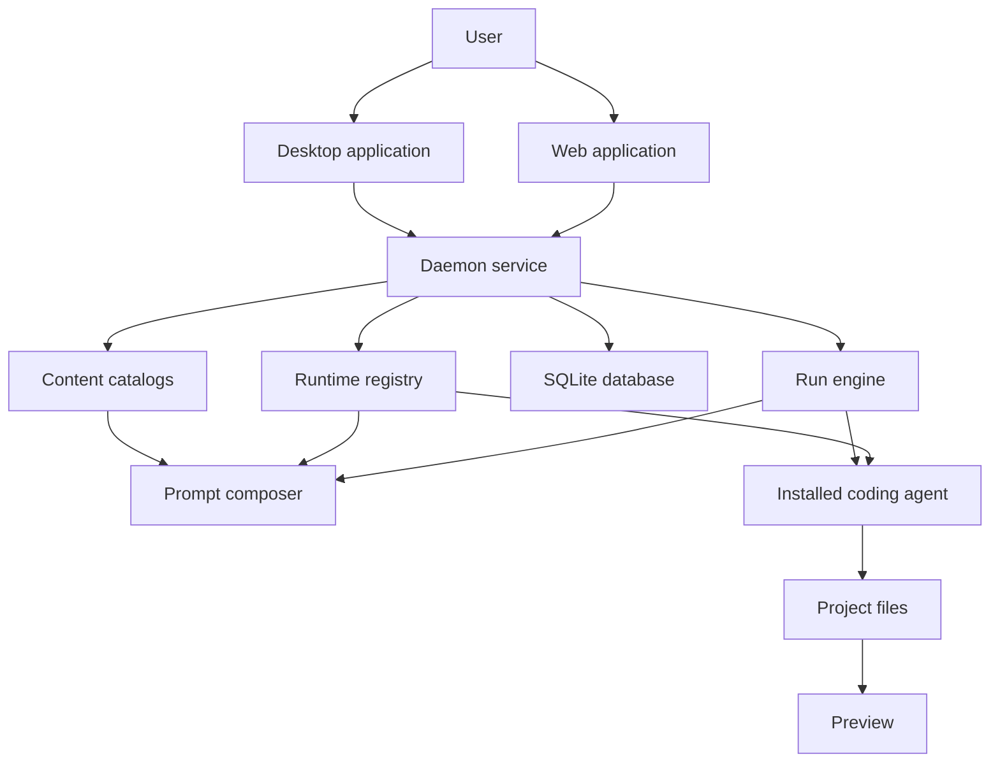
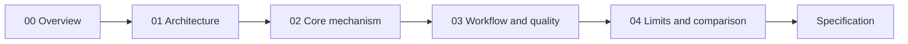

# OpenDesign package exploration

OpenDesign is a local-first design workspace that ships no model and no agent. It detects a coding-agent Command Line Interface (CLI) that the user already installed. It composes a large system prompt from four content planes and hands that prompt to the CLI. The four planes are plugins, functional skills, design templates, and design systems. The daemon keeps the projects, the run records, and the content catalogs on the local machine. The product is the control surface and the content library around an agent that somebody else owns. This exploration reads that design from the source snapshot. It explains how the parts fit, how one run reaches a preview, and where the design has limits.

## What it is

The package is a private pnpm monorepo at version 0.27.2. The license is Apache License 2.0. The module system is ECMAScript modules. The Node.js engine range is `~24`. The snapshot is dated 2026-11-15. The source directory is not a Git checkout, so this exploration gives no commit hash and no branch name.

The product has four content planes. A plugin is a directory with an `open-design.json` manifest. It declares a workflow, a pipeline, inputs, and capabilities. A functional skill is a `SKILL.md` file. It tells the agent how to do a class of work. A design template is a skill with rendering assets and seed files. A design system is a brand package with a manifest, prose, tokens, and optional component fixtures. The daemon discovers all four from plain directories. A user can add content without a database migration.

The daemon is the center of the system. It owns the database, the project files, the run engine, the prompt composer, and the preview. The web application and the desktop application are clients of the same daemon. The desktop shell packages the daemon as a sidecar process. For a filesystem-profile run, the daemon starts one external agent and reads the files that the agent writes.

The daemon ships 27 runtime definitions. A definition is not an agent. It describes how to find, probe, start, and read one agent CLI. The definitions cover commercial agents, open agents, and local harnesses. A user can add a local profile in `~/.open-design/agents.local.json` or in the file named by `OD_AGENT_PROFILES_CONFIG`. The registry rejects a duplicate identifier at load time.

The product has two execution profiles. The `filesystem` profile is for an agent that can write project files. The preview follows the files. The `text_artifact` profile is for an agent that cannot write files. The agent returns one complete artifact block in text. A run gets the text profile only when the stream format is `plain`.

A runtime definition declares one stream format. The formats in the snapshot are `plain`, `acp-json-rpc`, `claude-stream-json`, `copilot-stream-json`, `dsh-profile-jsonl`, `json-event-stream`, `pi-rpc`, and `qoder-stream-json`. The selected definition chooses the format. The daemon selects the matching parser.

## System shape



The diagram shows one daemon with two clients. The composer and the registry turn content and run data into a prompt. The registry also supplies the launch command. The agent writes files. The preview reads those files. The diagram does not show the browser clipper, the Figma plugin, or the Model Context Protocol (MCP) bridge. Those surfaces also call the same daemon.

## The five deep dives

| Document | What it explains |
|---|---|
| [00-overview.md](00-overview.md) | The product surface, the four content planes, the repository map, the runtime catalog, the two execution profiles, packaging, the clipper, and the test layout |
| [01-architecture.md](01-architecture.md) | The process shapes, the data root, the runtime registry, the spawn invariant, the HyperText Transfer Protocol (HTTP) and event boundary, the preview decision, and the trust boundaries |
| [02-core-mechanism.md](02-core-mechanism.md) | The prompt input surface, the early fork between two prompt implementations, the classic and slim variants, and the plugin manifest path |
| [03-workflow-and-quality.md](03-workflow-and-quality.md) | One brief from the web application to a preview, the close classifier, the artifact manifest, the deliverable validator, the artifact lint, and the test lanes |
| [04-limits-and-comparison.md](04-limits-and-comparison.md) | The limits, the failure modes, the security posture, and a property comparison with nearby product categories |

The specification, [../spec.md](../spec.md), records the source, the method, the task table, the measured counts, the corrections, and the verification results.

## Reading order



Read in order. The overview gives the vocabulary. The architecture document shows process ownership. The core mechanism document shows how content becomes prompt text. The workflow document joins the parts in one run. The limits document states what the design cannot do. Read the specification last for the source record.

## Quick start for the reader

This exploration does not build or run the package. The source is read only. A reader who wants to follow the code can start at three places. The project route is at `apps/daemon/src/routes/project/index.ts`. The run route is at `apps/daemon/src/routes/runs.ts`. The prompt fork is at `apps/daemon/src/prompts/system.ts:942`.

The first snippet shows the execution profile rule. The rule decides how the daemon receives the result. A `plain` stream maps to `text_artifact`. Every other stream format maps to `filesystem`.

```text
# packages/contracts/src/execution-profile.ts:1-7
export type ExecutionProfile = 'filesystem' | 'text_artifact';

export function executionProfileFromStreamFormat(
  streamFormat: string | null | undefined,
): ExecutionProfile {
  return streamFormat === 'plain' ? 'text_artifact' : 'filesystem';
}
```

The function looks small. It controls which prompt variant the agent receives. It also controls how the result is saved and how the preview reads it. A plain stream cannot use the filesystem workflow. A structured stream usually can.

The second snippet shows the runtime environment of the container image. The container binds to all interfaces on port 7456. The local daemon binds to `127.0.0.1` by default. A deployment must add authentication, or terminate the connection at an authenticated proxy.

```text
# deploy/Dockerfile:113-116
ENV NODE_ENV=production
ENV NODE_OPTIONS=--max-old-space-size=192
ENV OD_BIND_HOST=0.0.0.0
ENV OD_PORT=7456
```

`deploy/README.md` states one rule. A deployment either sets `OD_API_TOKEN` and sends a bearer token on each request, or terminates at a trusted reverse proxy that authenticates every request and sets `OPEN_DESIGN_DISABLE_API_AUTH=1`. The proxy replaces the token. It is not an extra layer. The token is single-tenant authentication, not user-level access control.

## Limits the project states

The package ships no model, no inference server, and no agent. The user must supply an agent CLI, credentials for that agent, and a Node.js runtime for source use. The desktop build supplies its own runtime. The container image supplies Node.js inside the container. It does not include an agent CLI by default.

The product inherits the user's agent installation, authentication, permissions, and failure modes. The exploration found an auto-approval flag in 10 of the 27 shipped definitions. The definitions are amp, antigravity, atomcode, claude, codebuddy, copilot, grok-build, qoder, qwen, and trae-cli. The agent can run shell commands with the user's authority. The daemon cannot fully sandbox an agent that the user installed and trusts.

Two prompt implementations live in the same code base. The legacy composer and the OpenDesign (OD) Next strategy share no composition floor. A composition floor is a shared base of rules that both stacks include. A rule can exist in one stack and not in the other. The code comment tells the reader to read `docs/prompt-composition.md` before editing either side. That source document is outside this six-file set. This is a coordination risk.

The preview and the quality checks are heuristics. The preview chooses between a URL load and an inline document. It reads source patterns such as focus grabs, redirect loops, and comment bridges. A comment bridge is an injected script that passes viewer events to the host frame. The artifact lint detects visual clichés such as trust gradients. A trust gradient is a two-stop blue or cyan gradient that the lint flags. It does not prove that a design is good. The deliverable validator checks file facts. It does not judge taste.

Several published counts differ from the snapshot. The README says 151 design systems. The snapshot has 152 packages under the catalog rule. The README says 277 official plugins plus 183 examples. The snapshot has 278 non-example manifests and 201 example manifests. The README says 93 prompts. The snapshot has 106 JavaScript Object Notation (JSON) files under `prompt-templates`. The README says 15 deck templates. The snapshot has 47 directories that start with `html-ppt-`. The plugin description says 139 skills. The snapshot has 169 `SKILL.md` files. The 27 runtime definitions are confirmed. The 26 distinct executable count is not confirmed.

The counts are directory counts or array lengths in the snapshot. The catalog rule counts a design-system directory only when it has `manifest.json`, `DESIGN.md`, and `tokens.css`. A distinct executable is a unique primary binary name.

The count differences have a cause. The catalogs grow faster than the prose. A count in a document is a claim about a moment. The snapshot is the authority for this exploration.

## What this exploration is not

This exploration is not a build record. No build, test, install, or network request to a product service ran.

It is not a runtime test. No agent CLI was detected or executed. The desktop application, the browser clipper, and the preview were not run. All runtime claims come from source reading.

It is not a review of generated design quality. The exploration explains how the product constrains an agent. It does not measure whether the output is good.

It is not a review of the hosted service, the marketplace server, or the release pipeline. Only the local snapshot was read. A published release can differ from this snapshot. The external agent CLIs can change their flags after the snapshot date.

It is not a claim that every one of the 27 runtime definitions works. Their definitions were read. Their external binaries were not run. A definition can be correct and still fail against a later agent release.

## Source record

The source is `/Users/darkvoid/GitSources/src.aidesign/open-design`. The repository field in the specification is `none, not a Git checkout`. The package manager is pnpm version 10.33.2. The primary languages are TypeScript, JavaScript, Markdown, Cascading Style Sheets, HyperText Markup Language, and JSON.

The exploration has six Markdown documents in `markdown/`: this index and five deep dives. `spec.md` is the seventh file and the audit record. It holds the full source record, the method, the task table, the disagreement log, and the verification table.
