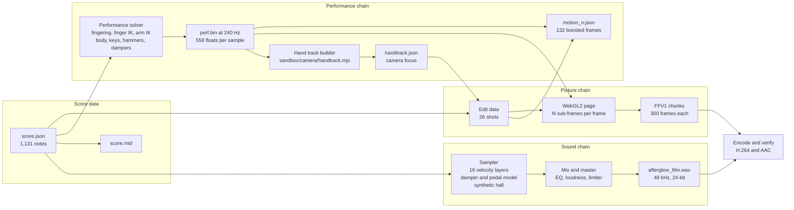
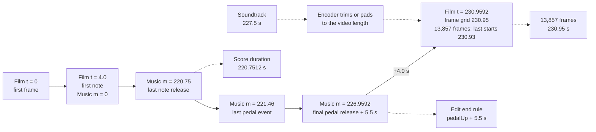

# 00 Overview: the film, the score, the performance, and the numbers

This document gives the shape of Afterglow before the mechanism. It covers the film, its inputs,
its two output chains, what it ships and its numbers. The other
documents go deeper. [`01-architecture.md`](01-architecture.md) gives
the layers and the data contracts. [`02-core-mechanism.md`](02-core-mechanism.md) follows one
frame from the edit to the lossless file. [`03-workflow-and-quality.md`](03-workflow-and-quality.md)
gives the rebuild and the gates. [`04-limits-and-comparison.md`](04-limits-and-comparison.md)
gives the limits and the comparison. The index is [`README.md`](README.md).

## 1. The film in one page

Afterglow is a short film. A pianist in a suit plays a concert grand piano in a shallow mountain lake at sunset. The
camera moves from a wide vista through the keyboard, the hands, the strings, the mountains and the sky. It ends on a
blue-hour view after the last chord.

The film is 230.95 seconds long, or 3 minutes 51 seconds. It holds 13,857 frames at 60 frames
per second (fps), at 1920 by 1080 pixels. It has 26 shots in edit order. Their identifiers run
from S01 to S25, but S07 and S12 are unused. S16b, S20b and S20c take a letter suffix. Each is a
separate shot. The shot lengths range from 2.63 to 19.77 seconds (`docs/SHOTLIST.md:59-84`). The film has four layers of authorship. A layer here is a data source and a time function. A time function maps a
time to a value with no hidden state beyond the state listed for it.

- **Score**: `music/final/score.json`, written by `music/dsl.py`. Its time functions are the note times, the tempo
  map and the pedal curve.
- **Performance**: `perf.bin` and `perf.json`, written by `perf/solve.mjs`. Its time functions are the per-sample
  poses at 240 hertz (Hz).
- **Scene**: the `world`, `piano` and `pianist` modules. A scene module turns film time and its data into geometry,
  materials and light.
- **Edit**: `scene/src/camera/shots.js`. Its time function is `cameraAt(t)`, which returns the camera pose, lens and
  focus at film time `t`.

These creative layers are not the six software layers of [`01-architecture.md`](01-architecture.md). The creative
layers are inputs and time functions. The software layers are code boundaries. For example, `cameraAt(t)` is a time
function in the edit layer. The camera module that calls it is a software layer.

The scene modules that evaluate the layers keep limited history. The piano module is the named one-frame case
(`docs/INTEGRATION.md:154-168`). It keeps a small per-frame state, so its pixels can depend on the frame before.

The film opens on 4.0 seconds of vista before the first note. The soundtrack is 227.5 seconds of music-time audio,
so it ends at film time 231.5 seconds.

## 2. Film time and music time

The project keeps three clocks. Film time zero is the first frame. Music time zero is the first note, so the film
opens at music time -4.0 seconds. The third clock is the audio sample clock. The sample rate of 48 kilohertz (kHz)
sets the time resolution of the soundtrack. The number of rendered samples sets its length. The sample clock does not
set the length.

Two exported function pairs convert between the clocks. The first pair is `frameToTime` and `timeToFrame`. The second
pair is `filmToMusic` and `musicToFilm`.

```text
# scene/src/core/constants.js:14-17
export const frameToTime = (frame) => frame / FPS;
export const timeToFrame = (t) => Math.round(t * FPS);
export const filmToMusic = (t) => t - MUSIC_OFFSET;
export const musicToFilm = (m) => m + MUSIC_OFFSET;
```

`FPS` is the frame rate. The frame interval is 1/60 second. A cut cannot land between frames, so the edit quantises
each cut to the frame boundary at or before the musical event. The project states that a picture change reads about
one frame late. `cutFrame` rounds down on purpose. The general `timeToFrame` rounds to the nearest frame.
```text
# scene/src/camera/score.js:182-183
export const cutFrame = (filmT) => Math.floor(filmT * FPS + 1e-6);
export const cutTime = (filmT) => cutFrame(filmT) / FPS;
```

A shutter value of 0.5 is the same fact as a 180-degree shutter. The value is the fraction of the frame interval that
the shutter is open. A 180-degree shutter is half of a full circle, so it is open for `0.5 * 1/60 = 1/120` second. The
interval is centred on film time `t`. A sub-frame is one sample of the shutter interval. One output frame is the
unweighted arithmetic mean of N sub-frames, and N is an integer for each shot. A sub-frame sample `s.t` in [0, 1] has time
`t + (s.t - 0.5) * 0.5 / 60`. [`02-core-mechanism.md`](02-core-mechanism.md) follows that loop in detail.

## 3. The score as a program

The score is not a performed Musical Instrument Digital Interface (MIDI) file. It is a Python program that writes
note events into a data structure. The project calls the language a domain-specific language (DSL). The score has a
token grammar (`music/dsl.py:82-90`). A token is `PITCH:DUR` for one note, `[P P P]:DUR` for a chord, `r:DUR` for a
rest, or `|` for a bar line. A duration is in beats, so `G3:1/3` lasts a third of a beat. A suffix
changes the token. `>` adds accent, `-` adds a soft attack, `'` adds staccato, `~` adds a tie,
`@NN` sets velocity, `^` rolls a chord. `%3` sets a fingering.

```text
# music/dsl.py:83-84
    offsets_ms: dict | None = None   # per-voice micro-timing, e.g. {"mel": 14, "acc": 7, "bass": 0}
                                     # None -> ballad default: melody leads by 18 ms, LH sits 4 ms late
```

The `section` call takes a name, a start bar and an end bar, both inclusive. Its keyword arguments include `swing`,
`rubato`, `humanize` and `offsets_ms`. `line(hand, bar, text, voice="mel", vel=64, beat=1, transpose=0)` adds a
sequence of tokens for one hand, starting at `bar` and `beat`.

The word "performing" means a deterministic expansion of the written score, not a recording. It applies six timed
transforms. A tempo map is a list of `(absolute beat, beats per minute)` points, with linear change between points.
A rubato arch pushes the tempo through a phrase and relaxes into the cadence; the section `rubato` value scales it.
A fermata adds a hold in seconds after one beat. Swing warps the beat inside a pair; 0.5 is straight and 0.58 is
light 16th-note swing. Melody lead is a small negative offset on melody notes. Seeded humanisation adds small random
timing offsets from a stored seed.

`offsets_ms` is a per-voice micro-timing map in milliseconds. The value `None` selects the ballad default: the
melody leads by 18 milliseconds and the left hand sits 4 milliseconds late. The melody lead is at
`music/dsl.py:298-299`, and the left-hand lag is at `music/dsl.py:289-290`.

```text
# music/dsl.py:269-302
    def perform(self, lead_in: float = 0.0):
        rng = np.random.default_rng(self.seed)
        total = max(n.beat + n.dur for n in self.notes) + 8
        tb, ts = self._beat_to_sec_table(total)
        b2s = lambda b: float(np.interp(b, tb, ts)) + lead_in

        notes = sorted(self.notes, key=lambda n: (n.beat, n.hand, -n.pitch))
        # group simultaneous onsets per hand for melody lead + rolls
        groups: dict[tuple, list[Note]] = {}
        for n in notes:
            groups.setdefault((round(n.beat, 4), n.hand), []).append(n)
        jit_cache: dict[float, float] = {}
        for (b, hand), grp in groups.items():
            sec = self._section_at(b)
            hum = sec.humanize if sec else 1.0
            if b not in jit_cache:
                jit_cache[b] = float(rng.normal(0, 0.0045)) * hum   # shared beat-level wobble
            sb = self._swing(b)
            base_t = b2s(sb) + jit_cache[b] + float(rng.normal(0, 0.0025)) * hum
            offs = sec.offsets_ms if sec else None
            if hand == "L" and offs is None:
                base_t += 0.004 * hum                                   # LH sits a hair behind
            grp.sort(key=lambda n: n.pitch)
            rolled = any(n.roll for n in grp)
            for i, n in enumerate(grp):
                t = base_t
                if rolled:
                    t += i * 0.038
                if offs is None:
                    if n.voice == "mel":
                        t -= 0.018 * hum                                # melody lead (ballad)
                else:
                    t += offs.get(n.voice, offs.get("default", 0)) / 1000.0   # groove: laid-back layers
                n.t_on = max(0.0, t)
```

The `offs` value `None` branch is the ballad branch. A section with an `offsets_ms` map takes the other branch.

The output is a JavaScript Object Notation (JSON) document. `to_json` writes the notes, the pedal curve, the
timeline tables and `lead_in`. The score script then adds the chord table and the seed
(`music/afterglow_score.py:481-484`). The final score has `lead_in` 0.0, not the film's 4.0-second offset. A bar
entry gives the bar number, its start time and its beat count. The score also has a MIDI output; the film reads the
JSON file.

```text
# music/afterglow_score.py:481-484
    data = s.to_json(os.path.join(OUT, "score.json"))
    data["chords"] = [dict(bar=bar, beat=beat, sym=sym, roman=roman, section=sec, t=round(s._b2s(b), 4))
                      for b, sym, roman, sec, bar, beat in s._timeline_chords]
    data["seed"] = SEED
```

The frozen score holds 1,131 notes. Note identifiers are zero-based: `perform()` assigns `n.id = i` over the sorted
note list (`music/dsl.py:315-316`). The last identifier is therefore 1130, not 1131. The longest note release belongs
to identifier 1129. That note is A4, and its release is at 220.75116 seconds. The score's `duration` field is
220.7512 seconds, that value rounded to four places (`music/dsl.py:369`).

The score has 68 bar entries. The last entry is an end marker at bar 68, not a played bar. The pedal curve has 549
events, and the last is at 221.4592 seconds. The `chords` table has 97 entries. The `seed` field is 20261021, and it
controls the humanisation. Both fields are added by the score script after `to_json` (`music/afterglow_score.py:480-486`).

## 4. The performance as a track file

The score is not the performance. The performance is a set of solved poses. A solver reads the score and the
pianist rig and writes `perf.bin` plus `perf.json`. The track file has one sample every 1/240 second in music time.
It starts at music time -4.0 seconds, which is film time zero. Each sample holds a full local rotation for every
animated bone, the root position, 88 key angles, 88 hammer angles, 88 damper lifts, and 3 pedal angles.

```text
# perf/lib/writer.js:6-13
export function writePerf(outDir, res, extraMeta = {}) {
  const { meta, bones, boneData, rootPos, rootS, keyArrays, ripples } = res;
  const N = meta.N, NB = bones.length;
  const channels = []; let off = 0;
  for (const b of bones) { channels.push({ name: b, kind: 'quat', offset: off, size: 4 }); off += 4; }
  channels.push({ name: 'root.position', kind: 'vec3', offset: off, size: 3 }); off += 3;
  channels.push({ name: 'keys', kind: 'keys', offset: off, size: 88, unit: 'rad', note: 'key angle about the balance axis, + = front down; index 0 = A0' }); off += 88;
  channels.push({ name: 'hammers', kind: 'hammers', offset: off, size: 88, unit: 'rad', note: 'hammer rotation about the flange pin, 0 = rest (geom/action.js convention)' }); off += 88;
```

With 72 animated bones, the stride is 558 floats per sample. The sum is `4 * 72 + 3 + 3 * 88 + 3 = 288 + 3 + 264 + 3
= 558`. It uses 4 floats for each bone, 3 for the root, 88 for each of the three key groups, and 3 pedal floats. The three key
groups are keys, hammers and dampers. The rig has 163 joints, so the track carries 72 of them
(`perf/lib/solver.js:26-33`). The source does not list the other 91 joints or define their motion. The page leaves
them in the bind pose. The bind pose is the neutral rest pose of the skeleton, before any animation. The browser and
Node.js readers both interpolate linearly between samples and use normalized linear interpolation for quaternions.
The root position is in the pianist frame, the local frame of the binary glTF (GLB) asset.

```text
# scene/src/perf/tracks.js:1-7
// Performance-track reader (browser + Node, no dependencies). DESIGN.md section 4 / docs/PERFORMANCE.md.
// perf.bin: float32 little-endian frames at `rate` Hz in MUSIC time from t0 (= -MUSIC_OFFSET, i.e. film t = 0);
// perf.json: { rate, t0, musicOffset, frames, stride, channels:[{name, kind, offset, size, stride}], bones, ripples }.
//   bone channels  kind 'quat', size 4: FULL local quaternion (x, y, z, w) replacing the bone's local rotation
//   'root.position' kind 'vec3': local position of the root bone (GLB/pianist frame)
//   'keys' / 'hammers' (rad), 'dampers' (m) size 88 each; 'pedals' size 3 (una corda, sostenuto, damper; rad)
// Sampling: linear between frames (nlerp for quaternions), clamped at both ends. tFilm = frame / 60.
```

The solver also writes ripple events, each with a time, rig-frame position and amplitude. The rig frame has its
origin at the keyboard centre on the water, +z toward the tail and -x toward the treble. A rig-frame point `p`
becomes a world position through the rig group transform: `R_rig * p + T_rig`, where `R_rig` is the rig rotation and
`T_rig` is the rig translation. The world module puts a ring on the water there. The rings are children of the rig
group, so a rig yaw change moves them with the piano. The pianist's own motion is the first place where performance
data changes what the camera sees beyond the piano mesh. The water rings are the second place.

The solver also writes a quality-control (QC) report with six per-note measures. Contact distance is the gap between
a fingertip and its key top. Penetration is the distance that a hand or finger vertex lies below a key surface.
Finger-to-finger distance is the closest gap between two finger capsules. Joint limits record an angle outside the
allowed range. Angular velocity is the joint angle change per second. Release behaviour records a finger that leaves
a key early or late. [`03-workflow-and-quality.md`](03-workflow-and-quality.md) section 4 defines the checks and
their limits.

A separate script, `sandbox/camera/handtrack.mjs`, builds a hand track from the solved performance for camera focus
and hand-following shots (`docs/SHOTLIST.md:634-635`).

## 5. The scene as five modules

The page loads five modules in a fixed order: world, piano, pianist, camera and integration. A module receives one
context object, `ctx`, from `main.js`. The object holds the renderer, the scene, the two groups, the camera, the sun,
the settings, the loaded data, the clock functions and the module registry. A module reads the context, and it may
read the modules that were loaded before it. It registers a per-frame update through its exported `create(ctx)`
function. The integration module loads last and connects the others. `parent` names the group that holds the module.
A group is a three.js `Object3D`, and `main.js` creates `worldGroup` and `rigGroup`.

```text
# scene/src/main.js:47-53
export const MODULE_SLOTS = [
  { slot: 'world', url: './world/index.js', placeholder: './core/placeholders/world.js', parent: 'world' },
  { slot: 'piano', url: './piano/index.js', placeholder: './core/placeholders/piano.js', parent: 'rig' },
  { slot: 'pianist', url: './pianist/index.js', placeholder: './core/placeholders/pianist.js', parent: 'rig' },
  { slot: 'camera', url: './camera/index.js', placeholder: null, parent: 'world' },
  { slot: 'integration', url: './integration/index.js', placeholder: null, parent: 'rig' },
];
```

The scene geometry is 13.9 million triangles per sub-frame. Each sub-frame renders the scene, so the total triangle
work is 13.9 million multiplied by N. The piano is 1.65 million triangles and 146 draw calls. The pianist is about 1
million triangles, with 163 joints and 72 animated bones. The terrain and the boulders are 1.9 million triangles.
These project values were not measured again. The listed parts sum to 4.55 million; the source does not account for
9.35 million.

The scene has no physics step and no random events. A visible value is a
function of film time, the sub-frame sample and, for a few modules, the previous frame. The water
surface, the sky bake and some material state keep history, and the pre-roll rebuilds it
([`03-workflow-and-quality.md`](03-workflow-and-quality.md)). Nothing that draws may use
`Math.random`, `Date`, `performance.now` or `requestAnimationFrame`.

## 6. The edit as data

The edit is a JavaScript object. Each shot has an identifier, a name, a start anchor, a camera setup, a lens, a move,
a focus target, a per-shot look and a documentation note.

An anchor has one base and zero or more offsets. The base is one of these forms:

- `fN`: film time `N` seconds.
- `mN`: music time `N` seconds, converted to film time by adding the 4.0-second offset.
- `barN` or `barN:beat`: a score bar and beat. A bare number is also a bar address.
- `section@bar:beat`: a section name, then a bar inside that section, then a beat.
- `end`, `lastNote`, `pedalUp`, `lastMel` or `filmEnd`: a named score point.

The five named points are:

- `end`: the end of the last bar.
- `lastNote`: the last key release, which is the largest note `t_off`.
- `lastMel`: the onset of the final melody note.
- `pedalUp`: the final pedal release.
- `filmEnd`: the computed film end.

An offset follows the base with no space. The suffix `s` is seconds, `f` is frames and `b` is beats. So `pedalUp+5.5s`
is 5.5 seconds after the final pedal release. `intro@3:1` is section intro, bar 3, beat 1. `f0` is film time zero.
`MusicTimeline` resolves such an address to a score position and a frame (`scene/src/camera/score.js:44,146`). The
director turns each anchor into a start frame. Shots end at the next start or the film end
(`scene/src/camera/director.js:80-85`).

The director compiles the orbit or path, the move, the focus point and the shot settings. A move is a `makeProfile`
velocity profile. The profile ramps the speed from a start value to cruise speed with a smootherstep curve, then down
to an end value over the closing fraction. Smootherstep keeps acceleration and jerk continuous. The profile returns a
normalised distance `s` and speed `v` at a normalised time `u` (`scene/src/camera/lib.js:46-66`). The move maps real
shot time to `u`, then uses `s` to place the camera on the orbit or path.

The settings hold N, preblur (the depth-of-field gap-fill strength), nearest depth (`nearestDist`), rig yaw cheat and shutter. N is the sub-frame count for
the shot. Preblur is the depth-of-field strength: it pre-combines aperture samples. The rig yaw cheat is a per-shot
rotation added to the base yaw of 120 degrees. The pianist then faces azimuth 60 minus the cheat
(`scene/src/camera/shots.js:13`). A focus target can be a fixed point or a hand box: the box around a solved hand.

```text
# scene/src/camera/shots.js:46-46
  end: 'pedalUp+5.5s',               // film ends 5.5 s after the final pedal release (reverb tail + fade)
```

An attack is the start of a note. A voice is a score label that groups notes with one musical role, such as `mel`,
`inner`, `bass`, `acc`, `chord` or `ghost`. A push is an anticipated attack. A note starts up to 0.75 beat before the
beat and still sounds across it. A ghost note is a soft note in the `ghost` voice, with velocity 18 to 32
(`music/afterglow_arr.py:7`). A ghost note is excluded. A tie holds one note across a bar line or a beat. The cut
stays on the beat for a tie, as in shot S17. The fades use `ev: 9`, which means 9 exposure stops of fade.

The sun arc is tied to score sections. It starts at -0.8 degrees, slightly below the horizon, and reaches -4.5
degrees at the film end (`scene/src/camera/shots.js:53-56`). The keys use monotone cubic interpolation. The curve does not overshoot a key, so the sun
never rises between two keys and the story time never moves backward. The constants file has a different default arc,
which starts at +0.6 degrees. The edit overrides it, so a reader of only the constants file gets the wrong arc.
[`01-architecture.md`](01-architecture.md) records the override as a contract.

The edit module pins its inputs at load. A query parameter or environment variable can select the
score and the hand track. A hand track that does not match the performance throws an error; a
camera that follows a stale track frames the wrong place.

```text
# scene/src/camera/shots.js:558-563
const QS = (() => { try { return new URL(import.meta.url).searchParams; } catch { return new URLSearchParams(); } })();
const PIN = QS.get('score');
if (PIN) globalThis.AG_SCORE = PIN;
if (QS.get('handtrack')) globalThis.AG_HANDTRACK = QS.get('handtrack');
const { score, url } = await loadScore();
export const SCORE_URL = url;
```

`loadScore` returns the parsed score and its URL. The module then builds the timeline with `new MusicTimeline`,
loads the hand track with `loadHandTrack`, builds the hand tracks with `buildHandTracks`, and creates the director
with `createDirector`. `AG.init` loads the page and accepts the camera module options.

The score proxy is a hand track built from score note positions, not from solved hands. It is valid only for a
framing check when the solved track is absent, and only when the caller asks for it. It is not valid for a render or
a quality check.

The score is frozen. The hand track and motion-blur boost table come from one performance and the same edit. The
hand track stores the `perf.json` Secure Hash Algorithm 256 bit (SHA-256) hash. The boost table stores
that hash and each shot's edit N. The
integration module compares both. It also checks that each shot's edit N is unchanged. A score change needs a new
solve; a performance change needs a new hand track and boost table.

## 7. The two chains

The score feeds two chains. The sound chain makes the soundtrack. The performance chain makes the pianist, the camera
focus, the water rings and the motion-blur boost. They meet at encode time, where the soundtrack is muxed under the
picture.

The soundtrack uses Waveform Audio File Format (WAV), and the lossless chunks use FFmpeg Video Codec 1 (FFV1). The
encoder joins H.264 (Advanced Video Coding) video and Advanced Audio Coding (AAC) audio. The solver computes finger
and arm inverse kinematics (IK), which finds joint angles that put a fingertip on a key while the hand stays inside
its joint limits. An objective function is a scalar cost that a solver tries to reduce. Here it is a sum of squared
weighted residuals. Each weight converts one residual's unit into the common cost. The contact term
`r.err * 1000 / 0.25` gives 4 cost units per millimetre of contact error. The source does not state one global
objective or one pass threshold. It gives the terms and weights in `perf/lib/palm.js` and `docs/PERFORMANCE.md`.
[`02-core-mechanism.md`](02-core-mechanism.md) section 6 shows the terms.



The sound chain depends only on the score. The picture chain also reads the edit, which reads the
score for cut anchors and the hand track for focus. The sampler and the solver each read the
score events; the sampler applies its own key and pedal behaviour, and the solver solves the
body. Both chains start from the same note times, so sound and picture agree without a feedback
loop; the encode check confirms it.

## 8. What ships and what does not

The repository ships the source, score, assets, rig data, documents and small generated tables,
but not the film. The `.gitignore` excludes the `build/` directory. The film exists as a release
download.

It does not ship the soundtrack render, sample library, release performance tracks or reference
images; the sampler needs a sample library that is not in the checkout. The pianist binary glTF
(GLB) and the Detmold impulse response use Git Large File Storage (LFS), so a clone without LFS
has pointer files, not assets.

The score is `music/final/score.json`, the MIDI file is `music/final/score.mid`, and the final mix
preset is `music/presets/final.json`. The preset
sets a synthetic hall, wet level -11.0 decibels, predelay 20.0 milliseconds, pan spread 0.30, an
equaliser, and a 9000-hertz high shelf of +5.0 decibels. Wet level is the wet energy relative to
the dry signal (`music/sampler.py:144`). Pan spread maps A0 to -0.30 and C8 to +0.30 with
constant-power panning (`music/sampler.py:139`). It sets nine reverb times from 2.2 to
0.65 seconds, one for each octave band from 63 hertz to 16 kilohertz (`music/presets/final.json:6`).
The sampler default is a different tuple (`music/sampler.py:139-146`). Four values differ: reverb wet -9.0 decibels,
predelay 24.0 milliseconds, reverb times 2.6 to 0.7 seconds, and reverb send high-pass 110 hertz. The target
loudness is -16.0 loudness units relative to full scale (LUFS).

The film is an H.264 High profile file at constant rate factor 14. It has 4:2:0 colour sampling
and Recommendation ITU-R BT.709 colour. The audio is AAC at 320 kilobits per second. The
lossless master is 47 FFV1 chunks.

The sync record uses dBTP (decibels true peak) and LU (loudness units). `MIDI CC64` is Musical Instrument Digital
Interface controller 64, the sustain pedal. The
symbol `r` is the Pearson correlation coefficient. The pedal angle is compared with CC64 over 904 samples, with
change windows excluded. The source does not define the change windows. The pedal is down at CC64 100 or more. It is
up at CC64 10 or less. The right foot height correlates negatively with pedal angle because the foot rises as the
pedal goes down. The source gives no sign convention for that correlation.

The release uses 360,368 sub-frames, which is `360,368 / 13,857 = 26.006` per frame. The README rounds that value to
26.0. Every one of 1,131 notes reaches key bottom within one film frame of its note-on. In the rendered scene, 30
probed notes have fingertip contact 30 of 30 (median gap 0.15 mm, maximum 0.63 mm) and damper contact 30 of 30. The
audio onset error is 0 milliseconds, and the cross-correlation lag is 0 at 7.7 and 170.4 seconds. The render used
23.7 gigabytes of lossless FFV1 on one laptop: AMD Ryzen 7 260, Radeon 780M graphics processing unit (GPU), Windows 11, Chrome 155
headless.

The hands use 9 texels per millimetre. A texel is one texture pixel. The source does not define how the texture maps
to hand surface area.

## 9. The numbers, and the four end points

The release used 360,368 sub-frames; the full-N plan uses 473,760. The final freeze lowered nine shots from 48 to 32
and one from 64 to 32; the release halves N after 1:50.
[`04-limits-and-comparison.md`](04-limits-and-comparison.md) section 2 gives the plan history table, the halving rule
and the 46,304 and 113,392 differences.

The render ran for 21.8 hours (h) of wall-clock time and 9.7 h of pure render time. The wall time minus the idle-GPU
projection is `21.8 - 13.4 = 8.4` h. The 9.7 h pure-render subset is a different measure. The source does not
reconcile it with the 8.4 h value. The lossless master is 23.7 gigabytes across 47 chunks (`README.md:220`).
[`03-workflow-and-quality.md`](03-workflow-and-quality.md) gives the chunk and resume details.



The score duration is not the film duration: the film adds the 4.0-second lead-in. The score ends at film time
224.7512 seconds, and the last pedal event at 225.4592 seconds. The edit ends 5.5 seconds after that release, at
230.9592 seconds. The grid holds 13,857 frames to 230.95 seconds. The last frame is `13,856 / 60 = 230.9333` seconds,
and its interval ends at 230.95 seconds. The edit end falls 9.2 milliseconds beyond the grid. `afterglow.wav` is
227.5 seconds in music time, so it ends at film time 231.5 seconds. `afterglow_film.wav` adds 4.0 seconds of silence
in front, so `227.5 + 4.0 = 231.5` seconds. The encoder trims the audio to 230.95 seconds, so it cuts the last
`231.5 - 230.95 = 0.55` seconds. That part is the hall tail, not a note.

**Aha:** The film is not a recording of the soundtrack and the soundtrack is not the score. The project has three
clocks and four end points: the last note release, the later pedal release, the audio after its hall tail, and the
picture after the edit fade. The encoder is the single place that reconciles them.

## 10. The quality record

The project uses scripts as gates. The self test requires accumulation alpha 1 everywhere. It also checks glare
energy, lookup table (LUT) axis order and a lost graphics context (`docs/RENDERING.md:433`). The determinism check compares three
sessions. The performance QC checks contacts, penetration, joint limits and releases. The integration check compares
modules at one film time. The encode check compares every frame with its source and checks the audio lag.
[`03-workflow-and-quality.md`](03-workflow-and-quality.md) lists every gate and its failure.
[`04-limits-and-comparison.md`](04-limits-and-comparison.md) lists what the gates do not cover.

## 11. The licence in one table

The licence is split. The code, scripts, documentation and generated data use the MIT licence. The composition, its
note-encoding files, the performance tracks, the film, the audio renders and the stills are all rights reserved. The
`license` field in `package.json` says `MIT`, but it is narrower than the repository licence.
Third-party assets keep their own licences. The Salamander Grand Piano V3 samples are CC BY 3.0,
the Detmold impulse response is CC BY 4.0. The MakeHuman and MPFB assets are CC0 1.0. CC means
Creative Commons; CC BY means Creative Commons Attribution.
CC0 means no rights reserved. The full text is in `LICENSE` and `docs/CREDITS.md`.
[`04-limits-and-comparison.md`](04-limits-and-comparison.md) explains which files the exclusion covers.

## 12. Where to read next

Read [`01-architecture.md`](01-architecture.md) for the structure and contracts, and
[`02-core-mechanism.md`](02-core-mechanism.md) for the frame loop and the score split. Read
[`03-workflow-and-quality.md`](03-workflow-and-quality.md) for the rebuild and the gates, and
[`04-limits-and-comparison.md`](04-limits-and-comparison.md) for the limits and the comparison. The index [`README.md`](README.md) has the reading order, the map and the non-claims.
